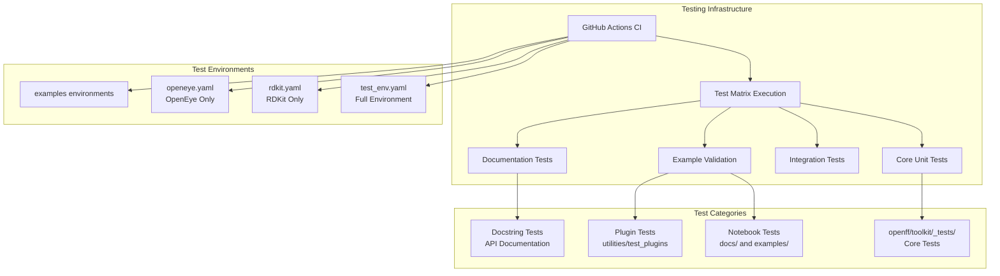
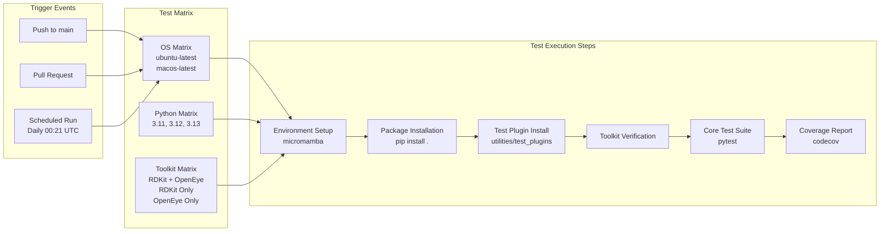
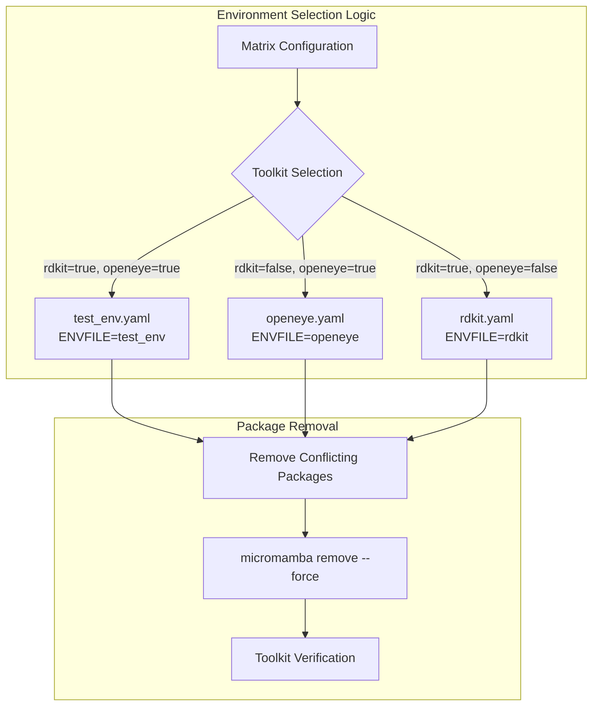
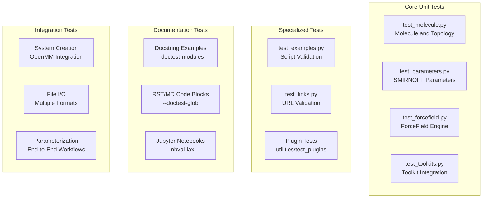
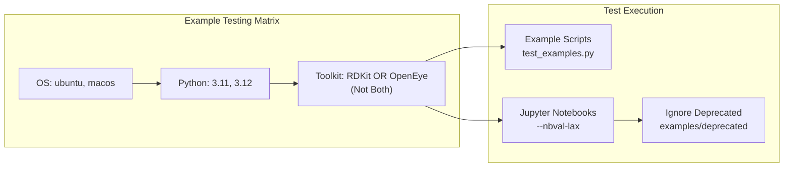
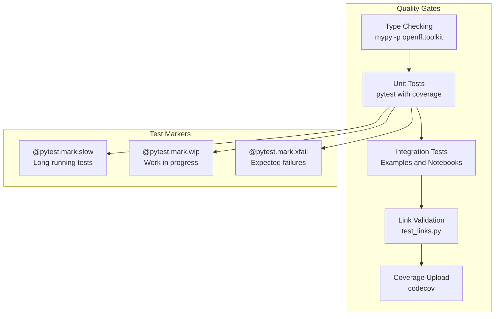

# Testing Framework

<details>
<summary>Relevant source files</summary>

The following files were used as context for generating this wiki page:

- [.github/workflows/CI.yml](.github/workflows/CI.yml)
- [.github/workflows/beta_rc.yaml](.github/workflows/beta_rc.yaml)
- [.github/workflows/conda.yml](.github/workflows/conda.yml)
- [.github/workflows/examples.yml](.github/workflows/examples.yml)
- [.github/workflows/installer.yml](.github/workflows/installer.yml)
- [devtools/conda-envs/conda.yaml](devtools/conda-envs/conda.yaml)
- [devtools/conda-envs/conda_oe.yaml](devtools/conda-envs/conda_oe.yaml)
- [devtools/conda-envs/openeye-examples.yaml](devtools/conda-envs/openeye-examples.yaml)
- [devtools/conda-envs/openeye.yaml](devtools/conda-envs/openeye.yaml)
- [devtools/conda-envs/rdkit-examples.yaml](devtools/conda-envs/rdkit-examples.yaml)
- [devtools/conda-envs/rdkit.yaml](devtools/conda-envs/rdkit.yaml)
- [devtools/conda-envs/test_env.yaml](devtools/conda-envs/test_env.yaml)
- [docs/typing.rst](docs/typing.rst)
- [openff/toolkit/_tests/test_forcefield.py](openff/toolkit/_tests/test_forcefield.py)
- [openff/toolkit/_tests/test_molecule.py](openff/toolkit/_tests/test_molecule.py)
- [openff/toolkit/_tests/test_parameters.py](openff/toolkit/_tests/test_parameters.py)

</details>


This document describes the comprehensive testing infrastructure used to ensure code quality and reliability in the OpenFF toolkit. It covers the automated testing pipeline, test environment management, test organization, and how to run tests during development.

For information about building and packaging the toolkit, see [Build and Packaging](#4.2). For details on developing custom plugins, see [Plugin Development](#4.3).

## Overview

The OpenFF toolkit employs a multi-tiered testing strategy that validates functionality across different platforms, Python versions, and cheminformatics toolkit combinations. The testing framework ensures compatibility with various dependency configurations and validates both core functionality and real-world usage scenarios.



**Testing Infrastructure Overview**

Sources: [.github/workflows/CI.yml:1-183](), [devtools/conda-envs/test_env.yaml:1-51](), [openff/toolkit/_tests/test_molecule.py:1-50]()

## CI/CD Pipeline Architecture

The continuous integration system uses GitHub Actions to orchestrate testing across multiple dimensions of the software stack. The primary workflow is defined in `CI.yml` and executes a comprehensive test matrix.



**CI/CD Pipeline Flow**

The test matrix systematically excludes invalid combinations, such as configurations with neither RDKit nor OpenEye, and limits OpenEye testing to Python 3.13 due to licensing constraints.

Sources: [.github/workflows/CI.yml:18-43](), [.github/workflows/CI.yml:49-104](), [.github/workflows/CI.yml:149-158]()

## Test Environment Management

The testing framework uses conda environment files to manage dependencies across different testing scenarios. Each environment is tailored for specific testing needs and toolkit combinations.

| Environment File | Purpose | Key Dependencies |
|------------------|---------|------------------|
| `test_env.yaml` | Full testing with all toolkits | `rdkit`, `openeye-toolkits`, `ambertools`, `pytest=8` |
| `rdkit.yaml` | RDKit-only testing | `rdkit`, `ambertools`, `mypy=1.15` |
| `openeye.yaml` | OpenEye-only testing | `openeye-toolkits`, type stubs |
| `rdkit-examples.yaml` | Example testing with RDKit | Additional dependencies for notebooks |
| `openeye-examples.yaml` | Example testing with OpenEye | GROMACS, visualization tools |



**Test Environment Selection and Configuration**

Sources: [.github/workflows/CI.yml:49-71](), [devtools/conda-envs/test_env.yaml:1-51](), [devtools/conda-envs/rdkit.yaml:1-42](), [devtools/conda-envs/openeye.yaml:1-53]()

## Test Categories and Organization

The test suite is organized into distinct categories that validate different aspects of the toolkit functionality:



**Test Organization and Categories**

### Core Test Execution

The main test execution excludes certain test files that require special handling:

```bash
PYTEST_ARGS+=" --ignore=openff/toolkit/_tests/test_examples.py"
PYTEST_ARGS+=" --ignore=openff/toolkit/_tests/test_links.py"
python -m pytest -x --durations=20 $PYTEST_ARGS $COV openff/toolkit/_tests
```

Sources: [.github/workflows/CI.yml:150-158](), [openff/toolkit/_tests/test_molecule.py:1-100](), [openff/toolkit/_tests/test_parameters.py:1-50](), [openff/toolkit/_tests/test_forcefield.py:1-100]()

## Specialized Testing Workflows

Beyond the main CI pipeline, the toolkit includes specialized testing workflows for different scenarios:

### Example and Notebook Testing

The `examples.yml` workflow specifically validates example scripts and Jupyter notebooks:



**Example Testing Pipeline**

### Beta/RC Testing

The `beta_rc.yaml` workflow tests against pre-release versions of dependencies:

- Tests against conda-forge release candidate channels
- Validates compatibility with upcoming dependency versions
- Uses specific micromamba version (`1.5.10-0`) for stability

### Deployment Testing

The `conda.yml` workflow validates conda package installations:

- Tests installation from conda packages rather than source
- Verifies version matching between git tags and installed packages
- Validates toolkit availability in conda-installed environments

Sources: [.github/workflows/examples.yml:1-140](), [.github/workflows/beta_rc.yaml:1-87](), [.github/workflows/conda.yml:1-132]()

## Test Configuration and Quality Assurance

The testing framework includes several quality assurance mechanisms:

### Coverage Reporting
- Uses `pytest-cov` with `--cov=openff/toolkit/` 
- Uploads results to Codecov with token authentication
- Fails CI if coverage upload fails

### Type Checking
- MyPy validation runs on OpenEye-only builds (RDKit builds often have stub issues)
- Validates type annotations in the `openff.toolkit` package

### Performance Monitoring
- `--durations=20` flag reports the 20 slowest tests
- Helps identify performance regressions

### Parallel Execution
- Uses `pytest-xdist` with `-nauto` for parallel test execution
- Includes special handling for Pint cross-interaction issues



**Quality Assurance Pipeline**

Sources: [.github/workflows/CI.yml:140-147](), [.github/workflows/CI.yml:176-183](), [.github/workflows/CI.yml:133-135]()

## Running Tests Locally

For local development, tests can be run using the same environment configurations as CI:

1. **Set up test environment:**
   ```bash
   micromamba env create -f devtools/conda-envs/test_env.yaml
   micromamba activate openff-toolkit-test
   ```

2. **Install toolkit in development mode:**
   ```bash
   pip install -e .
   ```

3. **Install test plugins:**
   ```bash
   pip install utilities/test_plugins
   ```

4. **Run specific test categories:**
   ```bash
   # Core unit tests
   pytest openff/toolkit/_tests/
   
   # With coverage
   pytest --cov=openff/toolkit/ openff/toolkit/_tests/
   
   # Examples only
   pytest openff/toolkit/_tests/test_examples.py
   
   # Notebooks
   pytest --nbval-lax docs/ examples/
   ```

The test framework supports various pytest markers for controlling test execution, including `@pytest.mark.slow` for time-intensive tests and `@pytest.mark.wip` for work-in-progress functionality.

Sources: [.github/workflows/CI.yml:84-96](), [devtools/conda-envs/test_env.yaml:32-43](), [openff/toolkit/_tests/test_molecule.py:175-236]()

---