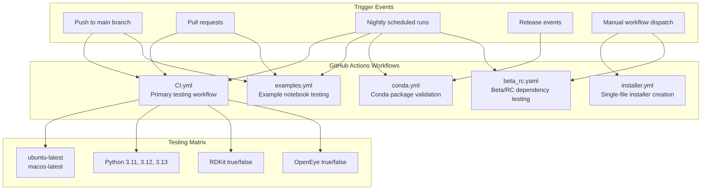
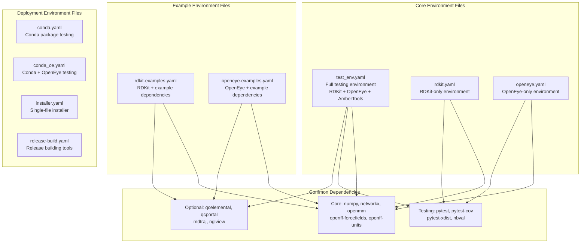
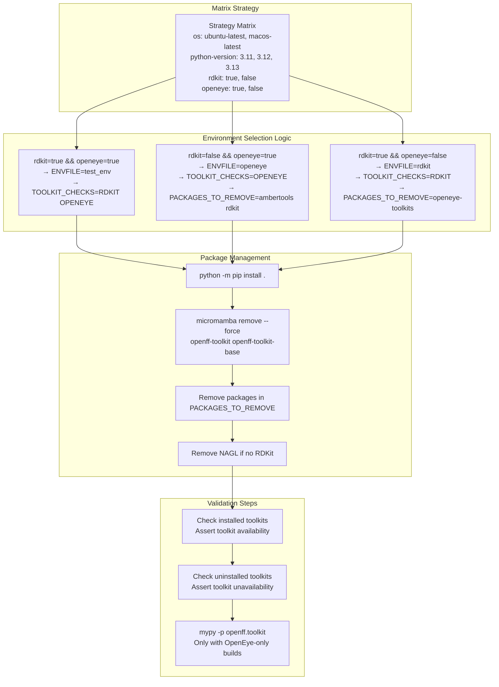
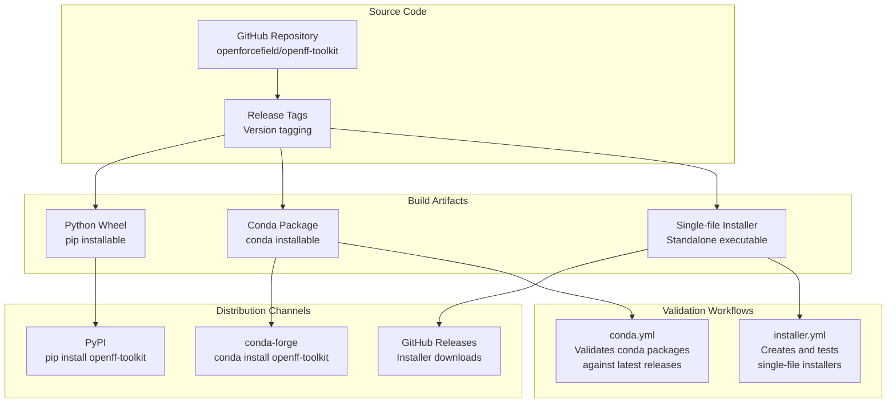
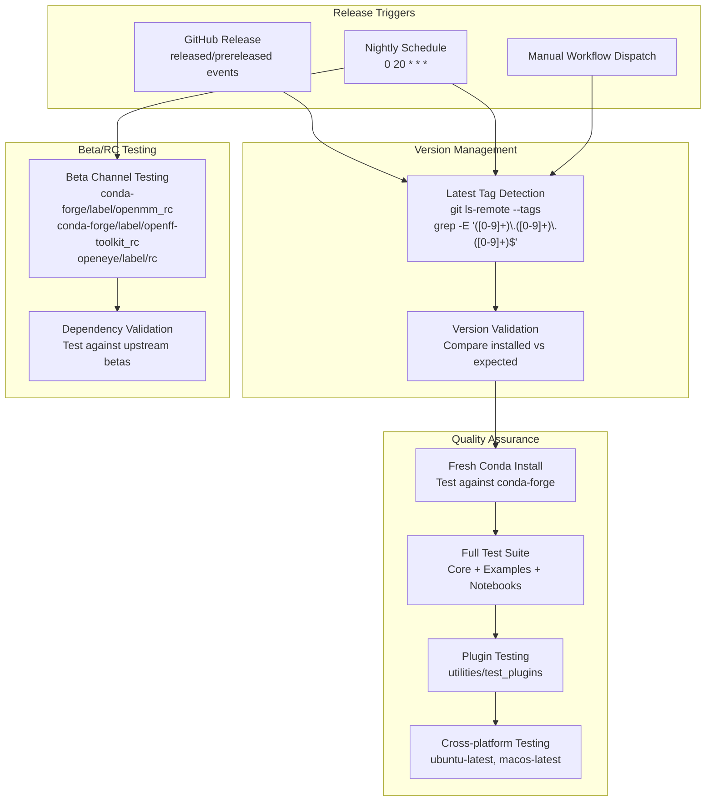

# Build and Packaging

Relevant source files

The following files were used as context for generating this wiki page:

- [.github/workflows/CI.yml](.github/workflows/CI.yml)
- [.github/workflows/beta_rc.yaml](.github/workflows/beta_rc.yaml)
- [.github/workflows/conda.yml](.github/workflows/conda.yml)
- [.github/workflows/examples.yml](.github/workflows/examples.yml)
- [.github/workflows/installer.yml](.github/workflows/installer.yml)
- [devtools/conda-envs/conda.yaml](devtools/conda-envs/conda.yaml)
- [devtools/conda-envs/conda_oe.yaml](devtools/conda-envs/conda_oe.yaml)
- [devtools/conda-envs/openeye-examples.yaml](devtools/conda-envs/openeye-examples.yaml)
- [devtools/conda-envs/openeye.yaml](devtools/conda-envs/openeye.yaml)
- [devtools/conda-envs/rdkit-examples.yaml](devtools/conda-envs/rdkit-examples.yaml)
- [devtools/conda-envs/rdkit.yaml](devtools/conda-envs/rdkit.yaml)
- [devtools/conda-envs/release-build.yaml](devtools/conda-envs/release-build.yaml)
- [devtools/conda-envs/test_env.yaml](devtools/conda-envs/test_env.yaml)

This document explains the build and packaging infrastructure for the OpenFF toolkit, including continuous integration workflows, environment management, testing matrices, and distribution processes. The system ensures code quality across multiple platforms, Python versions, and optional dependencies through automated testing and packaging.

For information about the actual testing framework and test organization, see [Testing Framework](#4.1). For plugin development and extension mechanisms, see [Plugin Development](#4.3).

## CI/CD Architecture

The OpenFF toolkit uses a comprehensive GitHub Actions-based CI/CD system that validates code across multiple dimensions: operating systems, Python versions, and optional toolkit dependencies.

The primary workflow excludes invalid combinations where both RDKit and OpenEye are disabled, and restricts OpenEye testing to Python 3.11 due to licensing constraints.

**Sources:** [.github/workflows/CI.yml:1-183](), [.github/workflows/conda.yml:1-132](), [.github/workflows/examples.yml:1-140](), [.github/workflows/installer.yml:1-112](), [.github/workflows/beta_rc.yaml:1-87]()

## Environment Management

The toolkit uses conda environment files to manage complex dependency combinations across different testing scenarios.

### Environment Configuration Matrix

| Environment | RDKit | OpenEye | AmberTools | Primary Use |
|-------------|-------|---------|------------|-------------|
| `test_env.yaml` | ✓ | ✓ | ✓ | Full CI testing |
| `rdkit.yaml` | ✓ | ✗ | ✓ | RDKit-only CI |
| `openeye.yaml` | ✗ | ✓ | ✗ | OpenEye-only CI |
| `rdkit-examples.yaml` | ✓ | ✗ | ✓ | Example notebooks |
| `openeye-examples.yaml` | ✗ | ✓ | ✗ | Example notebooks |
| `conda.yaml` | ✓ | ✗ | ✓ | Conda deployment |
| `conda_oe.yaml` | ✗ | ✓ | ✗ | Conda + OpenEye |

**Sources:** [devtools/conda-envs/test_env.yaml:1-53](), [devtools/conda-envs/rdkit.yaml:1-42](), [devtools/conda-envs/openeye.yaml:1-53](), [devtools/conda-envs/rdkit-examples.yaml:1-45](), [devtools/conda-envs/openeye-examples.yaml:1-44]()

## Testing Matrix and Workflow Logic

The CI system implements sophisticated logic to handle different toolkit combinations and their dependencies.

The workflow implements several exclusion rules:
- Excludes combinations where both `rdkit=false` and `openeye=false`
- Restricts OpenEye testing to Python 3.11 only
- Conditionally runs MyPy type checking only on OpenEye-only builds due to RDKit stub issues

**Sources:** [.github/workflows/CI.yml:22-36](), [.github/workflows/CI.yml:49-122](), [.github/workflows/CI.yml:140-147]()

## Package Distribution

The toolkit supports multiple distribution mechanisms to accommodate different user needs and deployment scenarios.

### Single-file Installer Process

The single-file installer workflow creates standalone executables that bundle the toolkit with all dependencies:

1. **Version Detection**: Automatically detects latest release tag using `git ls-remote`
2. **Constructor Integration**: Uses `toolkit-installer-constructor` repository for build configuration
3. **Build Process**: Generates platform-specific installers via `run.py`
4. **Validation**: Installs and tests the generated installer

**Sources:** [.github/workflows/installer.yml:46-112](), [.github/workflows/conda.yml:34-132]()

## Release Processes

The release workflow ensures quality and consistency across all distribution channels.

### Release Validation Steps

The conda workflow performs comprehensive validation of released packages:

1. **Environment Setup**: Creates clean conda environment with released package
2. **Version Verification**: Ensures installed version matches expected release tag
3. **Toolkit Validation**: Confirms proper toolkit availability/unavailability
4. **Test Execution**: Runs core test suite and example notebooks
5. **Cross-platform Testing**: Validates on both Ubuntu and macOS

**Sources:** [.github/workflows/conda.yml:71-132](), [.github/workflows/beta_rc.yaml:29-87]()

## Build Tools and Dependencies

The build system relies on specific tools and configurations for different aspects of the packaging process.

| Tool | Purpose | Configuration |
|------|---------|---------------|
| `micromamba` | Conda environment management | `mamba-org/setup-micromamba@v2` |
| `pytest` | Test execution | `pytest=8` with various plugins |
| `versioningit` | Version management | Dynamic versioning from git |
| `constructor` | Single-file installer creation | External repository integration |
| `anaconda-client` | Conda package upload | Release build environment |

### Environment Pinning Strategy

The toolkit uses careful dependency pinning to ensure reproducible builds:

- **NumPy**: Pinned to `<2.3` due to downstream compatibility issues
- **OpenMM**: Minimum version `>=7.6` for API compatibility
- **RDKit**: Excludes specific versions with known issues (`!=2024.03.6,!=2024.09.1`)
- **Python**: Supports 3.11, 3.12, and 3.13 with matrix testing

**Sources:** [devtools/conda-envs/test_env.yaml:10-53](), [devtools/conda-envs/release-build.yaml:1-10]()

---