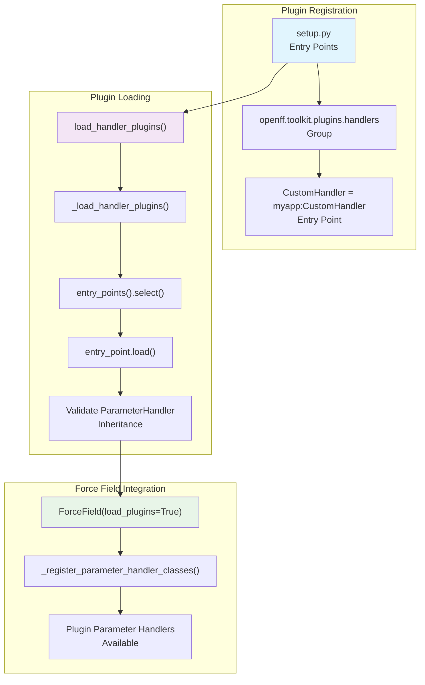
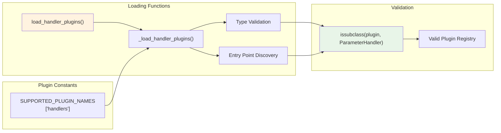
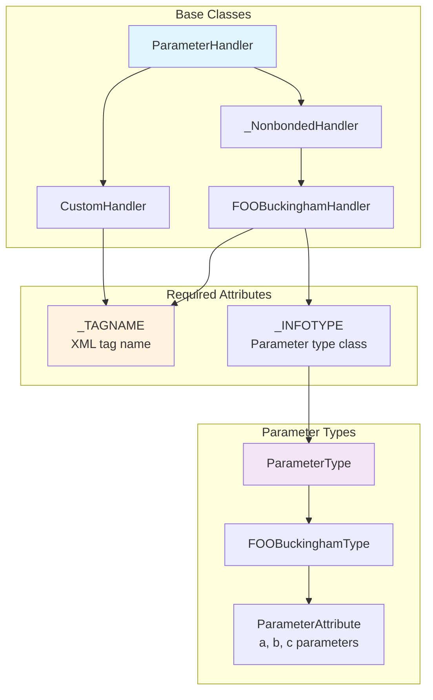
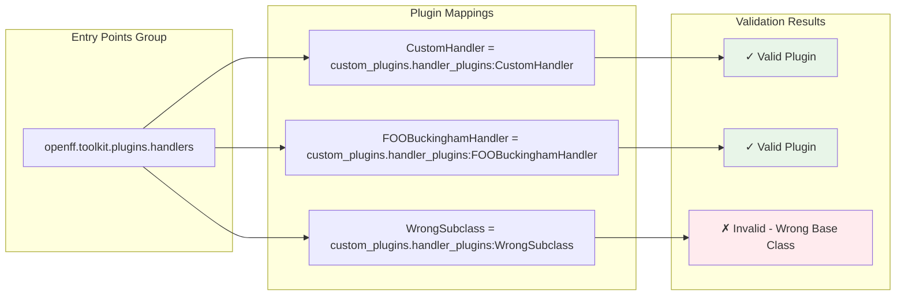
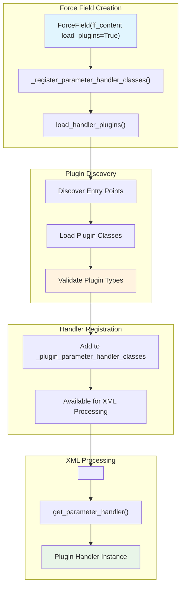
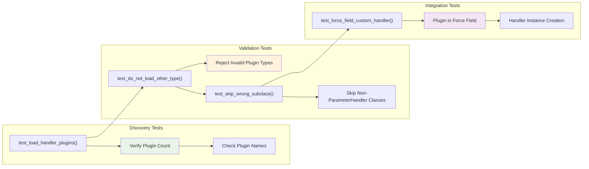

# Plugin Development

<details>
<summary>Relevant source files</summary>

The following files were used as context for generating this wiki page:

- [docs/typing.rst](docs/typing.rst)
- [openff/toolkit/_tests/test_forcefield.py](openff/toolkit/_tests/test_forcefield.py)
- [openff/toolkit/_tests/test_molecule.py](openff/toolkit/_tests/test_molecule.py)
- [openff/toolkit/_tests/test_parameter_plugins.py](openff/toolkit/_tests/test_parameter_plugins.py)
- [openff/toolkit/_tests/test_parameters.py](openff/toolkit/_tests/test_parameters.py)
- [openff/toolkit/data/proteins/MainChain_CYM.pdb](openff/toolkit/data/proteins/MainChain_CYM.pdb)
- [openff/toolkit/data/proteins/aa_residues_substructures_explicit_bond_orders_with_caps.json](openff/toolkit/data/proteins/aa_residues_substructures_explicit_bond_orders_with_caps.json)
- [openff/toolkit/data/proteins/aa_residues_substructures_explicit_bond_orders_with_caps_explicit_connectivity.json](openff/toolkit/data/proteins/aa_residues_substructures_explicit_bond_orders_with_caps_explicit_connectivity.json)
- [openff/toolkit/data/proteins/aa_residues_substructures_with_caps.json](openff/toolkit/data/proteins/aa_residues_substructures_with_caps.json)
- [openff/toolkit/data/proteins/ace-ala-nh2.pdb](openff/toolkit/data/proteins/ace-ala-nh2.pdb)
- [openff/toolkit/data/systems/test_systems/PE.pdb](openff/toolkit/data/systems/test_systems/PE.pdb)
- [openff/toolkit/typing/engines/smirnoff/plugins.py](openff/toolkit/typing/engines/smirnoff/plugins.py)
- [utilities/make_substructure_dict/_cif_to_substructure_dict.py](utilities/make_substructure_dict/_cif_to_substructure_dict.py)
- [utilities/make_substructure_dict/_make_chemical_substructures.py](utilities/make_substructure_dict/_make_chemical_substructures.py)
- [utilities/make_substructure_dict/_make_metadata_assignment_substructures.py](utilities/make_substructure_dict/_make_metadata_assignment_substructures.py)
- [utilities/test_plugins/custom_plugins/handler_plugins.py](utilities/test_plugins/custom_plugins/handler_plugins.py)
- [utilities/test_plugins/setup.py](utilities/test_plugins/setup.py)

</details>


This document explains how to create and register custom parameter handlers for the OpenFF toolkit using the plugin system. It covers the architecture of the plugin system, how to develop custom parameter handlers, and how to integrate them into force fields.

For information about the core parameter handler system that plugins extend, see [SMIRNOFF Force Field System](#2.2). For details about testing plugin functionality, see [Testing Framework](#4.1).

## Plugin System Architecture

The OpenFF toolkit uses Python's entrypoint plugin system to allow external packages to register custom parameter handlers that can be dynamically loaded and used in force fields.



**Plugin Discovery and Loading Workflow**

Sources: [openff/toolkit/typing/engines/smirnoff/plugins.py:35-94](), [utilities/test_plugins/setup.py:8-19]()

## Core Plugin Components

### Plugin Loading Infrastructure

The plugin system is built around several key functions and constants:



**Plugin Loading Components**

The `SUPPORTED_PLUGIN_NAMES` constant currently only includes `"handlers"`, indicating that only parameter handler plugins are supported. The loading process validates that discovered plugins inherit from `ParameterHandler`.

Sources: [openff/toolkit/typing/engines/smirnoff/plugins.py:32](), [openff/toolkit/typing/engines/smirnoff/plugins.py:72-82]()

## Creating Custom Parameter Handlers

### Basic Custom Handler

To create a custom parameter handler, inherit from `ParameterHandler` and define the required attributes:



**Custom Handler Class Hierarchy**

A minimal custom handler requires defining `_TAGNAME` for the XML element name. More complex handlers like `FOOBuckinghamHandler` also define custom parameter types with specific attributes.

Sources: [utilities/test_plugins/custom_plugins/handler_plugins.py:10-13](), [utilities/test_plugins/custom_plugins/handler_plugins.py:22-49]()

### Advanced Parameter Handler Example

The `FOOBuckinghamHandler` demonstrates a complete custom parameter handler with its own parameter type:

| Component | Purpose | Implementation |
|-----------|---------|----------------|
| `FOOBuckinghamHandler` | Main handler class | Inherits from `_NonbondedHandler` |
| `FOOBuckinghamType` | Parameter type | Defines `a`, `b`, `c` attributes with units |
| `_TAGNAME` | XML element name | `"FOOBuckingham"` |
| `_INFOTYPE` | Parameter type class | `FOOBuckinghamType` |

The parameter type defines three attributes with different unit specifications:
- `a`: Uses `unit.kilojoule_per_mole`
- `b`: Uses string notation `"nanometer**-1"`
- `c`: Uses compound units `unit.kilojoule_per_mole * unit.nanometer**6`

Sources: [utilities/test_plugins/custom_plugins/handler_plugins.py:22-49]()

## Plugin Registration

### Entry Point Configuration

Plugins are registered using Python's setuptools entry points system in the package's `setup.py`:



**Entry Point Registration and Validation**

The entry points map plugin names to their corresponding class paths. During loading, the plugin system validates that each discovered plugin inherits from the expected base class.

Sources: [utilities/test_plugins/setup.py:12-18]()

### Package Structure

A typical plugin package structure:
```
my_plugin_package/
├── setup.py
├── my_plugins/
│   ├── __init__.py
│   └── handler_plugins.py
```

The `setup.py` must include the entry points configuration:
```python
entry_points={
    "openff.toolkit.plugins.handlers": [
        "MyHandler = my_plugins.handler_plugins:MyHandler",
    ]
}
```

Sources: [utilities/test_plugins/setup.py:8-19]()

## Using Plugins in Force Fields

### Plugin Integration Workflow



**Plugin Loading and Registration in Force Fields**

When `load_plugins=True` is specified, the force field automatically discovers and registers all available plugin handlers, making them available for use in SMIRNOFF XML files.

Sources: [openff/toolkit/_tests/test_parameter_plugins.py:39-46]()

### Error Handling

When plugins are not enabled, attempting to use a custom handler results in a clear error:

| Scenario | Error Type | Message |
|----------|------------|---------|
| Plugin not loaded | `KeyError` | "Cannot find a registered parameter handler class for tag 'CustomHandler'" |
| Wrong inheritance | Logged warning | "does not inherit from ParameterHandler. This plugin will be skipped." |
| Import failure | Logged exception | "Could not load the {entry_point} plugin" |

Sources: [openff/toolkit/_tests/test_parameter_plugins.py:30-36](), [openff/toolkit/typing/engines/smirnoff/plugins.py:73-77]()

## Plugin Validation and Testing

### Plugin Discovery Testing

The plugin system includes comprehensive validation:



**Plugin Testing Strategy**

The test suite validates plugin discovery, type checking, and integration with force fields.

Sources: [openff/toolkit/_tests/test_parameter_plugins.py:48-74]()

### Parameter Type Validation

Custom parameter types are validated for proper unit handling:

```python
# Example from test_buckingham_type()
parameter = FOOBuckinghamHandler.FOOBuckinghamType(
    smirks="[*:1]",
    a="2 kilojoule_per_mole",
    b="1/nanometer", 
    c="-0.5 kilojoule_per_mole * nanometer**6",
)
```

The test verifies that all parameters are properly converted to `Quantity` objects with correct units.

Sources: [openff/toolkit/_tests/test_parameter_plugins.py:76-93]()

## Limitations and Future Development

### Current Limitations

| Limitation | Description | Future Possibility |
|------------|-------------|-------------------|
| Handler Types Only | Only `ParameterHandler` plugins supported | `ParameterIOHandler` plugins possible |
| Single Plugin Group | Only `"handlers"` group implemented | Additional groups for other components |
| Entry Point Only | Only setuptools entry points supported | Alternative discovery mechanisms |

The plugin system is marked as experimental and may be modified in future versions.

Sources: [openff/toolkit/typing/engines/smirnoff/plugins.py:5-9](), [openff/toolkit/typing/engines/smirnoff/plugins.py:32]()

### Extension Points

The architecture supports future expansion through:
- Additional plugin types via `SUPPORTED_PLUGIN_NAMES`
- Alternative parameter handler base classes
- Custom validation logic for different plugin categories

Sources: [openff/toolkit/typing/engines/smirnoff/plugins.py:50-54]()

---