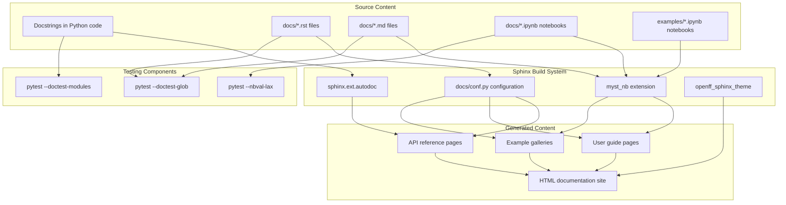
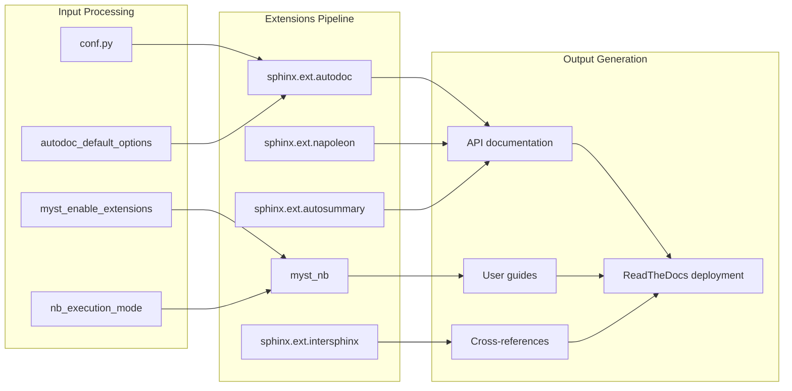
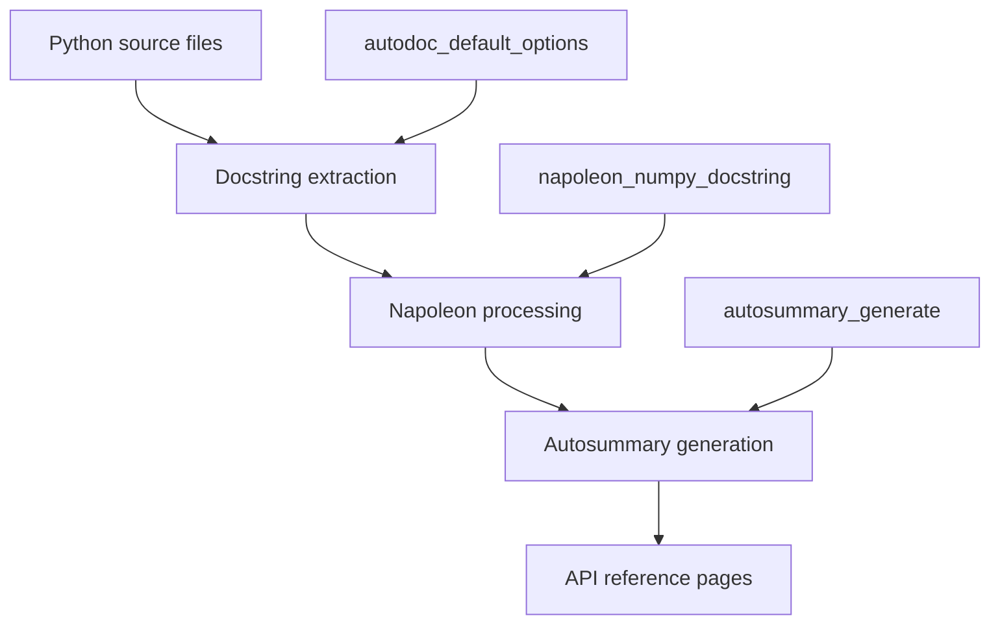
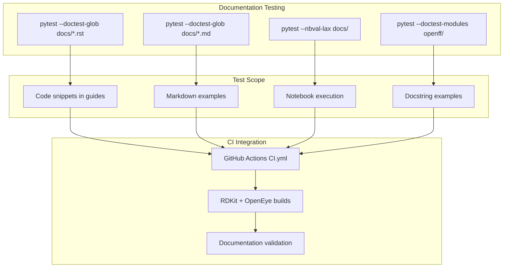
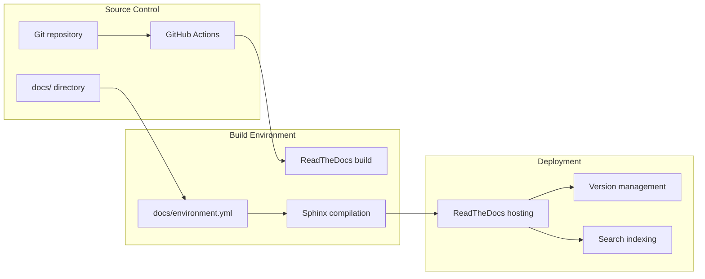

# Documentation System

<details>
<summary>Relevant source files</summary>

The following files were used as context for generating this wiki page:

- [.github/workflows/CI.yml](.github/workflows/CI.yml)
- [.github/workflows/beta_rc.yaml](.github/workflows/beta_rc.yaml)
- [.github/workflows/conda.yml](.github/workflows/conda.yml)
- [.github/workflows/examples.yml](.github/workflows/examples.yml)
- [.github/workflows/installer.yml](.github/workflows/installer.yml)
- [FAQ.md](FAQ.md)
- [devtools/conda-envs/conda.yaml](devtools/conda-envs/conda.yaml)
- [devtools/conda-envs/conda_oe.yaml](devtools/conda-envs/conda_oe.yaml)
- [devtools/conda-envs/openeye-examples.yaml](devtools/conda-envs/openeye-examples.yaml)
- [devtools/conda-envs/openeye.yaml](devtools/conda-envs/openeye.yaml)
- [devtools/conda-envs/rdkit-examples.yaml](devtools/conda-envs/rdkit-examples.yaml)
- [devtools/conda-envs/rdkit.yaml](devtools/conda-envs/rdkit.yaml)
- [devtools/conda-envs/test_env.yaml](devtools/conda-envs/test_env.yaml)
- [docs/api/toolkits.md](docs/api/toolkits.md)
- [docs/conf.py](docs/conf.py)
- [docs/environment.yml](docs/environment.yml)
- [docs/examples.md](docs/examples.md)
- [docs/index.md](docs/index.md)
- [docs/installation.md](docs/installation.md)
- [docs/users/developing.md](docs/users/developing.md)
- [docs/users/molecule_cookbook.ipynb](docs/users/molecule_cookbook.ipynb)
- [docs/users/pdb_cookbook/index.ipynb](docs/users/pdb_cookbook/index.ipynb)
- [docs/utils.rst](docs/utils.rst)
- [openff/toolkit/utils/toolkit_registry.py](openff/toolkit/utils/toolkit_registry.py)

</details>


The OpenFF Toolkit documentation system is responsible for generating, testing, and deploying comprehensive documentation from multiple sources including docstrings, Jupyter notebooks, and hand-written guides. This page covers the technical infrastructure that transforms source code and documentation files into the published documentation site.

For information about the testing framework that validates the documentation, see [Testing Framework](#4.1). For details about the build and packaging systems that support documentation deployment, see [Build and Packaging](#4.2).

## Documentation Architecture

The documentation system follows a multi-source, multi-format architecture that combines automated API generation with curated user content:



Sources: [docs/conf.py:1-299](), [.github/workflows/CI.yml:159-175]()

## Content Generation Pipeline

The documentation generation process transforms multiple input formats into a unified documentation site through several processing stages:



The `conf.py` configuration file orchestrates this pipeline through several key settings:

- **Autodoc Configuration**: `autodoc_default_options` controls API documentation generation
- **MyST Extensions**: `myst_enable_extensions` enables Markdown features like math and code fences  
- **Notebook Execution**: `nb_execution_mode = "off"` prevents re-execution during builds
- **Theme Configuration**: `openff_sphinx_theme` provides consistent styling

Sources: [docs/conf.py:51-70](), [docs/conf.py:111-125](), [docs/conf.py:191-217]()

## Content Types and Organization

The documentation system supports multiple content types, each with specific processing requirements:

| Content Type | Source Location | Processing | Output |
|--------------|-----------------|------------|---------|
| API Reference | Python docstrings | `sphinx.ext.autodoc` | `api/generated/` |
| User Guides | `docs/*.md`, `docs/*.rst` | `myst_parser` | Direct rendering |
| Cookbooks | `docs/users/*.ipynb` | `myst_nb` | Interactive examples |
| Examples | `examples/*.ipynb` | `myst_nb` + `nbval` | Tested tutorials |

### API Documentation Generation

API documentation is automatically generated from docstrings using Sphinx's autodoc system:



The system uses NumPy-style docstrings (`napoleon_numpy_docstring = True`) and automatically generates summary tables (`autosummary_generate = True`).

Sources: [docs/conf.py:51-70](), [docs/conf.py:65-70]()

### Interactive Content Processing

Jupyter notebooks are processed through the MyST-NB extension with special handling for execution and validation:

- **Execution Control**: `nb_execution_mode = "off"` prevents re-execution during documentation builds
- **Widget State**: Notebooks must save widget state for proper rendering
- **Cross-references**: MyST syntax enables linking between notebooks and API docs

Sources: [docs/conf.py:121-125](), [docs/conf.py:112-119]()

## Testing and Validation Infrastructure

The documentation system includes comprehensive testing to ensure accuracy and functionality:



Testing occurs in multiple phases:
- **Code snippets**: Executed via `pytest --doctest-glob` for RST and Markdown files
- **Notebooks**: Validated using `pytest --nbval-lax` to ensure they run without errors
- **Docstring examples**: Tested via `pytest --doctest-modules` across the codebase

Sources: [.github/workflows/CI.yml:159-175](), [.github/workflows/CI.yml:163-165](), [.github/workflows/CI.yml:167-174]()

## Deployment and Hosting

Documentation deployment follows an automated pipeline from source to published documentation:



### ReadTheDocs Configuration

The `docs/environment.yml` file specifies the build environment for ReadTheDocs:

- **Python version**: Constrained to `<3.13` for compatibility
- **Core dependencies**: Includes `myst-nb`, `sphinx`, and scientific libraries
- **Theme installation**: Custom OpenFF theme installed via pip from GitHub

The configuration includes special handling for CUDA toolkit dependencies and uses specific channel priorities to ensure reproducible builds.

Sources: [docs/environment.yml:1-42](), [docs/conf.py:130-148]()

### Cross-Reference System

The documentation maintains extensive cross-references through Sphinx's intersphinx extension:

```python
intersphinx_mapping = {
    "python": ("https://docs.python.org/3.7", None),
    "numpy": ("https://numpy.org/doc/stable", None),
    "openmm": ("http://docs.openmm.org/latest/api-python/", None),
    "openff.interchange": ("https://docs.openforcefield.org/projects/interchange/en/stable/", None),
    # ... additional mappings
}
```

This enables seamless linking to external documentation and maintains consistency across the OpenFF ecosystem.

Sources: [docs/conf.py:72-102]()

---