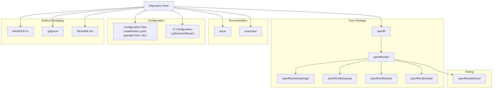
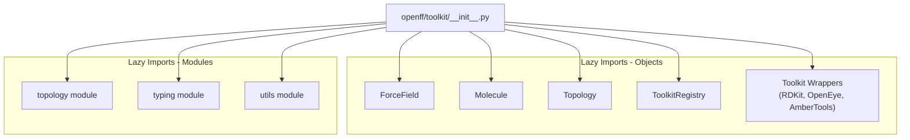
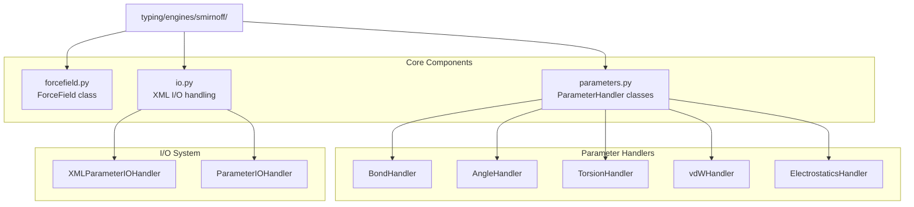
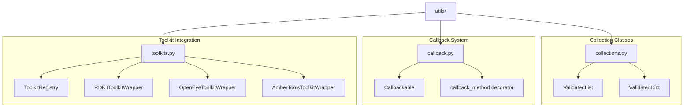
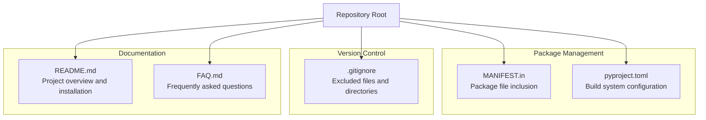

# Repository Structure

Relevant source files

The following files were used as context for generating this wiki page:

- [.gitignore](.gitignore)
- [.readthedocs.yaml](.readthedocs.yaml)
- [MANIFEST.in](MANIFEST.in)
- [README.md](README.md)
- [openff/toolkit/__init__.py](openff/toolkit/__init__.py)
- [openff/toolkit/typing/engines/smirnoff/io.py](openff/toolkit/typing/engines/smirnoff/io.py)
- [openff/toolkit/utils/callback.py](openff/toolkit/utils/callback.py)
- [openff/toolkit/utils/collections.py](openff/toolkit/utils/collections.py)

This page provides an overview of the OpenFF toolkit repository organization, detailing the key directories, files, and their purposes within the codebase. It serves as a guide for understanding how the repository is structured and where different components are located.

For information about the core architectural components and how they interact, see [Core Architecture](#2). For details about the development workflow and testing infrastructure, see [Development](#4).

## Repository Organization

The OpenFF toolkit repository follows a standard Python package structure with additional directories for documentation, examples, and configuration files. The main source code is organized under the `openff/toolkit/` directory, with supporting files at the repository root level.

### High-Level Directory Structure

**Sources:** [README.md:1-91](), [MANIFEST.in:1-6](), [.gitignore:1-83](), [openff/toolkit/__init__.py:1-100]()

## Core Package Structure

The main package is organized under `openff/toolkit/` with several key modules that implement the core functionality described in the architectural overview.

### Main Package Initialization

The package's public API is defined in the main `__init__.py` file, which uses lazy loading to optimize import performance:

**Sources:** [openff/toolkit/__init__.py:47-70]()

### Key Module Organization

The toolkit is organized into several main modules, each with specific responsibilities:

| Module | Purpose | Key Components |
|--------|---------|----------------|
| `topology/` | Molecular structure representation | `Molecule`, `Topology`, `Atom`, `Bond` |
| `typing/` | Force field assignment and SMIRNOFF | `ForceField`, `ParameterHandler`, `ParameterType` |
| `utils/` | Utility functions and toolkit wrappers | `ToolkitRegistry`, collection classes, exceptions |
| `data/` | Test data, force fields, and molecules | Force field XML files, test molecules |
| `tests/` | Test suite | Unit tests, integration tests |

**Sources:** [openff/toolkit/__init__.py:48-62]()

## SMIRNOFF Force Field System Structure

The SMIRNOFF force field implementation is organized under the `typing/engines/smirnoff/` directory, with specialized modules for different aspects of force field handling:

**Sources:** [openff/toolkit/typing/engines/smirnoff/io.py:1-236]()

## Utility and Support Systems

The `utils/` directory contains essential support classes and functions used throughout the toolkit:

### Collections and Validation

**Sources:** [openff/toolkit/utils/collections.py:1-252](), [openff/toolkit/utils/callback.py:1-190]()

## Configuration and Build Files

The repository root contains several important configuration files that control various aspects of the project:

### Documentation Configuration

The documentation system is configured through several files:

| File | Purpose |
|------|---------|
| `.readthedocs.yaml` | ReadTheDocs build configuration |
| `docs/conf.py` | Sphinx configuration |
| `docs/environment.yml` | Conda environment for documentation builds |

**Sources:** [.readthedocs.yaml:1-22]()

### Package Configuration

**Sources:** [MANIFEST.in:1-6](), [.gitignore:1-83](), [README.md:1-91]()

## Data and Test Files Organization

The repository includes structured data and test files:

### Data Directory Structure

Based on the `.gitignore` file, the data organization includes:

| Directory | Contents |
|-----------|----------|
| `openff/toolkit/data/test_forcefields/` | Test force field XML files |
| `openff/toolkit/data/molecules/` | Test molecule files (SDF, MOL2, etc.) |
| `openff/toolkit/tests/` | Test suite with unit and integration tests |

### Generated and Excluded Files

The `.gitignore` file reveals the build artifacts and generated files that are excluded from version control:

```mermaid
graph TB
    excluded["Excluded Files"]
    
    subgraph "Build Artifacts"
        pycache["__pycache__/<br/>Compiled Python bytecode"]
        dist["dist/, build/<br/>Package distribution files"]
        eggs["*.egg-info/<br/>Package metadata"]
    end
    
    subgraph "Test Artifacts"
        coverage["coverage files<br/>(.coverage, htmlcov/)"]
        pytest[".cache/<br/>Pytest cache"]
    end
    
    subgraph "Documentation"
        docs_build["docs/_build/<br/>Generated documentation"]
        api_gen["docs/api/generated<br/>Auto-generated API docs"]
    end
    
    subgraph "Development"
        vscode[".vscode<br/>VS Code settings"]
        idea["*.idea/<br/>PyCharm settings"]
        notebooks["*.ipynb_checkpoints/<br/>Jupyter notebook checkpoints"]
    end
    
    excluded --> pycache
    excluded --> dist
    excluded --> eggs
    excluded --> coverage
    excluded --> pytest
    excluded --> docs_build
    excluded --> api_gen
    excluded --> vscode
    excluded --> idea
    excluded --> notebooks
```

**Sources:** [.gitignore:1-83]()

## Examples and Documentation Structure

The repository includes comprehensive examples and documentation:

### Examples Organization

Based on the `.gitignore` exclusions, the examples are organized as:

| Directory | Contents |
|-----------|----------|
| `examples/` | Jupyter notebooks and example scripts |
| `examples/testing/` | Test examples and system conversion examples |

### Documentation Integration

The documentation system integrates with the main package structure through:

- Automatic API documentation generation from docstrings
- ReadTheDocs integration for hosted documentation
- Jupyter notebook examples that are tested as part of CI

**Sources:** [README.md:18-25](), [.readthedocs.yaml:16-18]()

## Plugin and Extension Points

The repository structure supports extensibility through:

### Plugin Architecture

The toolkit supports external plugins through:

- Entry points in `setup.py`/`pyproject.toml` for parameter handlers
- Modular toolkit wrapper system in `utils/toolkits.py`
- Force field distribution through conda packages

### Extension Directories

The structure allows for:

- Custom parameter handlers in the `typing/engines/smirnoff/` hierarchy
- Additional toolkit wrappers in `utils/toolkits.py`
- Plugin force fields discoverable through the package system

**Sources:** [README.md:41-42](), [openff/toolkit/__init__.py:47-70]()