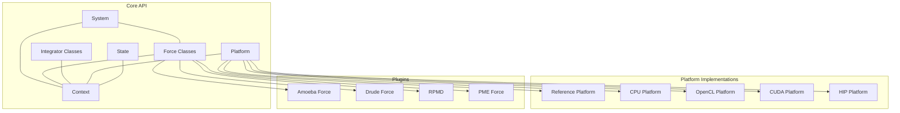
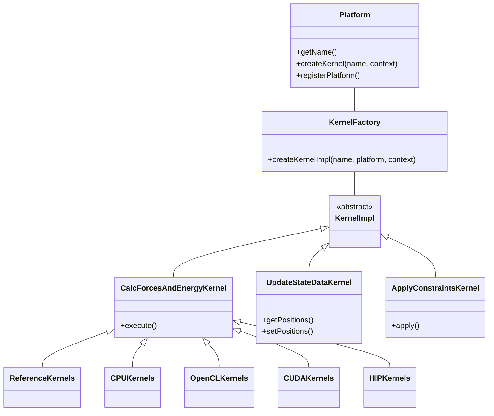
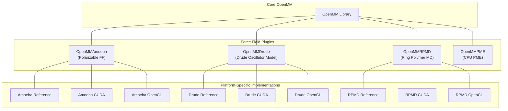
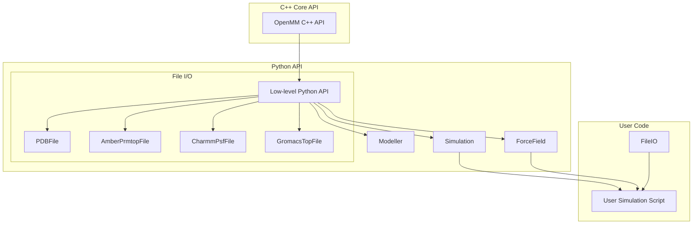

# Overview

<details>
<summary>Relevant source files</summary>

The following files were used as context for generating this wiki page:

- [docs-source/CMakeLists.txt](docs-source/CMakeLists.txt)
- [docs-source/api-c++/forces.rst](docs-source/api-c++/forces.rst)
- [docs-source/api-python/process-docstring.py](docs-source/api-python/process-docstring.py)
- [docs-source/developerguide/05_cpu_platform.rst](docs-source/developerguide/05_cpu_platform.rst)
- [docs-source/developerguide/07_cuda_platform.rst](docs-source/developerguide/07_cuda_platform.rst)
- [docs-source/developerguide/index.rst](docs-source/developerguide/index.rst)
- [docs-source/developerguide/make.bat](docs-source/developerguide/make.bat)
- [docs-source/sphinx/autonumber.py](docs-source/sphinx/autonumber.py)
- [docs-source/usersguide/application.rst](docs-source/usersguide/application.rst)
- [docs-source/usersguide/application/01_getting_started.rst](docs-source/usersguide/application/01_getting_started.rst)
- [docs-source/usersguide/application/02_running_sims.rst](docs-source/usersguide/application/02_running_sims.rst)
- [docs-source/usersguide/application/05_add_on_packages.rst](docs-source/usersguide/application/05_add_on_packages.rst)
- [docs-source/usersguide/application/06_creating_ffs.rst](docs-source/usersguide/application/06_creating_ffs.rst)
- [docs-source/usersguide/index.rst](docs-source/usersguide/index.rst)
- [docs-source/usersguide/library.rst](docs-source/usersguide/library.rst)
- [docs-source/usersguide/library/01_introduction.rst](docs-source/usersguide/library/01_introduction.rst)
- [docs-source/usersguide/library/02_compiling.rst](docs-source/usersguide/library/02_compiling.rst)
- [docs-source/usersguide/library/04_platform_specifics.rst](docs-source/usersguide/library/04_platform_specifics.rst)
- [docs-source/usersguide/make.bat](docs-source/usersguide/make.bat)
- [docs-source/usersguide/references.bib](docs-source/usersguide/references.bib)
- [docs-source/usersguide/theory.rst](docs-source/usersguide/theory.rst)
- [olla/include/openmm/kernels.h](olla/include/openmm/kernels.h)
- [openmmapi/include/OpenMM.h](openmmapi/include/OpenMM.h)
- [platforms/common/include/openmm/common/CommonKernels.h](platforms/common/include/openmm/common/CommonKernels.h)
- [platforms/common/include/openmm/common/ComputeContext.h](platforms/common/include/openmm/common/ComputeContext.h)
- [platforms/common/src/CommonKernels.cpp](platforms/common/src/CommonKernels.cpp)
- [platforms/common/src/ComputeContext.cpp](platforms/common/src/ComputeContext.cpp)
- [platforms/cuda/include/CudaContext.h](platforms/cuda/include/CudaContext.h)
- [platforms/cuda/include/CudaKernels.h](platforms/cuda/include/CudaKernels.h)
- [platforms/cuda/src/CudaContext.cpp](platforms/cuda/src/CudaContext.cpp)
- [platforms/cuda/src/CudaKernelFactory.cpp](platforms/cuda/src/CudaKernelFactory.cpp)
- [platforms/cuda/src/CudaKernels.cpp](platforms/cuda/src/CudaKernels.cpp)
- [platforms/cuda/src/CudaPlatform.cpp](platforms/cuda/src/CudaPlatform.cpp)
- [platforms/opencl/include/OpenCLContext.h](platforms/opencl/include/OpenCLContext.h)
- [platforms/opencl/include/OpenCLKernels.h](platforms/opencl/include/OpenCLKernels.h)
- [platforms/opencl/src/OpenCLContext.cpp](platforms/opencl/src/OpenCLContext.cpp)
- [platforms/opencl/src/OpenCLKernelFactory.cpp](platforms/opencl/src/OpenCLKernelFactory.cpp)
- [platforms/opencl/src/OpenCLKernels.cpp](platforms/opencl/src/OpenCLKernels.cpp)
- [platforms/opencl/src/OpenCLPlatform.cpp](platforms/opencl/src/OpenCLPlatform.cpp)
- [platforms/reference/include/ReferenceKernels.h](platforms/reference/include/ReferenceKernels.h)
- [platforms/reference/src/ReferenceKernelFactory.cpp](platforms/reference/src/ReferenceKernelFactory.cpp)
- [platforms/reference/src/ReferenceKernels.cpp](platforms/reference/src/ReferenceKernels.cpp)
- [platforms/reference/src/ReferencePlatform.cpp](platforms/reference/src/ReferencePlatform.cpp)
- [serialization/src/SerializationProxyRegistration.cpp](serialization/src/SerializationProxyRegistration.cpp)
- [wrappers/python/openmm/app/amberprmtopfile.py](wrappers/python/openmm/app/amberprmtopfile.py)
- [wrappers/python/openmm/app/charmmparameterset.py](wrappers/python/openmm/app/charmmparameterset.py)
- [wrappers/python/openmm/app/charmmpsffile.py](wrappers/python/openmm/app/charmmpsffile.py)
- [wrappers/python/openmm/app/desmonddmsfile.py](wrappers/python/openmm/app/desmonddmsfile.py)
- [wrappers/python/openmm/app/forcefield.py](wrappers/python/openmm/app/forcefield.py)
- [wrappers/python/openmm/app/internal/amber_file_parser.py](wrappers/python/openmm/app/internal/amber_file_parser.py)
- [wrappers/python/openmm/app/internal/amoebaforces.py](wrappers/python/openmm/app/internal/amoebaforces.py)
- [wrappers/python/openmm/app/tinkerfiles.py](wrappers/python/openmm/app/tinkerfiles.py)
- [wrappers/python/tests/TestAmberInpcrdFile.py](wrappers/python/tests/TestAmberInpcrdFile.py)
- [wrappers/python/tests/TestAmberPrmtopFile.py](wrappers/python/tests/TestAmberPrmtopFile.py)
- [wrappers/python/tests/TestCharmmFiles.py](wrappers/python/tests/TestCharmmFiles.py)
- [wrappers/python/tests/TestElement.py](wrappers/python/tests/TestElement.py)
- [wrappers/python/tests/TestForceField.py](wrappers/python/tests/TestForceField.py)
- [wrappers/python/tests/TestPatches.py](wrappers/python/tests/TestPatches.py)
- [wrappers/python/tests/TestTinkerFiles.py](wrappers/python/tests/TestTinkerFiles.py)
- [wrappers/python/tests/systems/4TVP-dmj_wat-ion.psf](wrappers/python/tests/systems/4TVP-dmj_wat-ion.psf)
- [wrappers/python/tests/systems/ala_ala_ala.crd](wrappers/python/tests/systems/ala_ala_ala.crd)
- [wrappers/python/tests/systems/amoebabio18.prm](wrappers/python/tests/systems/amoebabio18.prm)

</details>


OpenMM is a high-performance, extensible toolkit for molecular simulation. This page introduces the overall architecture, purpose, and key components of the OpenMM codebase, focusing on how different parts interact to provide a flexible and efficient framework for molecular dynamics simulations.

For information about building and installing OpenMM, see [Installation and Getting Started](#1.1). For details on development workflow, see [Development Workflow](#1.2).

## Purpose and Scope

OpenMM serves as both a software library that can be integrated into other applications and as a complete application for running molecular simulations. It provides:

1. A flexible, object-oriented API for setting up and running simulations
2. Multiple high-performance implementations targeting different hardware platforms
3. Extensibility through plugins for specialized force fields and algorithms
4. Support for a wide range of simulation techniques and force fields

Sources: [CMakeLists.txt:1-10]()

## System Architecture

### Core Components

OpenMM's architecture is designed around a clean separation between the simulation API and the implementation details for different hardware platforms.



Sources: [CMakeLists.txt:92-95](), [CMakeLists.txt:377-408]()

### Key Classes and Their Roles

- **System**: Defines the physical system being simulated, including particles, constraints, and forces
- **Force**: Represents a specific type of interaction between particles
- **Integrator**: Implements algorithms for advancing the simulation through time
- **Context**: Manages the state of a simulation and coordinates the interaction between System, Force, and Integrator
- **Platform**: Provides hardware-specific implementations of computational kernels
- **State**: Represents the complete state of a simulation at a point in time

Sources: [CMakeLists.txt:198-206]()

## Platforms and Kernels

OpenMM achieves performance portability through a platform abstraction that allows the same simulation to run on different hardware.



OpenMM supports the following hardware platforms:

| Platform | Description | Configuration Option |
|----------|-------------|---------------------|
| Reference | Pure C++ implementation (slow but precise) | Always built |
| CPU | Multi-threaded CPU implementation | `OPENMM_BUILD_CPU_LIB` |
| CUDA | NVIDIA GPU implementation | `OPENMM_BUILD_CUDA_LIB` |
| OpenCL | Cross-platform GPU implementation | `OPENMM_BUILD_OPENCL_LIB` |
| HIP | AMD GPU implementation | `OPENMM_BUILD_HIP_LIB` |

Sources: [CMakeLists.txt:319-357](), [CMakeLists.txt:369-372]()

## Plugin System

OpenMM uses a plugin architecture to allow specialized force fields and algorithms to be added without modifying the core library.



Each plugin:
- Implements specialized force types and algorithms
- Provides optimized implementations for different platforms
- Can be enabled/disabled at build time
- Integrates with the core API through standard interfaces

Sources: [CMakeLists.txt:376-408](), [plugins/amoeba/CMakeLists.txt:1-13](), [plugins/drude/CMakeLists.txt:1-13](), [plugins/rpmd/CMakeLists.txt:1-13]()

## Python API and Application Layer

OpenMM provides a comprehensive Python API for setting up and running simulations at a higher level than the C++ API.



A typical Python simulation workflow looks like:

1. Load molecule and topology (PDB, AMBER, CHARMM, GROMACS)
2. Define force field
3. Create System with force field parameters
4. Set up Integrator
5. Create Simulation object combining topology, system, and integrator
6. Run simulation and collect data

Example:
```python
from openmm.app import *
from openmm import *
from openmm.unit import *

pdb = PDBFile('input.pdb')
forcefield = ForceField('amber14-all.xml', 'amber14/tip3pfb.xml')
system = forcefield.createSystem(pdb.topology, nonbondedMethod=PME)
integrator = LangevinMiddleIntegrator(300*kelvin, 1/picosecond, 0.004*picoseconds)
simulation = Simulation(pdb.topology, system, integrator)
simulation.context.setPositions(pdb.positions)
simulation.minimizeEnergy()
simulation.step(10000)
```

Sources: [examples/simulatePdb.py:1-16](), [examples/simulateAmber.py:1-16](), [examples/simulateCharmm.py:1-34](), [examples/simulateGromacs.py:1-16]()

## Versioning and Compatibility

The current major version of OpenMM is 8.2.0, as defined in the build system:

Sources: [CMakeLists.txt:157-159]()

## Documentation Structure

The OpenMM documentation is organized into three main parts:

1. **The Application Layer** - Higher-level Python interface for building and running simulations
2. **The Library Layer** - C++ API and direct library usage
3. **The Theory Behind OpenMM** - Algorithms and methods implemented in the library

Sources: [docs-source/usersguide/application.rst:1-19](), [docs-source/usersguide/library.rst:1-22](), [docs-source/usersguide/theory.rst:1-16]()

This wiki provides complementary developer-focused documentation to help understand, modify, and extend the codebase.

---