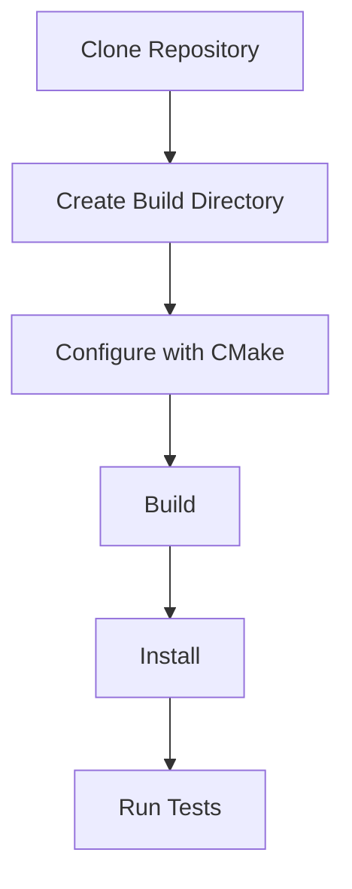
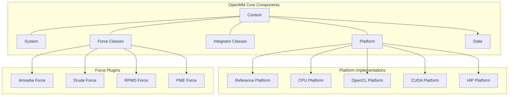

# Installation and Getting Started

<details>
<summary>Relevant source files</summary>

The following files were used as context for generating this wiki page:

- [.travis.yml](.travis.yml)
- [CMakeLists.txt](CMakeLists.txt)
- [appveyor.yml](appveyor.yml)
- [devtools/run-ctest.py](devtools/run-ctest.py)
- [examples/python-examples/argon-chemical-potential.py](examples/python-examples/argon-chemical-potential.py)
- [platforms/cpu/CMakeLists.txt](platforms/cpu/CMakeLists.txt)
- [plugins/amoeba/CMakeLists.txt](plugins/amoeba/CMakeLists.txt)
- [plugins/amoeba/platforms/reference/CMakeLists.txt](plugins/amoeba/platforms/reference/CMakeLists.txt)
- [plugins/drude/CMakeLists.txt](plugins/drude/CMakeLists.txt)
- [plugins/drude/platforms/reference/CMakeLists.txt](plugins/drude/platforms/reference/CMakeLists.txt)
- [plugins/drude/wrappers/CMakeLists.txt](plugins/drude/wrappers/CMakeLists.txt)
- [plugins/drude/wrappers/Doxyfile.in](plugins/drude/wrappers/Doxyfile.in)
- [plugins/drude/wrappers/generateDrudeWrappers.py](plugins/drude/wrappers/generateDrudeWrappers.py)
- [plugins/rpmd/CMakeLists.txt](plugins/rpmd/CMakeLists.txt)
- [plugins/rpmd/platforms/reference/CMakeLists.txt](plugins/rpmd/platforms/reference/CMakeLists.txt)
- [serialization/CMakeLists.txt](serialization/CMakeLists.txt)
- [wrappers/python/openmm/unit/mymatrix.py](wrappers/python/openmm/unit/mymatrix.py)
- [wrappers/python/openmm/unit/quantity.py](wrappers/python/openmm/unit/quantity.py)
- [wrappers/python/openmm/unit/unit.py](wrappers/python/openmm/unit/unit.py)
- [wrappers/python/tests/TestUnits.py](wrappers/python/tests/TestUnits.py)
- [wrappers/python/tests/pytest.ini](wrappers/python/tests/pytest.ini)

</details>


This page provides instructions for building, installing, and getting started with OpenMM from source code. If you're looking for information about using the pre-built Python packages, see [The OpenMM Application Layer](#6) or [Python API](#6.1).

## Prerequisites

Before building OpenMM, ensure you have the following dependencies installed:

### Required Dependencies

- **CMake** (version 3.17 or later) - Build system generator
- **C++ compiler** supporting C++11 standard:
  - GCC (Linux)
  - Clang (macOS/Linux) 
  - Visual Studio 2019 or later (Windows)
- **Doxygen** - For generating API documentation from C++ headers

Sources: [CMakeLists.txt:24](), [CMakeLists.txt:97]()

### Optional Dependencies for Python Wrappers

- **Python** (3.6 or later) - Required for Python API
- **SWIG** (version 3.0.7 or later) - Interface generator for Python bindings
- **Cython** - For optimized Python extensions
- **NumPy** - For array operations in Python
- **pytest** - For running Python test suite

Sources: [.travis.yml:167-189](), [appveyor.yml:12-14]()

### Optional Dependencies for GPU Platforms

- **CUDA Toolkit** (7.5 or later) - For NVIDIA GPU support via CUDA platform
  - Includes: `nvcc`, `cudart`, CUDA libraries
- **OpenCL** development files - For cross-platform GPU support
  - Includes: OpenCL headers and ICD loader
- **ROCm/HIP** - For AMD GPU support via HIP platform

Sources: [.travis.yml:191-203](), [appveyor.yml:25-41](), [CMakeLists.txt:324-357]()

### Optional Dependencies for Specific Features

- **FFTW3** - For CPU-based PME calculations
- **Gromacs** - For testing Gromacs file format support

Sources: [.travis.yml:9](), [.travis.yml:176]()

## Obtaining the Source Code

Clone the OpenMM repository:

```bash
git clone https://github.com/openmm/openmm.git
cd openmm
```

## Building from Source

OpenMM uses CMake to generate platform-specific build files. Here's the basic build process:

### Build Process Overview



Sources: [CMakeLists.txt:14-54](), [CMakeLists.txt:130-150]()

### Detailed Steps

1. **Create a build directory:**
   ```bash
   mkdir build
   cd build
   ```

2. **Configure with CMake:**
   ```bash
   cmake ..
   ```
   
3. **Build OpenMM:**
   ```bash
   make
   ```
   
4. **Install OpenMM:**
   ```bash
   make install
   ```
   
5. **Test the installation:**
   ```bash
   make test
   ```

### Important CMake Configuration Options

The following table shows key CMake options that control which features are built:

#### Core Library Options

| Option | Default | Description |
|--------|---------|-------------|
| `OPENMM_BUILD_SHARED_LIB` | ON | Build `libOpenMM.so`/`OpenMM.dll` shared library |
| `OPENMM_BUILD_STATIC_LIB` | OFF | Build `libOpenMM_static.a`/`OpenMM_static.lib` static library |
| `CMAKE_BUILD_TYPE` | Release | Build type: Release, Debug, RelWithDebInfo |
| `CMAKE_INSTALL_PREFIX` | `/usr/local/openmm` | Installation directory |

Sources: [CMakeLists.txt:72-73](), [CMakeLists.txt:86-88](), [CMakeLists.txt:134-136]()

#### Wrapper and Documentation Options

| Option | Default | Description |
|--------|---------|-------------|
| `OPENMM_BUILD_C_AND_FORTRAN_WRAPPERS` | ON | Generate C/Fortran API wrappers using SWIG |
| `OPENMM_BUILD_PYTHON_WRAPPERS` | ON | Generate Python wrappers (requires AMOEBA, RPMD, Drude plugins) |
| `OPENMM_GENERATE_API_DOCS` | OFF | Generate API documentation using Doxygen and Sphinx |
| `BUILD_TESTING` | ON | Build test executables |
| `OPENMM_BUILD_EXAMPLES` | ON | Build example programs |

Sources: [CMakeLists.txt:253](), [CMakeLists.txt:437](), [CMakeLists.txt:455](), [CMakeLists.txt:471](), [.travis.yml:94]()

#### Platform-Specific Options

| Option | Default | Description |
|--------|---------|-------------|
| `OPENMM_BUILD_REFERENCE_TESTS` | TRUE | Build test cases for Reference platform |
| `OPENMM_BUILD_CPU_LIB` | ON | Build optimized CPU platform with SSE/AVX |
| `OPENMM_BUILD_CUDA_LIB` | Auto† | Build CUDA platform (`libOpenMMCuda.so`) |
| `OPENMM_BUILD_OPENCL_LIB` | Auto† | Build OpenCL platform (`libOpenMMOpenCL.so`) |
| `OPENMM_BUILD_HIP_LIB` | Auto† | Build HIP platform for AMD GPUs (`libOpenMMHIP.so`) |

† Auto-detected based on whether SDK is found by CMake `FIND_PACKAGE` commands.

Sources: [CMakeLists.txt:316](), [CMakeLists.txt:369](), [CMakeLists.txt:324-333](), [CMakeLists.txt:336-344](), [CMakeLists.txt:347-357]()

#### Plugin Options

| Option | Default | Description |
|--------|---------|-------------|
| `OPENMM_BUILD_AMOEBA_PLUGIN` | ON | Build AMOEBA polarizable force field plugin |
| `OPENMM_BUILD_RPMD_PLUGIN` | ON | Build Ring Polymer MD plugin |
| `OPENMM_BUILD_DRUDE_PLUGIN` | ON | Build Drude oscillator plugin |
| `OPENMM_BUILD_PME_PLUGIN` | ON | Build CPU PME plugin (requires FFTW3) |

Sources: [CMakeLists.txt:376](), [CMakeLists.txt:385](), [CMakeLists.txt:394](), [CMakeLists.txt:403]()

#### Testing Options

| Option | Default | Description |
|--------|---------|-------------|
| `OPENMM_BUILD_SERIALIZATION_TESTS` | TRUE | Build serialization test cases |
| `OPENMM_BUILD_CPU_TESTS` | TRUE | Build CPU platform test cases |
| `OPENMM_BUILD_CUDA_TESTS` | OFF | Build CUDA platform test cases |
| `OPENMM_BUILD_OPENCL_TESTS` | OFF | Build OpenCL platform test cases |

Sources: [serialization/CMakeLists.txt:9](), [platforms/cpu/CMakeLists.txt:15](), [.travis.yml:50-51]()

### Example CMake Configuration

To build with CUDA and OpenCL support:

```bash
cmake .. -DOPENMM_BUILD_CUDA_LIB=ON -DOPENMM_BUILD_OPENCL_LIB=ON
```

To build with only CPU support:

```bash
cmake .. -DOPENMM_BUILD_CUDA_LIB=OFF -DOPENMM_BUILD_OPENCL_LIB=OFF -DOPENMM_BUILD_CPU_LIB=ON
```

## Platform-Specific Build Instructions

### Linux

**Default Installation Path:** `/usr/local/openmm`

**Compiler Setup:**
```bash
# Set compilers (optional, uses system default otherwise)
export CC=gcc
export CXX=g++
```

**Build Commands:**
```bash
mkdir build && cd build
cmake .. -DCMAKE_BUILD_TYPE=Release
make -j2 install
```

**Post-Installation:**
```bash
# Add library path
export LD_LIBRARY_PATH=$LD_LIBRARY_PATH:/usr/local/openmm/lib

# For Python wrappers
make PythonInstall
python -m openmm.testInstallation
```

**Linux-Specific Considerations:**
- The `-lrt` and `-ldl` libraries are linked automatically on Linux (not Android)
- On ARM and PPC architectures, a newer CMake (3.17.0+) is required

Sources: [CMakeLists.txt:62-64](), [CMakeLists.txt:263-267](), [.travis.yml:209-217](), [.travis.yml:138-153]()

### macOS

**Default Installation Path:** `/usr/local/openmm`

**Minimum Deployment Target:** macOS 10.7

**Compiler Setup:**
```bash
# macOS uses clang by default
# Install Homebrew dependencies
brew install fftw doxygen swig
```

**CMake Configuration:**
```bash
mkdir build && cd build
cmake .. \
  -DCMAKE_OSX_DEPLOYMENT_TARGET=10.7 \
  -DCMAKE_OSX_ARCHITECTURES=arm64 \
  -DCMAKE_INSTALL_NAME_DIR="@rpath" \
  -DCMAKE_BUILD_TYPE=Release
make -j2 install
```

**Post-Installation:**
```bash
# For Python wrappers
sudo make PythonInstall
python -m openmm.testInstallation
```

**macOS-Specific Considerations:**
- Builds use `libc++` standard library by default
- On x86_64, SSE2 is enabled via `-msse2` flag
- Uses `@rpath` for library install names to improve linking

Sources: [CMakeLists.txt:99-121](), [.travis.yml:128-137](), [.travis.yml:210-217]()

### Windows

**Default Installation Path:** `C:\Program Files\OpenMM`

**Visual Studio Setup:**
1. Open "Developer Command Prompt for VS 2019"
2. Set environment for x64:
   ```cmd
   call "C:\Program Files (x86)\Microsoft Visual Studio\2019\Community\VC\Auxiliary\Build\vcvarsall.bat" amd64
   ```

**CMake Configuration:**
```cmd
mkdir build
cd build
cmake .. -G "NMake Makefiles" ^
  -DCMAKE_BUILD_TYPE=Release ^
  -DOPENMM_BUILD_OPENCL_LIB=ON ^
  -DOPENCL_INCLUDE_DIR=C:/opencl/inc ^
  -DOPENCL_LIBRARY=C:/opencl/lib/OpenCL.lib
```

**Build Commands:**
```cmd
cmake --build . --target install
cmake --build . --target PythonInstall
```

**Windows-Specific Considerations:**
- Use `/MD` for release builds (multithreaded DLL runtime)
- Warning levels adjusted: `/W2` instead of default `/W4`
- Warnings 4305 (truncation) and 4244 (conversion) are suppressed
- No special link flags required (unlike Linux `-lrt`)

Sources: [CMakeLists.txt:57-65](), [CMakeLists.txt:122-127](), [CMakeLists.txt:268-270](), [appveyor.yml:1-62]()

## OpenMM Architecture Overview

The following diagram shows the main components of OpenMM:



Sources: [CMakeLists.txt:91-92](), [CMakeLists.txt:320-371](), [CMakeLists.txt:376-408]()

## Testing the Installation

After building and installing OpenMM, you should verify that it works correctly.

### Running C++ Tests

OpenMM uses CTest for running the C++ test suite:

```bash
# Run all tests
ctest

# Run tests in parallel
ctest --parallel 2

# Run with detailed output
ctest --output-on-failure

# Run specific test
ctest -R TestCudaPlatform
```

**Test Organization:**
- Core tests are in `tests/` directory
- Platform-specific tests in `platforms/*/tests/`
- Plugin tests in `plugins/*/tests/` or `plugins/*/serialization/tests/`

Sources: [devtools/run-ctest.py:1-125](), [CMakeLists.txt:455-469]()

### Running Python Tests

If you built Python wrappers, test them using pytest:

```bash
# Quick installation test
python -m openmm.testInstallation

# Run full Python test suite
cd python/tests
pytest -v
```

**Python Test Files:**
- Unit system tests: `wrappers/python/tests/TestUnits.py`
- Other Python API tests in `wrappers/python/tests/Test*.py`

Sources: [.travis.yml:215-216](), [wrappers/python/tests/TestUnits.py:1-10](), [wrappers/python/tests/pytest.ini:1-2]()

### CI Test Configuration

The OpenMM CI systems run comprehensive tests across platforms:

**Travis CI Test Matrix:**
- CPU with OpenCL on Linux (Ubuntu Xenial)
- CUDA compilation test (no GPU execution)
- macOS with Xcode 9.3
- Static library build
- Multiple Python versions (3.6, 3.8)
- ARM64 and PPC64LE architectures

**Appveyor Test Matrix:**
- Windows with Visual Studio 2019
- OpenCL compilation and testing

**Test Options:**
```bash
# Run with timeout (in seconds)
ctest --timeout 180

# Stop at specific time
ctest --stop-time 12:00:00

# Rerun failed tests only
ctest --rerun-failed
```

Sources: [.travis.yml:16-123](), [appveyor.yml:1-65](), [devtools/run-ctest.py:72-93]()

## Verifying Platform Availability

After installation, check which platforms are available:

```python
from openmm import Platform

# List all available platforms
print(f"Number of platforms: {Platform.getNumPlatforms()}")
for i in range(Platform.getNumPlatforms()):
    platform = Platform.getPlatform(i)
    print(f"Platform {i}: {platform.getName()}")

# Get platform properties
platform = Platform.getPlatformByName('CUDA')
print(f"CUDA version: {platform.getPropertyValue(None, 'CudaCompiler')}")
```

**Expected Platforms Based on Build Configuration:**
- `Reference` - Always available
- `CPU` - If `OPENMM_BUILD_CPU_LIB=ON` and SSE 4.1+ available
- `CUDA` - If CUDA Toolkit found and `OPENMM_BUILD_CUDA_LIB=ON`
- `OpenCL` - If OpenCL SDK found and `OPENMM_BUILD_OPENCL_LIB=ON`
- `HIP` - If ROCm found and `OPENMM_BUILD_HIP_LIB=ON`

Sources: [CMakeLists.txt:316-372]()

## Library Installation Structure

OpenMM installs into a structured directory layout:

### Installation Directory Structure

```
/usr/local/openmm/  (or CMAKE_INSTALL_PREFIX)
├── lib/
│   ├── libOpenMM.so                    # Core library
│   ├── libOpenMM_static.a              # Static library (if enabled)
│   ├── libOpenMMCPU.so                 # CPU platform
│   ├── libOpenMMCuda.so                # CUDA platform (if built)
│   ├── libOpenMMOpenCL.so              # OpenCL platform (if built)
│   ├── libOpenMMHIP.so                 # HIP platform (if built)
│   └── plugins/
│       ├── libOpenMMAmoebaReference.so  # Amoeba plugin platforms
│       ├── libOpenMMAmoebaCuda.so
│       ├── libOpenMMAmoebaOpenCL.so
│       ├── libOpenMMDrudeReference.so   # Drude plugin platforms
│       ├── libOpenMMRPMDReference.so    # RPMD plugin platforms
│       └── ...
├── include/
│   └── openmm/
│       ├── *.h                          # Public API headers
│       ├── internal/                    # Internal headers
│       ├── reference/                   # Reference platform headers
│       ├── cpu/                         # CPU platform headers
│       └── serialization/               # Serialization headers
└── lib/python3.x/site-packages/
    └── openmm/                          # Python package (if built)
        ├── __init__.py
        ├── app/                         # Application layer
        ├── unit/                        # Unit system
        └── _openmm.so                   # SWIG-generated extension
```

Sources: [CMakeLists.txt:410-427](), [plugins/amoeba/CMakeLists.txt:168-177](), [plugins/drude/CMakeLists.txt:151-160](), [plugins/rpmd/CMakeLists.txt:140-152]()

## Common Build Issues and Solutions

### Issue: CMake Cannot Find CUDA

**Symptoms:**
```
CMake Warning: Could not find CUDAToolkit
```

**Solution:**
```bash
# Set CUDA paths explicitly
cmake .. \
  -DCUDA_TOOLKIT_ROOT_DIR=/usr/local/cuda-11.0 \
  -DCUDA_CUDART_LIBRARY=/usr/local/cuda-11.0/lib64/libcudart.so \
  -DCUDA_NVCC_EXECUTABLE=/usr/local/cuda-11.0/bin/nvcc
```

Sources: [.travis.yml:57-62]()

### Issue: Clang 3.6 Compilation Failure

**Symptoms:**
```
CMake Error: The OpenMM CPU platform cannot be built with clang-3.6
```

**Solution:**
Upgrade to clang 3.7+, downgrade to clang 3.5, or switch to GCC. Clang 3.6 has known bugs in AVX support.

Sources: [platforms/cpu/CMakeLists.txt:35-40]()

### Issue: Python Wrappers Require Plugins

**Symptoms:**
```
CMake Error: The Python wrappers require that the AMOEBA/RPMD/Drude plugin be built.
```

**Solution:**
Either enable all three plugins or disable Python wrappers:
```bash
# Enable all plugins (default)
cmake .. -DOPENMM_BUILD_AMOEBA_PLUGIN=ON \
         -DOPENMM_BUILD_RPMD_PLUGIN=ON \
         -DOPENMM_BUILD_DRUDE_PLUGIN=ON

# Or disable Python wrappers
cmake .. -DOPENMM_BUILD_PYTHON_WRAPPERS=OFF
```

Sources: [CMakeLists.txt:439-447]()

### Issue: OpenCL Headers Not Found

**Symptoms:**
```
Could not find OpenCL headers
```

**Solution (Linux/macOS):**
```bash
# Install OpenCL development files
# Ubuntu/Debian:
sudo apt-get install opencl-headers ocl-icd-opencl-dev

# macOS: OpenCL included with Xcode
```

**Solution (Windows):**
Download and build OpenCL ICD loader as shown in Appveyor configuration.

Sources: [appveyor.yml:25-41]()

## Next Steps

After installing OpenMM and running basic simulations, you may want to explore:

1. More advanced simulation techniques in [Running Simulations](#2.2)
2. Working with different force fields in [Creating Force Fields](#6.6)
3. Learn about the OpenMM theoretical background in [The Theory Behind OpenMM](#3)
4. Dive deeper into the C++ API in [The OpenMM Library](#2)

---