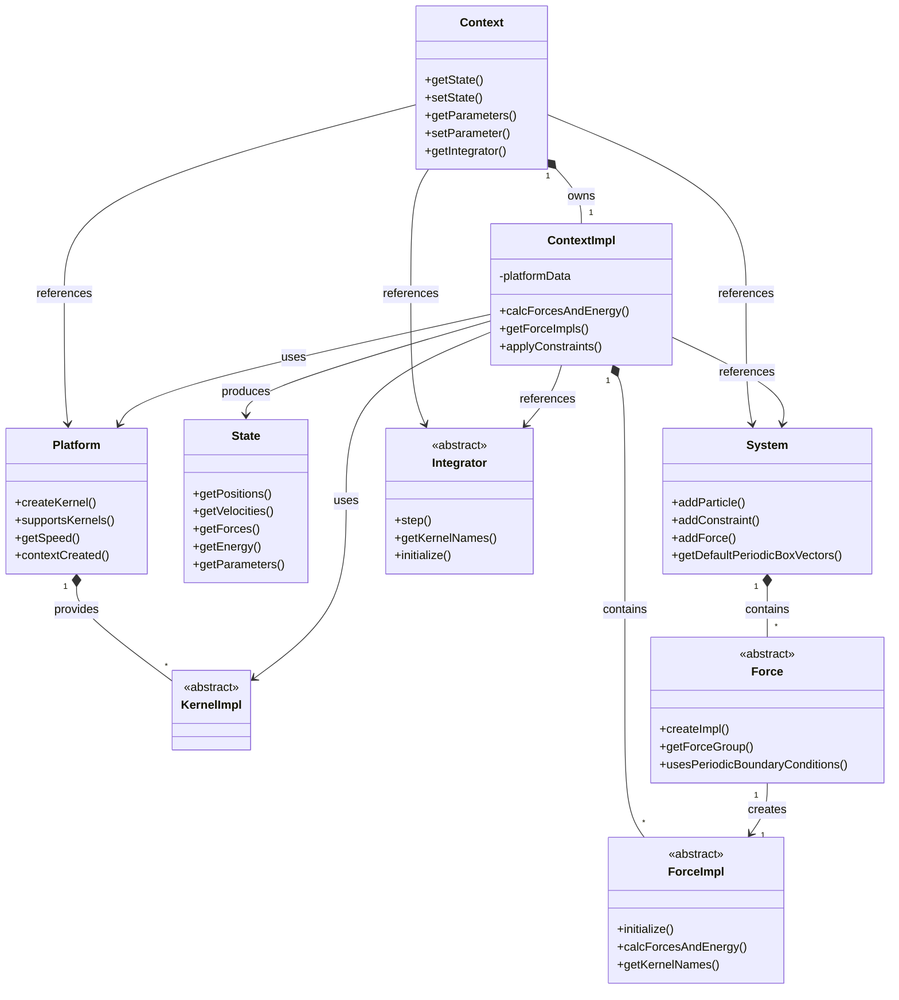
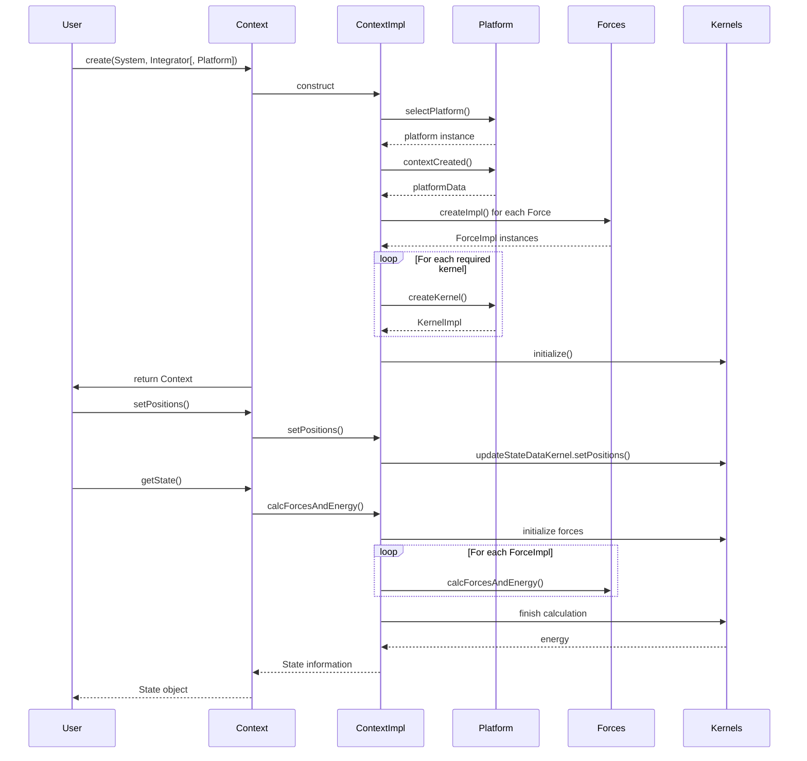
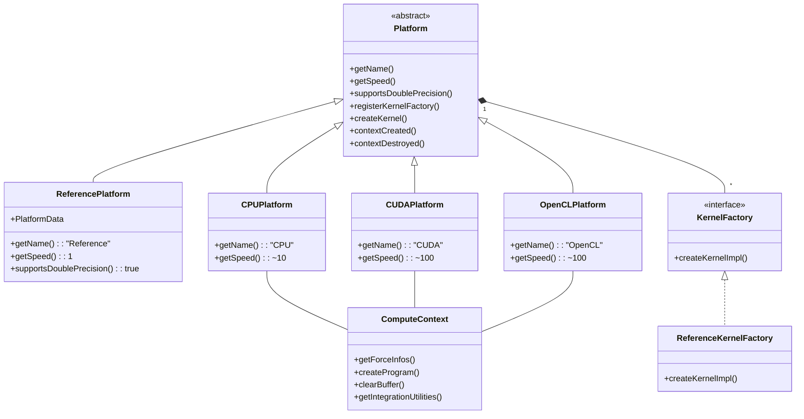
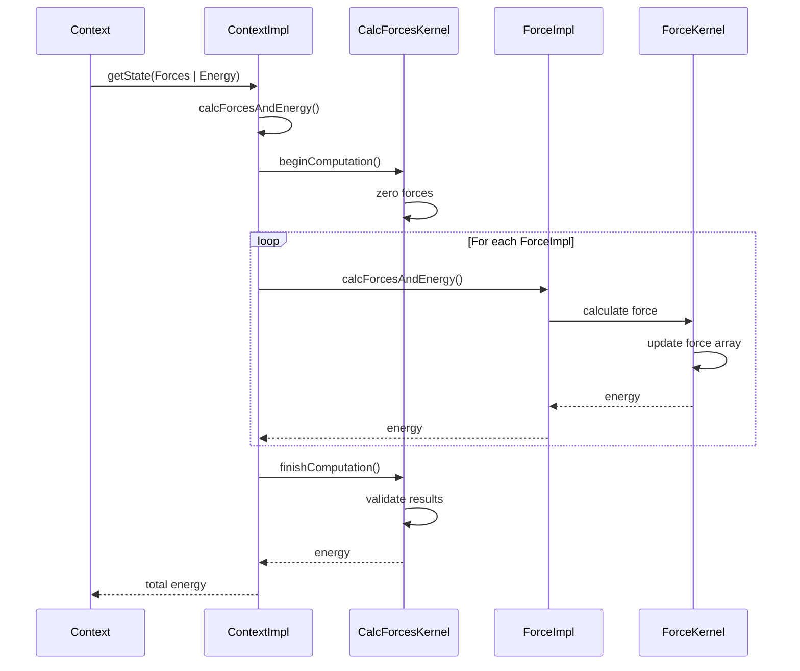
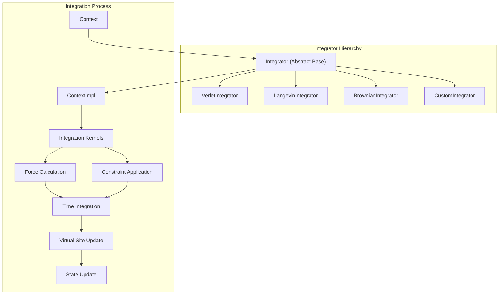
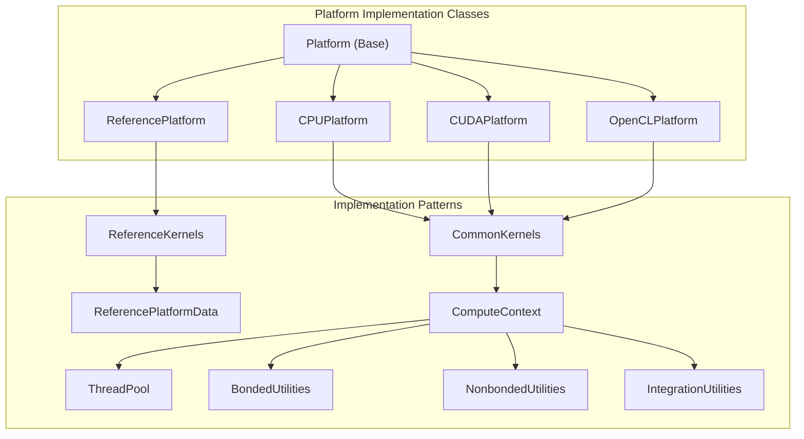

# Core Architecture

<details>
<summary>Relevant source files</summary>

The following files were used as context for generating this wiki page:

- [docs-source/api-c++/forces.rst](docs-source/api-c++/forces.rst)
- [olla/include/openmm/kernels.h](olla/include/openmm/kernels.h)
- [openmmapi/include/OpenMM.h](openmmapi/include/OpenMM.h)
- [platforms/common/include/openmm/common/CommonKernels.h](platforms/common/include/openmm/common/CommonKernels.h)
- [platforms/common/include/openmm/common/ComputeContext.h](platforms/common/include/openmm/common/ComputeContext.h)
- [platforms/common/src/CommonKernels.cpp](platforms/common/src/CommonKernels.cpp)
- [platforms/common/src/ComputeContext.cpp](platforms/common/src/ComputeContext.cpp)
- [platforms/cpu/include/CpuKernels.h](platforms/cpu/include/CpuKernels.h)
- [platforms/cpu/include/CpuNeighborList.h](platforms/cpu/include/CpuNeighborList.h)
- [platforms/cpu/include/CpuNonbondedForce.h](platforms/cpu/include/CpuNonbondedForce.h)
- [platforms/cpu/include/CpuPlatform.h](platforms/cpu/include/CpuPlatform.h)
- [platforms/cpu/src/CpuKernelFactory.cpp](platforms/cpu/src/CpuKernelFactory.cpp)
- [platforms/cpu/src/CpuKernels.cpp](platforms/cpu/src/CpuKernels.cpp)
- [platforms/cpu/src/CpuNeighborList.cpp](platforms/cpu/src/CpuNeighborList.cpp)
- [platforms/cpu/src/CpuNonbondedForce.cpp](platforms/cpu/src/CpuNonbondedForce.cpp)
- [platforms/cpu/src/CpuNonbondedForceVec4.cpp](platforms/cpu/src/CpuNonbondedForceVec4.cpp)
- [platforms/cpu/src/CpuPlatform.cpp](platforms/cpu/src/CpuPlatform.cpp)
- [platforms/cpu/tests/TestCpuNeighborList.cpp](platforms/cpu/tests/TestCpuNeighborList.cpp)
- [platforms/cuda/include/CudaContext.h](platforms/cuda/include/CudaContext.h)
- [platforms/cuda/include/CudaKernelFactory.h](platforms/cuda/include/CudaKernelFactory.h)
- [platforms/cuda/include/CudaKernels.h](platforms/cuda/include/CudaKernels.h)
- [platforms/cuda/src/CudaContext.cpp](platforms/cuda/src/CudaContext.cpp)
- [platforms/cuda/src/CudaKernelFactory.cpp](platforms/cuda/src/CudaKernelFactory.cpp)
- [platforms/cuda/src/CudaKernels.cpp](platforms/cuda/src/CudaKernels.cpp)
- [platforms/cuda/src/CudaPlatform.cpp](platforms/cuda/src/CudaPlatform.cpp)
- [platforms/opencl/include/OpenCLContext.h](platforms/opencl/include/OpenCLContext.h)
- [platforms/opencl/include/OpenCLKernels.h](platforms/opencl/include/OpenCLKernels.h)
- [platforms/opencl/src/OpenCLContext.cpp](platforms/opencl/src/OpenCLContext.cpp)
- [platforms/opencl/src/OpenCLKernelFactory.cpp](platforms/opencl/src/OpenCLKernelFactory.cpp)
- [platforms/opencl/src/OpenCLKernels.cpp](platforms/opencl/src/OpenCLKernels.cpp)
- [platforms/opencl/src/OpenCLPlatform.cpp](platforms/opencl/src/OpenCLPlatform.cpp)
- [platforms/reference/include/ReferenceKernels.h](platforms/reference/include/ReferenceKernels.h)
- [platforms/reference/include/ReferencePlatform.h](platforms/reference/include/ReferencePlatform.h)
- [platforms/reference/src/ReferenceKernelFactory.cpp](platforms/reference/src/ReferenceKernelFactory.cpp)
- [platforms/reference/src/ReferenceKernels.cpp](platforms/reference/src/ReferenceKernels.cpp)
- [platforms/reference/src/ReferencePlatform.cpp](platforms/reference/src/ReferencePlatform.cpp)
- [platforms/reference/src/SimTKReference/ReferenceNeighborList.cpp](platforms/reference/src/SimTKReference/ReferenceNeighborList.cpp)
- [platforms/reference/tests/TestReferenceNeighborList.cpp](platforms/reference/tests/TestReferenceNeighborList.cpp)
- [serialization/src/SerializationProxyRegistration.cpp](serialization/src/SerializationProxyRegistration.cpp)

</details>


This page describes the foundational components and architecture that power OpenMM simulations. It explains the high-level design, core API classes, and relationships between key components that make up OpenMM's internal structure. For specific information about how forces are calculated, see [Force Calculation System](#2.2), and for details on time integration, see [Integration System](#2.3).

## Core Components Overview

OpenMM's architecture is built around several key components that work together to define, manage, and execute molecular simulations. These components form a layered structure with a clear separation of concerns.



Sources:
- [openmmapi/include/openmm/Context.h]()
- [openmmapi/include/openmm/internal/ContextImpl.h]()
- [openmmapi/src/ContextImpl.cpp]()
- [openmmapi/include/openmm/State.h]()
- [openmmapi/src/Context.cpp]()

The core architecture is organized around these primary components:

1. **System**: Defines the physical model including particles, forces, and constraints
2. **Context**: Main interface for users to interact with the simulation
3. **ContextImpl**: Internal implementation that manages the actual computation
4. **Platform**: Provides hardware-specific implementations of all computation kernels
5. **Kernels**: Individual computational components implementing specific algorithms
6. **Forces**: Components that define interactions between particles
7. **Integrators**: Algorithms for advancing the simulation through time
8. **State**: Container for the current state of the simulation

## Context Lifecycle

The Context is the central object that manages a molecular simulation. It coordinates the interaction between the physical system definition, the integration algorithm, and the hardware platform.



Sources:
- [openmmapi/src/Context.cpp:43-71]()
- [openmmapi/src/ContextImpl.cpp:56-164]()
- [openmmapi/src/ContextImpl.cpp:302-317]()

When a Context is created:

1. The constructor determines which Platform to use, either explicitly specified or chosen automatically based on available hardware and required kernels.
2. It creates a ContextImpl object that will handle the actual computation.
3. The ContextImpl initializes:
   - Creates ForceImpl objects for each Force in the System
   - Creates kernel implementations for all required kernels
   - Sets up initial state (default particle positions, velocities, etc.)
4. Once initialization is complete, the Context can be used to:
   - Set particle positions and velocities
   - Calculate forces and energies
   - Step the simulation forward using the Integrator
   - Retrieve the current State of the simulation

## Kernel-Based Architecture

OpenMM uses a kernel-based architecture to support multiple platforms (CPU, CUDA, OpenCL, etc.) while maintaining a single public API. Each platform provides implementations of various kernels that perform specific computational tasks.

```mermaid
graph TD
    subgraph "Kernel Hierarchy"
        KernelImpl["KernelImpl (Abstract Base)"]
        
        CalcForcesKernel["CalcForcesAndEnergyKernel"] --> KernelImpl
        UpdateStateKernel["UpdateStateDataKernel"] --> KernelImpl
        ConstraintsKernel["ApplyConstraintsKernel"] --> KernelImpl
        VirtualSitesKernel["VirtualSitesKernel"] --> KernelImpl
        
        ForceKernels["Force-Specific Kernels"] --> KernelImpl
        IntegratorKernels["Integrator Kernels"] --> KernelImpl
    end
    
    subgraph "Platform Implementations"
        CudaKernels["CUDA Kernels"]
        OpenCLKernels["OpenCL Kernels"] 
        ReferenceKernels["Reference Kernels"]
        CPUKernels["CPU Kernels"]
    end
    
    subgraph "Kernel Registry"
        Platform["Platform Class"]
        KernelFactory["KernelFactory Interface"]
        PlatformData["Platform-Specific Data"]
    end
    
    Platform -- KernelFactory
    KernelFactory --> ReferenceKernels
    KernelFactory --> CudaKernels
    KernelFactory --> OpenCLKernels
    KernelFactory --> CPUKernels
    
    CalcForcesKernel -.-> ReferenceKernels
    UpdateStateKernel -.-> ReferenceKernels
    ConstraintsKernel -.-> ReferenceKernels
    
    CalcForcesKernel -.-> CudaKernels
    UpdateStateKernel -.-> CudaKernels
    ConstraintsKernel -.-> CudaKernels
    
    Platform -- PlatformData
```

Sources:
- [olla/include/openmm/kernels.h:83-130]()
- [olla/include/openmm/kernels.h:127-238]()
- [platforms/reference/src/ReferenceKernelFactory.cpp:39-116]()
- [platforms/reference/include/ReferenceKernels.h:78-116]()

Key aspects of the kernel architecture:

1. **Kernel Interface**: Each computational task is defined by a kernel interface, which declares the methods required for that task.

2. **Platform Independence**: The kernel interfaces are platform-independent, allowing the same high-level code to run on any supported hardware.

3. **Core Kernels**: The most important kernels include:
   - `CalcForcesAndEnergyKernel`: Coordinates force calculation and energy summation
   - `UpdateStateDataKernel`: Manages access to state data (positions, velocities, etc.)
   - `ApplyConstraintsKernel`: Implements constraint algorithms
   - `VirtualSitesKernel`: Handles virtual site calculations

4. **Force-Specific Kernels**: Each Force type has one or more corresponding kernels that implement its specific calculations.

5. **Kernel Registration**: Platforms register kernel factories during initialization, which are used to create the appropriate implementation of each required kernel.

## Platform System

Platforms in OpenMM encapsulate hardware-specific implementations of computational kernels. The Platform class serves as a factory for creating kernel implementations tailored to specific hardware.



Sources:
- [platforms/reference/src/ReferencePlatform.cpp:42-81]()
- [platforms/reference/src/ReferenceKernelFactory.cpp:39-116]()
- [platforms/common/include/openmm/common/ComputeContext.h:63-183]()

Key aspects of the platform system:

1. **Platform Base Class**: The abstract `Platform` class defines the interface for platform-specific implementations.

2. **Platform Registry**: OpenMM maintains a registry of available platforms, allowing it to select the appropriate one based on hardware availability and performance.

3. **Platform Selection**: When creating a Context, OpenMM selects a platform either:
   - Explicitly specified by the user
   - Automatically chosen based on available hardware and required kernels
   - Determined by the `OPENMM_DEFAULT_PLATFORM` environment variable

4. **PlatformData**: Each platform implementation creates platform-specific data structures when a context is created, which are used by kernel implementations.

5. **Kernel Creation**: Platforms use registered KernelFactories to create implementations of required kernels.

6. **Reference Platform**: Serves as the reference implementation for all kernels, focusing on correctness rather than performance.

7. **GPU Platforms**: CUDA and OpenCL platforms share much of their implementation through the ComputeContext class, which provides utilities for managing GPU resources.

## State Management

The State object captures a snapshot of the simulation at a point in time. It can include various types of data, such as positions, velocities, forces, and energies.

```mermaid
classDiagram
    class State {
        -time: double
        -stepCount: long long
        -positions: vector~Vec3~
        -velocities: vector~Vec3~
        -forces: vector~Vec3~
        -energies: {kinetic, potential}
        -parameters: map~string,double~
        -periodicBoxVectors: Vec3[3]
        -dataTypes: int
        
        +getTime()
        +getStepCount()
        +getPositions()
        +getVelocities()
        +getForces()
        +getKineticEnergy()
        +getPotentialEnergy()
        +getParameters()
        +getPeriodicBoxVectors()
    }
    
    class DataType {
        <<enumeration>>
        Positions
        Velocities
        Forces
        Energy
        Parameters
        ParameterDerivatives
        IntegratorParameters
    }
    
    class StateBuilder {
        +setPositions()
        +setVelocities()
        +setForces()
        +setEnergy()
        +setParameters()
        +setEnergyParameterDerivatives()
        +getState()
    }
    
    class Context {
        +getState()
        +setState()
    }
    
    class UpdateStateDataKernel {
        +getPositions()
        +getVelocities()
        +getForces()
        +getEnergyParameterDerivatives()
        +getTime()
        +getPeriodicBoxVectors()
    }
    
    State -- DataType
    State <|.. StateBuilder : creates
    Context --> State : produces
    Context --> UpdateStateDataKernel : uses
    UpdateStateDataKernel --> State : populates
```

Sources:
- [openmmapi/include/openmm/State.h:55-87]()
- [openmmapi/src/State.cpp:38-84]()
- [openmmapi/src/Context.cpp:89-154]()
- [platforms/reference/src/ReferenceKernels.cpp:210-246]()
- [platforms/common/src/CommonKernels.cpp:60-298]()

State management involves:

1. **State Creation**: When Context.getState() is called, the Context uses kernel implementations to gather the requested data (positions, velocities, forces, energies, etc.).

2. **Data Types**: The State.DataType enumeration allows specifying which types of data to include in a State object.

3. **State Builder Pattern**: The StateBuilder class implements a builder pattern to construct State objects with the requested data.

4. **Cross-Platform Support**: Each platform's UpdateStateDataKernel implementation provides methods to get and set state data.

5. **Force Calculation**: When forces or energies are requested, the Context triggers a force calculation using calcForcesAndEnergy().

6. **State Serialization**: State objects can be serialized for checkpoint/restart purposes or for analysis.

## Force Calculation Process

Force calculation is a central part of every molecular simulation. OpenMM uses a modular approach where each Force object has a corresponding ForceImpl that handles the actual calculation.



Sources:
- [openmmapi/src/ContextImpl.cpp:302-317]()
- [platforms/reference/src/ReferenceKernels.cpp:160-185]() 
- [platforms/common/src/CommonKernels.cpp:60-298]()

The force calculation process includes:

1. **Initialization**: The `CalcForcesAndEnergyKernel` initializes the calculation by clearing force arrays.

2. **Force Calculation**: Each `ForceImpl` calculates its contribution to the forces and energy.

3. **Force Types**: OpenMM supports various force types:
   - Bonded forces (bonds, angles, torsions)
   - Nonbonded forces (electrostatics, van der Waals)
   - Custom forces for specialized interactions

4. **Force Groups**: Forces can be organized into groups, allowing selective inclusion in calculations.

5. **Energy Summation**: The total energy is calculated by summing contributions from all active force components.

6. **Multithreading**: Platforms may implement parallel force calculations for better performance.

7. **Cutoffs and Periodic Boundary Conditions**: Platforms handle various optimizations for long-range interactions.

## Integration Process

Integration advances the simulation through time. Different integrators implement various algorithms for numerical integration of the equations of motion.



Sources:
- [openmmapi/src/ContextImpl.cpp:302-317]()
- [olla/include/openmm/kernels.h:650-705]()
- [platforms/reference/src/ReferenceKernels.cpp:160-185]()

The integration process includes:

1. **Time Step Execution**: When the Integrator.step() method is called, it delegates to platform-specific kernel implementations.

2. **Force Calculation**: The integrator requests force calculations via ContextImpl.calcForcesAndEnergy().

3. **State Update**: Kernels update positions and velocities according to the integration algorithm.

4. **Constraint Application**: After updating positions, constraints are applied to maintain fixed bond lengths or angles.

5. **Virtual Site Update**: Positions of virtual sites are recalculated based on the new positions of real particles.

6. **Multiple Algorithms**: OpenMM provides several built-in integrators and allows custom algorithm implementation through CustomIntegrator.

## Platform-Specific Implementation Details

While the kernel interfaces are platform-independent, their implementations are specific to each platform. This section highlights the significant differences between platforms.



Sources:
- [platforms/reference/include/ReferencePlatform.h:49-78]()
- [platforms/reference/src/ReferencePlatform.cpp:100-120]()
- [platforms/common/include/openmm/common/ComputeContext.h:63-183]()
- [platforms/common/src/ComputeContext.cpp:47-193]()

Key platform implementation details:

1. **Reference Platform**: 
   - Straightforward C++ implementations focused on correctness
   - No performance optimizations
   - Serves as the gold standard for validating other platforms

2. **GPU Platforms (CUDA and OpenCL)**:
   - Share common code through ComputeContext class
   - Implement specialized kernels for GPU execution
   - Use ComputeProgram and ComputeKernel abstractions to handle platform-specific compilation
   - Employ various optimizations:
     - Specialized data structures for efficient memory access
     - Work division for parallel execution
     - Memory layout optimizations for coalesced access

3. **CPU Platform**:
   - Optimized for multi-core CPU execution
   - Uses SIMD instructions where available
   - Shares some code with GPU platforms via CommonKernels

4. **PlatformData**:
   - Each platform maintains context-specific data
   - Reference platform uses simple C++ data structures
   - GPU platforms maintain device memory buffers and kernel objects

## Conclusion

OpenMM's core architecture is designed to provide a flexible, extensible framework for molecular simulation that can efficiently utilize diverse hardware platforms. The key design principles include:

1. **Separation of Interface and Implementation**: The public API is platform-independent, while implementations are platform-specific.

2. **Modular Design**: Functionality is divided into independent components that can be combined as needed.

3. **Extensibility**: The system can be extended with new forces, integrators, and platforms.

4. **Performance Optimization**: Platform-specific implementations allow for hardware-specific optimizations.

This architecture enables OpenMM to provide both a user-friendly API for application developers and high-performance implementations for computational efficiency.

Sources:
- [openmmapi/include/OpenMM.h:1-87]()
- [openmmapi/src/ContextImpl.cpp:56-164]()
- [openmmapi/src/Context.cpp:43-71]()

---