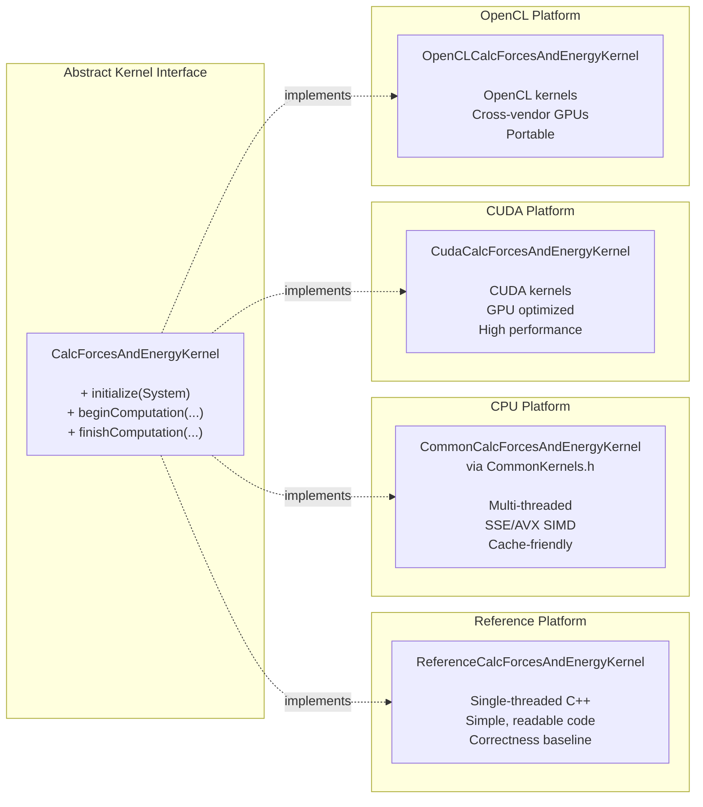
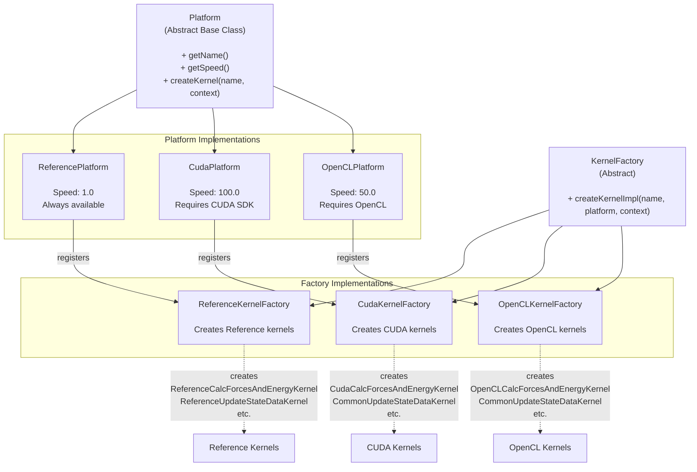
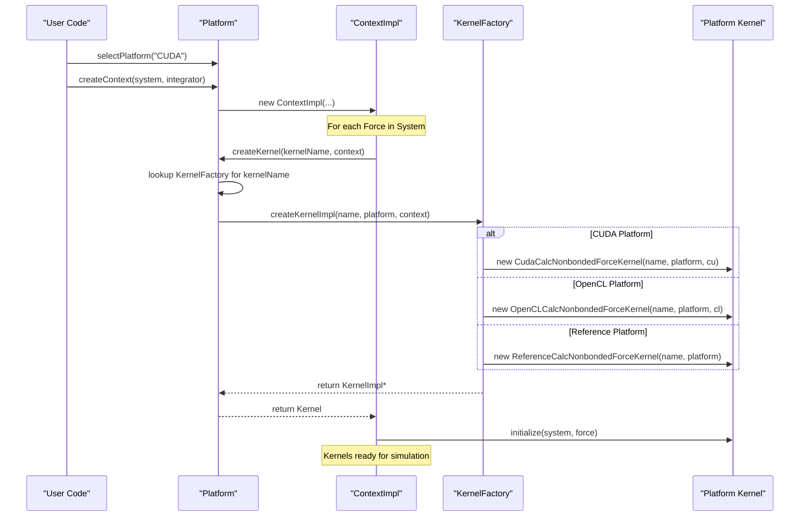
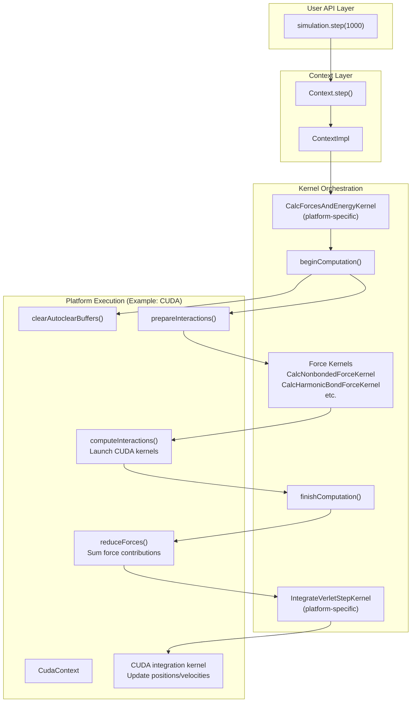
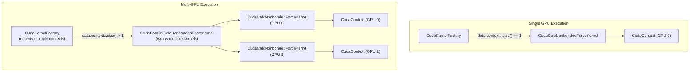
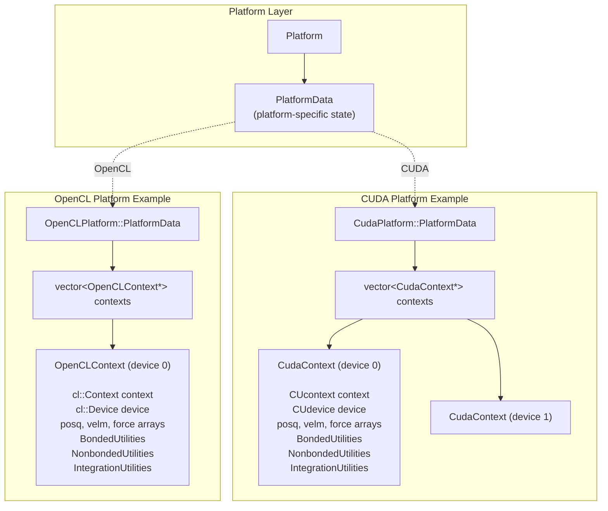

# Platform Abstraction and Kernel Pattern

<details>
<summary>Relevant source files</summary>

The following files were used as context for generating this wiki page:

- [docs-source/api-c++/forces.rst](docs-source/api-c++/forces.rst)
- [olla/include/openmm/kernels.h](olla/include/openmm/kernels.h)
- [openmmapi/include/OpenMM.h](openmmapi/include/OpenMM.h)
- [platforms/common/include/openmm/common/CommonKernels.h](platforms/common/include/openmm/common/CommonKernels.h)
- [platforms/common/include/openmm/common/ComputeContext.h](platforms/common/include/openmm/common/ComputeContext.h)
- [platforms/common/src/CommonKernels.cpp](platforms/common/src/CommonKernels.cpp)
- [platforms/common/src/ComputeContext.cpp](platforms/common/src/ComputeContext.cpp)
- [platforms/cuda/include/CudaContext.h](platforms/cuda/include/CudaContext.h)
- [platforms/cuda/include/CudaKernelFactory.h](platforms/cuda/include/CudaKernelFactory.h)
- [platforms/cuda/include/CudaKernels.h](platforms/cuda/include/CudaKernels.h)
- [platforms/cuda/src/CudaContext.cpp](platforms/cuda/src/CudaContext.cpp)
- [platforms/cuda/src/CudaKernelFactory.cpp](platforms/cuda/src/CudaKernelFactory.cpp)
- [platforms/cuda/src/CudaKernels.cpp](platforms/cuda/src/CudaKernels.cpp)
- [platforms/cuda/src/CudaPlatform.cpp](platforms/cuda/src/CudaPlatform.cpp)
- [platforms/opencl/include/OpenCLContext.h](platforms/opencl/include/OpenCLContext.h)
- [platforms/opencl/include/OpenCLKernels.h](platforms/opencl/include/OpenCLKernels.h)
- [platforms/opencl/src/OpenCLContext.cpp](platforms/opencl/src/OpenCLContext.cpp)
- [platforms/opencl/src/OpenCLKernelFactory.cpp](platforms/opencl/src/OpenCLKernelFactory.cpp)
- [platforms/opencl/src/OpenCLKernels.cpp](platforms/opencl/src/OpenCLKernels.cpp)
- [platforms/opencl/src/OpenCLPlatform.cpp](platforms/opencl/src/OpenCLPlatform.cpp)
- [platforms/reference/include/ReferenceKernels.h](platforms/reference/include/ReferenceKernels.h)
- [platforms/reference/src/ReferenceKernelFactory.cpp](platforms/reference/src/ReferenceKernelFactory.cpp)
- [platforms/reference/src/ReferenceKernels.cpp](platforms/reference/src/ReferenceKernels.cpp)
- [platforms/reference/src/ReferencePlatform.cpp](platforms/reference/src/ReferencePlatform.cpp)
- [serialization/src/SerializationProxyRegistration.cpp](serialization/src/SerializationProxyRegistration.cpp)

</details>


## Purpose and Scope

This page describes OpenMM's platform abstraction layer and the kernel pattern that enables runtime selection of optimized implementations for different hardware backends. This architectural pattern allows the same high-level simulation code to execute on CPUs, NVIDIA GPUs (CUDA), AMD GPUs (OpenCL/HIP), or other platforms without modification. 

For information about specific platform implementations and their optimizations, see [Platform Implementations](#3). For details on how forces are calculated across platforms, see [Force Calculation Pipeline](#2.3).

## Core Abstraction Pattern

OpenMM separates the **what** (high-level simulation operations) from the **how** (platform-specific implementations) through a three-layer pattern:

1. **Kernel Interfaces** (`KernelImpl` subclasses) - Define abstract operations like force calculation, state updates, and integration
2. **Platform Classes** - Register and manage available hardware backends (Reference, CPU, CUDA, OpenCL, HIP)
3. **Kernel Factories** - Create platform-specific kernel implementations at runtime

This pattern enables:
- **Hardware portability**: Same API works across all platforms
- **Runtime selection**: Platform chosen when creating a `Context`, not at compile time
- **Extensibility**: New platforms and forces added without modifying core code
- **Performance**: Each platform provides optimized implementations

Sources: [openmmapi/include/openmm/kernels.h:82-125](), [platforms/cuda/include/CudaKernels.h:46-83](), [platforms/opencl/include/OpenCLKernels.h:46-83]()

## Kernel Interface Hierarchy

```mermaid
graph TB
    KernelImpl["KernelImpl<br/>(Abstract Base)"]
    
    subgraph "Core Simulation Kernels"
        CalcForcesKernel["CalcForcesAndEnergyKernel<br/>beginComputation()<br/>finishComputation()"]
        UpdateStateKernel["UpdateStateDataKernel<br/>getPositions()<br/>setPositions()<br/>getForces()"]
        ApplyConstraintsKernel["ApplyConstraintsKernel<br/>apply()<br/>applyToVelocities()"]
        VirtualSitesKernel["VirtualSitesKernel<br/>computePositions()"]
    end
    
    subgraph "Force Calculation Kernels"
        HarmonicBondKernel["CalcHarmonicBondForceKernel<br/>initialize()<br/>execute()"]
        NonbondedKernel["CalcNonbondedForceKernel<br/>initialize()<br/>execute()"]
        CustomBondKernel["CalcCustomBondForceKernel"]
        OtherForceKernels["50+ other force kernels..."]
    end
    
    subgraph "Integration Kernels"
        VerletKernel["IntegrateVerletStepKernel<br/>execute()"]
        LangevinKernel["IntegrateLangevinMiddleStepKernel<br/>execute()"]
        CustomIntegratorKernel["IntegrateCustomStepKernel"]
    end
    
    KernelImpl --> CalcForcesKernel
    KernelImpl --> UpdateStateKernel
    KernelImpl --> ApplyConstraintsKernel
    KernelImpl --> VirtualSitesKernel
    KernelImpl --> HarmonicBondKernel
    KernelImpl --> NonbondedKernel
    KernelImpl --> CustomBondKernel
    KernelImpl --> OtherForceKernels
    KernelImpl --> VerletKernel
    KernelImpl --> LangevinKernel
    KernelImpl --> CustomIntegratorKernel
```



**Key Kernel Categories**

| Kernel Type | Purpose | Key Methods | Examples |
|------------|---------|-------------|----------|
| **Core Simulation** | Orchestrate force/energy computation lifecycle | `beginComputation()`, `finishComputation()` | `CalcForcesAndEnergyKernel` |
| **State Management** | Get/set particle positions, velocities, forces | `getPositions()`, `setVelocities()`, `getForces()` | `UpdateStateDataKernel` |
| **Force Calculation** | Compute forces and energies for specific force types | `initialize()`, `execute()` | `CalcNonbondedForceKernel`, `CalcHarmonicBondForceKernel` |
| **Integration** | Advance simulation time by updating positions/velocities | `execute()`, `computeKineticEnergy()` | `IntegrateVerletStepKernel` |
| **Constraints** | Apply distance constraints (SHAKE/SETTLE) | `apply()`, `applyToVelocities()` | `ApplyConstraintsKernel` |

Each kernel interface is an abstract class defining pure virtual methods. Platform-specific implementations override these methods with optimized code.

Sources: [openmmapi/include/openmm/kernels.h:87-1068](), [platforms/reference/include/ReferenceKernels.h:73-115]()

## Platform-Specific Implementations



**Implementation Characteristics by Platform**

| Platform | Kernel Implementation Base | Context Type | Typical Speedup | Use Case |
|----------|---------------------------|--------------|-----------------|----------|
| **Reference** | `ReferenceCalcForcesAndEnergyKernel` | N/A (CPU only) | 1x (baseline) | Debugging, validation |
| **CPU** | `CommonKernels.h` (shared with GPU) | `ComputeContext` | 4-8x | Multi-core CPUs |
| **CUDA** | `CudaCalcForcesAndEnergyKernel` | `CudaContext` | 50-200x | NVIDIA GPUs |
| **OpenCL** | `OpenCLCalcForcesAndEnergyKernel` | `OpenCLContext` | 40-150x | AMD/Intel GPUs |

Each platform implementation:
- Inherits from the abstract kernel interface
- Receives a platform-specific context (`CudaContext`, `OpenCLContext`, etc.) that provides hardware access
- Implements the same virtual methods with platform-optimized code

Sources: [platforms/reference/include/ReferenceKernels.h:78-115](), [platforms/cuda/include/CudaKernels.h:46-83](), [platforms/opencl/include/OpenCLKernels.h:46-83](), [platforms/common/include/openmm/common/CommonKernels.h:46-160]()

## Platform and KernelFactory Architecture



**Platform Registration Process**

Each platform implementation follows this pattern:

1. **Constructor creates KernelFactory** and registers it for each kernel type
2. **Platform registered** with global `Platform` registry at startup
3. **Runtime selection** occurs when user creates a `Context`

Example from CUDA platform:

```cpp
// In CudaPlatform constructor (CudaPlatform.cpp:62-114)
CudaKernelFactory* factory = new CudaKernelFactory();
registerKernelFactory(CalcForcesAndEnergyKernel::Name(), factory);
registerKernelFactory(UpdateStateDataKernel::Name(), factory);
registerKernelFactory(CalcNonbondedForceKernel::Name(), factory);
// ... 40+ more kernel types
```

Sources: [platforms/cuda/src/CudaPlatform.cpp:62-114](), [platforms/opencl/src/OpenCLPlatform.cpp:56-119](), [platforms/reference/src/ReferencePlatform.cpp:41-86]()

## Kernel Creation Flow



**Kernel Factory Implementation Pattern**

The factory uses string-based kernel names to determine which implementation to create:

```cpp
// From CudaKernelFactory::createKernelImpl (CudaKernelFactory.cpp:43-140)
KernelImpl* CudaKernelFactory::createKernelImpl(std::string name, 
                                                 const Platform& platform, 
                                                 ContextImpl& context) const {
    CudaPlatform::PlatformData& data = *static_cast<CudaPlatform::PlatformData*>(context.getPlatformData());
    CudaContext& cu = *data.contexts[0];
    
    if (name == CalcForcesAndEnergyKernel::Name())
        return new CudaCalcForcesAndEnergyKernel(name, platform, cu);
    if (name == UpdateStateDataKernel::Name())
        return new CommonUpdateStateDataKernel(name, platform, cu);
    if (name == CalcNonbondedForceKernel::Name())
        return new CudaCalcNonbondedForceKernel(name, platform, cu, context.getSystem());
    // ... more kernel types
}
```

Note that some kernels (like `UpdateStateDataKernel`) use shared implementations from `CommonKernels.h` that work across GPU platforms.

Sources: [platforms/cuda/src/CudaKernelFactory.cpp:43-140](), [platforms/opencl/src/OpenCLKernelFactory.cpp:41-154](), [platforms/reference/src/ReferenceKernelFactory.cpp:37-148]()

## Runtime Kernel Execution Example



**Execution Flow Details**

1. **beginComputation()** ([platforms/cuda/src/CudaKernels.cpp:63-76]())
   - Clears force buffers
   - Updates global parameters
   - Prepares neighbor lists for nonbonded calculations
   - Initializes energy parameter derivative workspace

2. **Force Kernel Execution** (platform-specific)
   - Each `Force` in the `System` has a corresponding kernel
   - Kernels compute forces and add them to force buffers
   - Energy contributions accumulated

3. **finishComputation()** ([platforms/cuda/src/CudaKernels.cpp:78-91]())
   - Executes bonded force computations
   - Executes nonbonded force computations  
   - Reduces forces from multiple buffers
   - Distributes forces to virtual sites
   - Returns total potential energy

4. **Integration**
   - Integrator kernel updates positions and velocities
   - Platform-specific implementation (CUDA, OpenCL, Reference)

Sources: [platforms/cuda/src/CudaKernels.cpp:60-91](), [platforms/opencl/src/OpenCLKernels.cpp:57-87](), [platforms/reference/src/ReferenceKernels.cpp:170-192]()

## Multi-Platform Support for Parallel Execution



**Parallel Kernel Pattern**

When multiple devices are available, the kernel factory creates **parallel wrapper kernels** that coordinate work across devices:

```cpp
// From CudaKernelFactory.cpp:46-66
if (data.contexts.size() > 1) {
    // Multi-device parallel execution
    if (name == CalcForcesAndEnergyKernel::Name())
        return new CudaParallelCalcForcesAndEnergyKernel(name, platform, data);
    if (name == CalcNonbondedForceKernel::Name())
        return new CudaParallelCalcNonbondedForceKernel(name, platform, data, context.getSystem());
    // ...
}
// Single device execution
if (name == CalcForcesAndEnergyKernel::Name())
    return new CudaCalcForcesAndEnergyKernel(name, platform, cu);
```

The parallel kernel:
- Divides particles across GPUs
- Executes force calculations on each GPU in parallel
- Reduces results from all GPUs to compute total energy
- Handles inter-GPU communication for particles near device boundaries

Sources: [platforms/cuda/src/CudaKernelFactory.cpp:43-75](), [platforms/opencl/src/OpenCLKernelFactory.cpp:41-75]()

## Platform Data and Context Management



**Platform Data Responsibilities**

Each platform maintains a `PlatformData` structure that:

1. **Stores device contexts** - One or more hardware contexts (GPU devices)
2. **Tracks global state** - Time, step count, simulation parameters
3. **Manages resources** - Memory buffers, compiled kernels, thread pools
4. **Coordinates devices** - For multi-GPU execution

The platform-specific context (e.g., `CudaContext`) provides:
- Hardware access (CUDA streams, OpenCL command queues)
- Memory management (device buffers for positions, velocities, forces)
- Utility objects (`BondedUtilities`, `NonbondedUtilities`, `IntegrationUtilities`)
- Kernel compilation and caching

Sources: [platforms/cuda/include/CudaContext.h:86-400](), [platforms/opencl/include/OpenCLContext.h:86-350](), [platforms/cuda/src/CudaPlatform.cpp:217-280](), [platforms/opencl/src/OpenCLPlatform.cpp:224-281]()

## Benefits of the Kernel Pattern

**Separation of Concerns**
- High-level simulation logic (forces, integrators) independent of hardware
- Platform maintainers optimize kernels without changing simulation APIs
- New forces added once, automatically available on all platforms

**Runtime Flexibility**
- Platform selection at `Context` creation, not compile time
- Same executable runs on any available hardware
- Automatic fallback to CPU if GPU unavailable

**Performance Optimization**
- Each platform uses hardware-specific optimizations (SIMD, GPU parallelism)
- Kernel specialization for different precision modes (single, mixed, double)
- Multi-device parallelization handled transparently

**Extensibility**
- Plugin system uses same kernel pattern (see [Plugin System and Extensions](#5))
- Custom platforms can be added without modifying core code
- New kernel types registered dynamically

Sources: [openmmapi/include/openmm/kernels.h:82-125](), [platforms/common/include/openmm/common/ComputeContext.h:1-800]()

---