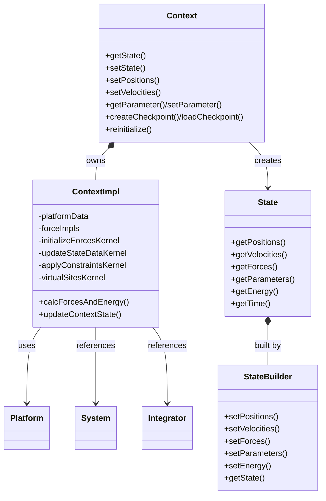
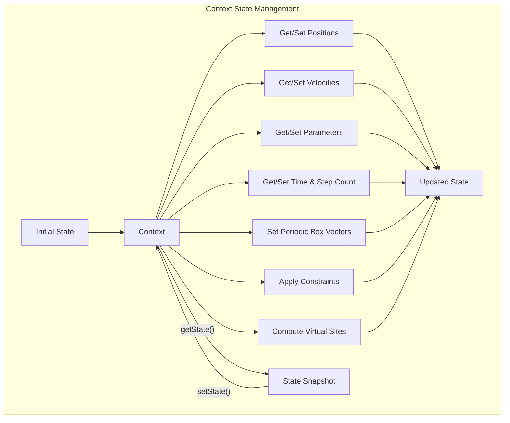
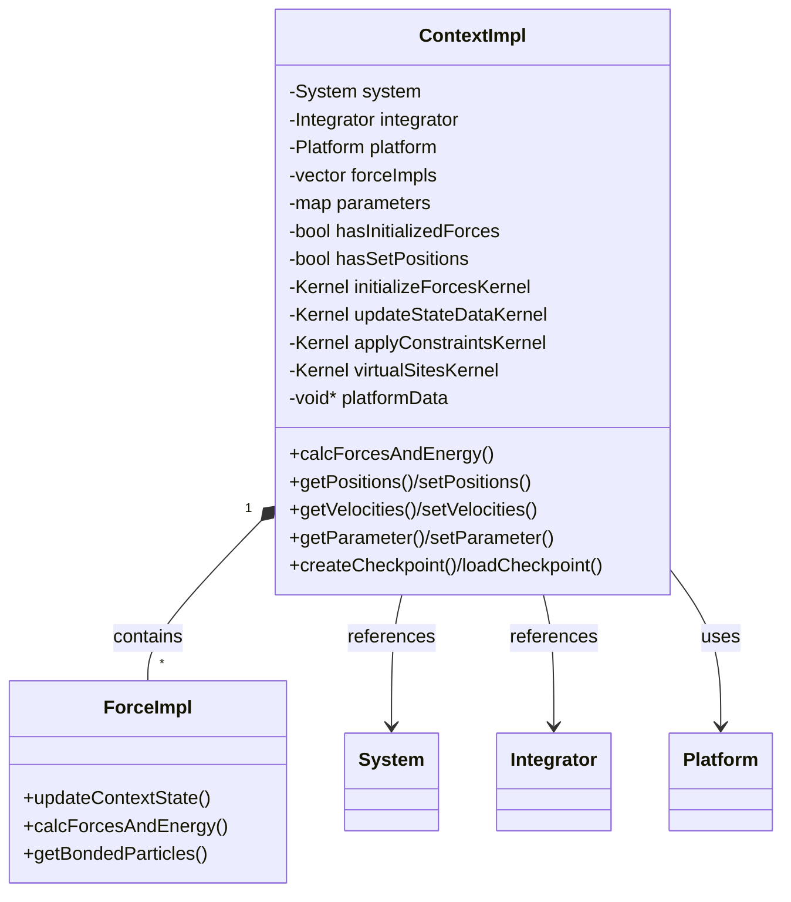
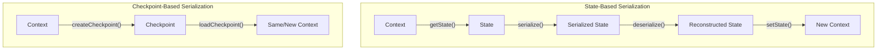

# Context and State Management

<details>
<summary>Relevant source files</summary>

The following files were used as context for generating this wiki page:

- [docs-source/api-c++/forces.rst](docs-source/api-c++/forces.rst)
- [olla/include/openmm/kernels.h](olla/include/openmm/kernels.h)
- [openmmapi/include/OpenMM.h](openmmapi/include/OpenMM.h)
- [platforms/common/include/openmm/common/CommonKernels.h](platforms/common/include/openmm/common/CommonKernels.h)
- [platforms/common/include/openmm/common/ComputeContext.h](platforms/common/include/openmm/common/ComputeContext.h)
- [platforms/common/src/CommonKernels.cpp](platforms/common/src/CommonKernels.cpp)
- [platforms/common/src/ComputeContext.cpp](platforms/common/src/ComputeContext.cpp)
- [platforms/cpu/include/CpuKernels.h](platforms/cpu/include/CpuKernels.h)
- [platforms/cpu/include/CpuNeighborList.h](platforms/cpu/include/CpuNeighborList.h)
- [platforms/cpu/include/CpuNonbondedForce.h](platforms/cpu/include/CpuNonbondedForce.h)
- [platforms/cpu/include/CpuPlatform.h](platforms/cpu/include/CpuPlatform.h)
- [platforms/cpu/src/CpuKernelFactory.cpp](platforms/cpu/src/CpuKernelFactory.cpp)
- [platforms/cpu/src/CpuKernels.cpp](platforms/cpu/src/CpuKernels.cpp)
- [platforms/cpu/src/CpuNeighborList.cpp](platforms/cpu/src/CpuNeighborList.cpp)
- [platforms/cpu/src/CpuNonbondedForce.cpp](platforms/cpu/src/CpuNonbondedForce.cpp)
- [platforms/cpu/src/CpuNonbondedForceVec4.cpp](platforms/cpu/src/CpuNonbondedForceVec4.cpp)
- [platforms/cpu/src/CpuPlatform.cpp](platforms/cpu/src/CpuPlatform.cpp)
- [platforms/cpu/tests/TestCpuNeighborList.cpp](platforms/cpu/tests/TestCpuNeighborList.cpp)
- [platforms/cuda/include/CudaContext.h](platforms/cuda/include/CudaContext.h)
- [platforms/cuda/include/CudaKernels.h](platforms/cuda/include/CudaKernels.h)
- [platforms/cuda/src/CudaContext.cpp](platforms/cuda/src/CudaContext.cpp)
- [platforms/cuda/src/CudaKernelFactory.cpp](platforms/cuda/src/CudaKernelFactory.cpp)
- [platforms/cuda/src/CudaKernels.cpp](platforms/cuda/src/CudaKernels.cpp)
- [platforms/cuda/src/CudaPlatform.cpp](platforms/cuda/src/CudaPlatform.cpp)
- [platforms/opencl/include/OpenCLContext.h](platforms/opencl/include/OpenCLContext.h)
- [platforms/opencl/include/OpenCLKernels.h](platforms/opencl/include/OpenCLKernels.h)
- [platforms/opencl/src/OpenCLContext.cpp](platforms/opencl/src/OpenCLContext.cpp)
- [platforms/opencl/src/OpenCLKernelFactory.cpp](platforms/opencl/src/OpenCLKernelFactory.cpp)
- [platforms/opencl/src/OpenCLKernels.cpp](platforms/opencl/src/OpenCLKernels.cpp)
- [platforms/opencl/src/OpenCLPlatform.cpp](platforms/opencl/src/OpenCLPlatform.cpp)
- [platforms/reference/include/ReferenceKernels.h](platforms/reference/include/ReferenceKernels.h)
- [platforms/reference/include/ReferencePlatform.h](platforms/reference/include/ReferencePlatform.h)
- [platforms/reference/src/ReferenceKernelFactory.cpp](platforms/reference/src/ReferenceKernelFactory.cpp)
- [platforms/reference/src/ReferenceKernels.cpp](platforms/reference/src/ReferenceKernels.cpp)
- [platforms/reference/src/ReferencePlatform.cpp](platforms/reference/src/ReferencePlatform.cpp)
- [platforms/reference/src/SimTKReference/ReferenceNeighborList.cpp](platforms/reference/src/SimTKReference/ReferenceNeighborList.cpp)
- [platforms/reference/tests/TestReferenceNeighborList.cpp](platforms/reference/tests/TestReferenceNeighborList.cpp)
- [serialization/src/SerializationProxyRegistration.cpp](serialization/src/SerializationProxyRegistration.cpp)

</details>


This document describes the core classes responsible for managing simulation state in OpenMM: `Context` and `State`. These classes form the central interface for controlling molecular simulations, storing simulation data, and capturing system snapshots.

## Overview

The Context and State management system handles:
- Creating and configuring simulation environments
- Storing and retrieving simulation data (positions, velocities, forces, etc.)
- Capturing snapshots of simulation state
- Serializing and deserializing simulation state for checkpointing
- Providing a hardware-agnostic interface for simulation control



Sources: [openmmapi/include/openmm/Context.h:1-302](), [openmmapi/include/openmm/internal/ContextImpl.h:1-317](), [openmmapi/include/openmm/State.h:1-179]()

## Context Class

The `Context` class is the primary interface for controlling a simulation in OpenMM. It brings together a `System` (which defines particles, forces, and constraints), an `Integrator` (which defines how to advance the simulation in time), and a `Platform` (which handles the computational implementation).

### Creating a Context

A Context can be created in several ways:

```cpp
// Create a Context using the fastest available platform
Context context(system, integrator);

// Create a Context using a specific platform
Context context(system, integrator, platform);

// Create a Context with platform-specific properties
Context context(system, integrator, platform, properties);
```

When creating a Context without specifying a platform, OpenMM selects the fastest available platform that supports all required kernels. The construction process includes validation of the system configuration, initialization of all forces, and preparation of the computational kernels.

Sources: [openmmapi/src/Context.cpp:43-65](), [openmmapi/src/ContextImpl.cpp:56-164]()

### Context State Management

The Context maintains the complete state of a simulation, including:

1. **Time tracking**: Current simulation time and step count
2. **Particle state**: Positions, velocities, and forces
3. **System configuration**: Periodic box vectors and parameters
4. **Energy**: Kinetic and potential energy



Sources: [openmmapi/src/Context.cpp:89-154](), [openmmapi/src/Context.cpp:173-246](), [openmmapi/src/ContextImpl.cpp:212-300]()

### The State Object

The `State` class captures a snapshot of a simulation at a specific point in time. When creating a State through `Context::getState()`, you specify which data types to include:

```cpp
// Get a State containing positions and velocities
State state = context.getState(State::Positions | State::Velocities);

// Get a complete State with all data
State state = context.getState(State::Positions | State::Velocities | 
                              State::Forces | State::Energy | 
                              State::Parameters | State::ParameterDerivatives |
                              State::IntegratorParameters);
```

The State object provides methods to access the requested data:

```cpp
// Access data from a State object
double time = state.getTime();
long long stepCount = state.getStepCount();
const vector<Vec3>& positions = state.getPositions();
const vector<Vec3>& velocities = state.getVelocities();
const vector<Vec3>& forces = state.getForces();
double kineticEnergy = state.getKineticEnergy();
double potentialEnergy = state.getPotentialEnergy();
const map<string, double>& parameters = state.getParameters();
```

Attempting to access data that wasn't included when creating the State will throw an exception.

Sources: [openmmapi/include/openmm/State.h:44-153](), [openmmapi/src/State.cpp:38-133]()

## Internal Implementation

### ContextImpl

The `ContextImpl` class is the internal implementation of `Context`. It handles the actual work of:
- Managing the computational kernels
- Storing simulation data
- Interacting with the Platform



A key feature of `ContextImpl` is its ability to interact with various platform implementations through a kernel-based approach. The four essential kernels are:

1. `initializeForcesKernel`: Calculates forces and energy
2. `updateStateDataKernel`: Gets/sets positions, velocities, and other state data
3. `applyConstraintsKernel`: Enforces distance constraints
4. `virtualSitesKernel`: Updates positions of virtual sites

Sources: [openmmapi/include/openmm/internal/ContextImpl.h:53-312](), [openmmapi/src/ContextImpl.cpp:167-191](), [openmmapi/src/ContextImpl.cpp:228-356]()

### Force Calculation

The `ContextImpl::calcForcesAndEnergy()` method is responsible for calculating forces and energy. It:

1. Begins force computation through the `CalcForcesAndEnergyKernel`
2. Calls `calcForcesAndEnergy()` on each `ForceImpl` to add their contributions
3. Finishes computation and returns the total energy

This method also allows for selective force group calculation through the `groups` parameter, enabling partial energy evaluations.

Sources: [openmmapi/src/ContextImpl.cpp:302-317]()

## Checkpointing and Serialization

OpenMM provides two mechanisms for saving and restoring simulation state:

1. **State-based method**: Using `setState()` and `getState()`
2. **Checkpoint-based method**: Using `createCheckpoint()` and `loadCheckpoint()`

The State-based method is more portable but less complete, while the checkpoint method is platform-specific but preserves the internal state more completely.



The checkpointing mechanism writes a complete binary representation of the simulation state, including internal platform data. This allows for exact continuation of a simulation, even preserving the state of random number generators.

Sources: [openmmapi/src/ContextImpl.cpp:458-503](), [openmmapi/src/Context.cpp:257-272](), [serialization/src/StateProxy.cpp:41-159]()

## Context Reinitialization

The `Context::reinitialize()` method allows updating a Context to reflect changes made to the System:

```cpp
// Update the Context after modifying the System
context.reinitialize();

// Preserve the current state during reinitialization
context.reinitialize(true);
```

This is an expensive operation that rebuilds the internal representation of the System. When possible, it's preferable to use the `updateParametersInContext()` method provided by most Force classes for more efficient updates.

Sources: [openmmapi/src/Context.cpp:248-264]()

## Finding Molecular Structure

The Context provides a method to identify the molecular structure of the system:

```cpp
// Get a list of particles in each molecule
const vector<vector<int>>& molecules = context.getMolecules();
```

This method identifies molecules by looking at bonds, constraints, and virtual sites. Particles connected by any of these interactions are considered part of the same molecule.

Sources: [openmmapi/src/ContextImpl.cpp:358-442]()

## Related Concepts

- For details on how forces are calculated within a Context, see [Force Calculation System](#2.2)
- For information about time integration in OpenMM, see [Integration System](#2.3)
- For platform-specific implementations, see [Platform Implementations](#3)

---