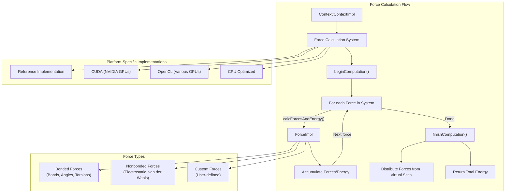
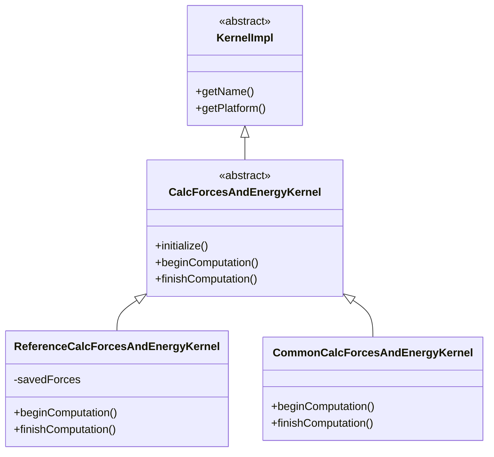
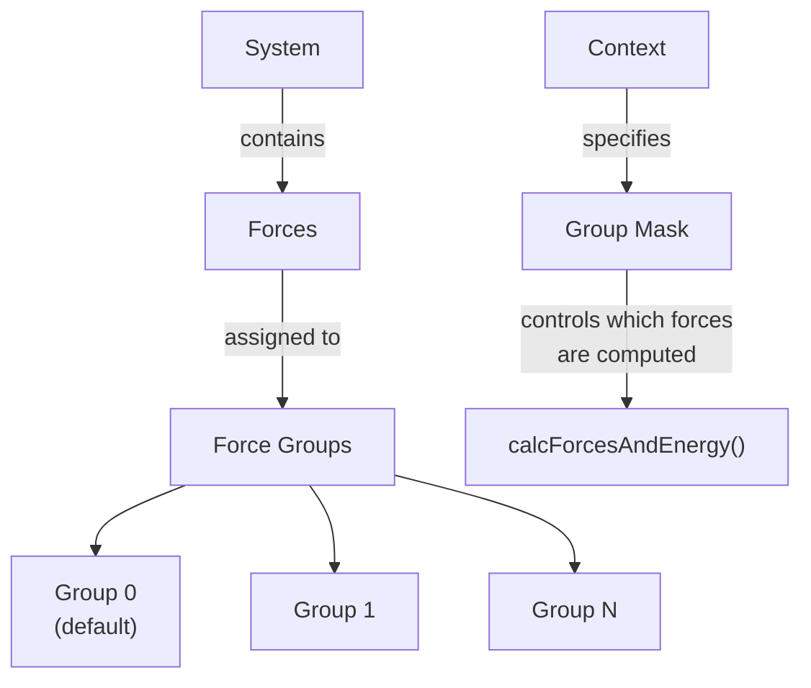
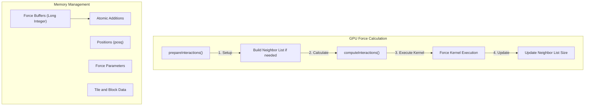

# Force Calculation System

Relevant source files

The following files were used as context for generating this wiki page:

- [docs-source/api-c++/forces.rst](docs-source/api-c++/forces.rst)
- [olla/include/openmm/kernels.h](olla/include/openmm/kernels.h)
- [openmmapi/include/OpenMM.h](openmmapi/include/OpenMM.h)
- [platforms/common/include/openmm/common/CommonKernels.h](platforms/common/include/openmm/common/CommonKernels.h)
- [platforms/common/include/openmm/common/ComputeContext.h](platforms/common/include/openmm/common/ComputeContext.h)
- [platforms/common/src/CommonKernels.cpp](platforms/common/src/CommonKernels.cpp)
- [platforms/common/src/ComputeContext.cpp](platforms/common/src/ComputeContext.cpp)
- [platforms/cpu/include/CpuKernels.h](platforms/cpu/include/CpuKernels.h)
- [platforms/cpu/include/CpuNeighborList.h](platforms/cpu/include/CpuNeighborList.h)
- [platforms/cpu/include/CpuNonbondedForce.h](platforms/cpu/include/CpuNonbondedForce.h)
- [platforms/cpu/include/CpuPlatform.h](platforms/cpu/include/CpuPlatform.h)
- [platforms/cpu/src/CpuKernelFactory.cpp](platforms/cpu/src/CpuKernelFactory.cpp)
- [platforms/cpu/src/CpuKernels.cpp](platforms/cpu/src/CpuKernels.cpp)
- [platforms/cpu/src/CpuNeighborList.cpp](platforms/cpu/src/CpuNeighborList.cpp)
- [platforms/cpu/src/CpuNonbondedForce.cpp](platforms/cpu/src/CpuNonbondedForce.cpp)
- [platforms/cpu/src/CpuNonbondedForceVec4.cpp](platforms/cpu/src/CpuNonbondedForceVec4.cpp)
- [platforms/cpu/src/CpuPlatform.cpp](platforms/cpu/src/CpuPlatform.cpp)
- [platforms/cpu/tests/TestCpuNeighborList.cpp](platforms/cpu/tests/TestCpuNeighborList.cpp)
- [platforms/cuda/include/CudaContext.h](platforms/cuda/include/CudaContext.h)
- [platforms/cuda/include/CudaKernels.h](platforms/cuda/include/CudaKernels.h)
- [platforms/cuda/src/CudaContext.cpp](platforms/cuda/src/CudaContext.cpp)
- [platforms/cuda/src/CudaKernelFactory.cpp](platforms/cuda/src/CudaKernelFactory.cpp)
- [platforms/cuda/src/CudaKernels.cpp](platforms/cuda/src/CudaKernels.cpp)
- [platforms/cuda/src/CudaPlatform.cpp](platforms/cuda/src/CudaPlatform.cpp)
- [platforms/opencl/include/OpenCLContext.h](platforms/opencl/include/OpenCLContext.h)
- [platforms/opencl/include/OpenCLKernels.h](platforms/opencl/include/OpenCLKernels.h)
- [platforms/opencl/src/OpenCLContext.cpp](platforms/opencl/src/OpenCLContext.cpp)
- [platforms/opencl/src/OpenCLKernelFactory.cpp](platforms/opencl/src/OpenCLKernelFactory.cpp)
- [platforms/opencl/src/OpenCLKernels.cpp](platforms/opencl/src/OpenCLKernels.cpp)
- [platforms/opencl/src/OpenCLPlatform.cpp](platforms/opencl/src/OpenCLPlatform.cpp)
- [platforms/reference/include/ReferenceKernels.h](platforms/reference/include/ReferenceKernels.h)
- [platforms/reference/include/ReferencePlatform.h](platforms/reference/include/ReferencePlatform.h)
- [platforms/reference/src/ReferenceKernelFactory.cpp](platforms/reference/src/ReferenceKernelFactory.cpp)
- [platforms/reference/src/ReferenceKernels.cpp](platforms/reference/src/ReferenceKernels.cpp)
- [platforms/reference/src/ReferencePlatform.cpp](platforms/reference/src/ReferencePlatform.cpp)
- [platforms/reference/src/SimTKReference/ReferenceNeighborList.cpp](platforms/reference/src/SimTKReference/ReferenceNeighborList.cpp)
- [platforms/reference/tests/TestReferenceNeighborList.cpp](platforms/reference/tests/TestReferenceNeighborList.cpp)
- [serialization/src/SerializationProxyRegistration.cpp](serialization/src/SerializationProxyRegistration.cpp)

This document describes how forces are calculated within OpenMM, covering the architecture, components, and optimization techniques used to efficiently compute forces and energies in molecular simulations. The Force Calculation System is responsible for coordinating all individual force contributions into a consistent framework that scales across different hardware platforms.

For information about integrating and advancing the simulation state forward in time using these forces, see [Integration System](#2.3).

## Core Architecture

The force calculation system in OpenMM is built around a flexible architecture that manages the computation and accumulation of all forces acting on particles in the simulation.

Sources: [olla/include/openmm/kernels.h:82-121](), [platforms/reference/src/ReferenceKernels.cpp:160-185]()

The `CalcForcesAndEnergyKernel` is the central component that coordinates force calculations:

1. **Initialization (beginComputation)**: Zero out forces and energy parameter derivatives
2. **Force Calculation**: Each force type computes its contribution
3. **Finalization (finishComputation)**: Process virtual sites and return total energy

## Kernel-Based Design

OpenMM uses a kernel-based architecture to abstract platform-specific implementations of force calculations. The kernel interface is defined in the base `KernelImpl` class, with platform-specific implementations provided by different platforms.

Sources: [olla/include/openmm/kernels.h:82-121](), [platforms/reference/include/ReferenceKernels.h:73-115](), [platforms/common/include/openmm/common/CommonKernels.h:42-157]()

## Force Groups and Selective Computation

OpenMM allows forces to be organized into groups, which can be selectively included or excluded during force calculation. This provides flexibility for implementing techniques like multiple time-step integration.

Sources: [platforms/opencl/src/OpenCLNonbondedUtilities.cpp:100-125](), [platforms/cuda/src/CudaNonbondedUtilities.cpp:92-112]()

## Nonbonded Force Optimization

Nonbonded forces typically dominate computational cost in molecular simulations. OpenMM implements several optimizations to accelerate these calculations:

Sources: [platforms/opencl/src/OpenCLNonbondedUtilities.cpp:345-411](), [platforms/cuda/src/CudaNonbondedUtilities.cpp:386-456](), [platforms/opencl/src/kernels/findInteractingBlocks.cl:6-151](), [platforms/cuda/src/kernels/findInteractingBlocks.cu:40-185]()

### Spatial Decomposition

Atoms are organized into blocks (typically 32 atoms each) for efficient calculation. Key components:

1. **Blocks**: Groups of TILE_SIZE (usually 32) atoms
2. **Tiles**: Pairs of blocks that may interact with each other
3. **Bounding Boxes**: Spatial bounds for blocks to quickly determine interaction potential 

### Neighbor List Construction

For simulations using a cutoff distance, a neighbor list accelerates computation by storing only potentially interacting atom groups:

1. **Find Block Bounds**: Determine the bounding box for each atom block
2. **Sort Blocks**: Sort blocks by size for improved cache efficiency
3. **Find Interacting Blocks**: Identify pairs of blocks that may have atoms within the cutoff
4. **Build Interaction List**: Create a list of interacting tiles and atoms

Sources: [platforms/opencl/src/kernels/findInteractingBlocks.cl:6-68](), [platforms/opencl/src/kernels/findInteractingBlocks.cl:70-151](), [platforms/cuda/src/kernels/findInteractingBlocks.cu:41-102]()

### Tile-Based Computation

The force calculation is performed on tiles (pairs of atom blocks) with special handling for:

1. **Diagonal Tiles**: Where both blocks are the same (requires special handling to avoid double-counting)
2. **Exclusion Tiles**: Tiles containing atom pairs that should be excluded from nonbonded interactions
3. **Interacting Tiles**: Tiles where atoms are within the cutoff distance

Sources: [platforms/opencl/src/kernels/nonbonded.cl:16-26](), [platforms/cuda/src/kernels/nonbonded.cu:104-113](), [platforms/opencl/src/kernels/nonbonded_cpu.cl:12-21]()

## Force Implementation Examples

Each force type in OpenMM is implemented as a subclass of the `Force` class with a corresponding `ForceImpl` and calculation kernel:

| Force Type | Implementation | Kernel | Description |
|------------|----------------|--------|-------------|
| HarmonicBondForce | ReferenceHarmonicBondIxn | ReferenceCalcHarmonicBondForceKernel | Computes forces from harmonic bonds |
| HarmonicAngleForce | ReferenceAngleBondIxn | ReferenceCalcHarmonicAngleForceKernel | Computes forces from harmonic angles |
| PeriodicTorsionForce | ReferenceProperDihedralBond | ReferenceCalcPeriodicTorsionForceKernel | Computes forces from periodic torsions |
| NonbondedForce | ReferenceLJCoulombIxn | ReferenceCalcNonbondedForceKernel | Computes forces from nonbonded interactions |
| CustomForce | Custom expression-based | (Varies) | Computes forces from user-defined expressions |

Sources: [platforms/reference/src/ReferenceKernels.cpp:366-392](), [platforms/reference/src/ReferenceKernels.cpp:496-523](), [platforms/reference/src/ReferenceKernels.cpp:626-654](), [platforms/common/src/CommonKernels.cpp:458-515]()

## Implementation Details By Platform

Each platform provides its own implementation of the force calculation system with specific optimizations:

### Reference Platform

The Reference platform provides a straightforward, readable implementation focused on correctness:

- Direct calculation of forces without advanced optimizations
- Simple data structures for storing forces and energies
- Used as the "gold standard" for validating other implementations

Sources: [platforms/reference/src/ReferencePlatform.cpp:42-81](), [platforms/reference/src/ReferenceKernels.cpp:160-185]()

### GPU Platforms (CUDA and OpenCL)

The GPU platforms share many optimization techniques but with hardware-specific implementations:

- **Tile-Based Computation**: Organized for efficient parallel execution 
- **Warp/Wavefront Synchronization**: Uses hardware-level synchronization for efficiency
- **Mixed Precision**: Strategic use of single and double precision
- **Memory Layout Optimization**: Carefully arranged data for coalesced memory access

Sources: [platforms/opencl/src/OpenCLNonbondedUtilities.cpp:347-411](), [platforms/cuda/src/CudaNonbondedUtilities.cpp:403-456]()

#### Key Optimizations

1. **Atomic Force Accumulation**: Forces are accumulated using atomic operations to allow parallel computation
2. **Neighbor List Auto-Resizing**: Dynamically adjusts neighbor list size based on system changes
3. **Block Sorting**: Sorts atom blocks by size to improve work distribution and cache coherence
4. **Exclusion Handling**: Efficiently handles exclusions with bit flags

Sources: [platforms/opencl/src/kernels/nonbonded.cl:33-34](), [platforms/cuda/src/kernels/nonbonded.cu:33-40](), [platforms/opencl/src/OpenCLNonbondedUtilities.cpp:413-457]()

## CPU-Optimized Platform

The CPU platform includes specific optimizations for modern processors:

- **SIMD Vectorization**: Utilizes SSE/AVX instructions on compatible CPUs
- **Cache-Friendly Algorithms**: Designed for optimal CPU cache usage
- **Thread Parallelism**: Multi-threaded implementation for multi-core processors

Sources: [platforms/opencl/src/kernels/nonbonded_cpu.cl:12-21](), [platforms/opencl/src/OpenCLNonbondedUtilities.cpp:59-64]()

## Extending the Force System

OpenMM provides several interfaces for extending the force calculation system:

1. **CustomForce Classes**: Allow defining custom force expressions without writing code
2. **Plugin Architecture**: Enables adding entirely new force types through plugins
3. **ForceImpl Interface**: Enables creation of new force implementations

Sources: [platforms/reference/src/ReferenceKernels.cpp:413-494](), [platforms/common/src/CommonKernels.cpp:516-599]()

This design makes OpenMM's force calculation system both powerful for standard molecular simulations and flexible enough for implementing novel energy functions and force types.

---