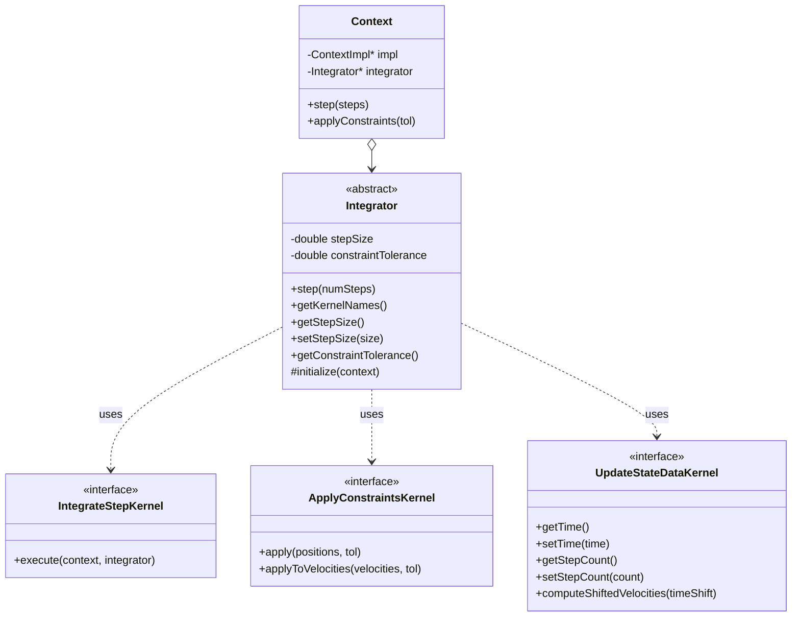
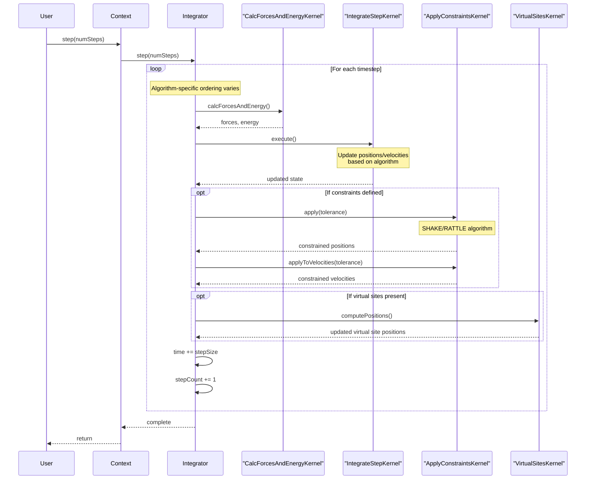
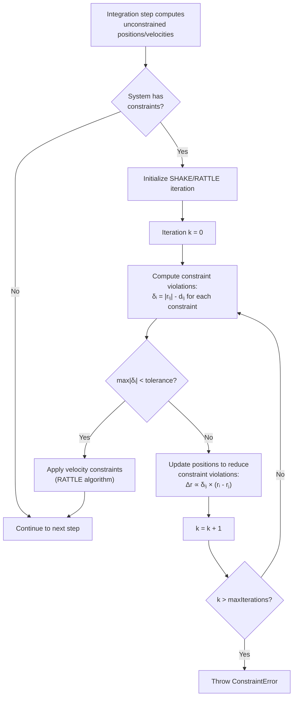
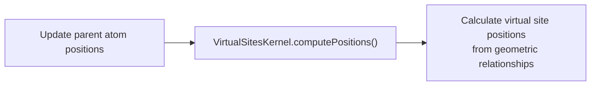

# Integration and Time Stepping

<details>
<summary>Relevant source files</summary>

The following files were used as context for generating this wiki page:

- [docs-source/CMakeLists.txt](docs-source/CMakeLists.txt)
- [docs-source/api-c++/forces.rst](docs-source/api-c++/forces.rst)
- [docs-source/api-python/process-docstring.py](docs-source/api-python/process-docstring.py)
- [docs-source/developerguide/05_cpu_platform.rst](docs-source/developerguide/05_cpu_platform.rst)
- [docs-source/developerguide/07_cuda_platform.rst](docs-source/developerguide/07_cuda_platform.rst)
- [docs-source/developerguide/index.rst](docs-source/developerguide/index.rst)
- [docs-source/developerguide/make.bat](docs-source/developerguide/make.bat)
- [docs-source/sphinx/autonumber.py](docs-source/sphinx/autonumber.py)
- [docs-source/usersguide/application.rst](docs-source/usersguide/application.rst)
- [docs-source/usersguide/application/01_getting_started.rst](docs-source/usersguide/application/01_getting_started.rst)
- [docs-source/usersguide/application/02_running_sims.rst](docs-source/usersguide/application/02_running_sims.rst)
- [docs-source/usersguide/application/05_add_on_packages.rst](docs-source/usersguide/application/05_add_on_packages.rst)
- [docs-source/usersguide/application/06_creating_ffs.rst](docs-source/usersguide/application/06_creating_ffs.rst)
- [docs-source/usersguide/index.rst](docs-source/usersguide/index.rst)
- [docs-source/usersguide/library.rst](docs-source/usersguide/library.rst)
- [docs-source/usersguide/library/01_introduction.rst](docs-source/usersguide/library/01_introduction.rst)
- [docs-source/usersguide/library/02_compiling.rst](docs-source/usersguide/library/02_compiling.rst)
- [docs-source/usersguide/library/04_platform_specifics.rst](docs-source/usersguide/library/04_platform_specifics.rst)
- [docs-source/usersguide/make.bat](docs-source/usersguide/make.bat)
- [docs-source/usersguide/references.bib](docs-source/usersguide/references.bib)
- [docs-source/usersguide/theory.rst](docs-source/usersguide/theory.rst)
- [olla/include/openmm/kernels.h](olla/include/openmm/kernels.h)
- [openmmapi/include/OpenMM.h](openmmapi/include/OpenMM.h)
- [platforms/common/include/openmm/common/CommonKernels.h](platforms/common/include/openmm/common/CommonKernels.h)
- [platforms/common/include/openmm/common/ComputeContext.h](platforms/common/include/openmm/common/ComputeContext.h)
- [platforms/common/src/CommonKernels.cpp](platforms/common/src/CommonKernels.cpp)
- [platforms/common/src/ComputeContext.cpp](platforms/common/src/ComputeContext.cpp)
- [platforms/cuda/include/CudaContext.h](platforms/cuda/include/CudaContext.h)
- [platforms/cuda/include/CudaKernels.h](platforms/cuda/include/CudaKernels.h)
- [platforms/cuda/src/CudaContext.cpp](platforms/cuda/src/CudaContext.cpp)
- [platforms/cuda/src/CudaKernelFactory.cpp](platforms/cuda/src/CudaKernelFactory.cpp)
- [platforms/cuda/src/CudaKernels.cpp](platforms/cuda/src/CudaKernels.cpp)
- [platforms/cuda/src/CudaPlatform.cpp](platforms/cuda/src/CudaPlatform.cpp)
- [platforms/opencl/include/OpenCLContext.h](platforms/opencl/include/OpenCLContext.h)
- [platforms/opencl/include/OpenCLKernels.h](platforms/opencl/include/OpenCLKernels.h)
- [platforms/opencl/src/OpenCLContext.cpp](platforms/opencl/src/OpenCLContext.cpp)
- [platforms/opencl/src/OpenCLKernelFactory.cpp](platforms/opencl/src/OpenCLKernelFactory.cpp)
- [platforms/opencl/src/OpenCLKernels.cpp](platforms/opencl/src/OpenCLKernels.cpp)
- [platforms/opencl/src/OpenCLPlatform.cpp](platforms/opencl/src/OpenCLPlatform.cpp)
- [platforms/reference/include/ReferenceKernels.h](platforms/reference/include/ReferenceKernels.h)
- [platforms/reference/src/ReferenceKernelFactory.cpp](platforms/reference/src/ReferenceKernelFactory.cpp)
- [platforms/reference/src/ReferenceKernels.cpp](platforms/reference/src/ReferenceKernels.cpp)
- [platforms/reference/src/ReferencePlatform.cpp](platforms/reference/src/ReferencePlatform.cpp)
- [serialization/src/SerializationProxyRegistration.cpp](serialization/src/SerializationProxyRegistration.cpp)

</details>


Integration and time stepping in OpenMM refers to the process of advancing the simulation forward through time by numerically solving the equations of motion. This page describes how integrators update particle positions and velocities, the various integration algorithms available (Verlet, Langevin, Brownian, etc.), and how constraints are handled during time stepping.

## Overview

Time stepping in molecular dynamics involves discretizing continuous equations of motion into finite steps. OpenMM's integration system performs several key operations during each time step:

- Computing new positions and velocities from current forces
- Applying holonomic constraints (e.g., rigid bonds) to maintain geometric requirements
- Handling stochastic terms for temperature control (in thermostated integrators)
- Updating virtual site positions based on parent atom positions
- Tracking simulation time and step count

The integration process works in concert with the Force Calculation Pipeline (see page 2.3) and Context/State Management (see page 2.2) to advance the simulation.

Sources: [openmmapi/include/openmm/Integrator.h](), [openmmapi/src/Context.cpp]()

## Key Classes and Interfaces

The time stepping architecture centers around the `Integrator` base class and platform-specific kernel implementations:

**Class Hierarchy**



Sources: [openmmapi/include/openmm/Integrator.h](), [openmmapi/include/openmm/Context.h](), [olla/include/openmm/kernels.h:545-834]()

## Time Stepping Process Flow

**Typical Integration Step**

Each call to `Integrator.step()` performs the following sequence:



Sources: [openmmapi/src/Context.cpp:75-89](), [platforms/reference/src/ReferenceKernels.cpp:3640-3800](), [platforms/cuda/src/CudaKernels.cpp:63-91]()

## Available Integration Algorithms

OpenMM provides multiple integration algorithms implemented as concrete subclasses of `Integrator`:

**Integrator Class Hierarchy**

```mermaid
classDiagram
    class Integrator {
        <<abstract>>
        #double stepSize
        #double constraintTolerance
        +step(steps)
        +getStepSize()
        +setStepSize()
    }
    
    class VerletIntegrator {
        +VerletIntegrator(stepSize)
    }
    
    class LangevinIntegrator {
        -double temperature
        -double friction
        +LangevinIntegrator(temp, friction, stepSize)
        +getTemperature()
        +getFriction()
    }
    
    class LangevinMiddleIntegrator {
        -double temperature
        -double friction
        +LangevinMiddleIntegrator(temp, friction, stepSize)
    }
    
    class BrownianIntegrator {
        -double temperature
        -double friction
        +BrownianIntegrator(temp, friction, stepSize)
    }
    
    class VariableVerletIntegrator {
        -double errorTolerance
        +VariableVerletIntegrator(errorTol)
    }
    
    class VariableLangevinIntegrator {
        -double errorTolerance
        +VariableLangevinIntegrator(temp, friction, errorTol)
    }
    
    class CustomIntegrator {
        -vector~ComputationStep~ steps
        +addComputePerDof(variable, expression)
        +addConstrainPositions()
        +addConstrainVelocities()
    }
    
    class NoseHooverIntegrator {
        -NoseHooverChain chain
        +NoseHooverIntegrator(temp, freq, stepSize)
    }
    
    Integrator <|-- VerletIntegrator
    Integrator <|-- LangevinIntegrator
    Integrator <|-- LangevinMiddleIntegrator
    Integrator <|-- BrownianIntegrator
    Integrator <|-- VariableVerletIntegrator
    Integrator <|-- VariableLangevinIntegrator
    Integrator <|-- CustomIntegrator
    Integrator <|-- NoseHooverIntegrator
    Integrator <|-- DPDIntegrator
```



Sources: [openmmapi/include/OpenMM.h:58-70](), [openmmapi/include/openmm/VerletIntegrator.h](), [openmmapi/include/openmm/LangevinIntegrator.h](), [openmmapi/include/openmm/CustomIntegrator.h]()

## Integration Algorithm Details

Each integrator implements a specific numerical method for solving the equations of motion. The algorithms differ in accuracy, stability, and computational cost.

### Velocity Verlet (VerletIntegrator)

The basic symplectic integrator that conserves energy in the microcanonical (NVE) ensemble:

**Algorithm Steps:**
1. v(t + Δt/2) = v(t) + (Δt/2) × a(t) / m
2. x(t + Δt) = x(t) + Δt × v(t + Δt/2)
3. Calculate forces at x(t + Δt) to get a(t + Δt)
4. v(t + Δt) = v(t + Δt/2) + (Δt/2) × a(t + Δt) / m

Where: x = position, v = velocity, a = acceleration (force/mass), Δt = timestep

This leapfrog scheme keeps positions and velocities offset by half a timestep, improving stability and allowing for time-reversibility.

Sources: [platforms/reference/src/ReferenceKernels.cpp:3640-3710](), [openmmapi/include/openmm/VerletIntegrator.h]()

### Langevin Dynamics (LangevinIntegrator, LangevinMiddleIntegrator)

Stochastic dynamics with friction and random forces for constant temperature simulation:

**LangevinIntegrator (BAOAB splitting):**
1. v(t + Δt/2) = v(t) + (Δt/2) × a(t) / m
2. x(t + Δt) = x(t) + Δt × v(t + Δt/2)
3. Apply Ornstein-Uhlenbeck: v = a×v + b×R where R ~ N(0,1), a = exp(-γΔt), b = sqrt((1-a²)kT/m)
4. Calculate forces at x(t + Δt)
5. v(t + Δt) = v(t + Δt/2) + (Δt/2) × a(t + Δt) / m

**LangevinMiddleIntegrator (VRORV splitting):**
Uses a different splitting order with better accuracy for configurational sampling.

Where: γ = friction coefficient, k = Boltzmann constant, T = temperature

Sources: [platforms/reference/src/ReferenceKernels.cpp:3710-3850](), [openmmapi/include/openmm/LangevinIntegrator.h](), [openmmapi/include/openmm/LangevinMiddleIntegrator.h]()

### Brownian Dynamics (BrownianIntegrator)

Overdamped Langevin dynamics suitable for highly damped systems:

**Algorithm:**
1. x(t + Δt) = x(t) + (Δt/γ) × F(t) + R
2. R ~ N(0, 2kTΔt/γ) for each coordinate

No explicit velocity update is needed since velocities equilibrate instantaneously in the overdamped limit.

Sources: [platforms/reference/src/ReferenceKernels.cpp:3850-3950](), [openmmapi/include/openmm/BrownianIntegrator.h]()

### Variable Timestep Integrators

`VariableVerletIntegrator` and `VariableLangevinIntegrator` automatically adjust the timestep based on local error estimates to maintain a specified accuracy tolerance. This can be more efficient than fixed timesteps when dynamics vary significantly during the simulation.

Sources: [openmmapi/include/openmm/VariableVerletIntegrator.h](), [openmmapi/include/openmm/VariableLangevinIntegrator.h]()

### Nose-Hoover Dynamics (NoseHooverIntegrator)

Deterministic thermostat using extended system variables (Nose-Hoover chains) to sample the canonical ensemble without stochastic terms.

Sources: [openmmapi/include/openmm/NoseHooverIntegrator.h](), [platforms/reference/src/ReferenceKernels.cpp:4300-4500]()

## Constraint Handling During Integration

Constraints maintain fixed distances between atoms (e.g., rigid bonds) during integration. OpenMM uses iterative constraint algorithms applied after position and velocity updates.

**Constraint Application Workflow**



**SHAKE Algorithm (Position Constraints):**
- Iteratively adjusts positions to satisfy distance constraints
- Converges when all constraint distances are within tolerance
- Default tolerance: 10⁻⁵

**RATTLE Algorithm (Velocity Constraints):**
- Projects velocities onto constraint surface
- Ensures velocities don't violate constrained directions
- Applied after position constraints

Sources: [platforms/reference/src/ReferenceConstraints.cpp](), [platforms/common/src/CommonKernels.cpp:429-454](), [platforms/reference/src/ReferenceKernels.cpp:329-340]()

### Virtual Sites

Virtual sites are particles whose positions are computed from other "parent" atoms rather than integrated. They are updated after each integration step:



Common virtual site types:
- **TwoParticle**: Position on line between two atoms
- **ThreeParticle**: Position in plane of three atoms  
- **OutOfPlane**: Position out of plane defined by three atoms
- **LocalCoords**: Position in local coordinate system

Sources: [platforms/reference/src/ReferenceKernels.cpp:344-347](), [platforms/common/src/CommonKernels.cpp:456-460]()

## Leapfrog Time Offsetting

Many integrators use a leapfrog scheme where velocities are offset by half a timestep from positions. This improves stability and accuracy.

**Computing Instantaneous Velocities:**

The `computeShiftedVelocities()` method calculates velocities at the same time as positions:

```
v(t) = v(t - Δt/2) + (Δt/2) × a(t) / m
```

This is used when computing kinetic energy or returning velocity data to the user, since the stored velocities are actually v(t - Δt/2).

Sources: [platforms/reference/src/ReferenceKernels.cpp:233-258](), [platforms/common/src/CommonKernels.cpp:281-283]()

## Custom Integration

The `CustomIntegrator` class allows users to define their own integration algorithms by specifying a series of computational steps. These steps can include:

- Per-degree-of-freedom computations
- Global variable computations
- Constraint applications
- Random number generation

This provides a flexible way to implement algorithms not directly supported by the built-in integrators.

A custom integrator is defined by specifying a sequence of steps, each of which modifies the system state according to user-defined mathematical expressions.

Sources: [openmmapi/include/OpenMM.h:48]()

## Practical Usage

Here are common operations for working with integrators in OpenMM:

| Operation | Code Example |
|-----------|--------------|
| Creating an integrator | `Integrator* integrator = new VerletIntegrator(0.002);` |
| Setting up a context | `Context context(system, *integrator);` |
| Running a simulation | `context.getIntegrator().step(1000);` |
| Getting simulation results | `State state = context.getState(State::Positions \| State::Velocities);` |
| Checkpointing | `ofstream file; context.createCheckpoint(file);` |

The most common way to use the integration system is through the `Context.step()` method, which delegates to the appropriate integrator to advance the simulation.

Sources: [openmmapi/src/Context.cpp:72-280]()

## Platform Specifics

The integration system is implemented differently on each platform to optimize for specific hardware:

### Reference Platform
- Uses simple C++ data structures
- Focuses on correctness, not performance
- Serves as a reference implementation

### CPU Platform
- Optimized for multi-core CPUs
- Uses vectorized operations and threading

### OpenCL/CUDA Platforms
- Highly parallelized implementations
- Specialized memory layouts for GPU efficiency
- Custom kernels for each integration algorithm

Sources: [platforms/reference/src/ReferencePlatform.cpp:70-77](), [platforms/common/src/ComputeContext.cpp:230-250]()

## Summary

The Integration System is a core part of OpenMM that enables advancing molecular simulations through time. It provides a flexible framework for implementing various integration algorithms while abstracting platform-specific details through a kernel-based approach. This design allows OpenMM to effectively balance between providing standard algorithms, supporting custom methods, and achieving high performance across different hardware platforms.

---