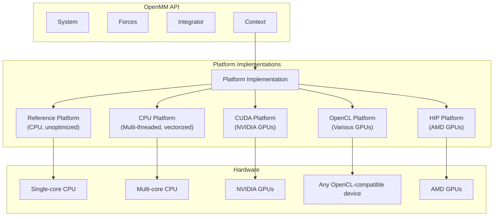
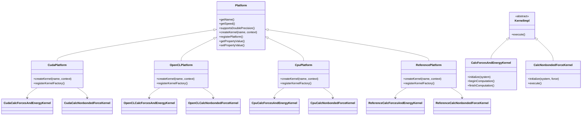
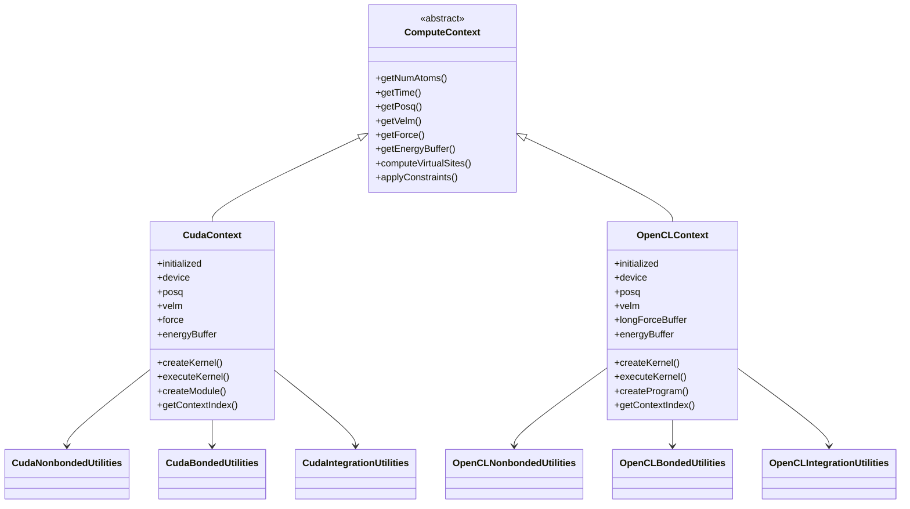
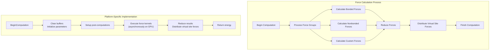
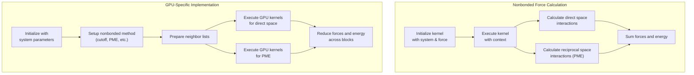
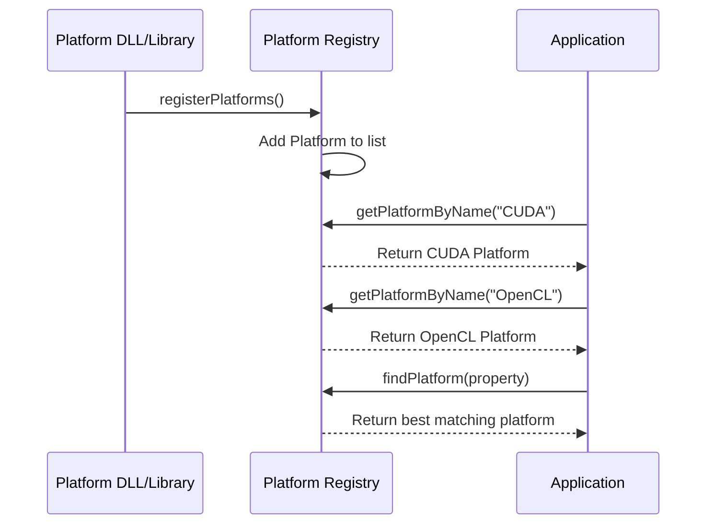
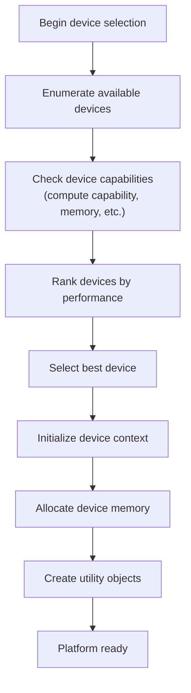

# Platform Implementations

Relevant source files

The following files were used as context for generating this wiki page:

- [docs-source/api-c++/forces.rst](docs-source/api-c++/forces.rst)
- [olla/include/openmm/kernels.h](olla/include/openmm/kernels.h)
- [openmmapi/include/OpenMM.h](openmmapi/include/OpenMM.h)
- [platforms/common/include/openmm/common/CommonKernels.h](platforms/common/include/openmm/common/CommonKernels.h)
- [platforms/common/include/openmm/common/ComputeContext.h](platforms/common/include/openmm/common/ComputeContext.h)
- [platforms/common/src/CommonKernels.cpp](platforms/common/src/CommonKernels.cpp)
- [platforms/common/src/ComputeContext.cpp](platforms/common/src/ComputeContext.cpp)
- [platforms/cpu/include/CpuKernels.h](platforms/cpu/include/CpuKernels.h)
- [platforms/cpu/include/CpuNeighborList.h](platforms/cpu/include/CpuNeighborList.h)
- [platforms/cpu/include/CpuNonbondedForce.h](platforms/cpu/include/CpuNonbondedForce.h)
- [platforms/cpu/include/CpuPlatform.h](platforms/cpu/include/CpuPlatform.h)
- [platforms/cpu/src/CpuKernelFactory.cpp](platforms/cpu/src/CpuKernelFactory.cpp)
- [platforms/cpu/src/CpuKernels.cpp](platforms/cpu/src/CpuKernels.cpp)
- [platforms/cpu/src/CpuNeighborList.cpp](platforms/cpu/src/CpuNeighborList.cpp)
- [platforms/cpu/src/CpuNonbondedForce.cpp](platforms/cpu/src/CpuNonbondedForce.cpp)
- [platforms/cpu/src/CpuNonbondedForceVec4.cpp](platforms/cpu/src/CpuNonbondedForceVec4.cpp)
- [platforms/cpu/src/CpuPlatform.cpp](platforms/cpu/src/CpuPlatform.cpp)
- [platforms/cpu/tests/TestCpuNeighborList.cpp](platforms/cpu/tests/TestCpuNeighborList.cpp)
- [platforms/cuda/include/CudaContext.h](platforms/cuda/include/CudaContext.h)
- [platforms/cuda/include/CudaKernelFactory.h](platforms/cuda/include/CudaKernelFactory.h)
- [platforms/cuda/include/CudaKernels.h](platforms/cuda/include/CudaKernels.h)
- [platforms/cuda/src/CudaContext.cpp](platforms/cuda/src/CudaContext.cpp)
- [platforms/cuda/src/CudaKernelFactory.cpp](platforms/cuda/src/CudaKernelFactory.cpp)
- [platforms/cuda/src/CudaKernels.cpp](platforms/cuda/src/CudaKernels.cpp)
- [platforms/cuda/src/CudaPlatform.cpp](platforms/cuda/src/CudaPlatform.cpp)
- [platforms/opencl/include/OpenCLContext.h](platforms/opencl/include/OpenCLContext.h)
- [platforms/opencl/include/OpenCLKernels.h](platforms/opencl/include/OpenCLKernels.h)
- [platforms/opencl/src/OpenCLContext.cpp](platforms/opencl/src/OpenCLContext.cpp)
- [platforms/opencl/src/OpenCLKernelFactory.cpp](platforms/opencl/src/OpenCLKernelFactory.cpp)
- [platforms/opencl/src/OpenCLKernels.cpp](platforms/opencl/src/OpenCLKernels.cpp)
- [platforms/opencl/src/OpenCLPlatform.cpp](platforms/opencl/src/OpenCLPlatform.cpp)
- [platforms/reference/include/ReferenceKernels.h](platforms/reference/include/ReferenceKernels.h)
- [platforms/reference/include/ReferencePlatform.h](platforms/reference/include/ReferencePlatform.h)
- [platforms/reference/src/ReferenceKernelFactory.cpp](platforms/reference/src/ReferenceKernelFactory.cpp)
- [platforms/reference/src/ReferenceKernels.cpp](platforms/reference/src/ReferenceKernels.cpp)
- [platforms/reference/src/ReferencePlatform.cpp](platforms/reference/src/ReferencePlatform.cpp)
- [platforms/reference/src/SimTKReference/ReferenceNeighborList.cpp](platforms/reference/src/SimTKReference/ReferenceNeighborList.cpp)
- [platforms/reference/tests/TestReferenceNeighborList.cpp](platforms/reference/tests/TestReferenceNeighborList.cpp)
- [serialization/src/SerializationProxyRegistration.cpp](serialization/src/SerializationProxyRegistration.cpp)

This page provides a detailed overview of how OpenMM implements support for different hardware platforms, allowing the same molecular simulation to run efficiently on CPUs, NVIDIA GPUs, AMD GPUs, and other hardware accelerators. Each platform optimizes calculations for a specific type of hardware while exposing the same API to users.

For information about forces and energy calculations, see the Force Calculation System (#2.2). For information about specific optimizations used, see the Performance Optimizations (#4).

## Platform Architecture Overview

OpenMM achieves hardware flexibility through a platform-based architecture where multiple implementations of the same API are provided for different hardware types. Each platform implements a set of computational kernels optimized for a particular hardware target.

Sources: platforms/cuda/src/CudaPlatform.cpp, platforms/opencl/src/OpenCLPlatform.cpp, platforms/cpu/src/CpuPlatform.cpp, platforms/reference/src/ReferencePlatform.cpp

### Available Platforms

OpenMM provides the following platform implementations:

| Platform | Target Hardware | Precision Options | Key Characteristics |
|----------|----------------|-------------------|---------------------|
| Reference | CPU | Double | Focused on correctness rather than performance, serves as a reference implementation |
| CPU | Multi-core CPU | Single, Mixed, Double | Optimized with SIMD vectorization and multi-threading |
| CUDA | NVIDIA GPU | Single, Mixed, Double | Optimized for NVIDIA GPUs using CUDA |
| OpenCL | Various GPUs | Single, Mixed, Double | Hardware-neutral implementation for any OpenCL-compatible device |
| HIP | AMD GPU | Single, Mixed, Double | Optimized for AMD GPUs using HIP |

Sources: platforms/cuda/src/CudaPlatform.cpp:65-120, platforms/opencl/src/OpenCLPlatform.cpp:58-109, platforms/cpu/src/CpuPlatform.cpp

## Platform Interface and Abstraction

All platforms implement a common set of interfaces, allowing the OpenMM core to interact with them in a uniform way regardless of the underlying hardware.

Sources: olla/include/openmm/kernels.h, platforms/cuda/include/CudaKernels.h, platforms/opencl/include/OpenCLKernels.h, platforms/cpu/include/CpuKernels.h, platforms/reference/include/ReferenceKernels.h

### Kernel Interface Architecture

Kernels are specific computational tasks that each platform must implement. The key kernel interfaces include:

1. **CalcForcesAndEnergyKernel**: Manages the overall force and energy calculation process
2. **UpdateStateDataKernel**: Handles operations related to system state (positions, velocities)
3. **ApplyConstraintsKernel**: Applies distance constraints to the system
4. **CalcNonbondedForceKernel**: Computes nonbonded interactions (electrostatics, van der Waals)
5. **Various force kernels**: Specific implementations for different force types (bonds, angles, etc.)
6. **Integration kernels**: Implement different integration algorithms (Verlet, Langevin, etc.)

Each platform registers a kernel factory that creates platform-specific implementations of these kernel interfaces.

Sources: olla/include/openmm/kernels.h:83-147, platforms/cuda/src/CudaKernelFactory.cpp, platforms/opencl/src/OpenCLKernelFactory.cpp

## Platform Context Classes

Each GPU platform provides a context class that manages hardware resources and state.

Sources: platforms/common/include/openmm/common/ComputeContext.h, platforms/cuda/include/CudaContext.h, platforms/opencl/include/OpenCLContext.h

### CUDA Context

The `CudaContext` class initializes and manages CUDA resources:

- **Device management**: Selects, initializes, and manages the CUDA device
- **Memory management**: Allocates and manages GPU memory for coordinates, forces, etc.
- **Kernel management**: Compiles and executes CUDA kernels
- **Utility objects**: Provides specialized utilities for force calculations, integration, etc.

Sources: platforms/cuda/src/CudaContext.cpp:86-358

### OpenCL Context

The `OpenCLContext` class provides similar functionality for OpenCL:

- **Device management**: Selects and initializes OpenCL devices
- **Memory management**: Creates and manages OpenCL buffers
- **Kernel management**: Compiles and executes OpenCL kernels
- **Utility objects**: Provides OpenCL-specific utilities for different calculation types

Sources: platforms/opencl/src/OpenCLContext.cpp:85-493

## Force Calculation Architecture

The Force calculation system is structured to handle different types of forces efficiently on each platform.

Sources: platforms/cuda/src/CudaKernels.cpp:60-87, platforms/opencl/src/OpenCLKernels.cpp:76-102

### Nonbonded Force Implementation

The nonbonded force calculation is particularly important and heavily optimized in each platform:

Sources: platforms/cuda/src/CudaKernels.cpp:263-1102, platforms/opencl/src/OpenCLKernels.cpp:281-1120

The nonbonded force calculation is implemented differently on each platform:

1. **Reference Platform**: Simple double-nested loops for direct calculations, reference PME implementation
2. **CPU Platform**: Optimized with neighbor lists, SIMD vectorization, and multithreading
3. **CUDA Platform**: Highly optimized GPU kernels with specialized implementations for different cutoff methods and particle mesh Ewald (PME)
4. **OpenCL Platform**: Similar to CUDA but using OpenCL kernels with platform-specific optimizations

Sources: platforms/cpu/src/CpuNonbondedForce.cpp, platforms/cuda/src/CudaKernels.cpp:263-1102, platforms/opencl/src/OpenCLKernels.cpp:281-1120

## Platform Registration and Selection

Platforms register themselves with the OpenMM runtime system, allowing automatic selection or explicit specification by the user.

### Platform Registration

Each platform registers itself when loaded:

Sources: platforms/cuda/src/CudaPlatform.cpp:54-62, platforms/opencl/src/OpenCLPlatform.cpp:46-55

The registration is typically done in the platform's implementation file:

- **CUDA**: `CudaPlatform.cpp` registers `CudaPlatform`
- **OpenCL**: `OpenCLPlatform.cpp` registers `OpenCLPlatform`
- **CPU**: `CpuPlatform.cpp` registers `CpuPlatform`
- **Reference**: `ReferencePlatform.cpp` registers `ReferencePlatform`

Sources: platforms/cuda/src/CudaPlatform.cpp:54-62, platforms/opencl/src/OpenCLPlatform.cpp:46-55, platforms/cpu/src/CpuPlatform.cpp, platforms/reference/src/ReferencePlatform.cpp

### Platform Properties

Each platform defines a set of properties that can be configured by users:

**CUDA Platform Properties**:
- `CudaPrecision`: Controls calculation precision (`single`, `mixed`, or `double`)
- `CudaDeviceIndex`: Specifies which GPU to use
- `CudaUseBlockingSync`: Controls whether operations are synchronous
- `CudaCompiler`: Specifies the path to the CUDA compiler
- `CudaTempDirectory`: Specifies where to store temporary files

**OpenCL Platform Properties**:
- `OpenCLPrecision`: Similar to CUDA precision
- `OpenCLPlatformIndex`: Selects which OpenCL platform to use
- `OpenCLDeviceIndex`: Selects which device on the platform to use
- `OpenCLDeviceName`: Selects a device by name

**CPU Platform Properties**:
- `CpuThreads`: Controls the number of CPU threads to use

Sources: platforms/cuda/src/CudaPlatform.cpp:111-129, platforms/opencl/src/OpenCLPlatform.cpp:102-111

## Platform-Specific Optimizations

Each platform implements various optimizations tailored to its target hardware.

### CPU Optimizations

- Thread pooling for parallel execution across multiple CPU cores
- SIMD vectorization (SSE, AVX) for efficient computation
- Cache-friendly data structures and memory layouts
- Optimized neighbor lists for nonbonded interactions

Sources: platforms/cpu/src/CpuNonbondedForce.cpp, platforms/cpu/src/CpuNeighborList.cpp

### CUDA and OpenCL Optimizations

- Custom memory layouts optimized for GPU memory access patterns
- Use of specialized memories (texture, shared) for different data types
- Asynchronous computation with multiple streams/queues
- Specialized kernels for different calculation types and precisions
- Tuned workgroup/thread block sizes for different computations

Sources: platforms/cuda/src/CudaContext.cpp:353-358, platforms/opencl/src/OpenCLContext.cpp:373-427

### Precision Modes

All GPU platforms support three precision modes:

1. **Single Precision**: All calculations in single precision (fastest)
2. **Mixed Precision**: Forces in single precision, accumulation in double precision (good balance)
3. **Double Precision**: All calculations in double precision (most accurate, slowest)

The precision mode is selected through platform properties (`CudaPrecision`, `OpenCLPrecision`).

Sources: platforms/cuda/src/CudaContext.cpp:219-251, platforms/opencl/src/OpenCLContext.cpp:320-358

## Device Selection and Initialization

GPU platforms implement sophisticated device selection algorithms to choose the best available hardware.

Sources: platforms/cuda/src/CudaContext.cpp:115-167, platforms/opencl/src/OpenCLContext.cpp:112-203

### CUDA Device Selection

The CUDA platform selects devices based on:
- User-specified device index
- Device compute capability
- Memory capacity
- Number of multiprocessors and clock speed

Sources: platforms/cuda/src/CudaContext.cpp:134-158

### OpenCL Device Selection

The OpenCL platform has a more complex selection process due to the variety of OpenCL implementations:
- User-specified platform and device
- Device type (GPU preferred over CPU)
- Vendor-specific considerations (Apple, NVIDIA, AMD, Intel)
- Support for required extensions
- Compute units and clock frequency

Sources: platforms/opencl/src/OpenCLContext.cpp:112-187

## Common Design Patterns

Several design patterns are used consistently across the platform implementations:

1. **Factory Pattern**: Kernel factories create platform-specific kernel implementations
2. **Strategy Pattern**: Different algorithms are used for the same calculation depending on the platform
3. **Observer Pattern**: Notification mechanisms for state changes (atom reordering, etc.)
4. **Resource Management**: RAII-style resource handling for GPU resources

Sources: platforms/cuda/src/CudaKernelFactory.cpp, platforms/opencl/src/OpenCLKernelFactory.cpp

## Comparison of Platform Implementations

While all platforms implement the same API, they differ significantly in their internal implementations:

| Feature | Reference | CPU | CUDA | OpenCL |
|---------|-----------|-----|------|--------|
| **Target Hardware** | Any CPU | Multi-core CPU | NVIDIA GPU | Various GPUs |
| **Implementation** | Simple loops | Vectorized + multithreaded | CUDA kernels | OpenCL kernels |
| **Memory Model** | Standard C++ vectors | Aligned arrays | Device memory | Device buffers |
| **Parallelism** | None/minimal | SIMD + threads | GPU threads | Work items |
| **Precision** | Double only | Single/Mixed/Double | Single/Mixed/Double | Single/Mixed/Double |
| **Key Strength** | Correctness | Hardware compatibility | Performance on NVIDIA | Hardware flexibility |

Sources: platforms/cuda/src/CudaKernels.cpp, platforms/opencl/src/OpenCLKernels.cpp, platforms/cpu/src/CpuKernels.cpp, platforms/reference/src/ReferenceKernels.cpp

## Platform Selection Strategy

When initializing a simulation, OpenMM selects a platform using the following process:

1. If the user explicitly specifies a platform, that platform is used
2. Otherwise, OpenMM tries each available platform in order of estimated performance:
   - CUDA (if available)
   - OpenCL (if available)
   - CPU
   - Reference (as a last resort)

This ensures that the fastest available platform is selected by default while allowing users to override the selection when needed.

Sources: platforms/cuda/src/CudaPlatform.cpp, platforms/opencl/src/OpenCLPlatform.cpp

---