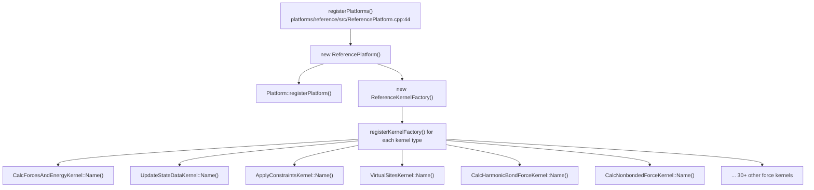
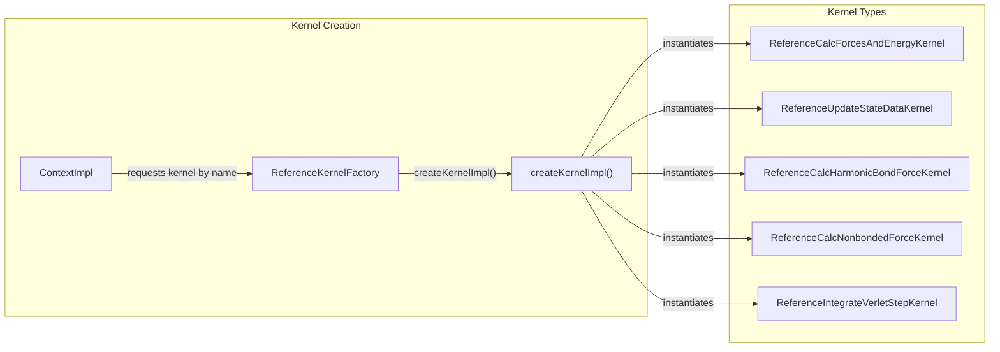
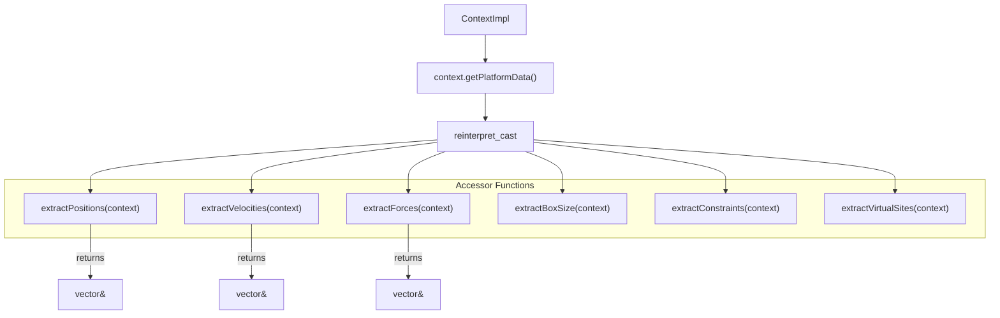
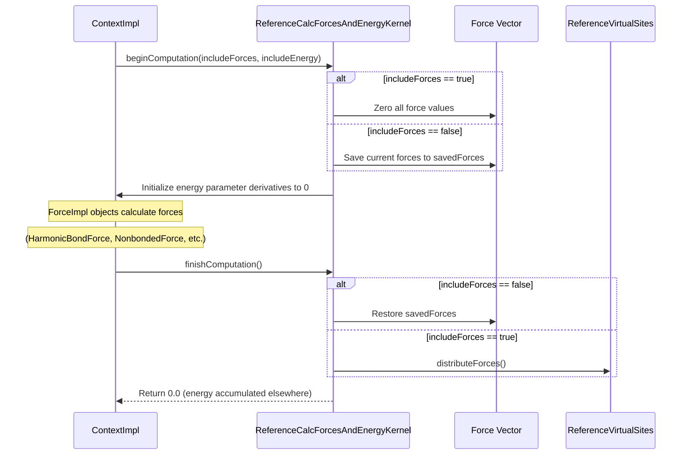
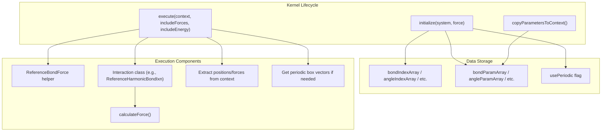
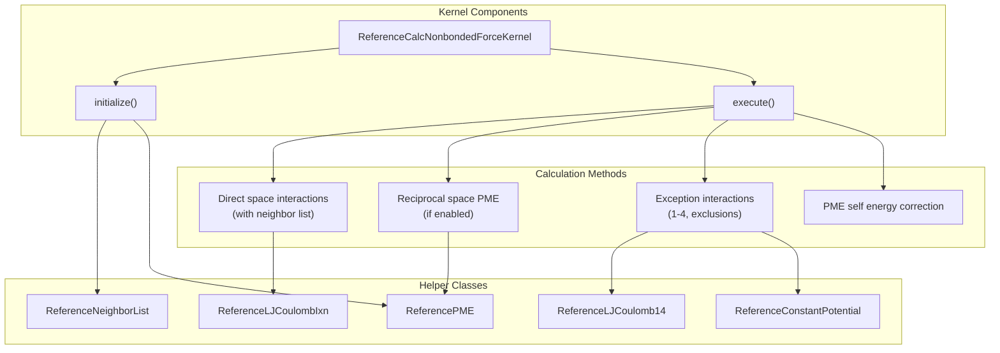
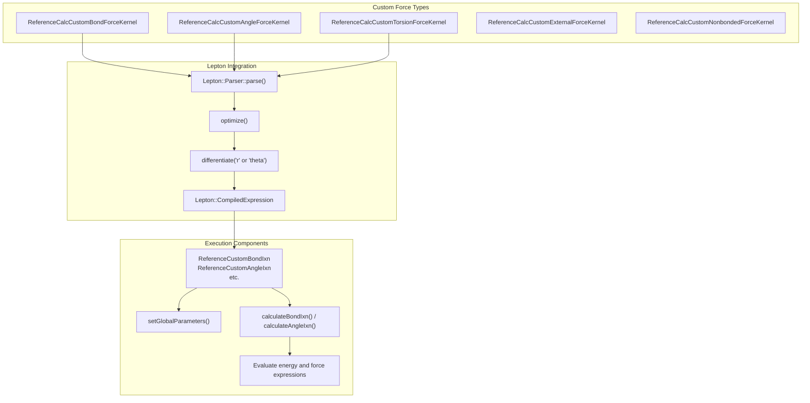
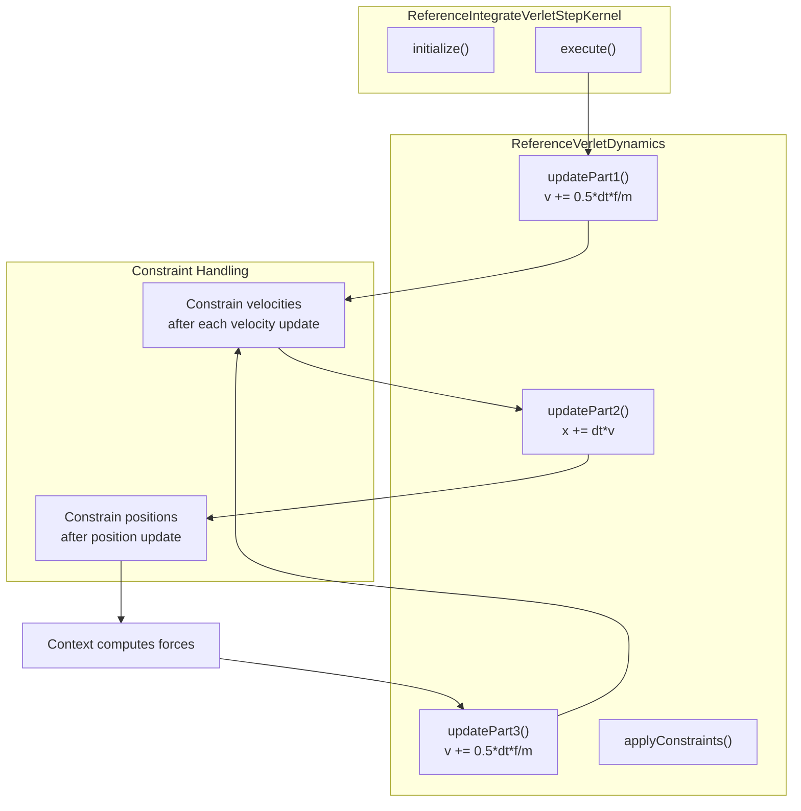

# Reference Platform

Relevant source files

The following files were used as context for generating this wiki page:

- [docs-source/api-c++/forces.rst](docs-source/api-c++/forces.rst)
- [olla/include/openmm/kernels.h](olla/include/openmm/kernels.h)
- [openmmapi/include/OpenMM.h](openmmapi/include/OpenMM.h)
- [platforms/common/include/openmm/common/CommonKernels.h](platforms/common/include/openmm/common/CommonKernels.h)
- [platforms/common/include/openmm/common/ComputeContext.h](platforms/common/include/openmm/common/ComputeContext.h)
- [platforms/common/src/CommonKernels.cpp](platforms/common/src/CommonKernels.cpp)
- [platforms/common/src/ComputeContext.cpp](platforms/common/src/ComputeContext.cpp)
- [platforms/cpu/include/CpuKernels.h](platforms/cpu/include/CpuKernels.h)
- [platforms/cpu/include/CpuNeighborList.h](platforms/cpu/include/CpuNeighborList.h)
- [platforms/cpu/include/CpuNonbondedForce.h](platforms/cpu/include/CpuNonbondedForce.h)
- [platforms/cpu/include/CpuPlatform.h](platforms/cpu/include/CpuPlatform.h)
- [platforms/cpu/src/CpuKernelFactory.cpp](platforms/cpu/src/CpuKernelFactory.cpp)
- [platforms/cpu/src/CpuKernels.cpp](platforms/cpu/src/CpuKernels.cpp)
- [platforms/cpu/src/CpuNeighborList.cpp](platforms/cpu/src/CpuNeighborList.cpp)
- [platforms/cpu/src/CpuNonbondedForce.cpp](platforms/cpu/src/CpuNonbondedForce.cpp)
- [platforms/cpu/src/CpuNonbondedForceVec4.cpp](platforms/cpu/src/CpuNonbondedForceVec4.cpp)
- [platforms/cpu/src/CpuPlatform.cpp](platforms/cpu/src/CpuPlatform.cpp)
- [platforms/cpu/tests/TestCpuNeighborList.cpp](platforms/cpu/tests/TestCpuNeighborList.cpp)
- [platforms/cuda/include/CudaContext.h](platforms/cuda/include/CudaContext.h)
- [platforms/cuda/include/CudaKernels.h](platforms/cuda/include/CudaKernels.h)
- [platforms/cuda/src/CudaContext.cpp](platforms/cuda/src/CudaContext.cpp)
- [platforms/cuda/src/CudaKernelFactory.cpp](platforms/cuda/src/CudaKernelFactory.cpp)
- [platforms/cuda/src/CudaKernels.cpp](platforms/cuda/src/CudaKernels.cpp)
- [platforms/cuda/src/CudaPlatform.cpp](platforms/cuda/src/CudaPlatform.cpp)
- [platforms/opencl/include/OpenCLContext.h](platforms/opencl/include/OpenCLContext.h)
- [platforms/opencl/include/OpenCLKernels.h](platforms/opencl/include/OpenCLKernels.h)
- [platforms/opencl/src/OpenCLContext.cpp](platforms/opencl/src/OpenCLContext.cpp)
- [platforms/opencl/src/OpenCLKernelFactory.cpp](platforms/opencl/src/OpenCLKernelFactory.cpp)
- [platforms/opencl/src/OpenCLKernels.cpp](platforms/opencl/src/OpenCLKernels.cpp)
- [platforms/opencl/src/OpenCLPlatform.cpp](platforms/opencl/src/OpenCLPlatform.cpp)
- [platforms/reference/include/ReferenceKernels.h](platforms/reference/include/ReferenceKernels.h)
- [platforms/reference/include/ReferencePlatform.h](platforms/reference/include/ReferencePlatform.h)
- [platforms/reference/src/ReferenceKernelFactory.cpp](platforms/reference/src/ReferenceKernelFactory.cpp)
- [platforms/reference/src/ReferenceKernels.cpp](platforms/reference/src/ReferenceKernels.cpp)
- [platforms/reference/src/ReferencePlatform.cpp](platforms/reference/src/ReferencePlatform.cpp)
- [platforms/reference/src/SimTKReference/ReferenceNeighborList.cpp](platforms/reference/src/SimTKReference/ReferenceNeighborList.cpp)
- [platforms/reference/tests/TestReferenceNeighborList.cpp](platforms/reference/tests/TestReferenceNeighborList.cpp)
- [serialization/src/SerializationProxyRegistration.cpp](serialization/src/SerializationProxyRegistration.cpp)

## Purpose and Scope

The Reference Platform is OpenMM's baseline implementation that provides simple, single-threaded C++ code for all simulation calculations. Its primary purpose is to serve as a correctness reference against which other platforms (CPU, CUDA, OpenCL, HIP) are validated. The Reference Platform prioritizes code clarity and correctness over performance, using straightforward algorithms without parallelization or hardware-specific optimizations.

For information about optimized multi-threaded CPU execution, see the CPU Platform ([3.2](#3.2)). For GPU-accelerated platforms, see GPU Platforms ([3.3](#3.3)).

## Platform Architecture and Registration

The Reference Platform implements the kernel factory pattern defined in OpenMM's platform abstraction layer (see [2.1](#2.1)). At startup, it registers implementations for all standard force calculations and integrators.

### Platform Registration Flow

Sources: [platforms/reference/src/ReferencePlatform.cpp:41-113]()

### Kernel Factory Pattern Implementation

Sources: [platforms/reference/src/ReferenceKernelFactory.cpp:33-100](), [platforms/reference/include/ReferenceKernelFactory.h:1-46]()

## Platform Data Structure

The Reference Platform stores simulation state in the `ReferencePlatform::PlatformData` structure, which is attached to each `ContextImpl`. This structure contains all particle data and simulation state.

### PlatformData Components

| Component | Type | Purpose |
|-----------|------|---------|
| `positions` | `vector<Vec3>*` | Particle positions in nm |
| `velocities` | `vector<Vec3>*` | Particle velocities in nm/ps |
| `forces` | `vector<Vec3>*` | Forces on particles in kJ/(mol·nm) |
| `periodicBoxSize` | `Vec3*` | Simulation box dimensions |
| `periodicBoxVectors` | `Vec3[3]` | Periodic box vectors (triclinic support) |
| `constraints` | `ReferenceConstraints*` | Constraint solver instance |
| `virtualSites` | `ReferenceVirtualSites*` | Virtual site calculator |
| `energyParameterDerivatives` | `map<string, double>*` | Energy derivatives w.r.t. parameters |
| `time` | `double` | Current simulation time in ps |
| `stepCount` | `long long` | Total steps executed |
| `threads` | `ThreadPool` | Thread pool for minimal parallelization |

Sources: [platforms/reference/include/ReferencePlatform.h:67-89](), [platforms/reference/src/ReferencePlatform.cpp:56-66]()

### Data Access Pattern

Helper functions extract data from the platform context:

Sources: [platforms/reference/src/ReferenceKernels.cpp:99-137]()

## Force and Energy Calculation Kernels

The Reference Platform implements the `CalcForcesAndEnergyKernel` interface to coordinate force calculations. This kernel orchestrates the `beginComputation()` and `finishComputation()` lifecycle.

### Force Calculation Coordination

Sources: [platforms/reference/src/ReferenceKernels.cpp:170-192]()

### ReferenceCalcForcesAndEnergyKernel Implementation

The kernel performs minimal work, delegating actual force calculations to individual force implementations:

**beginComputation()**: Clears force buffers or saves them if forces aren't being calculated
- [platforms/reference/src/ReferenceKernels.cpp:173-184]()

**finishComputation()**: Distributes forces from virtual sites to their parent atoms if forces were calculated
- [platforms/reference/src/ReferenceKernels.cpp:186-192]()

## State Data Management

The `ReferenceUpdateStateDataKernel` provides get/set access to simulation state including positions, velocities, forces, time, and periodic box vectors.

### State Data Operations

```mermaid
graph TB
    subgraph "Query Operations"
        GetTime["getTime()"]
        GetStepCount["getStepCount()"]
        GetPositions["getPositions()"]
        GetVelocities["getVelocities()"]
        GetForces["getForces()"]
        GetBoxVectors["getPeriodicBoxVectors()"]
        GetEnergyDerivs["getEnergyParameterDerivatives()"]
    end
    
    subgraph "Update Operations"
        SetTime["setTime()"]
        SetStepCount["setStepCount()"]
        SetPositions["setPositions()"]
        SetVelocities["setVelocities()"]
        SetBoxVectors["setPeriodicBoxVectors()"]
    end
    
    subgraph "PlatformData Storage"
        TimeField["data.time"]
        StepCountField["data.stepCount"]
        PosVector["*data.positions"]
        VelVector["*data.velocities"]
        ForceVector["*data.forces"]
        BoxVectors["data.periodicBoxVectors[3]"]
    end
    
    GetTime --> TimeField
    SetTime --> TimeField
    GetStepCount --> StepCountField
    SetStepCount --> StepCountField
    GetPositions --> PosVector
    SetPositions --> PosVector
    GetVelocities --> VelVector
    SetVelocities --> VelVector
    GetForces --> ForceVector
    GetBoxVectors --> BoxVectors
    SetBoxVectors --> BoxVectors
```

Sources: [platforms/reference/src/ReferenceKernels.cpp:194-284]()

### Checkpoint Save/Load

The kernel provides serialization for simulation state:

**createCheckpoint()**: Writes binary checkpoint to stream
- Version number (int): checkpoint format version
- Time (double): current simulation time
- Step count (long long): total steps executed
- Positions (Vec3[]): all particle positions
- Velocities (Vec3[]): all particle velocities
- Box vectors (Vec3[3]): periodic box vectors
- RNG state: random number generator state

**loadCheckpoint()**: Restores simulation state from stream with version checking

Sources: [platforms/reference/src/ReferenceKernels.cpp:286-314]()

## Bonded Force Implementations

The Reference Platform implements bonded force calculations using simple, direct evaluation of force field terms. Each bonded force type follows a similar pattern.

### Bonded Force Kernel Pattern

Sources: [platforms/reference/src/ReferenceKernels.cpp:349-394]()

### Example: Harmonic Bond Force

The `ReferenceCalcHarmonicBondForceKernel` demonstrates the typical pattern:

**Initialization** [platforms/reference/src/ReferenceKernels.cpp:349-363]():
- Stores bond indices (particle pairs)
- Stores bond parameters (equilibrium length, force constant)
- Records whether periodic boundary conditions are used

**Execution** [platforms/reference/src/ReferenceKernels.cpp:365-375]():
- Extracts position and force vectors from context
- Creates `ReferenceBondForce` and `ReferenceHarmonicBondIxn` objects
- Applies periodic box vectors if needed
- Calls `calculateForce()` which iterates over all bonds

**Parameter Updates** [platforms/reference/src/ReferenceKernels.cpp:377-394]():
- Validates that particle indices haven't changed
- Updates force constants and equilibrium lengths

## Nonbonded Force Implementation

The `ReferenceCalcNonbondedForceKernel` handles Lennard-Jones and Coulomb interactions, including support for:
- Cutoffs and switching functions
- Periodic boundary conditions
- Particle Mesh Ewald (PME) for long-range electrostatics
- Reaction field electrostatics
- Exceptions (1-4 interactions, exclusions)

### Nonbonded Force Architecture

Sources: [platforms/reference/src/ReferenceKernels.cpp:1413-1874]()

### Nonbonded Calculation Flow

The kernel uses different code paths depending on cutoff and PME settings:

**Without Cutoff**: All-pairs O(N²) calculation [platforms/reference/src/ReferenceKernels.cpp:1748-1757]()
- Iterates over all particle pairs
- No neighbor list needed
- Simple but slow for large systems

**With Cutoff**: Neighbor list-based calculation [platforms/reference/src/ReferenceKernels.cpp:1759-1788]()
- Computes neighbor list if invalid
- Only evaluates interactions within cutoff
- Applies switching function if enabled

**With PME**: Separates direct and reciprocal space [platforms/reference/src/ReferenceKernels.cpp:1789-1850]()
- Direct space: short-range interactions with damped Coulomb
- Reciprocal space: long-range electrostatics via FFT
- Self-energy correction for particle-particle terms
- LJ-PME for dispersion if enabled

## Custom Force Implementations

Custom forces allow user-defined energy functions via Lepton expression parsing. The Reference Platform evaluates these expressions directly without compilation.

### Custom Force Evaluation Pattern

Sources: [platforms/reference/src/ReferenceKernels.cpp:396-477]()

### Example: Custom Bond Force

**Initialization** [platforms/reference/src/ReferenceKernels.cpp:401-440]():
- Parses energy expression string using Lepton
- Creates compiled expressions for energy and force (derivative w.r.t. distance)
- Stores per-bond parameter names and global parameter names
- Creates energy parameter derivative expressions

**Execution** [platforms/reference/src/ReferenceKernels.cpp:442-459]():
- Retrieves global parameter values from context
- Creates `ReferenceCustomBondIxn` with compiled expressions
- Iterates over bonds, evaluating expressions for each
- Accumulates energy parameter derivatives

## Integration Kernels

The Reference Platform implements various integration algorithms including Verlet, Langevin, Brownian dynamics, and custom integrators.

### Verlet Integration

Sources: [platforms/reference/src/ReferenceKernels.cpp:3006-3051]()

The velocity Verlet algorithm is split into three parts to interleave force evaluation:
1. Half-step velocity update using old forces
2. Full-step position update
3. Half-step velocity update using new forces

Constraints are applied after each position and velocity update to maintain holonomic constraints.

## Helper Classes and Utilities

### ReferenceConstraints

Implements constraint algorithms (SHAKE/SETTLE) to maintain bond length and angle constraints:

**Algorithm**: [platforms/reference/src/SimTKReference/ReferenceConstraints.cpp]()
- SHAKE for general distance constraints
- SETTLE for rigid water molecules (optimized)
- Iterative solver with configurable tolerance

### ReferenceVirtualSites

Handles virtual site position calculation and force distribution:

**computePositions()**: Calculates virtual site positions from parent atom positions
- Two-particle virtual sites
- Three-particle virtual sites (average, out-of-plane, local coordinates)
- Four-particle virtual sites

**distributeForces()**: Distributes forces on virtual sites back to parent atoms
- Maintains conservation of energy and momentum
- Handles derivatives of position constraints

Sources: [platforms/reference/src/SimTKReference/ReferenceVirtualSites.cpp]()

### ReferenceNeighborList

Provides neighbor list construction for nonbonded force calculations:

**Voxel-based Algorithm**:
- Divides space into cubic voxels
- Assigns particles to voxels based on position
- Searches neighboring voxels for particle pairs within cutoff
- Supports both orthogonal and triclinic periodic boxes

**Usage**: Only constructed when cutoff is enabled and system is large enough to benefit

Sources: [platforms/reference/src/SimTKReference/ReferenceNeighborList.cpp:1-203]()

## Performance Characteristics

The Reference Platform has distinct performance characteristics compared to optimized platforms:

| Aspect | Reference Platform | CPU/GPU Platforms |
|--------|-------------------|-------------------|
| Threading | Mostly single-threaded | Multi-threaded / massively parallel |
| SIMD | No vectorization | SSE/AVX (CPU), GPU warps |
| Neighbor lists | Simple voxel algorithm | Optimized Hilbert curve sorting |
| Memory access | Random access OK | Cache/coalescing optimized |
| Precision | Double precision | Single/mixed precision options |
| Code complexity | Simple loops | Kernel compilation, tiling |
| Primary use | Correctness validation | Production simulations |

### Typical Performance Ratios

For a typical 23,558 atom system (DHFR in water):
- Reference: ~0.1 ns/day (single-threaded)
- CPU: ~2-10 ns/day (multi-threaded)
- CUDA: ~100-300 ns/day (high-end GPU)

The Reference Platform is typically 20-100× slower than the CPU platform and 1000-3000× slower than GPU platforms.

Sources: Based on architecture differences visible in [platforms/reference/src/ReferenceKernels.cpp](), [platforms/cpu/src/CpuKernels.cpp](), [platforms/cuda/src/CudaKernels.cpp]()

## Comparison with Other Platforms

### Force Calculation Method Comparison

```mermaid
graph TB
    subgraph "Reference Platform"
        RefCalcForces["ReferenceCalcForcesAndEnergyKernel::finishComputation()"]
        RefLoop["Simple for loops over interactions"]
        RefNeighborList["ReferenceNeighborList (voxel-based)"]
        RefNoOpt["No optimizations"]
    end
    
    subgraph "CPU Platform"
        CpuCalcForces["CpuCalcForcesAndEnergyKernel::finishComputation()"]
        CpuThreads["ThreadPool parallelization"]
        CpuNeighborList["CpuNeighborList (Hilbert curve)"]
        CpuSIMD["SIMD vectorization (fvec4)"]
    end
    
    subgraph "CUDA/OpenCL Platforms"
        GpuCalcForces["CudaCalcForcesAndEnergyKernel::finishComputation()"]
        GpuKernels["GPU kernel launches"]
        GpuNeighborList["CudaNonbondedUtilities (tile-based)"]
        GpuPME["GPU-accelerated PME/FFT"]
    end
    
    RefCalcForces --> RefLoop
    RefLoop --> RefNeighborList
    RefLoop --> RefNoOpt
    
    CpuCalcForces --> CpuThreads
    CpuThreads --> CpuNeighborList
    CpuThreads --> CpuSIMD
    
    GpuCalcForces --> GpuKernels
    GpuKernels --> GpuNeighborList
    GpuKernels --> GpuPME
```

Sources: [platforms/reference/src/ReferenceKernels.cpp:186-192](), [platforms/cpu/src/CpuKernels.cpp:287-309](), [platforms/cuda/src/CudaKernels.cpp:78-91](), [platforms/opencl/src/OpenCLKernels.cpp:74-87]()

### Key Architectural Differences

**Data Layout**:
- Reference: Standard C++ `vector<Vec3>` for positions, velocities, forces
- CPU: `AlignedArray<float>` with SIMD-friendly layout (x,y,z,w interleaved)
- GPU: Coalesced arrays in device memory with tiling

**Neighbor Lists**:
- Reference: Basic voxel hash [platforms/reference/src/SimTKReference/ReferenceNeighborList.cpp]()
- CPU: Hilbert curve sorting for cache efficiency [platforms/cpu/src/CpuNeighborList.cpp]()
- GPU: Tile-based with block exclusion masks [platforms/common/src/CommonNonbondedUtilities.cpp]()

**Force Accumulation**:
- Reference: Direct addition to force vectors
- CPU: Per-thread force buffers, then reduction
- GPU: Atomic operations or per-block reduction

## When to Use the Reference Platform

The Reference Platform should be used for:

1. **Validation Testing**: Verifying correctness of new force implementations or algorithmic changes
2. **Debugging**: Understanding exact numerical behavior without optimization complexity
3. **Small Systems**: When system size is too small for parallelization overhead to be worthwhile (<100 atoms)
4. **Development**: Prototyping new force types before implementing optimized versions
5. **Fallback**: When no accelerated platforms are available on the system

The Reference Platform should NOT be used for:
- Production simulations of typical systems (>1000 atoms)
- Long-timescale simulations requiring high performance
- Any scenario where wall-clock time is a constraint

Sources: Architectural principles evident throughout [platforms/reference/src/ReferenceKernels.cpp]()

---