# CPU Platform

<details>
<summary>Relevant source files</summary>

The following files were used as context for generating this wiki page:

- [platforms/cpu/include/CpuKernels.h](platforms/cpu/include/CpuKernels.h)
- [platforms/cpu/include/CpuNeighborList.h](platforms/cpu/include/CpuNeighborList.h)
- [platforms/cpu/include/CpuNonbondedForce.h](platforms/cpu/include/CpuNonbondedForce.h)
- [platforms/cpu/include/CpuPlatform.h](platforms/cpu/include/CpuPlatform.h)
- [platforms/cpu/src/CpuKernelFactory.cpp](platforms/cpu/src/CpuKernelFactory.cpp)
- [platforms/cpu/src/CpuKernels.cpp](platforms/cpu/src/CpuKernels.cpp)
- [platforms/cpu/src/CpuNeighborList.cpp](platforms/cpu/src/CpuNeighborList.cpp)
- [platforms/cpu/src/CpuNonbondedForce.cpp](platforms/cpu/src/CpuNonbondedForce.cpp)
- [platforms/cpu/src/CpuNonbondedForceVec4.cpp](platforms/cpu/src/CpuNonbondedForceVec4.cpp)
- [platforms/cpu/src/CpuPlatform.cpp](platforms/cpu/src/CpuPlatform.cpp)
- [platforms/cpu/tests/TestCpuNeighborList.cpp](platforms/cpu/tests/TestCpuNeighborList.cpp)
- [platforms/reference/include/ReferencePlatform.h](platforms/reference/include/ReferencePlatform.h)
- [platforms/reference/src/SimTKReference/ReferenceNeighborList.cpp](platforms/reference/src/SimTKReference/ReferenceNeighborList.cpp)
- [platforms/reference/tests/TestReferenceNeighborList.cpp](platforms/reference/tests/TestReferenceNeighborList.cpp)

</details>


## Purpose and Scope

The CPU Platform provides an optimized implementation of OpenMM kernels for multi-core CPUs using multi-threading and SIMD vectorization (SSE/AVX). It extends the Reference Platform (see [3.1](#3.1)) to add parallelization while maintaining the same algorithmic correctness. The CPU Platform is suitable for systems that lack GPU acceleration or for debugging purposes where GPU-Reference differences need investigation.

This document covers the CPU Platform's architecture, initialization, neighbor list construction, force calculation pipeline, and SIMD optimizations. For GPU-based platforms, see [3.3](#3.3). For the underlying platform abstraction pattern, see [2.1](#2.1).

## Architecture Overview

The CPU Platform inherits from `ReferencePlatform` and wraps Reference kernel implementations with parallelized execution. It requires SSE 4.1 instruction set support and uses single-precision arithmetic for position and force arrays.

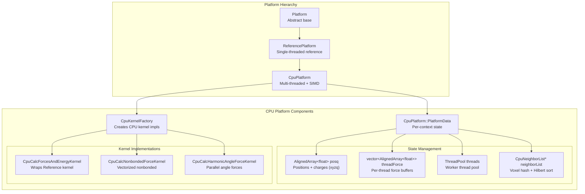

**Sources:** [platforms/cpu/include/CpuPlatform.h:48-86](), [platforms/cpu/src/CpuPlatform.cpp:61-88]()

### Key Design Principles

1. **Inheritance-based Extension**: CPU Platform extends Reference Platform rather than reimplementing everything, reusing mature code for correctness
2. **Single Precision**: Uses `float` for positions/forces in `AlignedArray` for SIMD efficiency
3. **Thread-Local Accumulation**: Each thread accumulates forces independently to avoid contention
4. **Lazy Neighbor List**: Recomputes only when particles move beyond threshold distance
5. **Processor Validation**: Checks for SSE 4.1 support before registration

**Sources:** [platforms/cpu/src/CpuPlatform.cpp:45-57](), [platforms/cpu/include/CpuPlatform.h:88-118]()

## Platform Registration and Initialization

The CPU Platform registers itself only if the processor supports SSE 4.1 instructions. Registration occurs via `registerPlatforms()` in the plugin entry point.

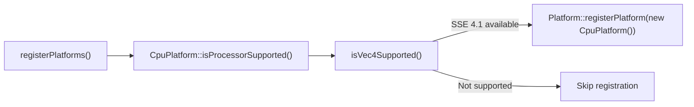

The processor check uses `isVec4Supported()` which queries CPU capabilities to verify SSE 4.1 availability. Without this instruction set, the platform is not registered.

**Sources:** [platforms/cpu/src/CpuPlatform.cpp:51-56](), [platforms/cpu/src/CpuPlatform.cpp:110-112]()

### Context Creation

When a context is created with the CPU Platform, it:

1. Creates the parent Reference Platform's `PlatformData`
2. Creates additional `CpuPlatform::PlatformData` with thread pool and single-precision buffers
3. Registers CPU-specific kernels via `CpuKernelFactory`
4. Replaces the Reference SETTLE constraint solver with parallel `CpuSETTLE`

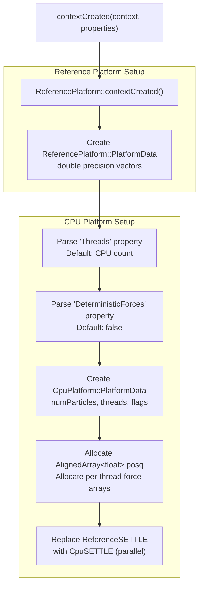

**Sources:** [platforms/cpu/src/CpuPlatform.cpp:114-133](), [platforms/cpu/include/CpuPlatform.h:88-118]()

### Platform Properties

| Property | Type | Default | Description |
|----------|------|---------|-------------|
| `Threads` | int | CPU count | Number of worker threads to use |
| `DeterministicForces` | bool | false | Enable deterministic force summation (slower) |

The number of threads defaults to the system CPU count but can be overridden via the `OPENMM_CPU_THREADS` environment variable or the `Threads` context property.

**Sources:** [platforms/cpu/src/CpuPlatform.cpp:80-87](), [platforms/cpu/include/CpuPlatform.h:65-77]()

## Platform Data and Per-Context State

`CpuPlatform::PlatformData` maintains per-context state separate from the parent Reference Platform data. The two coexist: Reference data stores double-precision vectors while CPU data stores single-precision aligned arrays optimized for SIMD.

### CpuPlatform::PlatformData Structure

```mermaid
graph TB
    PlatformData["CpuPlatform::PlatformData"]
    
    subgraph "Single-Precision Buffers"
        Posq["AlignedArray&lt;float&gt; posq<br/>4*numParticles (xyzq)"]
        ThreadForce["vector&lt;AlignedArray&lt;float&gt;&gt; threadForce<br/>numThreads × 4*numParticles"]
    end
    
    subgraph "Shared Resources"
        ThreadPool["ThreadPool& threads<br/>Worker thread pool"]
        Random["CpuRandom random<br/>Thread-safe RNG"]
    end
    
    subgraph "Neighbor List State"
        NeighborList["CpuNeighborList* neighborList<br/>Voxel hash structure"]
        Cutoff["double cutoff, paddedCutoff<br/>Interaction distances"]
        Exclusions["vector&lt;set&lt;int&gt;&gt; exclusions<br/>Excluded particle pairs"]
    end
    
    subgraph "Posq Index Management"
        CurrentIdx["int currentPosqIndex<br/>Currently active posq slot"]
        NextIdx["int nextPosqIndex<br/>Next available slot"]
    end
    
    PlatformData --> Posq
    PlatformData --> ThreadForce
    PlatformData --> ThreadPool
    PlatformData --> Random
    PlatformData --> NeighborList
    PlatformData --> Cutoff
    PlatformData --> Exclusions
    PlatformData --> CurrentIdx
    PlatformData --> NextIdx
```

**Sources:** [platforms/cpu/include/CpuPlatform.h:88-118](), [platforms/cpu/src/CpuPlatform.cpp:151-163]()

### Data Access Pattern

The CPU Platform stores a global map from `ContextImpl*` to `PlatformData*`:

```
map<const ContextImpl*, CpuPlatform::PlatformData*> CpuPlatform::contextData
```

Kernels access platform data via static methods:
- `CpuPlatform::getPlatformData(context)` - returns the `PlatformData` reference

This indirection is necessary because `ReferencePlatform` already uses the standard `context.getPlatformData()` for its own data.

**Sources:** [platforms/cpu/src/CpuPlatform.cpp:59](), [platforms/cpu/src/CpuPlatform.cpp:143-149]()

## Neighbor List Construction

The CPU Platform uses `CpuNeighborList` for efficient neighbor finding. The neighbor list construction involves two phases: spatial sorting via Hilbert curve and voxel-based neighbor search.

### Neighbor List Architecture

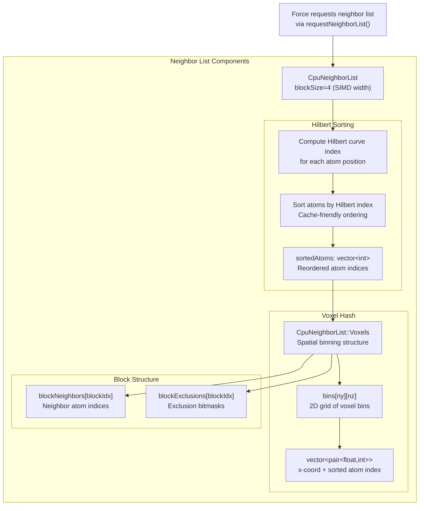

**Sources:** [platforms/cpu/include/CpuNeighborList.h:44-115](), [platforms/cpu/src/CpuNeighborList.cpp:411-508]()

### Hilbert Curve Sorting

Atoms are sorted along a Hilbert space-filling curve to improve cache locality. This ensures atoms near in space are near in memory, reducing cache misses during force calculation.

The sorting process:
1. Map each 3D position to a Hilbert curve index using `hilbert.h` functions
2. Sort atoms by Hilbert index (done in parallel threads)
3. Store sorted indices in `sortedAtoms` vector

**Sources:** [platforms/cpu/src/CpuNeighborList.cpp:463-468]()

### Voxel Hash Structure

The `CpuNeighborList::Voxels` class implements a 2D voxel grid (y-z plane) where each voxel stores atoms sorted by x-coordinate. This enables fast range queries via binary search.

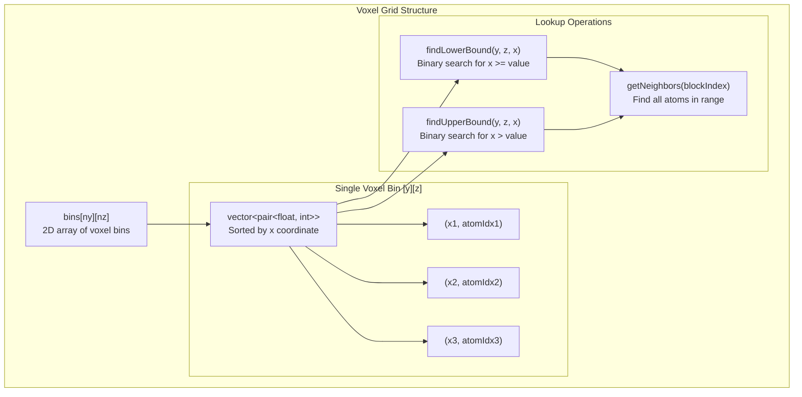

**Sources:** [platforms/cpu/src/CpuNeighborList.cpp:58-409](), [platforms/cpu/include/CpuNeighborList.h:46]()

### Voxel Size Selection

Voxel dimensions are chosen to balance spatial granularity with overhead:

**Non-periodic systems:**
```
edgeSizeY = edgeSizeZ = maxDistance
ny = min(500, max(1, floor((maxy-miny)/maxDistance)))
nz = min(500, max(1, floor((maxz-minz)/maxDistance)))
```

**Periodic systems:**
```
ny = floor(boxVectors[1][1]/maxDistance)
nz = floor(boxVectors[2][2]/maxDistance)
edgeSizeY = 0.6 * boxVectors[1][1] / ny
edgeSizeZ = 0.6 * boxVectors[2][2] / nz
```

The 0.6 factor provides a safety margin for periodic wrapping.

**Sources:** [platforms/cpu/src/CpuNeighborList.cpp:471-478](), [platforms/cpu/src/CpuNeighborList.cpp:78-91]()

### Block-Based Neighbor Storage

Neighbors are stored per-block (not per-atom) to enable efficient SIMD processing. Each block contains `blockSize` atoms (typically 4 for SSE/AVX).

For each block:
- `blockNeighbors[blockIdx]` - vector of neighbor atom indices
- `blockExclusions[blockIdx]` - vector of `BlockExclusionMask` bitmasks (16-bit)

The exclusion mask for each neighbor indicates which atoms in the block should exclude that neighbor (1 bit per block atom).

**Sources:** [platforms/cpu/include/CpuNeighborList.h:83](), [platforms/cpu/src/CpuNeighborList.cpp:510-547]()

## Force Calculation Pipeline

The CPU Platform's force calculation follows a multi-stage pipeline with parallel execution at multiple levels.

### CpuCalcForcesAndEnergyKernel

This kernel orchestrates the force/energy computation lifecycle:

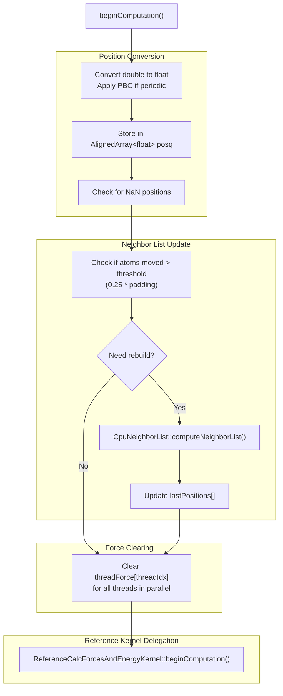

**Sources:** [platforms/cpu/src/CpuKernels.cpp:173-285]()

### Position Conversion and Boundary Conditions

The conversion from double to float happens in parallel across threads:

```cpp
// Parallel position conversion (pseudo-code from source)
data.threads.execute([&] (ThreadPool& threads, int threadIndex) {
    int start = threadIndex * numParticles / numThreads;
    int end = (threadIndex+1) * numParticles / numThreads;
    
    for (int i = start; i < end; i++) {
        Vec3 pos = posData[i];  // double precision
        
        // Apply periodic boundary conditions
        if (isPeriodic) {
            if (triclinic) {
                pos -= boxVectors[2] * floor(pos[2] * invBoxSize[2]);
                pos -= boxVectors[1] * floor(pos[1] * invBoxSize[1]);
                pos -= boxVectors[0] * floor(pos[0] * invBoxSize[0]);
            } else {
                // Rectangular box optimization
                for (int j = 0; j < 3; j++) {
                    double base = floor(pos[j] * invBoxSize[j]) * boxSize[j];
                    pos[j] -= base;
                }
            }
        }
        
        // Store as float
        posq[4*i+0] = (float) pos[0];
        posq[4*i+1] = (float) pos[1];
        posq[4*i+2] = (float) pos[2];
        // posq[4*i+3] is charge, set elsewhere
    }
});
```

**Sources:** [platforms/cpu/src/CpuKernels.cpp:180-233]()

### Force Summation and Reduction

After force calculation, per-thread force buffers are summed into the final force vector:

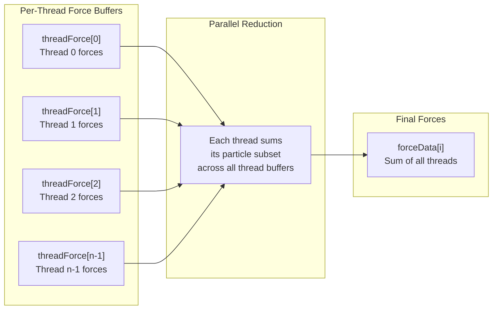

The reduction is parallelized: each thread reduces a contiguous range of particles, summing contributions from all thread buffers.

**Sources:** [platforms/cpu/src/CpuKernels.cpp:287-309]()

### finishComputation

The `finishComputation()` method:
1. Sums per-thread forces in parallel (shown above)
2. Delegates to Reference kernel's `finishComputation()` for constraint application and energy calculation
3. Returns total energy

**Sources:** [platforms/cpu/src/CpuKernels.cpp:287-309]()

## Nonbonded Force Calculation

Nonbonded forces dominate simulation runtime and receive the most optimization effort. The CPU Platform uses `CpuNonbondedForce` with SIMD vectorization.

### CpuNonbondedForce Architecture

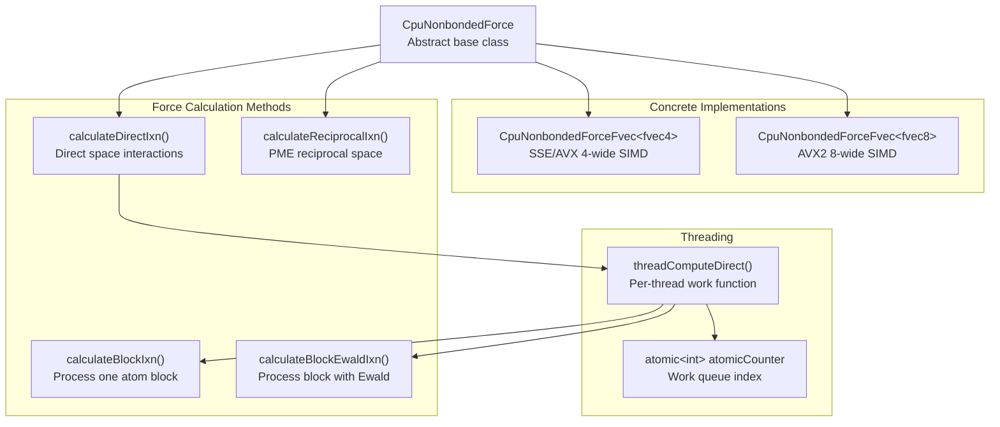

**Sources:** [platforms/cpu/include/CpuNonbondedForce.h:41-276](), [platforms/cpu/src/CpuNonbondedForce.cpp:376-406]()

### Direct Space Calculation Flow

The `calculateDirectIxn()` method sets up thread-local state and launches parallel workers:

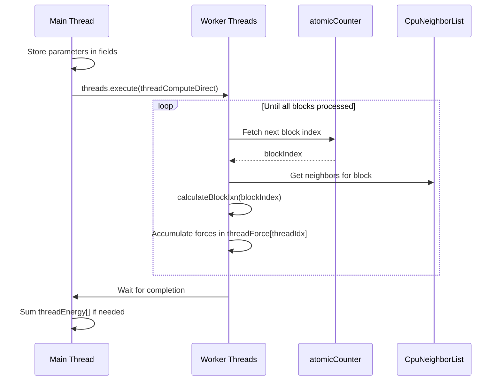

**Sources:** [platforms/cpu/src/CpuNonbondedForce.cpp:376-406](), [platforms/cpu/src/CpuNonbondedForce.cpp:408-486]()

### Block Processing with SIMD

The `calculateBlockIxn()` virtual method (implemented in subclasses) processes one block using SIMD instructions. The block size matches the SIMD width (4 for `fvec4`, 8 for `fvec8`).

Key SIMD operations:
- Load 4 atom positions simultaneously into `fvec4` registers
- Compute 4 pairwise distances in parallel
- Evaluate 4 LJ/Coulomb interactions simultaneously
- Accumulate 4 force contributions

**Sources:** Files not provided show full SIMD implementation, but structure defined in [platforms/cpu/include/CpuNonbondedForce.h:228-240]()

### PME Support

For PME electrostatics, the CPU Platform can optionally use an optimized PME plugin if available:

```cpp
// Check for optimized PME kernel
vector<string> kernelNames{"CalcPmeReciprocalForce"};
useOptimizedPme = getPlatform().supportsKernels(kernelNames);

if (useOptimizedPme) {
    optimizedPme = getPlatform().createKernel(CalcPmeReciprocalForceKernel::Name(), context);
    optimizedPme.getAs<CalcPmeReciprocalForceKernel>().initialize(...);
}
```

If unavailable, falls back to reference PME implementation.

**Sources:** [platforms/cpu/src/CpuKernels.cpp:643-653]()

### Ewald Scale Factor Tables

For Ewald summation, the CPU Platform precomputes lookup tables for expensive functions:

| Table | Function | Purpose |
|-------|----------|---------|
| `erfcTable` | `erfc(α*r)` | Complementary error function |
| `ewaldScaleTable` | `erfc(α*r) + (2α/√π)·r·exp(-α²r²)` | Combined Ewald scaling factor |
| `exptermsTable` | `1 - exp(-α²r²)·(1 + α²r² + ½α⁴r⁴)` | LJPME dispersion term |
| `dExptermsTable` | Derivative of above | LJPME force term |

Table size: 2048 points covering [0, cutoff]. Uses linear interpolation for intermediate values.

**Sources:** [platforms/cpu/src/CpuNonbondedForce.cpp:208-243](), [platforms/cpu/include/CpuNonbondedForce.h:198-200]()

## Bonded Force Parallelization

Bonded forces (angles, torsions) use `CpuBondForce` for parallel evaluation. Unlike nonbonded forces which use neighbor lists, bonded forces iterate over explicit bond lists.

### CpuBondForce Strategy

`CpuBondForce` partitions bonds into thread-local groups to avoid write conflicts:

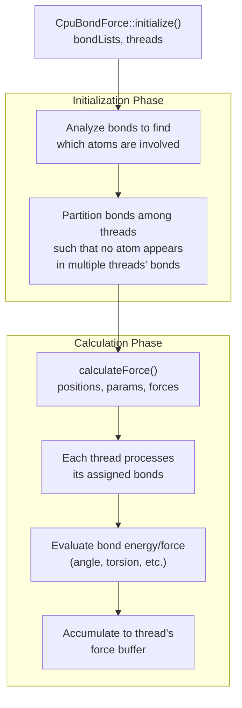

By ensuring no atom appears in multiple threads' bonds simultaneously, write conflicts are eliminated without locks.

**Sources:** Structure inferred from kernel usage patterns in [platforms/cpu/src/CpuKernels.cpp:335-347](), [platforms/cpu/src/CpuKernels.cpp:383-395]()

### Angle Force Example

`CpuCalcHarmonicAngleForceKernel` demonstrates the pattern:

```cpp
void CpuCalcHarmonicAngleForceKernel::initialize(const System& system, const HarmonicAngleForce& force) {
    numAngles = force.getNumAngles();
    angleIndexArray.resize(numAngles, vector<int>(3));      // 3 atoms per angle
    angleParamArray.resize(numAngles, vector<double>(2));   // 2 params (angle, k)
    
    // Copy angle definitions
    for (int i = 0; i < numAngles; ++i) {
        int particle1, particle2, particle3;
        double angle, k;
        force.getAngleParameters(i, particle1, particle2, particle3, angle, k);
        angleIndexArray[i][0] = particle1;
        angleIndexArray[i][1] = particle2;
        angleIndexArray[i][2] = particle3;
        angleParamArray[i][0] = angle;
        angleParamArray[i][1] = k;
    }
    
    // Initialize parallel bond force calculator
    bondForce.initialize(system.getNumParticles(), numAngles, 3, angleIndexArray, data.threads);
}
```

**Sources:** [platforms/cpu/src/CpuKernels.cpp:321-337]()

## SIMD Vectorization Details

The CPU Platform uses `fvec4` (4-wide SIMD) as the primary vectorization width, corresponding to SSE 4.1 or AVX.

### fvec4 Type

`fvec4` is a platform-independent abstraction over SIMD types:
- On SSE: maps to `__m128`
- On AVX: maps to `__m256` (used for wider operations)

Defined in `openmm/internal/vectorize.h` with operations:
- Arithmetic: `+`, `-`, `*`, `/`
- Comparisons: `<`, `>`, `==`
- Functions: `sqrt()`, `abs()`, `min()`, `max()`, `floor()`, `round()`
- Horizontal operations: `dot3()`, `any()`, `all()`

**Sources:** Reference to vectorization abstraction in [platforms/cpu/include/CpuKernels.h:47]()

### AlignedArray Layout

`AlignedArray<float>` ensures proper memory alignment for SIMD loads/stores:

```
AlignedArray<float> posq(4 * numParticles);

Memory layout:
[x0 y0 z0 q0 | x1 y1 z1 q1 | x2 y2 z2 q2 | x3 y3 z3 q3 | ...]
 ^^^^^^^^^^^^^^^
    16-byte aligned
    (SSE requirement)
```

Positions and charges are stored interleaved (AoS - Array of Structures) rather than planar (SoA - Structure of Arrays). While planar layout can be more efficient for some SIMD operations, AoS simplifies the codebase and is still cache-efficient.

**Sources:** [platforms/cpu/include/CpuPlatform.h:106](), [platforms/cpu/src/CpuPlatform.cpp:151-163]()

### Vectorized Force Accumulation

Forces are accumulated using SIMD addition:

```cpp
// Pseudo-code showing SIMD accumulation pattern
fvec4 force(0.0f);  // Initialize to zero vector

for (each neighbor) {
    fvec4 delta = computeDelta();
    fvec4 r2 = dot3(delta, delta);
    fvec4 invR = rsqrt(r2);
    fvec4 energy = computeEnergy(invR);
    fvec4 dEdR = computeDerivative(invR);
    
    force += delta * dEdR;  // SIMD multiply-add
}

// Store accumulated force
force.store(&threadForce[threadIdx][4*atomIndex]);
```

**Sources:** Force accumulation pattern described in [platforms/cpu/src/CpuKernels.cpp:298-305]()

## Deterministic Force Mode

By default, the CPU Platform sums forces in a non-deterministic order due to thread scheduling variations. The `DeterministicForces` property enables a mode that reduces (but does not eliminate) variability.

### Default Mode (Non-Deterministic)

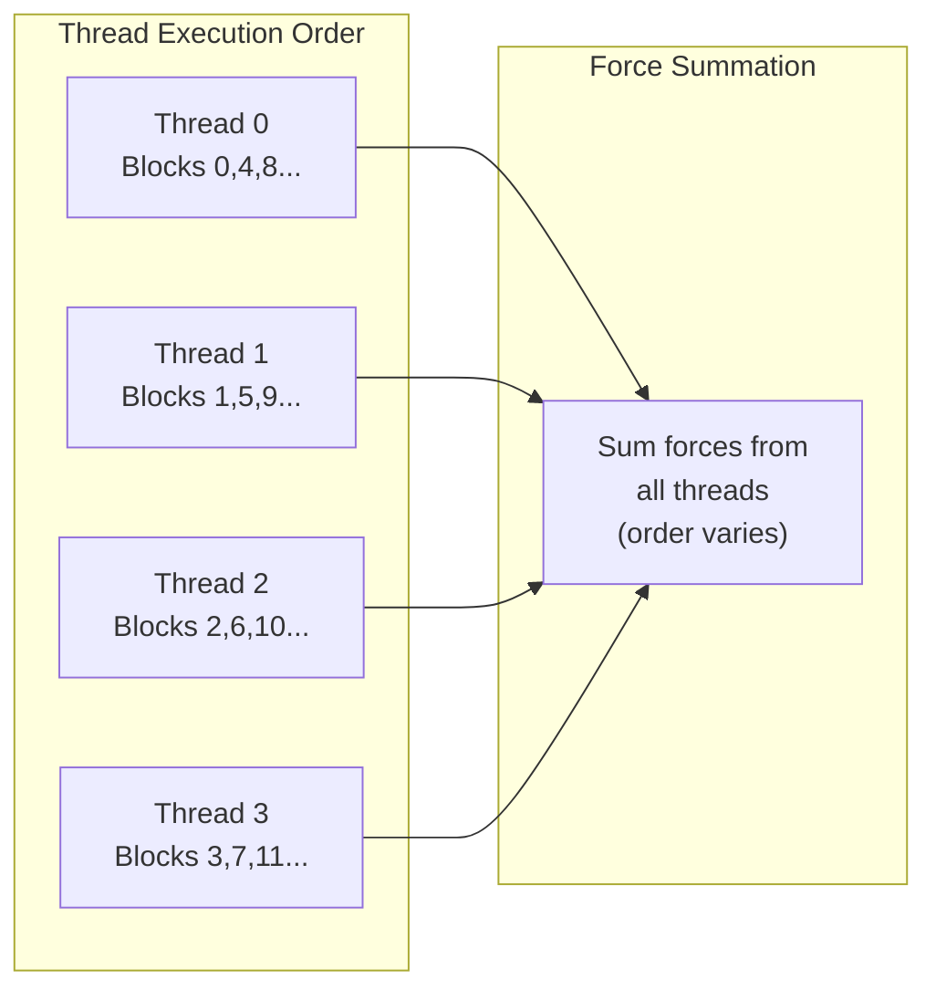

Threads claim blocks via atomic counter increment, so execution order varies between runs.

### Deterministic Mode

When enabled:
- Some algorithms use consistent iteration orders
- Floating-point summation order becomes more predictable
- Performance penalty: ~5-10% slower

**Note:** Even deterministic mode cannot guarantee bit-exact reproducibility across different CPU models or compiler versions due to variations in floating-point rounding.

**Sources:** [platforms/cpu/src/CpuPlatform.cpp:120-123](), [platforms/cpu/include/CpuPlatform.h:74-77]()

## Performance Characteristics

The CPU Platform achieves roughly 10x speedup over the Reference Platform through:

1. **Multi-threading**: Near-linear scaling up to ~8 cores, sublinear beyond due to memory bandwidth limits
2. **SIMD Vectorization**: 2-4x speedup from processing 4 interactions simultaneously
3. **Efficient Neighbor Lists**: Voxel hash reduces neighbor search from O(N²) to O(N)
4. **Cache Optimization**: Hilbert curve sorting improves cache hit rates

Performance relative to other platforms (approximate):
- **vs. Reference**: 10x faster (`getSpeed()` returns 10 vs. Reference's 1)
- **vs. GPU (CUDA/OpenCL)**: 10-50x slower depending on system size
- **Crossover point**: CPU competitive for systems <10,000 atoms on high-end CPUs

**Sources:** [platforms/cpu/src/CpuPlatform.cpp:102-104]()

### Limitations

- **Single Precision Only**: Cannot enable double precision (returns `false` from `supportsDoublePrecision()`)
- **SSE 4.1 Required**: Processors without SSE 4.1 cannot use this platform
- **Memory Bandwidth Bound**: Nonbonded calculations limited by memory bandwidth, not FLOPs
- **No GPU Features**: Cannot leverage GPU-specific optimizations like texture memory or warp-level primitives

**Sources:** [platforms/cpu/src/CpuPlatform.cpp:106-108](), [platforms/cpu/src/CpuPlatform.cpp:110-112]()

## Summary of Key Classes

| Class | Purpose |
|-------|---------|
| `CpuPlatform` | Platform implementation, extends `ReferencePlatform` |
| `CpuPlatform::PlatformData` | Per-context state: threads, buffers, neighbor list |
| `CpuKernelFactory` | Creates CPU-specific kernel implementations |
| `CpuCalcForcesAndEnergyKernel` | Orchestrates force/energy computation lifecycle |
| `CpuNeighborList` | Efficient neighbor list with voxel hash + Hilbert sort |
| `CpuNeighborList::Voxels` | 2D voxel grid for spatial queries |
| `CpuNonbondedForce` | Base class for vectorized nonbonded forces |
| `CpuNonbondedForceFvec<fvec4>` | 4-wide SIMD nonbonded implementation |
| `CpuBondForce` | Parallelized bonded force evaluation |
| `CpuSETTLE` | Parallel SETTLE constraint solver |
| `AlignedArray<float>` | SIMD-aligned memory buffer |
| `ThreadPool` | Worker thread pool (inherited from Reference) |

**Sources:** [platforms/cpu/include/CpuPlatform.h](), [platforms/cpu/include/CpuKernels.h](), [platforms/cpu/include/CpuNeighborList.h](), [platforms/cpu/include/CpuNonbondedForce.h]()

---