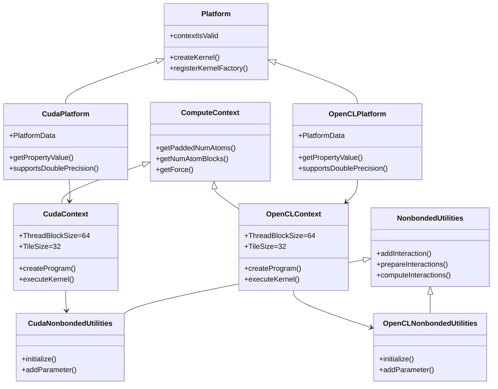
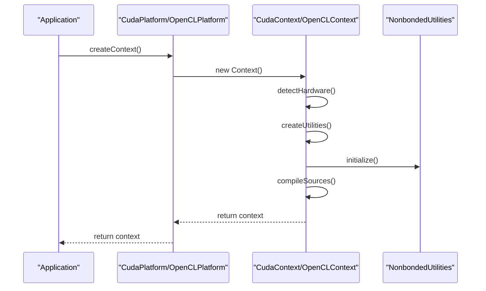
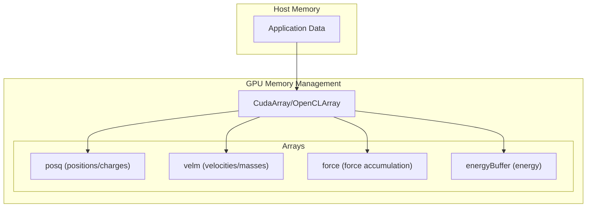
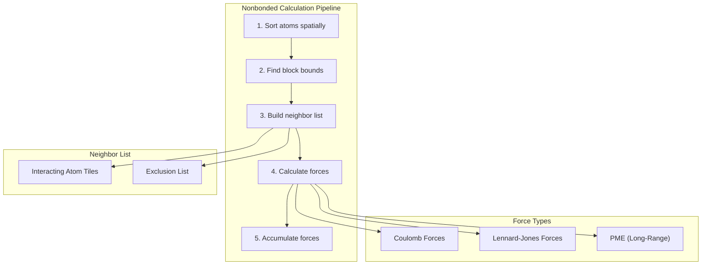
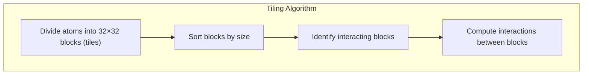
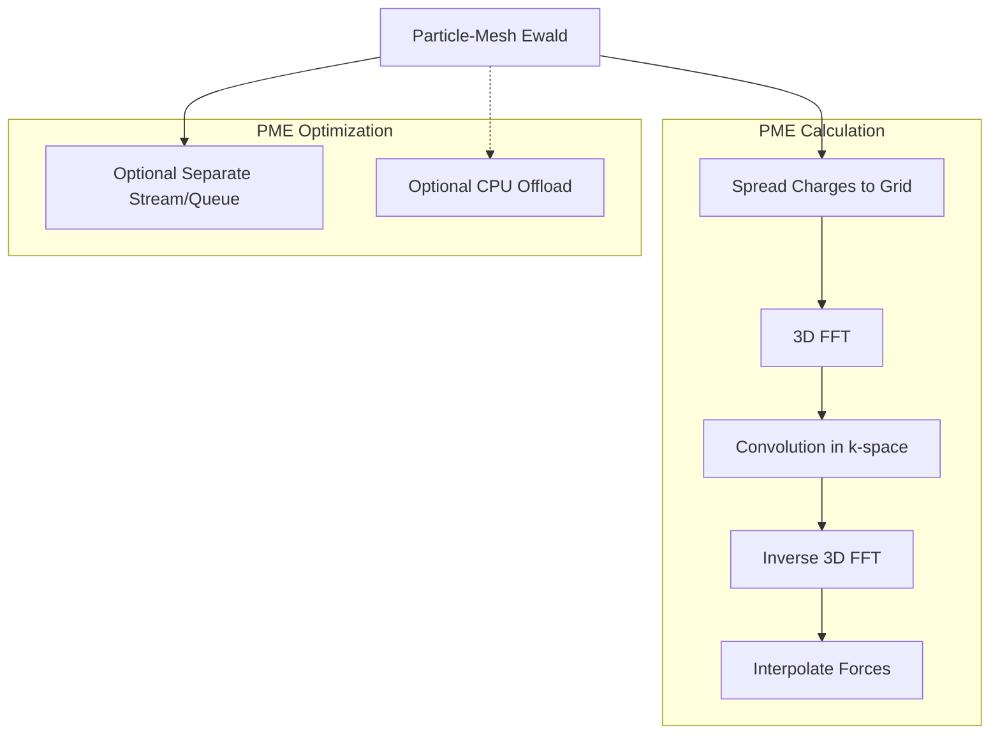
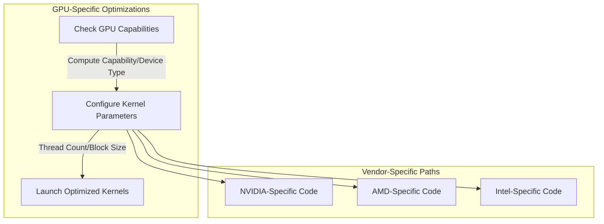
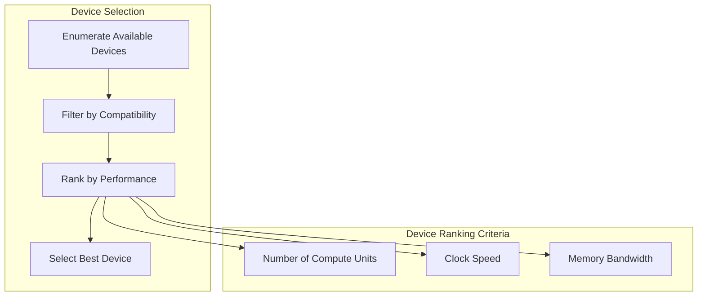
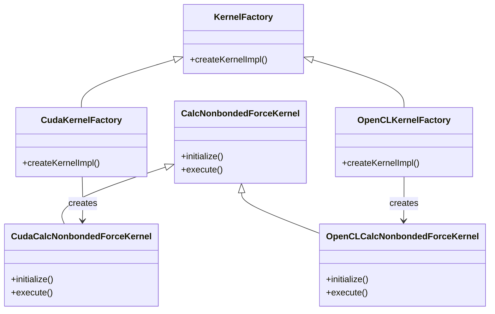

# CUDA/OpenCL Platforms

Relevant source files

The following files were used as context for generating this wiki page:

- [docs-source/api-c++/forces.rst](docs-source/api-c++/forces.rst)
- [olla/include/openmm/kernels.h](olla/include/openmm/kernels.h)
- [openmmapi/include/OpenMM.h](openmmapi/include/OpenMM.h)
- [platforms/common/include/openmm/common/CommonKernels.h](platforms/common/include/openmm/common/CommonKernels.h)
- [platforms/common/include/openmm/common/ComputeContext.h](platforms/common/include/openmm/common/ComputeContext.h)
- [platforms/common/src/CommonKernels.cpp](platforms/common/src/CommonKernels.cpp)
- [platforms/common/src/ComputeContext.cpp](platforms/common/src/ComputeContext.cpp)
- [platforms/cuda/include/CudaContext.h](platforms/cuda/include/CudaContext.h)
- [platforms/cuda/include/CudaKernelFactory.h](platforms/cuda/include/CudaKernelFactory.h)
- [platforms/cuda/include/CudaKernels.h](platforms/cuda/include/CudaKernels.h)
- [platforms/cuda/src/CudaContext.cpp](platforms/cuda/src/CudaContext.cpp)
- [platforms/cuda/src/CudaKernelFactory.cpp](platforms/cuda/src/CudaKernelFactory.cpp)
- [platforms/cuda/src/CudaKernels.cpp](platforms/cuda/src/CudaKernels.cpp)
- [platforms/cuda/src/CudaPlatform.cpp](platforms/cuda/src/CudaPlatform.cpp)
- [platforms/opencl/include/OpenCLContext.h](platforms/opencl/include/OpenCLContext.h)
- [platforms/opencl/include/OpenCLKernels.h](platforms/opencl/include/OpenCLKernels.h)
- [platforms/opencl/src/OpenCLContext.cpp](platforms/opencl/src/OpenCLContext.cpp)
- [platforms/opencl/src/OpenCLKernelFactory.cpp](platforms/opencl/src/OpenCLKernelFactory.cpp)
- [platforms/opencl/src/OpenCLKernels.cpp](platforms/opencl/src/OpenCLKernels.cpp)
- [platforms/opencl/src/OpenCLPlatform.cpp](platforms/opencl/src/OpenCLPlatform.cpp)
- [platforms/reference/include/ReferenceKernels.h](platforms/reference/include/ReferenceKernels.h)
- [platforms/reference/src/ReferenceKernelFactory.cpp](platforms/reference/src/ReferenceKernelFactory.cpp)
- [platforms/reference/src/ReferenceKernels.cpp](platforms/reference/src/ReferenceKernels.cpp)
- [platforms/reference/src/ReferencePlatform.cpp](platforms/reference/src/ReferencePlatform.cpp)
- [serialization/src/SerializationProxyRegistration.cpp](serialization/src/SerializationProxyRegistration.cpp)

This page describes the CUDA and OpenCL implementations in OpenMM that enable GPU-accelerated molecular simulations. These two platforms provide high-performance calculations on NVIDIA (CUDA) and a broader range of GPUs including AMD and Intel (OpenCL). We'll cover how these platforms are structured, initialized, and optimized for molecular dynamics simulations, focusing on their architecture and key algorithms.

For information about the CPU platform implementation, see [CPU Platform](#3.2).

## Platform Architecture Overview

The CUDA and OpenCL platforms share a similar architecture despite targeting different GPU ecosystems. Each platform consists of:

1. A platform class (`CudaPlatform` or `OpenCLPlatform`) that registers the platform with OpenMM
2. A context class (`CudaContext` or `OpenCLContext`) that manages GPU resources
3. Various utility classes for handling different computation types
4. Kernel implementations for specific force calculations

Sources:
- [platforms/cuda/src/CudaPlatform.cpp:63-138]()
- [platforms/opencl/src/OpenCLPlatform.cpp:58-114]()
- [platforms/cuda/src/CudaContext.cpp:85-358]()
- [platforms/opencl/src/OpenCLContext.cpp:67-358]()

## Platform Initialization

When OpenMM starts, the CUDA and OpenCL platforms register themselves as available platforms if the necessary hardware and drivers are detected. Each platform provides properties that control its behavior:

### CUDA Platform Properties
- `CudaDeviceIndex` - Specifies which GPU device to use
- `CudaPrecision` - Controls calculation precision (single, mixed, double)
- `CudaUseCpuPme` - Whether to use CPU for PME calculations
- `CudaCompiler` - Specifies a custom CUDA compiler
- `CudaUseBlockingSync` - Whether to use blocking synchronization
- `CudaDeterministicForces` - Whether to ensure deterministic force calculations

### OpenCL Platform Properties
- `OpenCLDeviceIndex` - Specifies which GPU device to use
- `OpenCLPlatformIndex` - Specifies which OpenCL platform to use
- `OpenCLPrecision` - Controls calculation precision (single, mixed, double)
- `OpenCLUseCpuPme` - Whether to use CPU for PME calculations
- `OpenCLDisablePmeStream` - Whether to disable separate stream for PME

During initialization, these platforms detect available devices, determine their capabilities, and select appropriate compilation parameters.

Sources:
- [platforms/cuda/src/CudaPlatform.cpp:139-250]()
- [platforms/opencl/src/OpenCLPlatform.cpp:137-176]()
- [platforms/cuda/src/CudaContext.cpp:85-358]()
- [platforms/opencl/src/OpenCLContext.cpp:85-358]()

## Data Structures and Memory Management

Both CUDA and OpenCL platforms use similar data structures to manage atomic data and forces:

- `posq` - Array holding positions and charges (float4/double4)
- `velm` - Array holding velocities and masses
- `force` - Array for accumulating forces
- `energyBuffer` - Buffer for energy accumulation

The platforms use slightly different memory models:

### Memory Precision Options

Both platforms support three precision modes:

1. **Single Precision** - Uses float for all calculations (fastest)
2. **Mixed Precision** - Uses float for positions but double for forces and integration
3. **Double Precision** - Uses double for all calculations (most accurate, slowest)

The memory layouts and calculations adjust based on the selected precision option.

Sources:
- [platforms/cuda/src/CudaContext.cpp:219-251]()
- [platforms/opencl/src/OpenCLContext.cpp:320-358]()
- [platforms/cuda/include/CudaContext.h]()
- [platforms/opencl/include/OpenCLContext.h]()

## Force Calculation System

The most computationally intensive part of a molecular dynamics simulation is typically the nonbonded force calculation. The CUDA and OpenCL platforms use sophisticated algorithms to optimize these calculations.

### Nonbonded Force Calculation

Both platforms use a similar approach for nonbonded calculations:

1. Atoms are divided into blocks (tiles) of size 32
2. A spatial sorting algorithm organizes atoms to improve cache efficiency
3. The code builds a neighbor list for calculating only relevant interactions
4. Calculations are parallelized across the GPU using specialized kernels

### Tiling Strategy

Both CUDA and OpenCL platforms use a tiling strategy where atoms are organized into blocks (typically 32×32 atoms), and these blocks are then processed to compute interactions. This approach improves memory access patterns and cache efficiency.

Sources:
- [platforms/cuda/src/CudaNonbondedUtilities.cpp:179-289]()
- [platforms/opencl/src/OpenCLNonbondedUtilities.cpp:199-281]()
- [platforms/cuda/src/kernels/findInteractingBlocks.cu:41-102]()
- [platforms/opencl/src/kernels/findInteractingBlocks.cl:7-67]()
- [platforms/cuda/src/kernels/nonbonded.cu:30-91]()
- [platforms/opencl/src/kernels/nonbonded.cl:16-31]()

## Particle-Mesh Ewald (PME) Implementation

For long-range electrostatic interactions, both platforms implement the Particle-Mesh Ewald method:

1. Direct space calculations use cutoffs and neighbor lists
2. Reciprocal space calculations use 3D FFTs
3. The platforms can optionally use a separate stream/queue for PME calculations

The PME implementation also supports LJPME for long-range dispersion forces.

Sources:
- [platforms/cuda/src/CudaKernels.cpp:407-616]()
- [platforms/opencl/src/OpenCLKernels.cpp:422-616]()

## Hardware Optimization Techniques

Both platforms implement various optimizations to maximize GPU performance:

### Shared Memory and Warps

- CUDA-specific: Uses warp-level synchronization and shuffles for efficient communication
- Both platforms utilize shared memory for tile-based calculations
- `ThreadBlockSize` is set to 64 or multiples to match warp sizes

### Register Pressure Optimization

- Both platforms balance register usage to maximize occupancy
- CUDA kernels are optimized for different compute capabilities

### Atomic Operations

The platforms handle race conditions during force accumulation differently:
- CUDA uses 64-bit atomics on recent GPUs
- OpenCL has special AMD-specific optimizations for atomic operations

### Precision-Specific Intrinsics

Both platforms select appropriate intrinsic functions based on precision mode:
- OpenCL tests native math functions (sqrt, reciprocal) for accuracy
- CUDA selects appropriate intrinsics based on precision mode

Sources:
- [platforms/cuda/src/CudaContext.cpp:209-216]()
- [platforms/opencl/src/OpenCLContext.cpp:218-295]()
- [platforms/cuda/src/kernels/nonbonded.cu:4-28]()
- [platforms/opencl/src/OpenCLContext.cpp:389-434]()

## Platform-Specific Features

While the platforms share a common architecture, they have some implementation differences:

### CUDA-Specific Features
- Support for compute capability detection and optimization
- CUDA streams for asynchronous operations
- Uses NVIDIA's cuFFT library for FFT operations
- Runtime compilation with NVRTC

### OpenCL-Specific Features
- Supports a wider range of hardware vendors (NVIDIA, AMD, Intel, Apple)
- Vendor-specific optimizations based on detected hardware
- Custom FFT implementation (OpenCLFFT3D)
- Compilation via OpenCL runtime

### Differences in Thread Organization

Sources:
- [platforms/cuda/src/CudaContext.cpp:166-187]()
- [platforms/opencl/src/OpenCLContext.cpp:126-187]()

## Performance Tuning and Device Selection

Both platforms allow performance tuning through properties and device selection:

### Device Selection
- `CudaDeviceIndex`/`OpenCLDeviceIndex` allows specifying a particular GPU
- Automatic selection based on device capabilities when not specified
- Multiple GPUs can be used with specialized parallel kernels

### Performance Properties
- Precision mode selection (`CudaPrecision`/`OpenCLPrecision`)
- PME calculation options (`CudaUseCpuPme`/`OpenCLUseCpuPme`)
- Specialized settings like `CudaUseBlockingSync` or `OpenCLDisablePmeStream`

Sources:
- [platforms/cuda/src/CudaContext.cpp:126-165]()
- [platforms/opencl/src/OpenCLContext.cpp:104-187]()
- [platforms/cuda/src/CudaPlatform.cpp:139-207]()
- [platforms/opencl/src/OpenCLPlatform.cpp:195-245]()

## Kernel System and Code Generation

Both platforms use a factory pattern to create appropriate kernel implementations:

The platforms dynamically generate and compile GPU code during initialization, with defines and replacements based on:
- Selected precision mode
- Hardware capabilities
- Periodic boundary conditions configuration
- Force-specific parameters

Sources:
- [platforms/cuda/src/CudaKernelFactory.cpp:44-104]()
- [platforms/opencl/src/OpenCLKernelFactory.cpp:42-107]()
- [platforms/cuda/include/CudaKernels.h:88-217]()
- [platforms/opencl/include/OpenCLKernels.h:88-224]()

## Summary

The CUDA and OpenCL platforms in OpenMM provide highly optimized implementations for GPU-accelerated molecular dynamics simulations. They share a common architecture while addressing platform-specific differences, allowing OpenMM to run efficiently on a wide range of GPU hardware.

Key features of both platforms include:
- Flexible precision options (single, mixed, double)
- Optimized nonbonded force calculations with tiling and neighbor lists
- Efficient Particle-Mesh Ewald implementation for long-range interactions
- Hardware-specific optimizations
- Dynamic code generation and compilation

These platforms form the backbone of OpenMM's ability to deliver high performance molecular dynamics simulations across a wide range of GPU hardware.

---