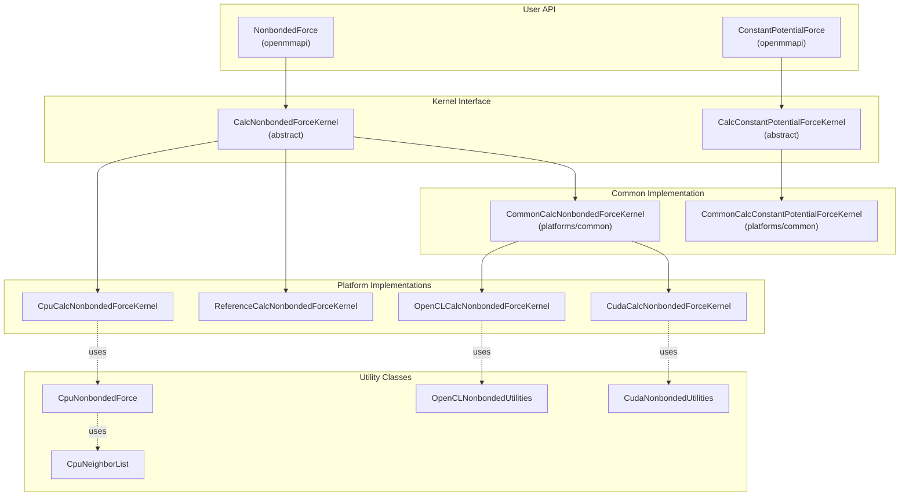
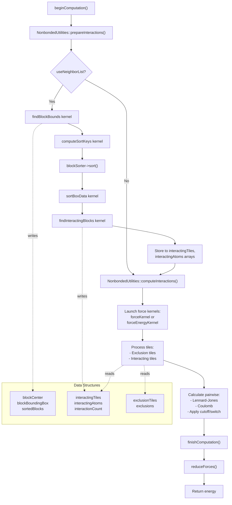

# Nonbonded Interactions and Performance Optimizations

<details>
<summary>Relevant source files</summary>

The following files were used as context for generating this wiki page:

- [docs-source/api-c++/forces.rst](docs-source/api-c++/forces.rst)
- [olla/include/openmm/kernels.h](olla/include/openmm/kernels.h)
- [openmmapi/include/OpenMM.h](openmmapi/include/OpenMM.h)
- [platforms/common/include/openmm/common/CommonKernels.h](platforms/common/include/openmm/common/CommonKernels.h)
- [platforms/common/include/openmm/common/ComputeContext.h](platforms/common/include/openmm/common/ComputeContext.h)
- [platforms/common/src/CommonKernels.cpp](platforms/common/src/CommonKernels.cpp)
- [platforms/common/src/ComputeContext.cpp](platforms/common/src/ComputeContext.cpp)
- [platforms/cpu/include/CpuKernels.h](platforms/cpu/include/CpuKernels.h)
- [platforms/cpu/include/CpuNeighborList.h](platforms/cpu/include/CpuNeighborList.h)
- [platforms/cpu/include/CpuNonbondedForce.h](platforms/cpu/include/CpuNonbondedForce.h)
- [platforms/cpu/include/CpuPlatform.h](platforms/cpu/include/CpuPlatform.h)
- [platforms/cpu/src/CpuKernelFactory.cpp](platforms/cpu/src/CpuKernelFactory.cpp)
- [platforms/cpu/src/CpuKernels.cpp](platforms/cpu/src/CpuKernels.cpp)
- [platforms/cpu/src/CpuNeighborList.cpp](platforms/cpu/src/CpuNeighborList.cpp)
- [platforms/cpu/src/CpuNonbondedForce.cpp](platforms/cpu/src/CpuNonbondedForce.cpp)
- [platforms/cpu/src/CpuNonbondedForceVec4.cpp](platforms/cpu/src/CpuNonbondedForceVec4.cpp)
- [platforms/cpu/src/CpuPlatform.cpp](platforms/cpu/src/CpuPlatform.cpp)
- [platforms/cpu/tests/TestCpuNeighborList.cpp](platforms/cpu/tests/TestCpuNeighborList.cpp)
- [platforms/cuda/include/CudaContext.h](platforms/cuda/include/CudaContext.h)
- [platforms/cuda/include/CudaKernels.h](platforms/cuda/include/CudaKernels.h)
- [platforms/cuda/include/CudaNonbondedUtilities.h](platforms/cuda/include/CudaNonbondedUtilities.h)
- [platforms/cuda/src/CudaContext.cpp](platforms/cuda/src/CudaContext.cpp)
- [platforms/cuda/src/CudaKernelFactory.cpp](platforms/cuda/src/CudaKernelFactory.cpp)
- [platforms/cuda/src/CudaKernels.cpp](platforms/cuda/src/CudaKernels.cpp)
- [platforms/cuda/src/CudaNonbondedUtilities.cpp](platforms/cuda/src/CudaNonbondedUtilities.cpp)
- [platforms/cuda/src/CudaPlatform.cpp](platforms/cuda/src/CudaPlatform.cpp)
- [platforms/cuda/src/kernels/findInteractingBlocks.cu](platforms/cuda/src/kernels/findInteractingBlocks.cu)
- [platforms/opencl/include/OpenCLContext.h](platforms/opencl/include/OpenCLContext.h)
- [platforms/opencl/include/OpenCLKernels.h](platforms/opencl/include/OpenCLKernels.h)
- [platforms/opencl/include/OpenCLNonbondedUtilities.h](platforms/opencl/include/OpenCLNonbondedUtilities.h)
- [platforms/opencl/src/OpenCLContext.cpp](platforms/opencl/src/OpenCLContext.cpp)
- [platforms/opencl/src/OpenCLKernelFactory.cpp](platforms/opencl/src/OpenCLKernelFactory.cpp)
- [platforms/opencl/src/OpenCLKernels.cpp](platforms/opencl/src/OpenCLKernels.cpp)
- [platforms/opencl/src/OpenCLNonbondedUtilities.cpp](platforms/opencl/src/OpenCLNonbondedUtilities.cpp)
- [platforms/opencl/src/OpenCLPlatform.cpp](platforms/opencl/src/OpenCLPlatform.cpp)
- [platforms/opencl/src/kernels/findInteractingBlocks.cl](platforms/opencl/src/kernels/findInteractingBlocks.cl)
- [platforms/reference/include/ReferenceKernels.h](platforms/reference/include/ReferenceKernels.h)
- [platforms/reference/include/ReferencePlatform.h](platforms/reference/include/ReferencePlatform.h)
- [platforms/reference/src/ReferenceKernelFactory.cpp](platforms/reference/src/ReferenceKernelFactory.cpp)
- [platforms/reference/src/ReferenceKernels.cpp](platforms/reference/src/ReferenceKernels.cpp)
- [platforms/reference/src/ReferencePlatform.cpp](platforms/reference/src/ReferencePlatform.cpp)
- [platforms/reference/src/SimTKReference/ReferenceNeighborList.cpp](platforms/reference/src/SimTKReference/ReferenceNeighborList.cpp)
- [platforms/reference/tests/TestReferenceNeighborList.cpp](platforms/reference/tests/TestReferenceNeighborList.cpp)
- [serialization/src/SerializationProxyRegistration.cpp](serialization/src/SerializationProxyRegistration.cpp)

</details>


Nonbonded interactions (van der Waals and electrostatic forces between all pairs of atoms) typically account for 80-95% of the computational cost in molecular dynamics simulations. OpenMM implements sophisticated algorithms to calculate these interactions efficiently across different hardware platforms. This page provides an overview of the nonbonded force calculation system and its performance optimizations.

For detailed information on specific components:
- **Neighbor List Construction** ([page 4.1](#4.1)) - Spatial decomposition and interaction detection algorithms
- **Direct Space Nonbonded Calculations** ([page 4.2](#4.2)) - Short-range Lennard-Jones and Coulomb force computation
- **PME and Long-Range Electrostatics** ([page 4.3](#4.3)) - Particle Mesh Ewald for long-range interactions

## Nonbonded Force Calculation Architecture

The nonbonded force calculation system in OpenMM is organized around platform-independent interfaces and platform-specific implementations. The diagram below shows the key classes involved:

**Diagram: Nonbonded Force Class Hierarchy**



Sources: [platforms/cuda/include/CudaKernels.h:88-102](), [platforms/opencl/include/OpenCLKernels.h:88-102](), [platforms/common/include/openmm/common/CommonKernels.h](), [platforms/cpu/include/CpuKernels.h](), [platforms/reference/include/ReferenceKernels.h]()

## Force Calculation Pipeline

The nonbonded force calculation proceeds through several stages. The following diagram shows the execution flow using actual function names from the codebase:

**Diagram: Nonbonded Force Calculation Pipeline**



Sources: [platforms/cuda/src/CudaKernels.cpp:63-91](), [platforms/opencl/src/OpenCLKernels.cpp:60-87](), [platforms/cuda/src/CudaNonbondedUtilities.cpp:424-498](), [platforms/opencl/src/OpenCLNonbondedUtilities.cpp:333-397]()

## Optimization Strategy Overview

OpenMM achieves high performance for nonbonded calculations through a multi-layered optimization strategy:

### 1. Algorithmic Optimizations

**Cutoff-based methods**: When interactions have a finite cutoff distance, OpenMM uses neighbor lists to avoid computing forces between distant atom pairs. This reduces computational complexity from O(N²) to approximately O(N).

- **Neighbor lists** reduce the number of pair interactions that must be checked
- **Padding** allows reusing neighbor lists for multiple time steps
- **Block-based spatial decomposition** organizes atoms into tiles of 32 atoms

See [Neighbor List Construction](#4.1) for details on the algorithms used, including voxel hashing on CPU and GPU-based block finding.

**Long-range electrostatics**: For systems with periodic boundary conditions, OpenMM uses Particle Mesh Ewald (PME) to efficiently calculate long-range electrostatic interactions.

- **Direct space** calculations handle short-range interactions with a cutoff
- **Reciprocal space** calculations use FFT to handle long-range interactions on a grid
- **LJPME** extends the method to Lennard-Jones interactions

See [PME and Long-Range Electrostatics](#4.3) for implementation details.

Sources: [platforms/cuda/src/CudaNonbondedUtilities.cpp:87-113](), [platforms/opencl/src/OpenCLNonbondedUtilities.cpp:96-122](), [platforms/common/include/openmm/common/CommonKernels.h]()

### 2. Parallelization

**GPU parallelism**: CUDA and OpenCL platforms distribute work across thousands of GPU threads.

- Each thread computes interactions for one atom in a tile
- Warp/wavefront-level parallelism with SIMD width of 32 or 64
- Thread blocks sized for optimal occupancy (typically 256 threads)

**CPU parallelism**: The CPU platform uses multi-threading and SIMD vectorization.

- Thread pool distributes tiles across CPU cores
- SSE4.1, AVX, and AVX2 instructions compute 4-8 interactions simultaneously
- Cache-friendly data layouts minimize memory latency

Sources: [platforms/cuda/src/CudaNonbondedUtilities.cpp:65-79](), [platforms/opencl/src/OpenCLNonbondedUtilities.cpp:56-88](), [platforms/cpu/src/CpuKernels.cpp:160-285]()

### 3. Memory Access Patterns

**Tile-based calculations**: Processing atoms in tiles of 32 improves memory locality.

- Data for a tile is loaded into shared memory (GPU) or cache (CPU) once
- Each thread reuses the loaded data to compute interactions with all atoms in the tile
- Structure-of-arrays layout for position data (`posq` buffer)

**Coalesced memory access**: GPU threads access consecutive memory addresses.

- Thread i accesses atom i's data, ensuring coalesced reads
- Forces accumulated in fixed-point representation to avoid atomic operations
- Position and parameter data laid out for optimal memory bandwidth

Sources: [platforms/cuda/src/kernels/nonbonded.cu:103-265](), [platforms/opencl/src/kernels/nonbonded.cl:16-182]()

## Key Data Structures

The nonbonded utilities classes maintain several important data structures:

| Data Structure | Type | Purpose |
|----------------|------|---------|
| `blockCenter` | Array of real4 | Center position of each 32-atom block |
| `blockBoundingBox` | Array of real4 | Half-widths of bounding box for each block |
| `sortedBlocks` | Array of unsigned int | Block indices sorted by size |
| `interactingTiles` | Array of int | List of tile pairs that interact |
| `interactingAtoms` | Array of int | Atom indices in interacting tiles |
| `exclusionTiles` | Array of int2 | List of tiles containing exclusions |
| `exclusions` | Array of unsigned int | Bitmask of excluded interactions |
| `interactionCount` | Atomic counter | Number of interacting tiles found |

These are allocated and managed by `CudaNonbondedUtilities` and `OpenCLNonbondedUtilities`:

```cpp
// Key initialization code from CudaNonbondedUtilities::initialize()
interactingTiles.initialize<int>(context, maxTiles, "interactingTiles");
interactingAtoms.initialize<int>(context, TileSize*maxTiles, "interactingAtoms");
blockCenter.initialize(context, numAtomBlocks, 4*elementSize, "blockCenter");
blockBoundingBox.initialize(context, numAtomBlocks, 4*elementSize, "blockBoundingBox");
sortedBlocks.initialize<unsigned int>(context, numAtomBlocks, "sortedBlocks");
```

Sources: [platforms/cuda/src/CudaNonbondedUtilities.cpp:257-301](), [platforms/opencl/src/OpenCLNonbondedUtilities.cpp:269-302]()

## Interaction Registration and Force Groups

Forces register their nonbonded interactions with the utilities class using `addInteraction()`:

```cpp
void CudaNonbondedUtilities::addInteraction(bool usesCutoff, bool usesPeriodic, 
    bool usesExclusions, double cutoffDistance,
    const vector<vector<int>>& exclusionList, const string& kernel, 
    int forceGroup, bool useNeighborList, bool supportsPairList)
```

This method:
- Records whether the force uses cutoffs, periodic boundary conditions, and exclusions
- Stores the kernel source code for computing interactions
- Associates the interaction with a force group (for selective force evaluation)
- Determines whether neighbor lists should be used

Multiple forces can contribute to the same force group, and their kernel code is concatenated. This allows computing multiple nonbonded-style forces in a single kernel launch.

Sources: [platforms/cuda/src/CudaNonbondedUtilities.cpp:87-113](), [platforms/opencl/src/OpenCLNonbondedUtilities.cpp:96-122]()

## Direct Space vs. Reciprocal Space

For systems with periodic boundary conditions, nonbonded calculations are split into two parts:

**Direct space (short-range)**: Computed using neighbor lists with a cutoff distance.
- Lennard-Jones interactions (with optional switching function)
- Screened Coulomb interactions (Ewald direct sum)
- Typically handled by the standard nonbonded kernels

**Reciprocal space (long-range)**: Computed using Particle Mesh Ewald.
- Long-range electrostatics beyond the cutoff
- Optional long-range Lennard-Jones (LJPME)
- Uses FFT for efficiency

The split is controlled by parameters:
- `cutoffDistance`: Separates direct and reciprocal space
- `ewaldErrorTol`: Determines the Ewald coefficient (α)
- `pmeGridDimensions`: FFT grid size (auto-calculated if not specified)

See [PME and Long-Range Electrostatics](#4.3) for implementation details.

Sources: [platforms/common/include/openmm/common/CommonKernels.h](), [openmmapi/include/openmm/NonbondedForce.h]()

## Exclusions and Exceptions

Not all atom pairs should interact with the full nonbonded potential:

**Exclusions**: Some pairs have zero interaction (e.g., atoms bonded directly or through one intermediate atom).

**Exceptions**: Some pairs use modified parameters (e.g., 1-4 interactions in AMBER force fields use scaled parameters).

OpenMM handles these efficiently:

1. **Exclusion tiles**: Tiles containing any excluded pairs are identified and stored in the `exclusionTiles` array.
2. **Exclusion masks**: A bitmask in the `exclusions` array indicates which atom pairs in an exclusion tile should not interact.
3. **Exception parameters**: Modified Lennard-Jones and Coulomb parameters are stored separately and looked up during force calculation.

The exclusion checking code in the force kernels uses bitwise operations for efficiency:

```cpp
// Pseudo-code from nonbonded kernels
if (isExclusionTile) {
    unsigned int excl = exclusions[tileIndex*TILE_SIZE + localIndex];
    if (excl & (1 << otherAtomIndex))
        continue; // Skip this interaction
}
```

Sources: [platforms/cuda/src/CudaNonbondedUtilities.cpp:179-271](), [platforms/opencl/src/OpenCLNonbondedUtilities.cpp:201-268]()

## Cutoff Methods

OpenMM supports several methods for handling nonbonded cutoffs:

| Method | Description | Use Case |
|--------|-------------|----------|
| `NoCutoff` | All pairs computed, O(N²) | Small systems, gas phase |
| `CutoffNonPeriodic` | Cutoff in non-periodic box | Solvated droplet |
| `CutoffPeriodic` | Cutoff with periodic boundaries | Reaction field, fast approximation |
| `Ewald` | Ewald summation | Periodic systems (slow) |
| `PME` | Particle Mesh Ewald | Periodic systems (recommended) |
| `LJPME` | PME for LJ + Coulomb | Systems needing accurate LJ long-range |

The cutoff method is specified when creating a `NonbondedForce`:

```cpp
NonbondedForce* nonbonded = new NonbondedForce();
nonbonded->setNonbondedMethod(NonbondedForce::PME);
nonbonded->setCutoffDistance(1.0*nanometers);
nonbonded->setEwaldErrorTolerance(0.0005);
```

Sources: [openmmapi/include/openmm/NonbondedForce.h](), [platforms/common/include/openmm/common/CommonKernels.h]()

## Switching Functions

For Lennard-Jones interactions, OpenMM supports switching functions to smoothly reduce forces to zero at the cutoff:

```cpp
nonbonded->setUseSwitchingFunction(true);
nonbonded->setSwitchingDistance(0.9*nanometers);  // Start tapering
nonbonded->setCutoffDistance(1.0*nanometers);     // Force = 0
```

The switching function is a polynomial that:
- Equals 1.0 for r < switchingDistance
- Smoothly transitions to 0.0 between switchingDistance and cutoffDistance
- Has continuous first and second derivatives (C² continuity)

This reduces energy fluctuations when atoms cross the cutoff boundary.

Sources: [platforms/common/src/CommonKernels.cpp](), [platforms/reference/src/ReferenceKernels.cpp]()

## Performance Characteristics

Typical performance breakdown for a well-optimized simulation on a modern GPU:

| Component | % of Nonbonded Time | Notes |
|-----------|---------------------|-------|
| Neighbor list construction | 5-10% | Only when rebuilt (every 10-20 steps) |
| Direct space calculation | 60-80% | Dominates for moderate cutoffs (1.0 nm) |
| PME reciprocal space | 10-30% | Increases with larger systems |
| Force reduction | 5-10% | Converting fixed-point forces to floating-point |

**Scaling behavior**:
- Direct space: O(N) with neighbor lists, O(N²) without
- PME reciprocal space: O(N log N) due to FFT
- Overall: Near-linear scaling for systems > 10,000 atoms

**GPU vs. CPU performance**: 
- GPUs are typically 10-100× faster for nonbonded calculations
- Speedup is larger for bigger systems due to better parallelism
- CPU platform remains useful for small systems and PME-on-CPU mode

Sources: [platforms/cuda/src/CudaKernels.cpp](), [platforms/opencl/src/OpenCLKernels.cpp](), [platforms/cpu/src/CpuKernels.cpp]()

## Conclusion

OpenMM employs a comprehensive set of performance optimizations across multiple levels:

1. **Algorithmic optimizations**: Neighbor lists, tile-based calculations, and PME for efficient force computation.
2. **Parallelization strategies**: Thread-level parallelism, SIMD vectorization, and GPU parallelism.
3. **Memory access patterns**: Cache-friendly data layouts, memory coalescing, and shared memory usage.
4. **Platform-specific tuning**: Hardware-specific optimizations for CUDA, OpenCL, and CPU platforms.

These optimizations work together to provide excellent performance across a wide range of hardware platforms, from laptops to supercomputers, making OpenMM one of the fastest molecular dynamics engines available.

For more detailed information about specific components, see the [Force Calculation System](#2.2) and [Platform Implementations](#3) pages.

Sources: [platforms/cuda/src/CudaNonbondedUtilities.cpp](), [platforms/opencl/src/OpenCLNonbondedUtilities.cpp](), [plugins/cpupme/src/CpuPmeKernels.cpp]()

---