# Neighbor List Construction

<details>
<summary>Relevant source files</summary>

The following files were used as context for generating this wiki page:

- [platforms/cpu/include/CpuKernels.h](platforms/cpu/include/CpuKernels.h)
- [platforms/cpu/include/CpuNeighborList.h](platforms/cpu/include/CpuNeighborList.h)
- [platforms/cpu/include/CpuNonbondedForce.h](platforms/cpu/include/CpuNonbondedForce.h)
- [platforms/cpu/include/CpuPlatform.h](platforms/cpu/include/CpuPlatform.h)
- [platforms/cpu/src/CpuKernelFactory.cpp](platforms/cpu/src/CpuKernelFactory.cpp)
- [platforms/cpu/src/CpuKernels.cpp](platforms/cpu/src/CpuKernels.cpp)
- [platforms/cpu/src/CpuNeighborList.cpp](platforms/cpu/src/CpuNeighborList.cpp)
- [platforms/cpu/src/CpuNonbondedForce.cpp](platforms/cpu/src/CpuNonbondedForce.cpp)
- [platforms/cpu/src/CpuNonbondedForceVec4.cpp](platforms/cpu/src/CpuNonbondedForceVec4.cpp)
- [platforms/cpu/src/CpuPlatform.cpp](platforms/cpu/src/CpuPlatform.cpp)
- [platforms/cpu/tests/TestCpuNeighborList.cpp](platforms/cpu/tests/TestCpuNeighborList.cpp)
- [platforms/cuda/include/CudaNonbondedUtilities.h](platforms/cuda/include/CudaNonbondedUtilities.h)
- [platforms/cuda/src/CudaNonbondedUtilities.cpp](platforms/cuda/src/CudaNonbondedUtilities.cpp)
- [platforms/cuda/src/kernels/findInteractingBlocks.cu](platforms/cuda/src/kernels/findInteractingBlocks.cu)
- [platforms/opencl/include/OpenCLNonbondedUtilities.h](platforms/opencl/include/OpenCLNonbondedUtilities.h)
- [platforms/opencl/src/OpenCLNonbondedUtilities.cpp](platforms/opencl/src/OpenCLNonbondedUtilities.cpp)
- [platforms/opencl/src/kernels/findInteractingBlocks.cl](platforms/opencl/src/kernels/findInteractingBlocks.cl)
- [platforms/reference/include/ReferencePlatform.h](platforms/reference/include/ReferencePlatform.h)
- [platforms/reference/src/SimTKReference/ReferenceNeighborList.cpp](platforms/reference/src/SimTKReference/ReferenceNeighborList.cpp)
- [platforms/reference/tests/TestReferenceNeighborList.cpp](platforms/reference/tests/TestReferenceNeighborList.cpp)

</details>


## Purpose and Scope

This document describes OpenMM's neighbor list construction algorithms, which accelerate nonbonded force calculations by pre-computing which atom pairs are within cutoff distance. Different platforms use distinct algorithms optimized for their hardware: the CPU platform uses voxel hashing with Hilbert curve sorting, while GPU platforms use a two-stage bounding box approach. For information about how neighbor lists are used during force calculations, see [Direct Space Nonbonded Calculations](#4.2).

## Neighbor List Concept

A neighbor list is a data structure that identifies all atom pairs within a specified cutoff distance, avoiding the need to check all O(N²) pairs during every force calculation. The list includes a **padding distance** beyond the actual cutoff, allowing reuse of the list for multiple timesteps until atoms move significantly.

### Rebuild Criteria

Neighbor lists are rebuilt when:
- Any atom moves more than `PADDING/2` from its position when the list was last built (typical padding is 8-10% of cutoff)
- The periodic box size changes significantly
- A force rebuild is explicitly requested

**Key Rebuild Logic:**

| Platform | Rebuild Check Location | Threshold |
|----------|----------------------|-----------|
| CPU | [platforms/cpu/src/CpuKernels.cpp:240-284]() | 0.25 × padding² |
| CUDA | [platforms/cuda/src/kernels/findInteractingBlocks.cu:174-184]() | 0.25 × PADDING² |
| OpenCL | [platforms/opencl/src/kernels/findInteractingBlocks.cl:140-150]() | 0.25 × PADDING² |

Sources: [platforms/cpu/src/CpuKernels.cpp:238-284](), [platforms/cuda/src/kernels/findInteractingBlocks.cu:144-185]()

## CPU Platform: Voxel Hash with Hilbert Sorting

The CPU platform uses `CpuNeighborList` which implements a sophisticated voxel-based spatial partitioning scheme combined with Hilbert curve sorting for cache efficiency.

### Architecture Overview

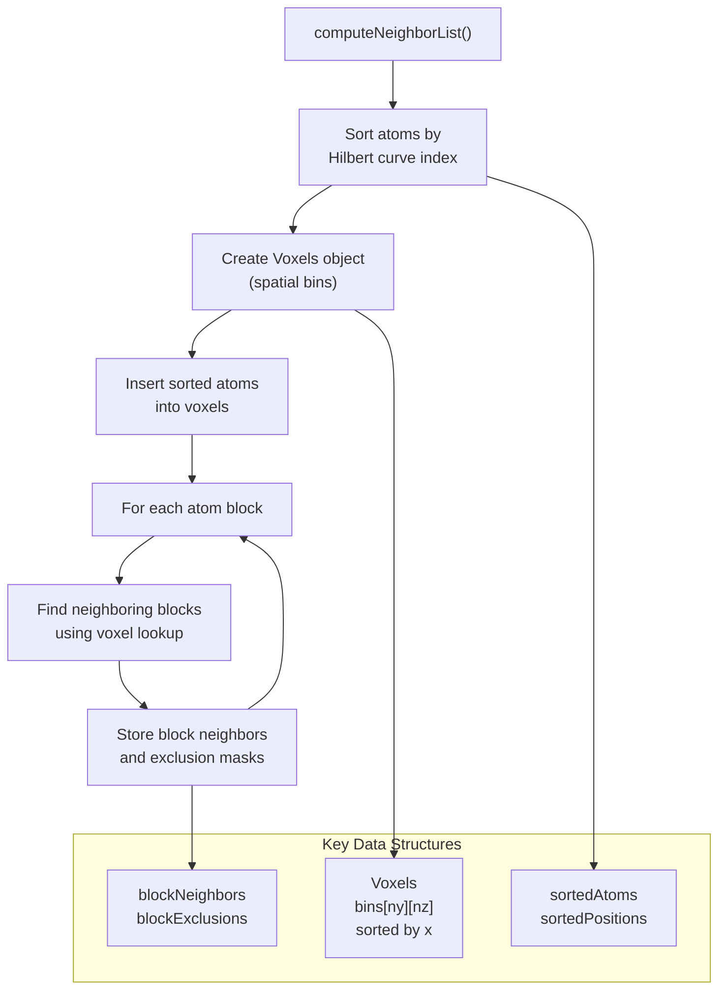

Sources: [platforms/cpu/src/CpuNeighborList.cpp:61-155](), [platforms/cpu/include/CpuNeighborList.h:44-115]()

### Hilbert Curve Sorting

Atoms are sorted using a Hilbert space-filling curve to improve spatial locality and cache performance. The Hilbert curve maps 3D coordinates to a 1D index while preserving spatial proximity.

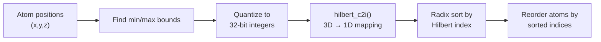

**Implementation:**
- [platforms/cpu/src/CpuNeighborList.cpp:331-379]() - Hilbert index computation
- [platforms/cpu/src/hilbert.cpp]() - Core Hilbert curve functions

Sources: [platforms/cpu/src/CpuNeighborList.cpp:331-379](), [platforms/cpu/src/hilbert.h]()

### Voxel Data Structure

The `Voxels` class divides space into bins along Y and Z axes, with each bin storing atoms sorted by X coordinate for efficient range queries.

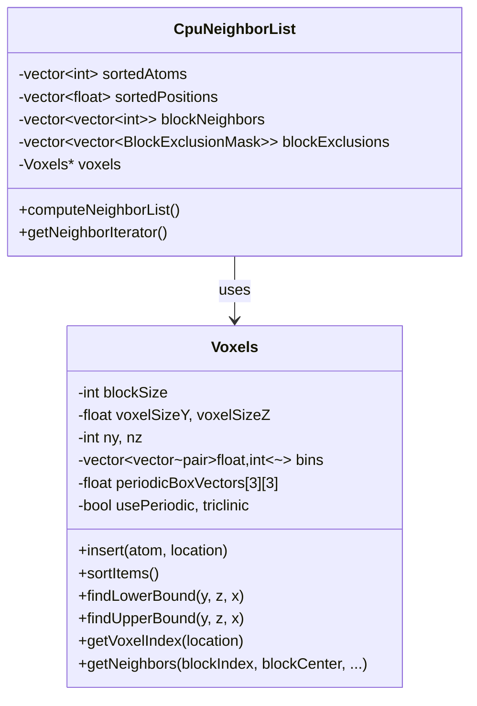

**Voxel Partitioning Strategy:**
- Y and Z dimensions divided into voxels (up to 500 bins per dimension)
- Each voxel bin stores `(x_position, atom_index)` pairs
- Binary search on X within each voxel provides O(log n) lookups
- For periodic systems: voxel size = box_size / num_voxels

Sources: [platforms/cpu/src/CpuNeighborList.cpp:58-165](), [platforms/cpu/include/CpuNeighborList.h:46-47]()

### Neighbor Finding Algorithm

For each atom block, the algorithm queries nearby voxels to find potential neighbors:

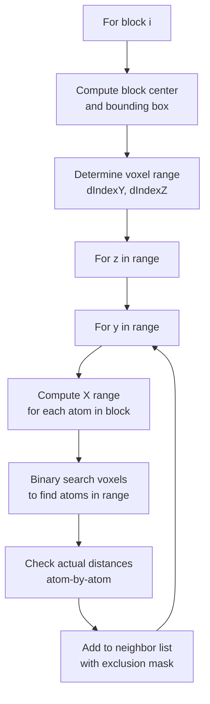

**Key Features:**
- Block-centric: finds all atoms interacting with each block
- Uses bounding boxes to minimize voxel queries
- Binary search within voxels (X-dimension)
- Handles periodic boundary conditions with image offsets
- Stores exclusion masks as bitmasks for efficient GPU upload

Sources: [platforms/cpu/src/CpuNeighborList.cpp:166-330](), [platforms/cpu/src/CpuNeighborList.cpp:423-654]()

### Parallel Execution

The neighbor list construction is parallelized across multiple threads:

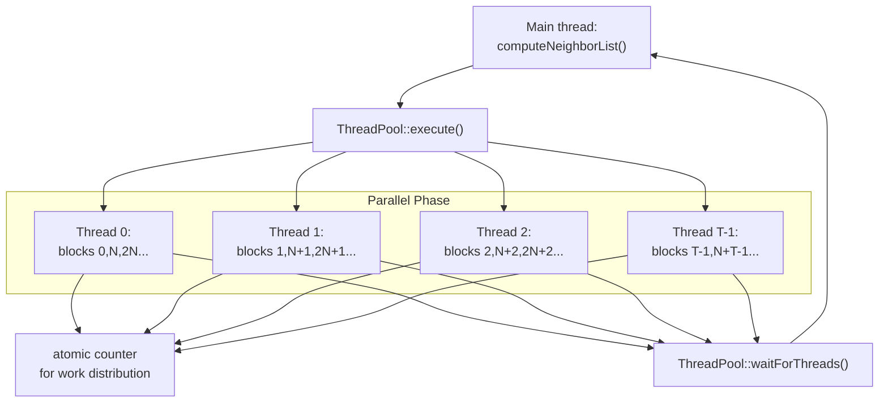

**Implementation Details:**
- Atomic counter for dynamic work distribution: [platforms/cpu/src/CpuNeighborList.cpp:413-418]()
- Each thread processes blocks independently
- No locks needed as each block writes to distinct memory

Sources: [platforms/cpu/src/CpuNeighborList.cpp:391-421]()

## GPU Platforms: Two-Stage Bounding Box Approach

GPU platforms (CUDA and OpenCL) use a fundamentally different algorithm optimized for massive parallelism and coalesced memory access.

### Two-Stage Pipeline

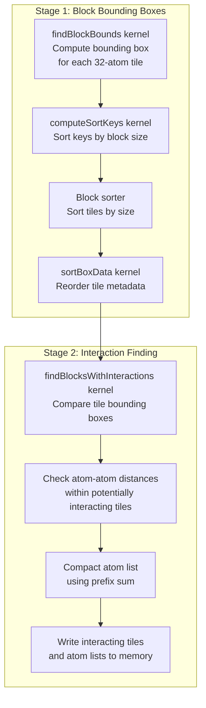

Sources: [platforms/cuda/src/kernels/findInteractingBlocks.cu:1-517](), [platforms/opencl/src/kernels/findInteractingBlocks.cl:1-398]()

### Tile-Based Organization

GPU implementations divide atoms into **tiles** of 32 atoms (matching warp size on NVIDIA GPUs):

| Data Structure | Type | Contents |
|----------------|------|----------|
| `blockCenter` | real4[] | Center of mass + radius for each tile |
| `blockBoundingBox` | real4[] or half3[] | Half-widths of bounding box |
| `sortedBlocks` | uint[] | Tile indices sorted by size |
| `interactingTiles` | int[] | List of tile pairs to compute |
| `interactingAtoms` | int[] | Specific atoms in each interacting tile |

Sources: [platforms/cuda/src/CudaNonbondedUtilities.cpp:258-278](), [platforms/opencl/src/OpenCLNonbondedUtilities.cpp:282-301]()

### Bounding Box Calculation

The `findBlockBounds` kernel computes tight bounding boxes for each tile:

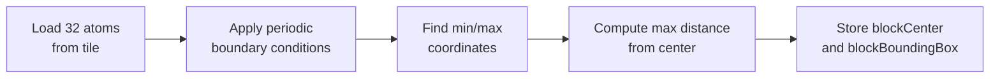

**CUDA Implementation:** [platforms/cuda/src/kernels/findInteractingBlocks.cu:41-102]()

**Key optimizations:**
- Each thread handles one complete tile (32 atoms)
- Periodic box wrapping applied before min/max computation
- Stores both half-widths (for box tests) and radius (for sphere tests)

Sources: [platforms/cuda/src/kernels/findInteractingBlocks.cu:41-102](), [platforms/opencl/src/kernels/findInteractingBlocks.cl:7-68]()

### Block Sorting by Size

Tiles are sorted by bounding box size to improve load balancing:

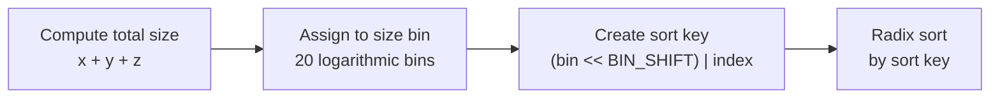

**Purpose:** Sorting ensures similar-sized tiles are processed together, reducing warp divergence when checking interactions.

**Implementation:**
- CUDA: [platforms/cuda/src/kernels/findInteractingBlocks.cu:104-132]()
- Uses 20 logarithmic size bins for better distribution

Sources: [platforms/cuda/src/kernels/findInteractingBlocks.cu:104-132](), [platforms/opencl/src/kernels/findInteractingBlocks.cl:70-98]()

### Finding Interacting Blocks

The `findBlocksWithInteractions` kernel is the most complex part, using warp-level cooperation:

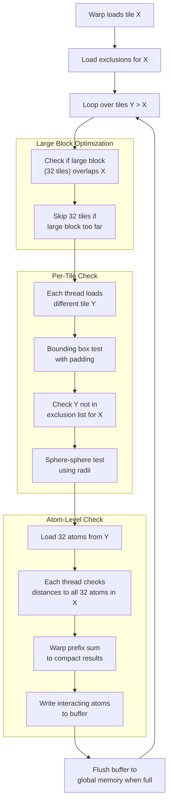

**Warp-Level Optimization:**
- All 32 threads in a warp process the same tile X simultaneously
- Each thread evaluates a different candidate tile Y
- Uses `__syncwarp()` (CUDA) or `barrier()` (OpenCL) for cooperation
- Buffer size: 256 atoms per warp to amortize global memory writes

Sources: [platforms/cuda/src/kernels/findInteractingBlocks.cu:239-517](), [platforms/opencl/src/kernels/findInteractingBlocks.cl:157-398]()

### Large Block Optimization

For large systems (>90,000 atoms on CUDA, >100,000 on OpenCL), an additional optimization groups 32 regular tiles into "large blocks":

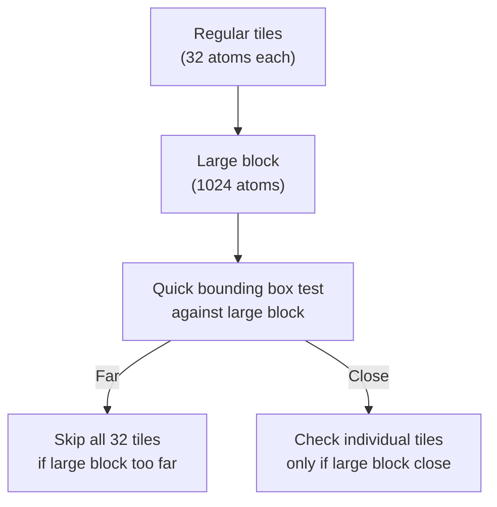

**Trade-off:** Faster neighbor list construction but potentially less efficient list (can't sort tiles by size).

**Selection Logic:**
- CUDA: [platforms/cuda/src/CudaNonbondedUtilities.cpp:77-78]()
- OpenCL: [platforms/opencl/src/OpenCLNonbondedUtilities.cpp:83-84]()

Sources: [platforms/cuda/src/CudaNonbondedUtilities.cpp:75-78](), [platforms/opencl/src/OpenCLNonbondedUtilities.cpp:78-84]()

## Platform-Specific Data Structures

### CPU: Block Iterator Pattern

The CPU platform provides a `NeighborIterator` for efficient traversal:

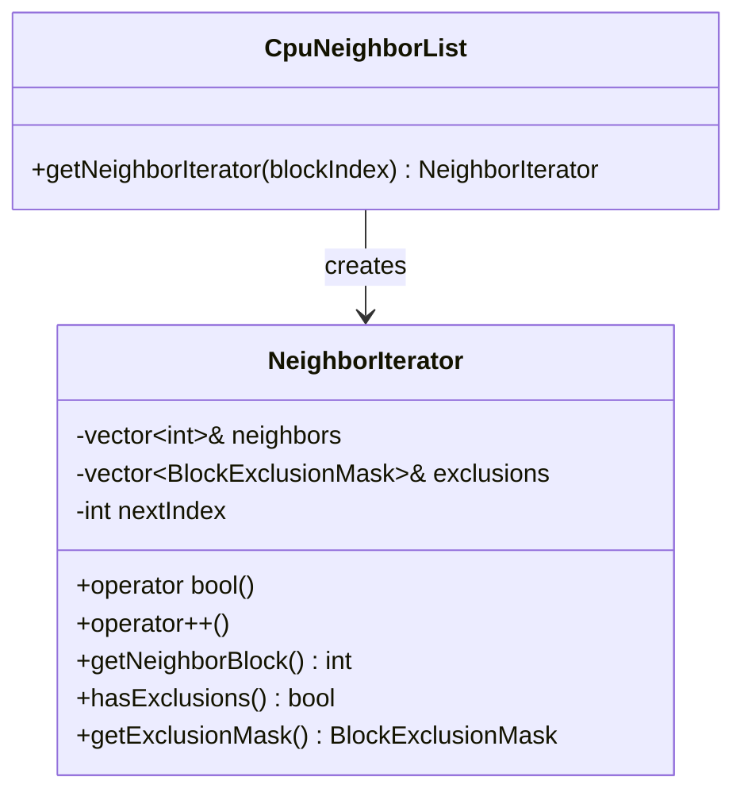

**Usage Pattern:**
```cpp
// Iterate over neighbors of block i
for (NeighborIterator iter = neighborList.getNeighborIterator(i); iter; ++iter) {
    int neighborBlock = iter.getNeighborBlock();
    if (iter.hasExclusions()) {
        BlockExclusionMask mask = iter.getExclusionMask();
        // Use mask to skip excluded pairs
    }
}
```

Sources: [platforms/cpu/include/CpuNeighborList.h:117-155]()

### GPU: Tile and Atom Arrays

GPU platforms store results in parallel arrays:

| Array | Description | Size |
|-------|-------------|------|
| `interactingTiles` | X-tile indices for each interaction | maxTiles |
| `interactingAtoms` | Y-atoms for each tile-pair | TileSize × maxTiles |
| `singlePairs` | Individual atom pairs (CUDA only) | maxSinglePairs |
| `interactionCount` | Total tiles/pairs found | 1-2 elements |

**Dynamic Resizing:** Arrays grow by 20% when overflow detected: [platforms/cuda/src/CudaNonbondedUtilities.cpp:441-478]()

Sources: [platforms/cuda/src/CudaNonbondedUtilities.cpp:258-278](), [platforms/cuda/include/CudaNonbondedUtilities.h:151-172]()

## Exclusions Handling

All platforms must handle exclusions (e.g., 1-2, 1-3 bonded pairs) that should not interact:

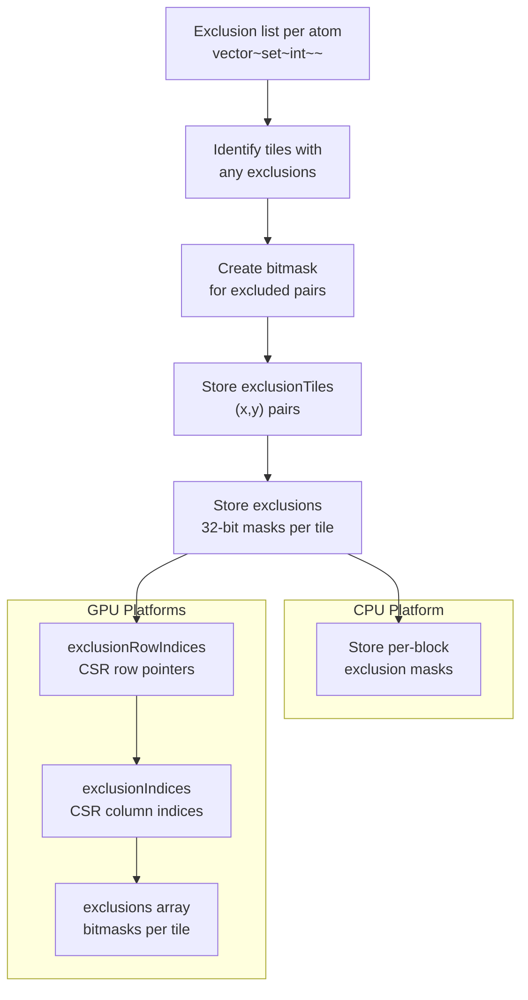

**Bitmask Format:** For a tile pair (X, Y), the exclusion mask has one bit per atom in the tile. If bit `i` is clear, atom `X*TileSize + i` is excluded from interactions.

**Implementations:**
- CPU: [platforms/cpu/src/CpuNeighborList.cpp:670-723]()
- CUDA: [platforms/cuda/src/CudaNonbondedUtilities.cpp:180-243]()
- OpenCL: [platforms/opencl/src/OpenCLNonbondedUtilities.cpp:202-267]()

Sources: [platforms/cpu/src/CpuNeighborList.cpp:656-723](), [platforms/cuda/src/CudaNonbondedUtilities.cpp:179-243]()

## Reference Platform: Naive and Voxel Hash

The Reference platform provides two implementations for testing and validation:

### Naive O(N²) Algorithm

Simple double loop checking all pairs:

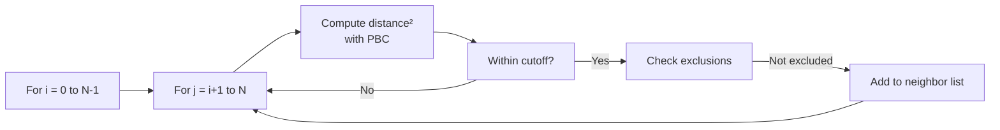

**Purpose:** Correctness reference, not for production use.

Sources: [platforms/reference/src/SimTKReference/ReferenceNeighborList.cpp:28-57]()

### Voxel Hash Algorithm

Similar to CPU platform but simpler:
- No Hilbert sorting
- Simpler voxel structure
- Used as intermediate performance reference

Sources: [platforms/reference/src/SimTKReference/ReferenceNeighborList.cpp:84-333]()

## Performance Characteristics

### Complexity Analysis

| Platform | Build Time | Memory | Cache Efficiency |
|----------|-----------|--------|------------------|
| CPU | O(N log N + N×M) | O(N + B×M) | Excellent (Hilbert) |
| CUDA | O(N log B + B²) | O(N + T²) | Good (coalesced) |
| OpenCL | O(N log B + B²) | O(N + T²) | Good (coalesced) |
| Reference | O(N²) or O(N×V) | O(N²) or O(N+V) | Poor |

Where: N = atoms, B = blocks/tiles, M = avg neighbors per block, T = tiles with interactions, V = voxels

### Padding Strategy

Padding allows neighbor list reuse across multiple timesteps:

| Platform | Padding | Rebuild Frequency |
|----------|---------|------------------|
| CPU | 25% of cutoff | Every ~10-50 steps |
| CUDA | 8% of cutoff | Every ~20-100 steps |
| OpenCL | 10% of cutoff | Every ~20-80 steps |

**Implementation:**
- CPU: [platforms/cpu/src/CpuPlatform.cpp:170-187]()
- CUDA: [platforms/cuda/src/CudaNonbondedUtilities.cpp:380-383]()
- OpenCL: [platforms/opencl/src/OpenCLNonbondedUtilities.cpp:328-331]()

Sources: [platforms/cpu/src/CpuPlatform.cpp:170-187](), [platforms/cuda/src/CudaNonbondedUtilities.cpp:380-383]()

## Integration with Force Calculations

The neighbor list is consumed by nonbonded force kernels:

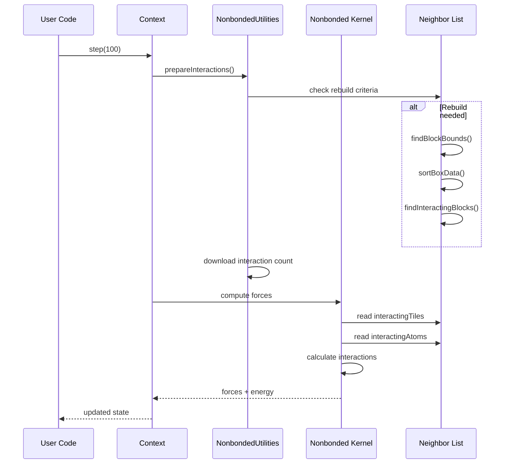

**Synchronization:** GPU platforms use asynchronous downloads and events to overlap neighbor list building with other work:
- CUDA: [platforms/cuda/src/CudaNonbondedUtilities.cpp:410-411]()
- OpenCL: [platforms/opencl/src/OpenCLNonbondedUtilities.cpp:363-371]()

Sources: [platforms/cuda/src/CudaNonbondedUtilities.cpp:402-412](), [platforms/opencl/src/OpenCLNonbondedUtilities.cpp:333-372]()

---