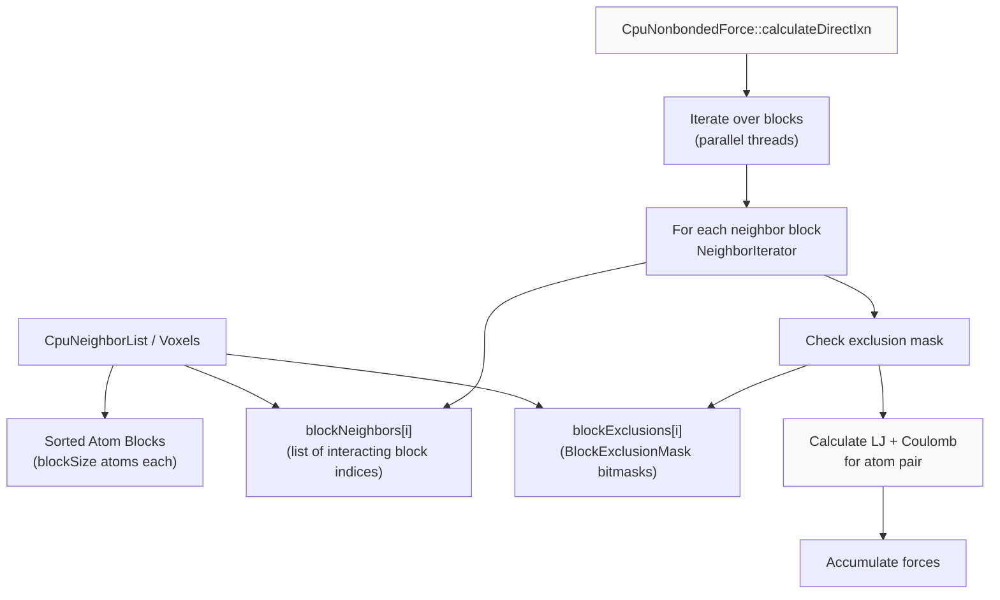
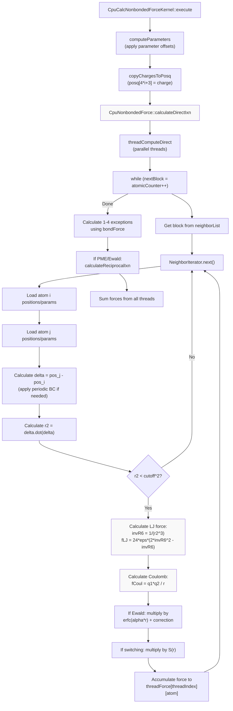
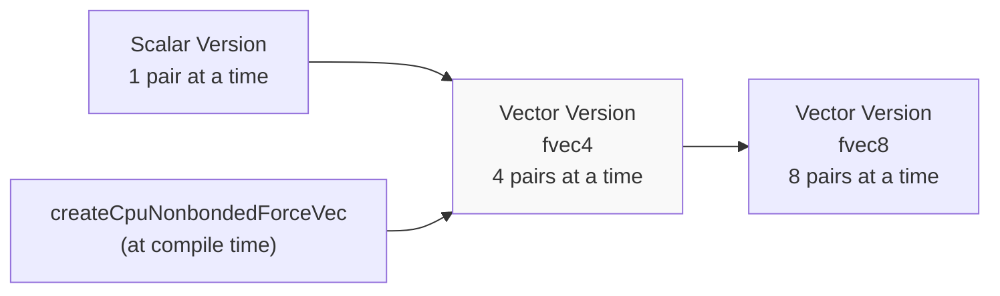
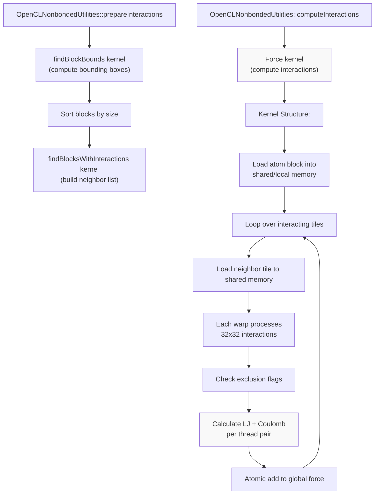

# Direct Space Nonbonded Calculations

<details>
<summary>Relevant source files</summary>

The following files were used as context for generating this wiki page:

- [platforms/cpu/include/CpuKernels.h](platforms/cpu/include/CpuKernels.h)
- [platforms/cpu/include/CpuNeighborList.h](platforms/cpu/include/CpuNeighborList.h)
- [platforms/cpu/include/CpuNonbondedForce.h](platforms/cpu/include/CpuNonbondedForce.h)
- [platforms/cpu/include/CpuPlatform.h](platforms/cpu/include/CpuPlatform.h)
- [platforms/cpu/src/CpuKernelFactory.cpp](platforms/cpu/src/CpuKernelFactory.cpp)
- [platforms/cpu/src/CpuKernels.cpp](platforms/cpu/src/CpuKernels.cpp)
- [platforms/cpu/src/CpuNeighborList.cpp](platforms/cpu/src/CpuNeighborList.cpp)
- [platforms/cpu/src/CpuNonbondedForce.cpp](platforms/cpu/src/CpuNonbondedForce.cpp)
- [platforms/cpu/src/CpuNonbondedForceVec4.cpp](platforms/cpu/src/CpuNonbondedForceVec4.cpp)
- [platforms/cpu/src/CpuPlatform.cpp](platforms/cpu/src/CpuPlatform.cpp)
- [platforms/cpu/tests/TestCpuNeighborList.cpp](platforms/cpu/tests/TestCpuNeighborList.cpp)
- [platforms/cuda/include/CudaNonbondedUtilities.h](platforms/cuda/include/CudaNonbondedUtilities.h)
- [platforms/cuda/src/CudaNonbondedUtilities.cpp](platforms/cuda/src/CudaNonbondedUtilities.cpp)
- [platforms/cuda/src/kernels/findInteractingBlocks.cu](platforms/cuda/src/kernels/findInteractingBlocks.cu)
- [platforms/opencl/include/OpenCLNonbondedUtilities.h](platforms/opencl/include/OpenCLNonbondedUtilities.h)
- [platforms/opencl/src/OpenCLNonbondedUtilities.cpp](platforms/opencl/src/OpenCLNonbondedUtilities.cpp)
- [platforms/opencl/src/kernels/findInteractingBlocks.cl](platforms/opencl/src/kernels/findInteractingBlocks.cl)
- [platforms/reference/include/ReferencePlatform.h](platforms/reference/include/ReferencePlatform.h)
- [platforms/reference/src/SimTKReference/ReferenceNeighborList.cpp](platforms/reference/src/SimTKReference/ReferenceNeighborList.cpp)
- [platforms/reference/tests/TestReferenceNeighborList.cpp](platforms/reference/tests/TestReferenceNeighborList.cpp)

</details>


## Purpose and Scope

This page describes the computation of short-range nonbonded interactions in OpenMM using the neighbor lists constructed as described in [Neighbor List Construction](#4.1). Direct space calculations encompass Lennard-Jones (van der Waals) and Coulomb (electrostatic) interactions between atom pairs within a cutoff distance. For long-range electrostatics handled via PME, see [PME and Long-Range Electrostatics](#4.3).

## Overview of Direct Space Interactions

Direct space nonbonded calculations evaluate pairwise potentials between atoms that are spatially close, as determined by the neighbor list. The term "direct space" distinguishes these real-space interactions from reciprocal-space calculations used in Ewald summation methods.

The primary interaction types computed are:

- **Lennard-Jones (LJ)**: 12-6 potential modeling van der Waals forces
- **Coulomb electrostatics**: Charge-charge interactions with various treatments (cutoff, reaction field, or Ewald direct space component)
- **Exceptions**: Modified parameters for bonded 1-4 interactions

All platforms follow a common computational pattern: iterate over atom blocks, use the neighbor list to identify interacting atoms, compute forces for each pair, and accumulate results.

**Sources:** [platforms/cpu/src/CpuNonbondedForce.cpp:376-406](), [platforms/cpu/include/CpuNonbondedForce.h:152-240]()

## Interaction Potentials

### Lennard-Jones Potential

The Lennard-Jones potential between atoms i and j is computed as:

```
E_LJ = 4*epsilon*((sigma/r)^12 - (sigma/r)^6)
```

In the implementation, this is optimized by storing preprocessed parameters `sigma/2` and `2*sqrt(epsilon)` per atom, from which the combined parameters for a pair are computed:

```
sigma_ij = sigma_i + sigma_j
epsilon_ij = epsilon_i * epsilon_j
```

The force calculation uses an inverse power representation to minimize divisions:

```
r2 = distance^2
r6 = r2^3
invR6 = 1/r6
energy = 4*epsilon*(invR6*invR6 - invR6)
force_magnitude = 24*epsilon*(2*invR6*invR6 - invR6)/r2
```

**Sources:** [platforms/cpu/src/CpuNonbondedForce.cpp:67-85](), [platforms/cpu/include/CpuNonbondedForce.h:44-58]()

### Coulomb Interactions

For direct space Coulomb interactions, the energy is:

```
E_coulomb = ONE_4PI_EPS0 * q_i * q_j / r
```

When using Ewald summation or PME, the direct space component is modified by a complementary error function:

```
E_coulomb = ONE_4PI_EPS0 * q_i * q_j * erfc(alpha*r) / r
```

Where `alpha` is the Ewald splitting parameter. For reaction field, the potential is modified by a distance-dependent dielectric:

```
E_coulomb = ONE_4PI_EPS0 * q_i * q_j * (1/r + krf*r^2 - crf)
```

**Sources:** [platforms/cpu/src/CpuNonbondedForce.cpp:143-152](), [platforms/cpu/src/CpuNonbondedForce.cpp:208-223]()

### Switching Functions

A switching function smoothly reduces forces to zero near the cutoff to avoid discontinuities. When enabled, forces are multiplied by a switching function S(r) that transitions from 1 at `switchingDistance` to 0 at `cutoffDistance`:

```
t = (r - switchingDistance) / (cutoffDistance - switchingDistance)
S(r) = 1 - 6*t^5 + 15*t^4 - 10*t^3
```

**Sources:** [platforms/cpu/src/CpuNonbondedForce.cpp:95-98]()

## Neighbor List Usage in Force Calculations

The neighbor list constructed in page [4.1](#4.1) divides atoms into blocks (typically 32 atoms each). For each block, the neighbor list stores:

1. **Sorted atom positions**: Atoms reordered by Hilbert curve index for cache efficiency
2. **Interacting tiles/blocks**: Lists of which atom blocks interact with each block
3. **Interacting atoms**: For each tile pair, a list of specific atoms that interact
4. **Exclusion masks**: Bit masks indicating which atom pairs within a tile should be excluded



**Diagram: Neighbor List Data Flow into Force Calculation Loop**

The CPU implementation iterates over neighbor list blocks in parallel threads. Each thread processes a subset of atom blocks and computes forces with their neighbors:

**Sources:** [platforms/cpu/src/CpuNonbondedForce.cpp:408-443](), [platforms/cpu/include/CpuNeighborList.h:117-152]()

## Exclusions and Exceptions

### Exclusion Handling

Exclusions prevent specific atom pairs from interacting (typically bonded atoms). The neighbor list stores exclusions as bitmasks where each bit corresponds to an atom in the tile:

```cpp
typedef int16_t BlockExclusionMask;
```

During force calculation, the exclusion mask is checked before computing each interaction. If bit j is cleared in the mask for atom i, the pair (i,j) is excluded.

**Sources:** [platforms/cpu/include/CpuNeighborList.h:80-85](), [platforms/opencl/src/OpenCLNonbondedUtilities.cpp:244-266]()

### Exception (1-4) Interactions

Exceptions represent atom pairs with modified parameters, typically 1-4 bonded interactions. These are handled separately from normal nonbonded interactions:

1. **Storage**: Exception parameters stored in `bonded14ParamArray` with indices in `bonded14IndexArray`
2. **Calculation**: Computed using `ReferenceLJCoulomb14` with special scaling factors
3. **Timing**: Evaluated during the direct space loop but with different parameters

| Property | Normal Nonbonded | 1-4 Exceptions |
|----------|------------------|----------------|
| Parameters | Global sigma/epsilon | Per-exception values |
| Exclusions | Stored in neighbor list | Separate list |
| Cutoff | Subject to cutoff | Can use periodic BC separately |
| Evaluation | Via neighbor list | Direct pair list |

**Sources:** [platforms/cpu/src/CpuKernels.cpp:504-554](), [platforms/cpu/include/CpuKernels.h:226-240]()

## Force Calculation Flow

### CPU Platform Implementation



**Diagram: CPU Force Calculation Execution Flow**

The CPU implementation uses the following key components:

| Component | Type | Purpose |
|-----------|------|---------|
| `CpuNonbondedForce` | Class | Manages nonbonded calculation state and methods |
| `threadComputeDirect` | Method | Per-thread worker computing subset of interactions |
| `calculateBlockEwaldIxn` | Method | Block-based Ewald direct space calculation |
| `threadForce` | `vector<AlignedArray<float>>` | Per-thread force accumulation buffers |
| `neighborList` | `CpuNeighborList*` | Reference to neighbor list structure |
| `atomicCounter` | `atomic<int>` | Thread-safe block assignment counter |

**Sources:** [platforms/cpu/src/CpuNonbondedForce.cpp:376-406](), [platforms/cpu/src/CpuNonbondedForce.cpp:408-443]()

### Vectorized Implementation

The CPU platform uses SIMD vectorization (SSE 4.1/AVX) to process multiple interactions simultaneously. The vectorized version (`CpuNonbondedForceFvec`) computes 4 or 8 atom pairs in parallel:



Key vectorization features:

- **Load operations**: `fvec4::load(&posq[4*atom])` loads x,y,z,q for 4 atoms
- **Arithmetic**: All distance calculations and force evaluations vectorized
- **Conditional execution**: Uses blend operations for cutoff tests
- **Accumulation**: Vector stores to force arrays

**Sources:** [platforms/cpu/src/CpuNonbondedForceVec4.cpp:1-34](), [platforms/cpu/include/CpuNonbondedForce.h:1-26]()

## GPU Platform Implementations

### OpenCL/CUDA Kernel Structure

GPU platforms compute direct space interactions using specialized kernels that process tiles of atoms. The kernel workflow differs significantly from CPU:



**Diagram: GPU Kernel Execution Pattern**

### Key GPU Implementation Details

**Tile-based Processing**: GPU kernels process 32x32 atom tiles. Each thread computes interactions for one atom in block X against one atom in block Y.

**Shared Memory Usage**: Atom positions and parameters loaded into shared memory to minimize global memory access:

```
localData[localAtomIndex].param_name = global_param[atom]
```

**Exclusion Handling**: Exclusions stored as 32-bit flags where bit j indicates if atom pair (i,j) is excluded:

```
unsigned int excl = exclusions[tileIndex*TILE_SIZE + atom1];
if (excl & (1 << atom2)) {
    // skip this interaction
}
```

**Warp-level Synchronization**: CUDA uses `__syncwarp()` primitives, OpenCL uses barriers for coordination within workgroups.

**Sources:** [platforms/opencl/src/kernels/findInteractingBlocks.cl:157-398](), [platforms/cuda/src/kernels/findInteractingBlocks.cu:239-277]()

### Force Kernel Code Generation

Both CUDA and OpenCL platforms dynamically generate force computation kernels by combining:

1. **Template code**: Loop structure, exclusion handling, periodic boundary conditions
2. **User-provided interaction**: Custom force expressions from `addInteraction()`
3. **Parameter loading**: Automatically generated from `parameters` and `arguments` lists

The kernel generation happens in `createInteractionKernel()`:

| Component | Description | Source |
|-----------|-------------|--------|
| `COMPUTE_INTERACTION` | User-provided force calculation code | Replaced into template |
| `ATOM_PARAMETER_DATA` | Struct definition for local parameter storage | Generated from `parameters` |
| `LOAD_ATOM1_PARAMETERS` | Code to load atom1 parameters | Generated from `parameters` |
| `LOAD_ATOM2_PARAMETERS` | Code to load atom2 from shared memory | Generated from `parameters` |
| `USE_CUTOFF`, `USE_PERIODIC` | Preprocessor flags | Defined based on settings |
| `USE_EXCLUSIONS` | Include exclusion checking logic | Defined if needed |

**Sources:** [platforms/opencl/src/OpenCLNonbondedUtilities.cpp:580-754](), [platforms/cuda/src/CudaNonbondedUtilities.cpp:580-733]()

## Performance Considerations

### Memory Access Patterns

Direct space calculations are memory-bandwidth limited. Key optimizations:

- **Coalesced access**: GPU implementations ensure threads in a warp access consecutive memory locations
- **Cache utilization**: CPU implementation sorts atoms by Hilbert curve for spatial locality
- **Register pressure**: GPU kernels minimize register usage to maximize occupancy

### Load Balancing

Uneven distribution of neighbors can cause load imbalance:

- **CPU**: Dynamic work stealing via `atomicCounter` ensures threads stay busy
- **GPU**: Sorting blocks by size groups similar work together
- **Tile granularity**: 32-atom tiles provide sufficient granularity for load distribution

### Cutoff Optimization

When using cutoffs, several optimizations reduce wasted computation:

1. **Padded cutoff**: Neighbor list uses slightly larger cutoff to reduce rebuild frequency
2. **Block-level culling**: Bounding box tests eliminate entire blocks
3. **Atom-level pruning**: Individual distance tests skip far atoms
4. **Switching function**: Smooth cutoff avoids force discontinuities

**Sources:** [platforms/cpu/src/CpuNonbondedForce.cpp:67-85](), [platforms/opencl/src/OpenCLNonbondedUtilities.cpp:321-331]()

## Platform-Specific Classes and Methods

### CPU Platform

| Class/Method | File | Purpose |
|--------------|------|---------|
| `CpuNonbondedForce` | [platforms/cpu/include/CpuNonbondedForce.h:41-58]() | Main force computation class |
| `calculateDirectIxn()` | [platforms/cpu/src/CpuNonbondedForce.cpp:376-406]() | Entry point for direct space calculation |
| `threadComputeDirect()` | [platforms/cpu/src/CpuNonbondedForce.cpp:408-443]() | Per-thread worker function |
| `calculateBlockEwaldIxn()` | [platforms/cpu/src/CpuNonbondedForce.cpp:445-636]() | Block-based Ewald calculation |
| `CpuNonbondedForceFvec` | [platforms/cpu/src/CpuNonbondedForceVec4.cpp:30-32]() | Vectorized implementation |

### OpenCL Platform

| Class/Method | File | Purpose |
|--------------|------|---------|
| `OpenCLNonbondedUtilities` | [platforms/opencl/include/OpenCLNonbondedUtilities.h:66-69]() | Manages nonbonded kernels |
| `computeInteractions()` | [platforms/opencl/src/OpenCLNonbondedUtilities.cpp:374-397]() | Execute force kernels |
| `createInteractionKernel()` | [platforms/opencl/src/OpenCLNonbondedUtilities.cpp:580-754]() | Generate custom force kernel |
| `findBlocksWithInteractions` | [platforms/opencl/src/kernels/findInteractingBlocks.cl:157-398]() | Neighbor list usage kernel |

### CUDA Platform

| Class/Method | File | Purpose |
|--------------|------|---------|
| `CudaNonbondedUtilities` | [platforms/cuda/include/CudaNonbondedUtilities.h:67-70]() | Manages nonbonded kernels |
| `computeInteractions()` | [platforms/cuda/src/CudaNonbondedUtilities.cpp:423-439]() | Execute force kernels |
| `createInteractionKernel()` | [platforms/cuda/src/CudaNonbondedUtilities.cpp:580-733]() | Generate custom force kernel |
| `findBlocksWithInteractions` | [platforms/cuda/src/kernels/findInteractingBlocks.cu:239-488]() | Neighbor list usage kernel |

**Sources:** [platforms/cpu/include/CpuKernels.h:1-31](), [platforms/opencl/include/OpenCLNonbondedUtilities.h:1-26](), [platforms/cuda/include/CudaNonbondedUtilities.h:1-26]()

---