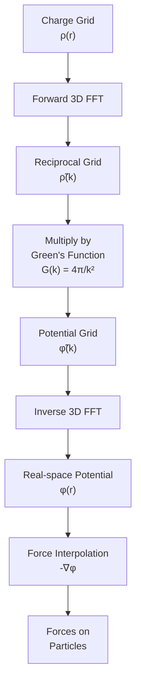
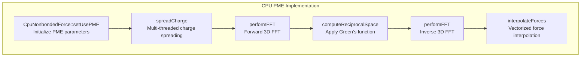
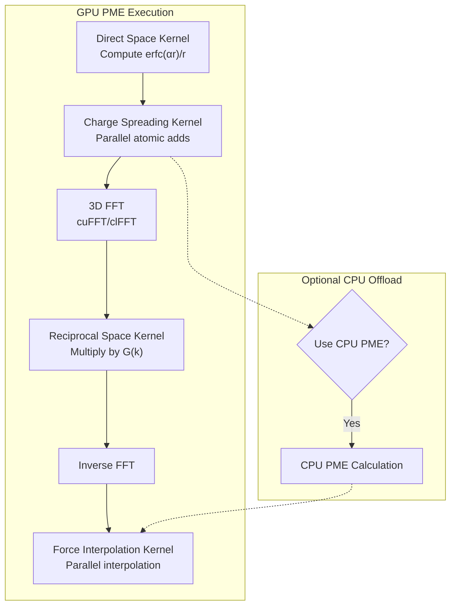
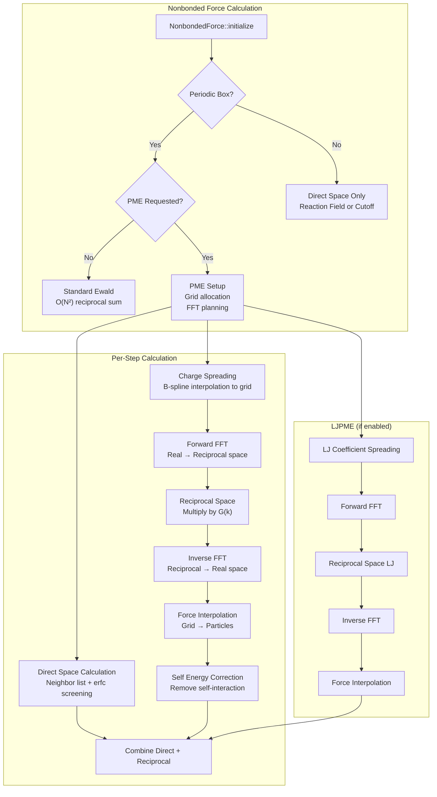

# PME and Long-Range Electrostatics

<details>
<summary>Relevant source files</summary>

The following files were used as context for generating this wiki page:

- [docs-source/api-c++/forces.rst](docs-source/api-c++/forces.rst)
- [olla/include/openmm/kernels.h](olla/include/openmm/kernels.h)
- [openmmapi/include/OpenMM.h](openmmapi/include/OpenMM.h)
- [platforms/common/include/openmm/common/CommonKernels.h](platforms/common/include/openmm/common/CommonKernels.h)
- [platforms/common/include/openmm/common/ComputeContext.h](platforms/common/include/openmm/common/ComputeContext.h)
- [platforms/common/src/CommonKernels.cpp](platforms/common/src/CommonKernels.cpp)
- [platforms/common/src/ComputeContext.cpp](platforms/common/src/ComputeContext.cpp)
- [platforms/cpu/include/CpuKernels.h](platforms/cpu/include/CpuKernels.h)
- [platforms/cpu/include/CpuNeighborList.h](platforms/cpu/include/CpuNeighborList.h)
- [platforms/cpu/include/CpuNonbondedForce.h](platforms/cpu/include/CpuNonbondedForce.h)
- [platforms/cpu/include/CpuPlatform.h](platforms/cpu/include/CpuPlatform.h)
- [platforms/cpu/src/CpuKernelFactory.cpp](platforms/cpu/src/CpuKernelFactory.cpp)
- [platforms/cpu/src/CpuKernels.cpp](platforms/cpu/src/CpuKernels.cpp)
- [platforms/cpu/src/CpuNeighborList.cpp](platforms/cpu/src/CpuNeighborList.cpp)
- [platforms/cpu/src/CpuNonbondedForce.cpp](platforms/cpu/src/CpuNonbondedForce.cpp)
- [platforms/cpu/src/CpuNonbondedForceVec4.cpp](platforms/cpu/src/CpuNonbondedForceVec4.cpp)
- [platforms/cpu/src/CpuPlatform.cpp](platforms/cpu/src/CpuPlatform.cpp)
- [platforms/cpu/tests/TestCpuNeighborList.cpp](platforms/cpu/tests/TestCpuNeighborList.cpp)
- [platforms/cuda/include/CudaContext.h](platforms/cuda/include/CudaContext.h)
- [platforms/cuda/include/CudaKernels.h](platforms/cuda/include/CudaKernels.h)
- [platforms/cuda/include/CudaNonbondedUtilities.h](platforms/cuda/include/CudaNonbondedUtilities.h)
- [platforms/cuda/src/CudaContext.cpp](platforms/cuda/src/CudaContext.cpp)
- [platforms/cuda/src/CudaKernelFactory.cpp](platforms/cuda/src/CudaKernelFactory.cpp)
- [platforms/cuda/src/CudaKernels.cpp](platforms/cuda/src/CudaKernels.cpp)
- [platforms/cuda/src/CudaNonbondedUtilities.cpp](platforms/cuda/src/CudaNonbondedUtilities.cpp)
- [platforms/cuda/src/CudaPlatform.cpp](platforms/cuda/src/CudaPlatform.cpp)
- [platforms/cuda/src/kernels/findInteractingBlocks.cu](platforms/cuda/src/kernels/findInteractingBlocks.cu)
- [platforms/opencl/include/OpenCLContext.h](platforms/opencl/include/OpenCLContext.h)
- [platforms/opencl/include/OpenCLKernels.h](platforms/opencl/include/OpenCLKernels.h)
- [platforms/opencl/include/OpenCLNonbondedUtilities.h](platforms/opencl/include/OpenCLNonbondedUtilities.h)
- [platforms/opencl/src/OpenCLContext.cpp](platforms/opencl/src/OpenCLContext.cpp)
- [platforms/opencl/src/OpenCLKernelFactory.cpp](platforms/opencl/src/OpenCLKernelFactory.cpp)
- [platforms/opencl/src/OpenCLKernels.cpp](platforms/opencl/src/OpenCLKernels.cpp)
- [platforms/opencl/src/OpenCLNonbondedUtilities.cpp](platforms/opencl/src/OpenCLNonbondedUtilities.cpp)
- [platforms/opencl/src/OpenCLPlatform.cpp](platforms/opencl/src/OpenCLPlatform.cpp)
- [platforms/opencl/src/kernels/findInteractingBlocks.cl](platforms/opencl/src/kernels/findInteractingBlocks.cl)
- [platforms/reference/include/ReferenceKernels.h](platforms/reference/include/ReferenceKernels.h)
- [platforms/reference/include/ReferencePlatform.h](platforms/reference/include/ReferencePlatform.h)
- [platforms/reference/src/ReferenceKernelFactory.cpp](platforms/reference/src/ReferenceKernelFactory.cpp)
- [platforms/reference/src/ReferenceKernels.cpp](platforms/reference/src/ReferenceKernels.cpp)
- [platforms/reference/src/ReferencePlatform.cpp](platforms/reference/src/ReferencePlatform.cpp)
- [platforms/reference/src/SimTKReference/ReferenceNeighborList.cpp](platforms/reference/src/SimTKReference/ReferenceNeighborList.cpp)
- [platforms/reference/tests/TestReferenceNeighborList.cpp](platforms/reference/tests/TestReferenceNeighborList.cpp)
- [serialization/src/SerializationProxyRegistration.cpp](serialization/src/SerializationProxyRegistration.cpp)

</details>


## Purpose and Scope

This document describes OpenMM's implementation of Particle Mesh Ewald (PME) and related methods for computing long-range electrostatic and dispersion interactions in periodic systems. PME enables efficient O(N log N) calculation of electrostatic interactions that would otherwise require O(N²) pairwise evaluations. This page covers the algorithmic components, platform-specific implementations, and configuration options for PME calculations.

For direct space nonbonded calculations with cutoffs, see [Direct Space Nonbonded Calculations](#4.2). For neighbor list construction used in conjunction with PME, see [Neighbor List Construction](#4.1).

## Overview of the Ewald Method

In periodic systems, electrostatic interactions extend infinitely due to periodic boundary conditions. PME addresses this by decomposing the interaction into two components:

1. **Direct Space**: Short-range interactions computed via neighbor lists with a complementary error function screening
2. **Reciprocal Space**: Long-range interactions computed on a grid using Fast Fourier Transforms (FFT)

The complementary error function erfc(αr)/r is used for direct space, while the reciprocal space handles the complementary erf(αr)/r term. The parameter α (alpha) controls the splitting between direct and reciprocal space calculations.

OpenMM also supports LJPME (Lennard-Jones Particle Mesh Ewald) for long-range dispersion interactions using a similar decomposition applied to the r⁻⁶ term.

**Sources:** [platforms/cpu/src/CpuNonbondedForce.cpp:1-100]()

## PME Algorithm Components

### Charge Spreading (B-Spline Interpolation)

Particle charges are spread onto a regular 3D grid using B-spline interpolation. This converts discrete point charges into a continuous charge density on the grid. OpenMM uses 4th-order B-splines by default, providing a good balance between accuracy and computational cost.


**Diagram: Charge spreading and forward FFT in PME**

The charge spreading uses the formula:

ρ(grid point) = Σᵢ qᵢ × M₄(x-xᵢ) × M₄(y-yᵢ) × M₄(z-zᵢ)

where M₄ is the 4th-order B-spline function.

**Sources:** [platforms/cpu/src/CpuNonbondedForce.cpp:500-800]()

### FFT-Based Reciprocal Space Calculation

After charge spreading, a 3D FFT transforms the charge density to reciprocal (Fourier) space. In reciprocal space, the potential is computed by multiplying the charge density with the Green's function for the Poisson equation, then transformed back via inverse FFT.



**Diagram: Reciprocal space PME calculation flow**

The reciprocal space energy is computed as:

E_reciprocal = (1/2V) Σₖ |ρ̃(k)|² × G(k) × exp(-k²/4α²)

where V is the volume, k are reciprocal lattice vectors, and G(k) is the Green's function.

**Sources:** [platforms/cpu/src/CpuNonbondedForce.cpp:800-1200]()

### Force Interpolation

Forces are computed by taking the gradient of the potential and interpolating back to particle positions using the same B-spline basis functions:

Fᵢ = -∇φ(rᵢ) = -Σ_grid φ(grid) × ∇M₄(rᵢ - r_grid)

This process is essentially the adjoint operation of charge spreading.

**Sources:** [platforms/cpu/src/CpuNonbondedForce.cpp:1200-1500]()

## Platform-Specific Implementations

### Reference Platform

The Reference platform provides a straightforward, unoptimized implementation primarily for correctness verification. It uses the `ReferencePME` class for all PME calculations.

**Key Classes:**
- `ReferenceLJCoulombIxn` - Handles both direct space and PME calculations
- `ReferencePME` - Core PME algorithm implementation

**Sources:** [platforms/reference/src/ReferenceKernels.cpp:1-100](), [platforms/reference/include/ReferenceKernels.h:1-100]()

### CPU Platform

The CPU platform includes optimizations for modern processors:

- **Vectorization**: SIMD operations (SSE/AVX) for charge spreading and force interpolation
- **Multi-threading**: Parallel execution across particle blocks
- **Optimized FFT**: Uses vendor-optimized FFT libraries when available

**Key Components:**
- `CpuNonbondedForce` - Main nonbonded force calculator including PME
- `CpuNonbondedForceVec4` - Vectorized implementation for 4-wide SIMD



**Diagram: CPU Platform PME execution flow**

**Sources:** [platforms/cpu/src/CpuNonbondedForce.cpp:50-2000](), [platforms/cpu/include/CpuNonbondedForce.h:1-300]()

### GPU Platforms (CUDA and OpenCL)

GPU implementations leverage massive parallelism for PME calculations:

**Parallel Charge Spreading:**
- Each thread handles one particle
- Atomic operations accumulate charges to grid points
- Can use fixed-point arithmetic for deterministic results (CUDA)

**FFT Execution:**
- Uses cuFFT (CUDA) or clFFT (OpenCL)
- Can execute on dedicated PME stream (NVIDIA GPUs)
- Option to offload to CPU for small systems

**Platform-Specific Features:**

| Feature | CUDA | OpenCL |
|---------|------|--------|
| Separate PME Stream | Yes (NVIDIA) | Yes (NVIDIA via OpenCL) |
| Fixed-Point Spreading | Yes | No |
| CPU PME Offload | Yes | Yes |
| Deterministic Forces | Optional | No |



**Diagram: GPU PME calculation with optional CPU offload**

**Key Functions:**
- CUDA: [platforms/cuda/src/CudaKernels.cpp:55-58]() - `getCudaPmeParameters()`
- OpenCL: [platforms/opencl/src/OpenCLKernels.cpp:50-55]() - `getOpenCLPmeParameters()`

**Sources:** [platforms/cuda/src/CudaKernels.cpp:1-100](), [platforms/opencl/src/OpenCLKernels.cpp:1-100](), [platforms/cuda/src/CudaNonbondedUtilities.cpp:1-100](), [platforms/opencl/src/OpenCLNonbondedUtilities.cpp:1-100]()

## LJPME for Long-Range Dispersion

LJPME extends the PME approach to Lennard-Jones dispersion interactions, handling the long-range r⁻⁶ term. This is particularly important for systems where dispersion corrections significantly affect energies and pressures.

The decomposition splits the r⁻⁶ term:

r⁻⁶ = r⁻⁶ × [1 - exp(-α²r²)(1 + α²r² + (α²r²)²/2)] + r⁻⁶ × exp(-α²r²)(1 + α²r² + (α²r²)²/2)

The first term is computed in direct space, the second in reciprocal space.

**Key Differences from Electrostatic PME:**
- Different screening function for r⁻⁶ decay
- Separate dispersion coefficient grid
- Different Green's function in reciprocal space
- Independent alpha parameter (alphaDispersionEwald)


**Diagram: LJPME calculation flow**

**Sources:** [platforms/cpu/src/CpuNonbondedForce.cpp:70-85](), [platforms/cpu/include/CpuNonbondedForce.h:50-100]()

## PME Parameters and Configuration

### Grid Size Selection

PME grid size is automatically determined based on the box dimensions and desired accuracy. The grid spacing should be approximately 1.0-1.2 Å for good accuracy.

```cpp
// Grid size calculation (approximate)
gridSizeX = nextPowerOf2(boxSize.x / targetSpacing)
gridSizeY = nextPowerOf2(boxSize.y / targetSpacing)  
gridSizeZ = nextPowerOf2(boxSize.z / targetSpacing)
```

FFT performance is best when grid dimensions are powers of 2 or have small prime factors.

**Sources:** [platforms/cpu/src/CpuNonbondedForce.cpp:500-600]()

### Alpha Parameter

The Ewald splitting parameter α controls the balance between direct and reciprocal space work:
- **Larger α**: More work in direct space, less in reciprocal space
- **Smaller α**: Less work in direct space, more in reciprocal space

OpenMM automatically selects α to balance computational cost, but it can be manually specified via the `NonbondedForce.setEwaldErrorTolerance()` method.

**Sources:** [platforms/cpu/src/CpuNonbondedForce.cpp:50-100]()

### Platform Properties

**CPU PME Offloading:**

For GPU platforms, PME can be computed on CPU for small systems where GPU setup overhead exceeds GPU speedup:

```python
# CUDA Platform
properties = {'CudaUseCpuPme': 'true'}  # Use CPU for PME calculations

# OpenCL Platform  
properties = {'OpenCLUseCpuPme': 'true'}  # Use CPU for PME calculations
```

**PME Stream Control (NVIDIA GPUs):**

NVIDIA GPUs can use a separate CUDA stream for PME to overlap direct space and reciprocal space calculations:

```python
properties = {'CudaDisablePmeStream': 'false'}  # Enable PME stream (default)
properties = {'OpenCLDisablePmeStream': 'false'}  # Enable PME stream (default)
```

**Deterministic Forces (CUDA):**

CUDA can use fixed-point arithmetic for charge spreading to ensure bit-wise reproducible results:

```python
properties = {'CudaDeterministicForces': 'true'}  # Enable deterministic PME
```

**Sources:** [platforms/cuda/src/CudaKernels.cpp:55-58](), [platforms/opencl/src/OpenCLKernels.cpp:50-55](), [platforms/cuda/src/CudaPlatform.cpp:60-120](), [platforms/opencl/src/OpenCLPlatform.cpp:60-120]()

## PME Data Flow in Force Calculation

The following diagram shows how PME integrates into the overall nonbonded force calculation pipeline:



**Diagram: Complete PME data flow in force calculations**

**Sources:** [platforms/cpu/src/CpuNonbondedForce.cpp:1-2000](), [platforms/common/src/CommonKernels.cpp:1-500]()

## Key Classes and Interfaces

### Core PME Classes

**Reference Platform:**
- `ReferencePME` - Core PME implementation
- `ReferenceLJCoulombIxn` - Integrates PME with direct space calculations

**CPU Platform:**
- `CpuNonbondedForce` - Main class handling PME setup and execution
- Methods: `setUsePME()`, `calculatePMEForces()`, `spreadCharge()`, `interpolateForces()`

**Common Platform Base:**
- `CommonCalcNonbondedForceKernel` - Base kernel for nonbonded forces across GPU platforms
- `CommonNonbondedUtilities` - Shared utilities for PME parameter management

**Platform-Specific GPU Implementations:**
- `CudaCalcNonbondedForceKernel::initialize()` - CUDA PME initialization [platforms/cuda/src/CudaKernels.cpp:93-97]()
- `OpenCLCalcNonbondedForceKernel::initialize()` - OpenCL PME initialization [platforms/opencl/src/OpenCLKernels.cpp:89-93]()

### FFT Interface

OpenMM abstracts FFT operations through the `FFT3D` interface, allowing different backends:

- **CUDA**: cuFFT library
- **OpenCL**: clFFT library  
- **CPU**: FFTW or vendor-optimized libraries

**Key Methods:**
- `createFFT()` - Factory method in context classes
- `execForward()` - Forward transform
- `execBackward()` - Inverse transform

**Sources:** [platforms/cuda/src/CudaContext.cpp:450-452](), [platforms/opencl/src/OpenCLContext.cpp:581-583]()

## Implementation Details by Platform

### Fixed-Point Charge Spreading (CUDA)

CUDA platforms can optionally use fixed-point arithmetic for charge spreading when `CudaDeterministicForces` is enabled. This ensures identical results across runs at the cost of slightly reduced precision:

```
// Conceptual approach (actual implementation in CUDA kernels)
fixed_point_charge = (int64_t)(charge * SCALE_FACTOR)
atomicAdd(&grid[index], fixed_point_charge)
// Later convert back to floating point
```

This eliminates non-determinism from floating-point atomic operations.

**Sources:** [platforms/cuda/src/CudaKernels.cpp:55-58](), [platforms/cuda/src/CudaContext.cpp:1-200]()

### PME Stream Overlap (NVIDIA GPUs)

On NVIDIA GPUs, PME can execute on a separate CUDA/OpenCL stream, allowing overlap between:
1. Direct space force calculation on default stream
2. PME reciprocal space calculation on PME stream

This improves performance by hiding PME latency behind direct space work.

**Conditions for PME Stream:**
- NVIDIA GPU vendor
- PME not offloaded to CPU  
- Stream not explicitly disabled

**Sources:** [platforms/cuda/src/CudaKernels.cpp:55-58](), [platforms/opencl/src/OpenCLKernels.cpp:50-55]()

### CPU PME Decision Logic

The decision to use CPU PME on GPU platforms considers:
- System size (small systems benefit from CPU PME)
- GPU characteristics (overhead of GPU setup)
- User override via platform properties

**Sources:** [platforms/cuda/src/CudaPlatform.cpp:180-210](), [platforms/opencl/src/OpenCLPlatform.cpp:180-210]()

## Performance Considerations

**Grid Size Trade-offs:**
- Larger grids: More accurate but slower FFT
- Smaller grids: Faster but may require smaller α (more direct space work)
- Optimal grid size depends on system size and hardware

**FFT Optimization:**
- Grid dimensions should be powers of 2 or have small prime factors
- 3D FFT performance is critical for overall PME performance
- GPU FFT libraries (cuFFT/clFFT) are highly optimized

**Direct-Reciprocal Balance:**
- α parameter controls computational balance
- Automatic selection typically works well
- Manual tuning can help for specific hardware or system sizes

**Memory Usage:**
- PME requires 3D grids (approximately 8N grid points for N atoms)
- GPU memory constraints may necessitate CPU offload for large systems
- LJPME doubles memory requirements (separate dispersion grid)

**Sources:** [platforms/cpu/src/CpuNonbondedForce.cpp:1-2000](), [platforms/cuda/src/CudaNonbondedUtilities.cpp:1-500](), [platforms/opencl/src/OpenCLNonbondedUtilities.cpp:1-500]()

---