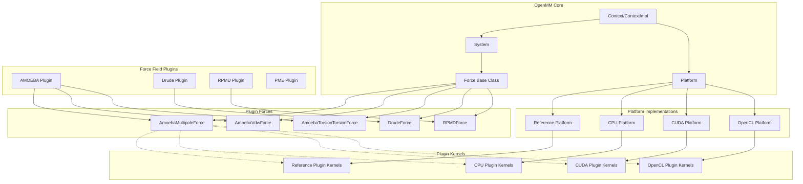
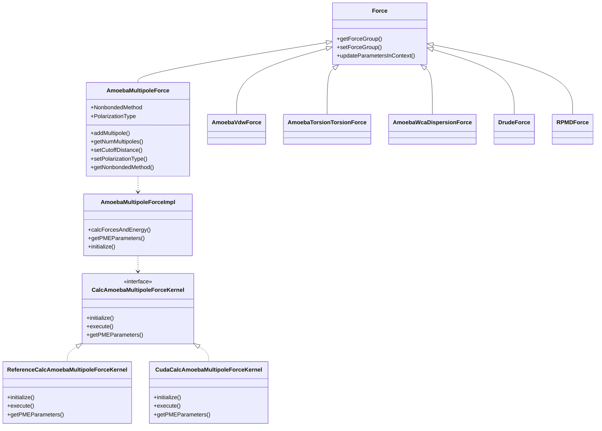
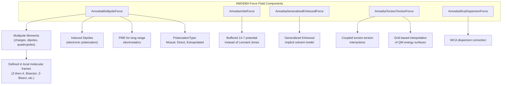
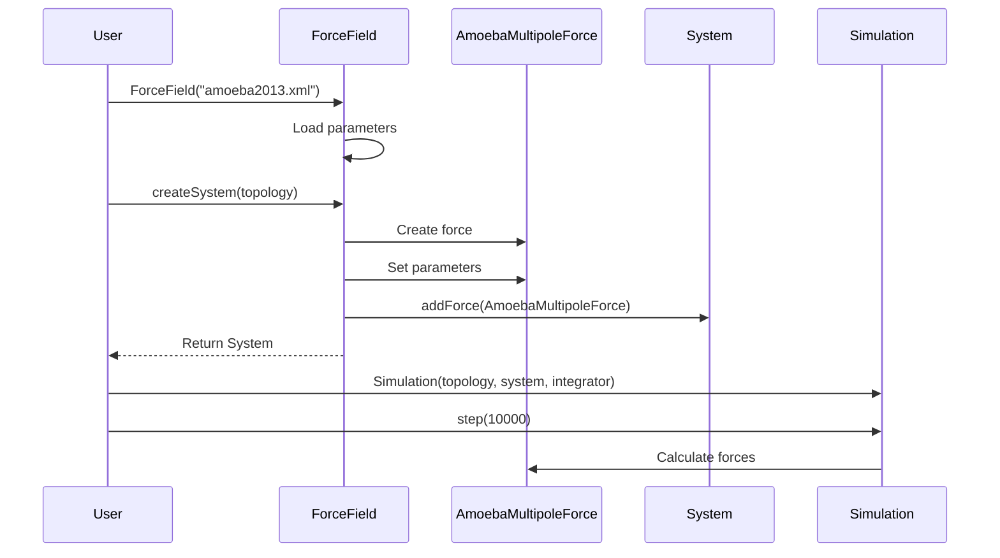
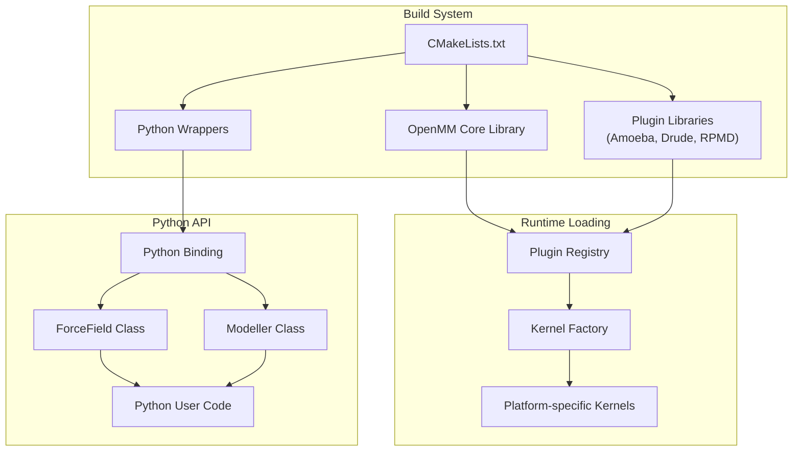

# Force Field Plugins

<details>
<summary>Relevant source files</summary>

The following files were used as context for generating this wiki page:

- [CMakeLists.txt](CMakeLists.txt)
- [platforms/cpu/CMakeLists.txt](platforms/cpu/CMakeLists.txt)
- [plugins/amoeba/CMakeLists.txt](plugins/amoeba/CMakeLists.txt)
- [plugins/amoeba/openmmapi/include/openmm/AmoebaMultipoleForce.h](plugins/amoeba/openmmapi/include/openmm/AmoebaMultipoleForce.h)
- [plugins/amoeba/openmmapi/include/openmm/amoebaKernels.h](plugins/amoeba/openmmapi/include/openmm/amoebaKernels.h)
- [plugins/amoeba/openmmapi/include/openmm/internal/AmoebaMultipoleForceImpl.h](plugins/amoeba/openmmapi/include/openmm/internal/AmoebaMultipoleForceImpl.h)
- [plugins/amoeba/openmmapi/src/AmoebaMultipoleForce.cpp](plugins/amoeba/openmmapi/src/AmoebaMultipoleForce.cpp)
- [plugins/amoeba/openmmapi/src/AmoebaMultipoleForceImpl.cpp](plugins/amoeba/openmmapi/src/AmoebaMultipoleForceImpl.cpp)
- [plugins/amoeba/platforms/cuda/src/AmoebaCudaKernels.cpp](plugins/amoeba/platforms/cuda/src/AmoebaCudaKernels.cpp)
- [plugins/amoeba/platforms/cuda/src/AmoebaCudaKernels.h](plugins/amoeba/platforms/cuda/src/AmoebaCudaKernels.h)
- [plugins/amoeba/platforms/cuda/src/kernels/multipoleInducedField.cu](plugins/amoeba/platforms/cuda/src/kernels/multipoleInducedField.cu)
- [plugins/amoeba/platforms/cuda/src/kernels/multipolePme.cu](plugins/amoeba/platforms/cuda/src/kernels/multipolePme.cu)
- [plugins/amoeba/platforms/cuda/tests/TestCudaAmoebaMultipoleForce.cpp](plugins/amoeba/platforms/cuda/tests/TestCudaAmoebaMultipoleForce.cpp)
- [plugins/amoeba/platforms/reference/CMakeLists.txt](plugins/amoeba/platforms/reference/CMakeLists.txt)
- [plugins/amoeba/platforms/reference/src/AmoebaReferenceKernels.cpp](plugins/amoeba/platforms/reference/src/AmoebaReferenceKernels.cpp)
- [plugins/amoeba/platforms/reference/src/AmoebaReferenceKernels.h](plugins/amoeba/platforms/reference/src/AmoebaReferenceKernels.h)
- [plugins/amoeba/platforms/reference/src/SimTKReference/AmoebaReferenceMultipoleForce.cpp](plugins/amoeba/platforms/reference/src/SimTKReference/AmoebaReferenceMultipoleForce.cpp)
- [plugins/amoeba/platforms/reference/src/SimTKReference/AmoebaReferenceMultipoleForce.h](plugins/amoeba/platforms/reference/src/SimTKReference/AmoebaReferenceMultipoleForce.h)
- [plugins/amoeba/platforms/reference/tests/TestReferenceAmoebaMultipoleForce.cpp](plugins/amoeba/platforms/reference/tests/TestReferenceAmoebaMultipoleForce.cpp)
- [plugins/drude/CMakeLists.txt](plugins/drude/CMakeLists.txt)
- [plugins/drude/platforms/reference/CMakeLists.txt](plugins/drude/platforms/reference/CMakeLists.txt)
- [plugins/drude/wrappers/CMakeLists.txt](plugins/drude/wrappers/CMakeLists.txt)
- [plugins/drude/wrappers/Doxyfile.in](plugins/drude/wrappers/Doxyfile.in)
- [plugins/drude/wrappers/generateDrudeWrappers.py](plugins/drude/wrappers/generateDrudeWrappers.py)
- [plugins/rpmd/CMakeLists.txt](plugins/rpmd/CMakeLists.txt)
- [plugins/rpmd/platforms/reference/CMakeLists.txt](plugins/rpmd/platforms/reference/CMakeLists.txt)
- [serialization/CMakeLists.txt](serialization/CMakeLists.txt)

</details>


This page provides a technical overview of OpenMM's force field plugin architecture, which enables the core simulation engine to be extended with specialized force field implementations beyond what's available in the core library. These plugins implement advanced force field models, such as polarizable force fields, and integrate seamlessly with both the C++ and Python APIs.

## Plugin Architecture

OpenMM uses a modular architecture that allows specialized force field implementations to be developed as separate plugin libraries. These plugins can then be loaded at runtime to extend OpenMM's functionality without modifying the core library.



Sources:
- [plugins/amoeba/openmmapi/include/openmm/AmoebaMultipoleForce.h:52-690](plugins/amoeba/openmmapi/include/openmm/AmoebaMultipoleForce.h:52-690)
- [wrappers/python/setup.py:173-177](wrappers/python/setup.py:173-177)
- [plugins/amoeba/platforms/cuda/src/AmoebaCudaKernels.h:30-98](plugins/amoeba/platforms/cuda/src/AmoebaCudaKernels.h:30-98)
- [plugins/amoeba/platforms/reference/src/AmoebaReferenceKernels.h:30-807](plugins/amoeba/platforms/reference/src/AmoebaReferenceKernels.h:30-807)

## Plugin Implementation Details

Each force field plugin typically consists of several key components:

1. **Force Classes**: Each plugin defines custom Force classes that extend the base OpenMM `Force` class
2. **Platform-Specific Kernels**: Implements calculation kernels for each supported hardware platform
3. **Registration Mechanism**: Registers these kernels with the OpenMM platform system
4. **Python Wrappers**: Exposes functionality through the OpenMM Python API



Sources:
- [plugins/amoeba/openmmapi/include/openmm/AmoebaMultipoleForce.h:52-690](plugins/amoeba/openmmapi/include/openmm/AmoebaMultipoleForce.h:52-690)
- [plugins/amoeba/openmmapi/include/openmm/internal/AmoebaMultipoleForceImpl.h:1-167](plugins/amoeba/openmmapi/include/openmm/internal/AmoebaMultipoleForceImpl.h:1-167)
- [plugins/amoeba/openmmapi/include/openmm/amoebaKernels.h:1-85](plugins/amoeba/openmmapi/include/openmm/amoebaKernels.h:1-85)
- [plugins/amoeba/platforms/cuda/src/AmoebaCudaKernels.h:42-94](plugins/amoeba/platforms/cuda/src/AmoebaCudaKernels.h:42-94)
- [plugins/amoeba/platforms/reference/src/AmoebaReferenceKernels.cpp:85-167](plugins/amoeba/platforms/reference/src/AmoebaReferenceKernels.cpp:85-167)

## Available Force Field Plugins

OpenMM includes several specialized force field plugins:

| Plugin | Description | Main Force Classes |
|--------|-------------|-------------------|
| AMOEBA | Implements the polarizable AMOEBA force field with atomic multipoles and polarization | `AmoebaMultipoleForce`, `AmoebaVdwForce`, `AmoebaTorsionTorsionForce` |
| Drude | Implements the Drude oscillator model for polarizable molecular mechanics | `DrudeForce` |
| RPMD | Implements Ring Polymer Molecular Dynamics for quantum effects | `RPMDForce` |
| PME | Specialized implementation of Particle Mesh Ewald method | `PMEForce` |

Sources:
- [wrappers/python/setup.py:173-177](wrappers/python/setup.py:173-177)
- [plugins/amoeba/openmmapi/include/openmm/AmoebaMultipoleForce.h:52-690](plugins/amoeba/openmmapi/include/openmm/AmoebaMultipoleForce.h:52-690)

## The AMOEBA Plugin

The AMOEBA (Atomic Multipole Optimized Energetics for Biomolecular Applications) plugin implements the sophisticated AMOEBA polarizable force field. Unlike traditional molecular mechanics force fields that use only point charges, AMOEBA provides a more accurate electrostatic model by using multipole expansions up to quadrupole moments and includes explicit treatment of electronic polarization.



### Key Components of AmoebaMultipoleForce

The `AmoebaMultipoleForce` class is the central component for handling electrostatics in the AMOEBA force field:

1. **Multipole Moments**: Includes charges, dipoles, and quadrupoles for each atom
2. **Polarization Types**:
   - `Mutual`: Full mutual induction where dipoles are iterated to convergence
   - `Direct`: Simpler approximation where induced dipoles depend only on permanent multipoles
   - `Extrapolated`: Uses perturbation theory to extrapolate to fully converged values

3. **Coordinate Frame Types**: Supports various molecular coordinate frames for defining multipoles:
   - `ZThenX`: Z-then-X frame
   - `Bisector`: Bisector frame
   - `ZBisect`: Z-Bisect frame
   - `ThreeFold`: Threefold frame
   - `ZOnly`: Z-only frame

4. **Long-range Methods**: 
   - `NoCutoff`: No cutoff, full N² calculation
   - `PME`: Particle Mesh Ewald for periodic boundary conditions

Sources:
- [plugins/amoeba/openmmapi/include/openmm/AmoebaMultipoleForce.h:52-690](plugins/amoeba/openmmapi/include/openmm/AmoebaMultipoleForce.h:52-690)
- [plugins/amoeba/openmmapi/src/AmoebaMultipoleForce.cpp:1-130](plugins/amoeba/openmmapi/src/AmoebaMultipoleForce.cpp:1-130)
- [plugins/amoeba/platforms/reference/src/SimTKReference/AmoebaReferenceMultipoleForce.cpp:1-650](plugins/amoeba/platforms/reference/src/SimTKReference/AmoebaReferenceMultipoleForce.cpp:1-650)

## Using Force Field Plugins

### Integration with ForceField Class

Force field plugins integrate with OpenMM's `ForceField` class through XML force field definition files. These XML files contain parameters specific to the plugin's force fields.



Sources:
- [wrappers/python/tests/TestForceField.py:227-268](wrappers/python/tests/TestForceField.py:227-268)
- [wrappers/python/openmm/app/forcefield.py:195-259](wrappers/python/openmm/app/forcefield.py:195-259)

### Adding Extra Particles for Special Force Fields

Some force field plugins (like Drude or specialized water models) require adding extra particles to the system. The `Modeller` class provides methods for this purpose:

```python
# Example: Adding Drude particles for a polarizable force field
forcefield = ForceField('charmm_polar_2013.xml')
modeller = Modeller(pdb.topology, pdb.positions)
modeller.addExtraParticles(forcefield)
system = forcefield.createSystem(modeller.topology)
```

The `addExtraParticles` method examines the force field to determine what extra particles are needed and adds them to the topology. It works with various plugins like the Drude oscillator model or specialized water models (TIP4P, TIP5P).

Sources:
- [wrappers/python/openmm/app/modeller.py:257-285](wrappers/python/openmm/app/modeller.py:257-285)
- [wrappers/python/tests/TestForceField.py:257-283](wrappers/python/tests/TestForceField.py:257-283)

### Example: Using the AMOEBA Force Field

```python
from openmm import *
from openmm.app import *
from openmm.unit import *

# Load the PDB file
pdb = PDBFile('protein.pdb')

# Create an AMOEBA force field
forcefield = ForceField('amoeba2013.xml')

# Create a system with AMOEBA forces
system = forcefield.createSystem(pdb.topology, nonbondedMethod=PME)

# Create an integrator appropriate for AMOEBA (usually shorter time steps)
integrator = LangevinMiddleIntegrator(300*kelvin, 1/picosecond, 1*femtoseconds)

# Create a simulation
simulation = Simulation(pdb.topology, system, integrator)
simulation.context.setPositions(pdb.positions)

# Minimize and run
simulation.minimizeEnergy()
simulation.step(10000)
```

## Plugin Loading Mechanism

OpenMM automatically loads plugins at runtime through a dynamic library loading mechanism. For Python applications, the plugins are linked into the Python module, so no additional steps are required to load them.

The build system handles the compilation and linking of plugin libraries:



Sources:
- [wrappers/python/CMakeLists.txt:172-177](wrappers/python/CMakeLists.txt:172-177)
- [wrappers/python/setup.py:173-177](wrappers/python/setup.py:173-177)

## Advanced Use Cases

### Mutual Induced Dipole Calculation in AMOEBA

One of the most computationally intensive parts of the AMOEBA model is the calculation of induced dipoles, which involves an iterative process to achieve self-consistency.

The `AmoebaMultipoleForce` class provides several options to control this calculation:

```cpp
// Set the type of polarization calculation
force->setPolarizationType(AmoebaMultipoleForce::Mutual); // Options: Mutual, Direct, Extrapolated

// Set parameters for the iterative solver
force->setMutualInducedTargetEpsilon(1.0e-5);
force->setMaximumMutualInducedIterations(500);

// For Extrapolated polarization, set the extrapolation coefficients
std::vector<double> coefficients = {-0.154, 0.017, 0.658, 0.474};
force->setExtrapolationCoefficients(coefficients);
```

Sources:
- [plugins/amoeba/openmmapi/include/openmm/AmoebaMultipoleForce.h:72-94](plugins/amoeba/openmmapi/include/openmm/AmoebaMultipoleForce.h:72-94)
- [plugins/amoeba/openmmapi/src/AmoebaMultipoleForce.cpp:61-75](plugins/amoeba/openmmapi/src/AmoebaMultipoleForce.cpp:61-75)
- [plugins/amoeba/platforms/reference/src/SimTKReference/AmoebaReferenceMultipoleForce.cpp:125-185](plugins/amoeba/platforms/reference/src/SimTKReference/AmoebaReferenceMultipoleForce.cpp:125-185)

### GPU Acceleration for Plugins

Force field plugins can take advantage of GPU acceleration through CUDA or OpenCL implementations. The AMOEBA plugin includes optimized CUDA kernels for efficient calculation of multipole interactions on NVIDIA GPUs.

```cpp
// The CUDA implementation uses specialized kernels for:
// 1. Multipole-multipole interactions
// 2. Mutual induced dipole solver
// 3. PME for long-range electrostatics
```

These implementations must handle complex mathematical operations like multipole rotations, polarization calculations, and PME grid operations efficiently on the GPU.

Sources:
- [plugins/amoeba/platforms/cuda/src/AmoebaCudaKernels.h:30-98](plugins/amoeba/platforms/cuda/src/AmoebaCudaKernels.h:30-98)
- [plugins/amoeba/platforms/cuda/src/AmoebaCudaKernels.cpp:1-102](plugins/amoeba/platforms/cuda/src/AmoebaCudaKernels.cpp:1-102)
- [plugins/amoeba/platforms/cuda/src/kernels/multipoleInducedField.cu:1-73](plugins/amoeba/platforms/cuda/src/kernels/multipoleInducedField.cu:1-73)
- [plugins/amoeba/platforms/cuda/src/kernels/multipolePme.cu:1-63](plugins/amoeba/platforms/cuda/src/kernels/multipolePme.cu:1-63)

## Conclusion

OpenMM's force field plugin architecture provides a powerful mechanism for extending the core library with specialized force field implementations. The AMOEBA plugin is a prime example, implementing a sophisticated polarizable force field that goes beyond the capabilities of traditional molecular mechanics. These plugins integrate seamlessly with the rest of OpenMM, allowing users to take advantage of advanced force fields while still using the familiar OpenMM API.

When writing simulations that use specialized force fields, users should be aware of the specific requirements and parameters needed for each plugin. The examples and documentation provided with OpenMM, along with the plugin-specific XML force field files, provide guidance on how to properly configure these advanced force fields.

---