# AMOEBA Polarizable Force Field

<details>
<summary>Relevant source files</summary>

The following files were used as context for generating this wiki page:

- [plugins/amoeba/openmmapi/include/openmm/AmoebaMultipoleForce.h](plugins/amoeba/openmmapi/include/openmm/AmoebaMultipoleForce.h)
- [plugins/amoeba/openmmapi/include/openmm/amoebaKernels.h](plugins/amoeba/openmmapi/include/openmm/amoebaKernels.h)
- [plugins/amoeba/openmmapi/include/openmm/internal/AmoebaMultipoleForceImpl.h](plugins/amoeba/openmmapi/include/openmm/internal/AmoebaMultipoleForceImpl.h)
- [plugins/amoeba/openmmapi/src/AmoebaMultipoleForce.cpp](plugins/amoeba/openmmapi/src/AmoebaMultipoleForce.cpp)
- [plugins/amoeba/openmmapi/src/AmoebaMultipoleForceImpl.cpp](plugins/amoeba/openmmapi/src/AmoebaMultipoleForceImpl.cpp)
- [plugins/amoeba/platforms/cuda/src/AmoebaCudaKernels.cpp](plugins/amoeba/platforms/cuda/src/AmoebaCudaKernels.cpp)
- [plugins/amoeba/platforms/cuda/src/AmoebaCudaKernels.h](plugins/amoeba/platforms/cuda/src/AmoebaCudaKernels.h)
- [plugins/amoeba/platforms/cuda/src/kernels/multipoleInducedField.cu](plugins/amoeba/platforms/cuda/src/kernels/multipoleInducedField.cu)
- [plugins/amoeba/platforms/cuda/src/kernels/multipolePme.cu](plugins/amoeba/platforms/cuda/src/kernels/multipolePme.cu)
- [plugins/amoeba/platforms/cuda/tests/TestCudaAmoebaMultipoleForce.cpp](plugins/amoeba/platforms/cuda/tests/TestCudaAmoebaMultipoleForce.cpp)
- [plugins/amoeba/platforms/reference/src/AmoebaReferenceKernels.cpp](plugins/amoeba/platforms/reference/src/AmoebaReferenceKernels.cpp)
- [plugins/amoeba/platforms/reference/src/AmoebaReferenceKernels.h](plugins/amoeba/platforms/reference/src/AmoebaReferenceKernels.h)
- [plugins/amoeba/platforms/reference/src/SimTKReference/AmoebaReferenceMultipoleForce.cpp](plugins/amoeba/platforms/reference/src/SimTKReference/AmoebaReferenceMultipoleForce.cpp)
- [plugins/amoeba/platforms/reference/src/SimTKReference/AmoebaReferenceMultipoleForce.h](plugins/amoeba/platforms/reference/src/SimTKReference/AmoebaReferenceMultipoleForce.h)
- [plugins/amoeba/platforms/reference/tests/TestReferenceAmoebaMultipoleForce.cpp](plugins/amoeba/platforms/reference/tests/TestReferenceAmoebaMultipoleForce.cpp)

</details>


## Purpose and Scope

This document describes OpenMM's implementation of the AMOEBA (Atomic Multipole Optimized Energetics for Biomolecular Applications) polarizable force field. The AMOEBA plugin extends OpenMM's core with support for:

- Permanent atomic multipoles (charge, dipole, quadrupole)
- Mutual induced dipole polarization with Thole damping
- Particle Mesh Ewald (PME) summation for multipole electrostatics
- Multiple polarization algorithms (Direct, Mutual, Extrapolated)

For information about other force field plugins, see [Other Force Field Plugins](#5.2). For the plugin architecture that enables AMOEBA, see [Plugin System and Extensions](#5).

**Sources:** [plugins/amoeba/openmmapi/include/openmm/AmoebaMultipoleForce.h:1-50](), [plugins/amoeba/platforms/reference/src/SimTKReference/AmoebaReferenceMultipoleForce.h:232-319]()

## Core Concepts

### Multipole Representation

AMOEBA represents electrostatics using permanent multipole moments at each atomic site rather than simple point charges. Each atom has:

| Multipole Component | Description | Storage |
|---------------------|-------------|---------|
| Charge (monopole) | Scalar charge value | `double charge` |
| Dipole | 3D vector in molecular frame | `std::vector<double>` (3 elements) |
| Quadrupole | Traceless symmetric tensor | `std::vector<double>` (9 elements, 6 unique) |

The quadrupole tensor must be traceless (trace = 0) and symmetric, validated at initialization with tolerance 1.0e-05 [plugins/amoeba/openmmapi/src/AmoebaMultipoleForceImpl.cpp:66-108]().

### Coordinate Frame Transformation

Multipoles are specified in a local molecular frame and must be rotated to the laboratory frame. Five axis types are supported:

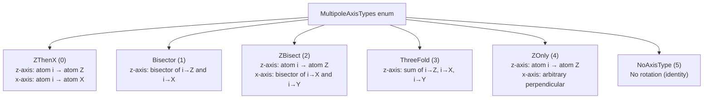

**Sources:** [plugins/amoeba/openmmapi/include/openmm/AmoebaMultipoleForce.h:94](), [plugins/amoeba/platforms/reference/src/SimTKReference/AmoebaReferenceMultipoleForce.cpp:402-567]()

### Thole Damping

Direct electrostatic interactions at short range are modulated by Thole damping to prevent "polarization catastrophe". The damping function depends on:

- `dampingFactor`: Product of atomic polarizabilities^(1/6) times distance
- `thole`: Dimensionless width parameter
- Distance ratio: `r / (dampingFactor_i * dampingFactor_j)^(1/3)`

The damping exponentially reduces field and field gradient terms at short range [plugins/amoeba/platforms/reference/src/SimTKReference/AmoebaReferenceMultipoleForce.cpp:669-701]().

**Sources:** [plugins/amoeba/platforms/reference/src/SimTKReference/AmoebaReferenceMultipoleForce.cpp:669-701]()

## Architecture and Class Hierarchy

### Public API Classes

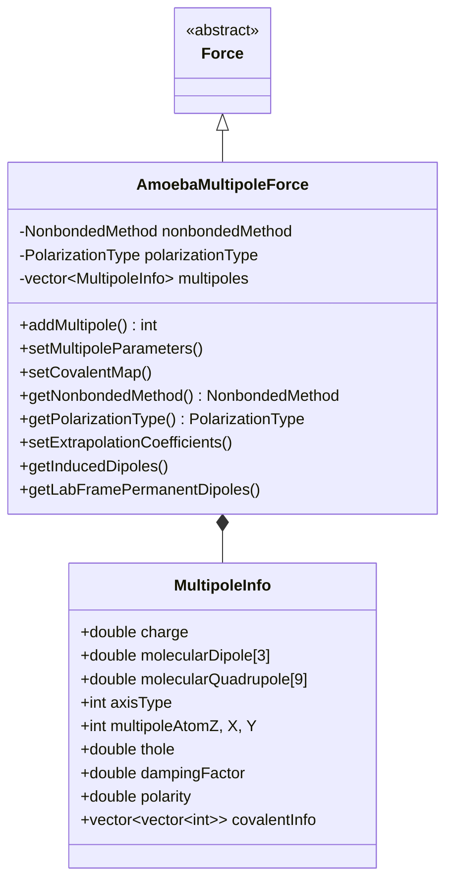

The `AmoebaMultipoleForce` class [plugins/amoeba/openmmapi/include/openmm/AmoebaMultipoleForce.h:51]() provides the public API for defining multipolar electrostatics. Key enumerations:

- `NonbondedMethod`: `NoCutoff` (0) or `PME` (1)
- `PolarizationType`: `Mutual` (0), `Direct` (1), or `Extrapolated` (2)
- `CovalentType`: Eight levels from `Covalent12` to `PolarizationCovalent14` for scaling maps

**Sources:** [plugins/amoeba/openmmapi/include/openmm/AmoebaMultipoleForce.h:51-99](), [plugins/amoeba/openmmapi/src/AmoebaMultipoleForce.cpp:1-47]()

### Implementation Layer

```mermaid
graph TB
    AmoebaMultipoleForce["AmoebaMultipoleForce<br/>(Public API)"]
    AmoebaMultipoleForceImpl["AmoebaMultipoleForceImpl<br/>ForceImpl subclass"]
    CalcKernel["CalcAmoebaMultipoleForceKernel<br/>(Abstract kernel interface)"]
    
    RefKernel["ReferenceCalcAmoebaMultipoleForceKernel"]
    CudaKernel["CudaCalcAmoebaMultipoleForceKernel<br/>→ CommonCalcAmoebaMultipoleForceKernel"]
    OpenCLKernel["OpenCLCalcAmoebaMultipoleForceKernel<br/>→ CommonCalcAmoebaMultipoleForceKernel"]
    
    RefForce["AmoebaReferenceMultipoleForce<br/>C++ calculation engine"]
    RefPmeForce["AmoebaReferencePmeMultipoleForce<br/>PME variant"]
    RefGkForce["AmoebaReferenceGeneralizedKirkwood<br/>MultipoleForce<br/>GK variant"]
    
    AmoebaMultipoleForce --> AmoebaMultipoleForceImpl
    AmoebaMultipoleForceImpl --> CalcKernel
    CalcKernel --> RefKernel
    CalcKernel --> CudaKernel
    CalcKernel --> OpenCLKernel
    
    RefKernel --> RefForce
    RefKernel --> RefPmeForce
    RefKernel --> RefGkForce
    
    RefForce <|-- RefPmeForce
    RefForce <|-- RefGkForce
```

The implementation follows OpenMM's standard kernel pattern. `AmoebaMultipoleForceImpl` [plugins/amoeba/openmmapi/src/AmoebaMultipoleForceImpl.cpp:43-47]() creates platform-specific kernels that implement the `CalcAmoebaMultipoleForceKernel` interface [plugins/amoeba/openmmapi/include/openmm/amoebaKernels.h:80-134]().

**Sources:** [plugins/amoeba/openmmapi/include/openmm/internal/AmoebaMultipoleForceImpl.h:46-101](), [plugins/amoeba/openmmapi/src/AmoebaMultipoleForceImpl.cpp:43-144]()

## Reference Platform Implementation

### Core Calculation Flow

The Reference platform implementation in `AmoebaReferenceMultipoleForce` provides a readable baseline. The calculation proceeds through these stages:

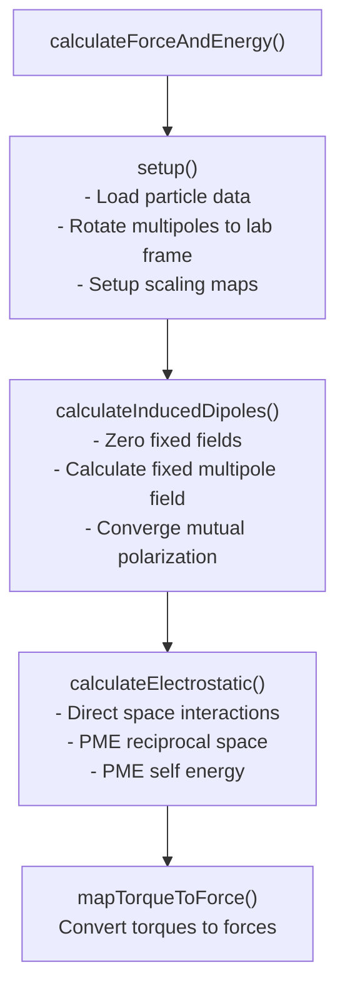

**Sources:** [plugins/amoeba/platforms/reference/src/SimTKReference/AmoebaReferenceMultipoleForce.h:232-319]()

### Multipole Particle Data Structure

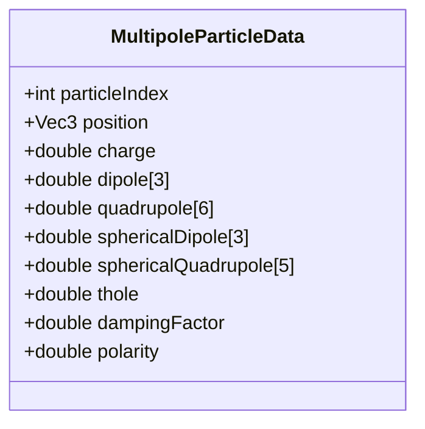

The `loadParticleData()` method [plugins/amoeba/platforms/reference/src/SimTKReference/AmoebaReferenceMultipoleForce.cpp:306-352]() converts from the input arrays to the `MultipoleParticleData` structure, storing both Cartesian and spherical harmonic representations of multipoles.

**Sources:** [plugins/amoeba/platforms/reference/src/SimTKReference/AmoebaReferenceMultipoleForce.cpp:306-352]()

### Rotation Matrix Application

Multipoles in the molecular frame are rotated to the laboratory frame using a rotation matrix derived from the axis atoms:

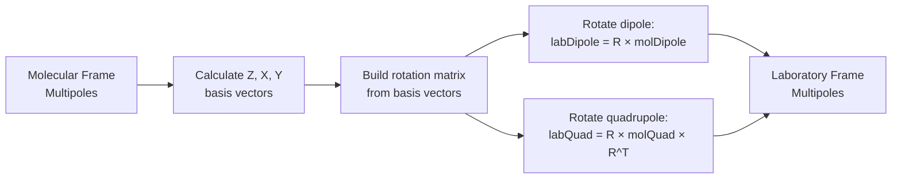

The method `applyRotationMatrixToParticle()` [plugins/amoeba/platforms/reference/src/SimTKReference/AmoebaReferenceMultipoleForce.cpp:402-567]() handles all axis types, computing appropriate basis vectors and applying the rotation.

**Sources:** [plugins/amoeba/platforms/reference/src/SimTKReference/AmoebaReferenceMultipoleForce.cpp:402-567]()

### Scaling Maps

Covalently bonded atoms have modified interactions controlled by scaling factors stored in maps:

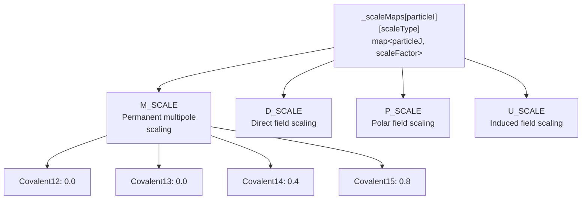

The `setupScaleMaps()` method [plugins/amoeba/platforms/reference/src/SimTKReference/AmoebaReferenceMultipoleForce.cpp:188-248]() constructs these maps from the covalent connectivity information. Default scaling values are initialized in `initialize()` [plugins/amoeba/platforms/reference/src/SimTKReference/AmoebaReferenceMultipoleForce.cpp:74-104]().

**Sources:** [plugins/amoeba/platforms/reference/src/SimTKReference/AmoebaReferenceMultipoleForce.cpp:74-104](), [plugins/amoeba/platforms/reference/src/SimTKReference/AmoebaReferenceMultipoleForce.cpp:188-248]()

## Induced Dipole Calculation

### Polarization Algorithms

AMOEBA supports three polarization methods, each with different computational characteristics:

| Method | Description | Convergence | Use Case |
|--------|-------------|-------------|----------|
| **Direct** | Induced dipoles from fixed multipoles only | Single step | Fast approximation |
| **Mutual** | Iterative SCF until convergence | ~5-20 iterations | Production accuracy |
| **Extrapolated** | Few iterations + extrapolation | Fixed (~4 iterations) | Speed/accuracy balance |

**Sources:** [plugins/amoeba/openmmapi/include/openmm/AmoebaMultipoleForce.h:70-92]()

### Mutual Polarization Convergence

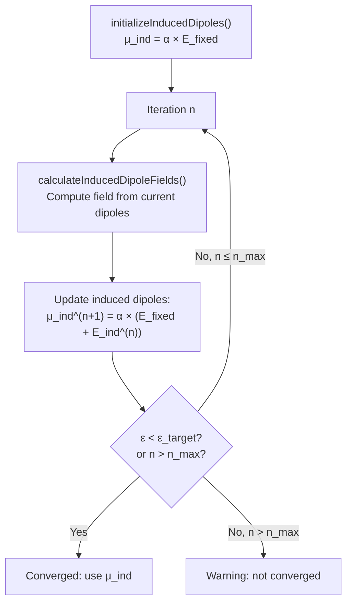

The convergence criterion is:

```
ε = max_i |μ_ind^(n+1) - μ_ind^(n)| / |μ_ind^(n+1)|
```

with default `ε_target = 1e-5` and `n_max = 60` [plugins/amoeba/openmmapi/src/AmoebaMultipoleForce.cpp:41]().

**Sources:** [plugins/amoeba/platforms/reference/src/SimTKReference/AmoebaReferenceMultipoleForce.cpp:782-794]()

### Extrapolated Polarization

The extrapolated method [plugins/amoeba/openmmapi/include/openmm/AmoebaMultipoleForce.h:84-90]() performs a fixed number of iterations (typically 4) then extrapolates to the converged solution using coefficients:

```
μ_converged ≈ c_0*μ_0 + c_1*μ_1 + c_2*μ_2 + c_3*μ_3
```

Default coefficients are `[-0.154, 0.017, 0.658, 0.474]` [plugins/amoeba/openmmapi/src/AmoebaMultipoleForce.cpp:43-46](), but can be customized via `setExtrapolationCoefficients()`.

**Sources:** [plugins/amoeba/openmmapi/src/AmoebaMultipoleForce.cpp:41-47](), [plugins/amoeba/openmmapi/include/openmm/AmoebaMultipoleForce.h:337-351]()

### Update Induced Dipole Field Structures

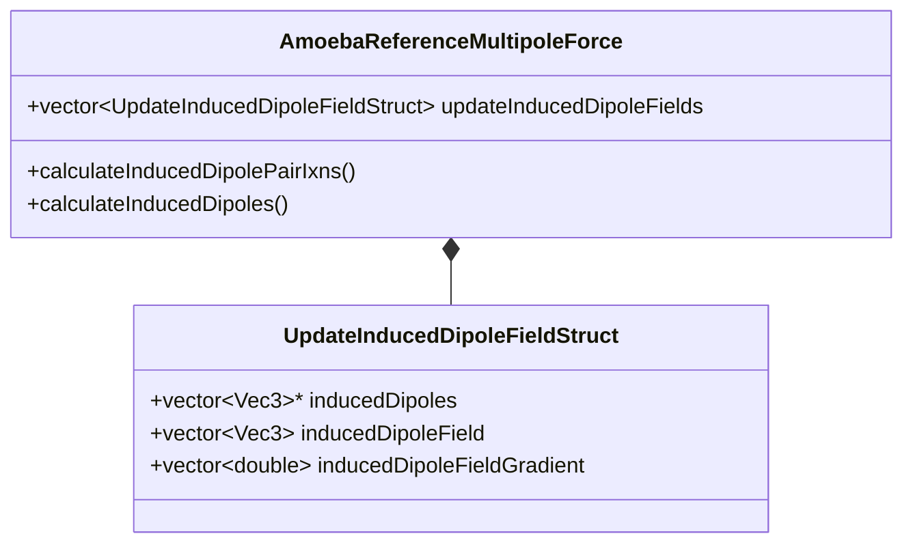

For extrapolated polarization, multiple sets of induced dipoles are maintained simultaneously. The field gradient is computed for extrapolation [plugins/amoeba/platforms/cuda/src/kernels/multipoleInducedField.cu:185-222]().

**Sources:** [plugins/amoeba/platforms/reference/src/SimTKReference/AmoebaReferenceMultipoleForce.cpp:811-874]()

## PME Implementation

### Reciprocal Space Calculation

Particle Mesh Ewald decomposes multipole electrostatics into direct and reciprocal space components. The reciprocal space calculation:

```mermaid
flowchart LR
    Multipoles["Lab Frame<br/>Multipoles"]
    Transform["transformMultipolesToFractional<br/>Coordinates()"]
    FracMultipoles["Fractional<br/>Coordinates"]
    GridSpread["gridSpreadFixedMultipoles()<br/>B-spline interpolation"]
    PMEGrid["PME Grid<br/>ρ(k)"]
    FFT["3D FFT<br/>forward"]
    ReciprocalGrid["k-space Grid<br/>ρ̃(k)"]
    ScaleConvolve["Reciprocal space<br/>convolution<br/>θ(k) × ρ̃(k)"]
    IFFT["3D FFT<br/>inverse"]
    PotentialGrid["Potential φ(r)<br/>on grid"]
    Gather["Gather to atoms<br/>B-spline interpolation"]
    Forces["Forces and<br/>Energy"]
    
    Multipoles --> Transform
    Transform --> FracMultipoles
    FracMultipoles --> GridSpread
    GridSpread --> PMEGrid
    PMEGrid --> FFT
    FFT --> ReciprocalGrid
    ReciprocalGrid --> ScaleConvolve
    ScaleConvolve --> IFFT
    IFFT --> PotentialGrid
    PotentialGrid --> Gather
    Gather --> Forces
```

**Sources:** [plugins/amoeba/platforms/cuda/src/kernels/multipoleInducedField.cu:1-290]()

### B-Spline Charge Spreading

Multipoles are spread onto the PME grid using B-spline interpolation. For PME order 5 (typical), the `computeBSplinePoint()` function [plugins/amoeba/platforms/cuda/src/kernels/multipolePme.cu:6-70]() computes coefficients for:

- Zero-order: charge spreading
- First derivative: dipole contribution
- Second derivative: quadrupole contribution (diagonal)
- Third derivative: quadrupole contribution (off-diagonal)

The spreading kernel `gridSpreadFixedMultipoles()` [plugins/amoeba/platforms/cuda/src/kernels/multipolePme.cu:184-290]() combines all contributions atomically into the grid.

**Sources:** [plugins/amoeba/platforms/cuda/src/kernels/multipolePme.cu:1-290]()

### Coordinate Transformations

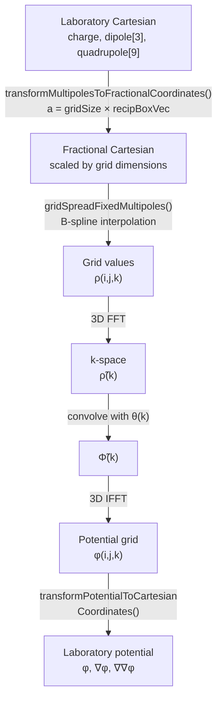

The transformation matrices account for the non-orthogonal periodic box [plugins/amoeba/platforms/cuda/src/kernels/multipolePme.cu:75-136]().

**Sources:** [plugins/amoeba/platforms/cuda/src/kernels/multipolePme.cu:75-182]()

### PME Grid Dimensions

Grid dimensions are chosen automatically based on Ewald error tolerance [plugins/amoeba/platforms/reference/src/AmoebaReferenceKernels.cpp:244-258]():

```cpp
if (pmeGridDimension[0] == 0 || alphaEwald == 0.0) {
    NonbondedForce nb;
    nb.setEwaldErrorTolerance(force.getEwaldErrorTolerance());
    nb.setCutoffDistance(force.getCutoffDistance());
    int gridSizeX, gridSizeY, gridSizeZ;
    NonbondedForceImpl::calcPMEParameters(system, nb, alphaEwald, 
                                         gridSizeX, gridSizeY, gridSizeZ, false);
    pmeGridDimension[0] = gridSizeX;
    pmeGridDimension[1] = gridSizeY;
    pmeGridDimension[2] = gridSizeZ;
}
```

**Sources:** [plugins/amoeba/platforms/reference/src/AmoebaReferenceKernels.cpp:244-258]()

## CUDA Platform Optimizations

### Kernel Organization

The CUDA implementation inherits from `CommonCalcAmoebaMultipoleForceKernel` which provides platform-agnostic GPU code. Platform-specific aspects:

```mermaid
graph TB
    CommonKernel["CommonCalcAmoebaMultipoleForceKernel<br/>(Common GPU code)"]
    CudaKernel["CudaCalcAmoebaMultipoleForceKernel"]
    
    FixedPoint["useFixedPointChargeSpreading()<br/>Returns: useDoublePrecision()"]
    Sort["SortTrait for atom grid indices"]
    
    CommonKernel <|-- CudaKernel
    CudaKernel --> FixedPoint
    CudaKernel --> Sort
```

Fixed-point charge spreading is used in double precision to avoid race conditions during atomic updates [plugins/amoeba/platforms/cuda/src/AmoebaCudaKernels.h:48-51]().

**Sources:** [plugins/amoeba/platforms/cuda/src/AmoebaCudaKernels.h:41-52](), [plugins/amoeba/platforms/cuda/src/AmoebaCudaKernels.cpp:83-94]()

### Direct Space Kernels

Direct space interactions use tile-based parallelization with neighbor lists:

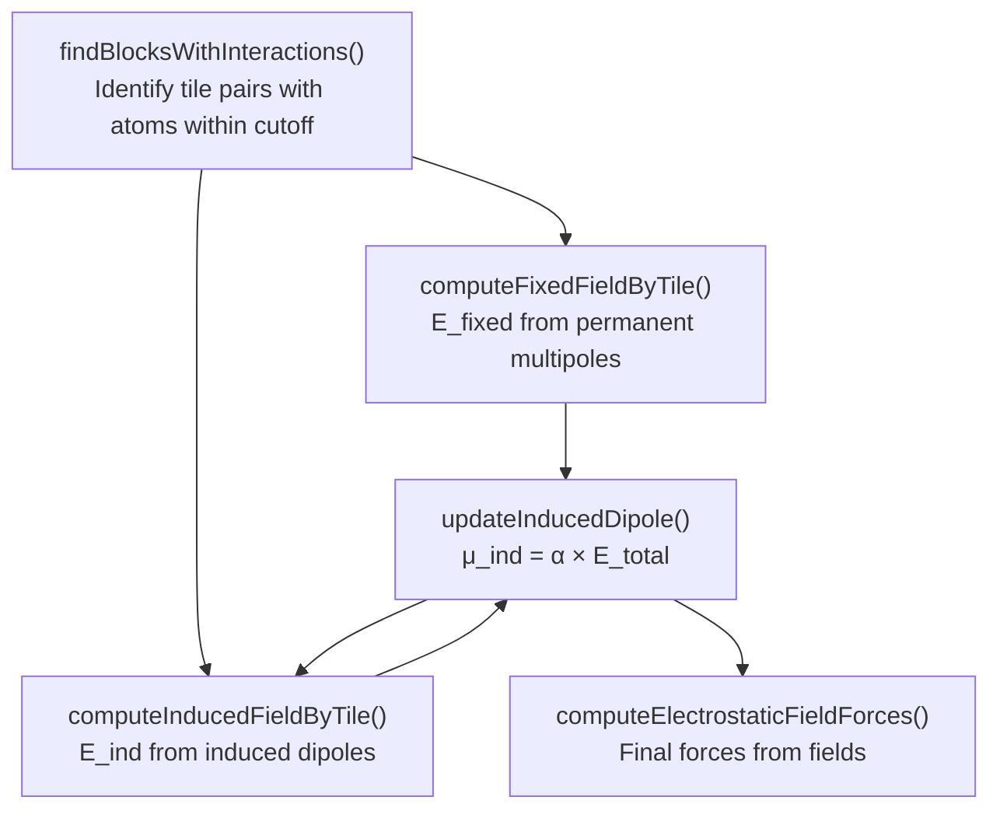

Each kernel processes atom tiles with a warp (32 threads) per tile [plugins/amoeba/platforms/cuda/src/kernels/multipoleInducedField.cu:1-3]().

**Sources:** [plugins/amoeba/platforms/cuda/src/kernels/multipoleInducedField.cu:1-450]()

### Thole Damping in GPU Code

```cuda
__device__ void computeOneInteraction(AtomData& atom1, AtomData& atom2, 
                                      real3 deltaR, bool isSelfInteraction) {
    // ... distance calculations ...
    
    // Thole damping
    real damp = atom1.damp*atom2.damp;
    real ratio = (r/damp);
    ratio = ratio*ratio*ratio;
    float pgamma = atom1.thole < atom2.thole ? atom1.thole : atom2.thole;
    damp = -pgamma*ratio;
    
    real expdamp = EXP(damp);
    real dsc3 = 1 - expdamp;
    real dsc5 = 1 - expdamp*(1-damp);
    real dsc7 = 1 - (1-damp+(0.6f*damp*damp))*expdamp;
    // Apply to interaction terms...
}
```

**Sources:** [plugins/amoeba/platforms/cuda/src/kernels/multipoleInducedField.cu:113-176]()

### Atomic Updates

Induced dipole fields are accumulated across thread blocks using 64-bit atomic additions in fixed-point representation:

```cuda
atomicAdd(&field[index], 
          static_cast<unsigned long long>((long long) (data.field.x*0x100000000)));
```

This approach [plugins/amoeba/platforms/cuda/src/kernels/multipoleInducedField.cu:86-110]() avoids floating-point race conditions while maintaining precision.

**Sources:** [plugins/amoeba/platforms/cuda/src/kernels/multipoleInducedField.cu:75-110]()

## HippoNonbondedForce

The HIPPO (Hydrogen-like Interactions and Polarization for Potential of Optimized energy) force is a newer variant that shares much infrastructure with AMOEBA but uses charge penetration and different damping:

```mermaid
graph LR
    HippoForce["HippoNonbondedForce"]
    HippoKernel["CalcHippoNonbondedForceKernel"]
    CommonHippo["CommonCalcHippoNonbondedForceKernel"]
    
    CudaHippo["CudaCalcHippoNonbondedForceKernel"]
    
    HippoForce --> HippoKernel
    HippoKernel --> CommonHippo
    CommonHippo <|-- CudaHippo
    
    CudaHippo -.->|"shares kernels with"| AmoebaCUDA["AMOEBA CUDA kernels<br/>#ifdef HIPPO"]
```

HIPPO kernels are compiled from the same source files as AMOEBA but with `HIPPO` preprocessor flag [plugins/amoeba/platforms/cuda/src/kernels/multipoleInducedField.cu:1]().

**Sources:** [plugins/amoeba/platforms/cuda/src/AmoebaCudaKernels.h:57-91](), [plugins/amoeba/platforms/cuda/src/kernels/multipoleInducedField.cu:1-450]()

## Key Data Structures

### AtomData Structure (GPU)

```cpp
typedef struct {
    real3 pos;
    real3 field, fieldPolar, inducedDipole, inducedDipolePolar;
#ifdef EXTRAPOLATED_POLARIZATION
    real fieldGradient[6], fieldGradientPolar[6];
#endif
#ifdef USE_GK
    real3 fieldS, fieldPolarS, inducedDipoleS, inducedDipolePolarS;
    real bornRadius;
#endif
    float thole, damp;
} AtomData;
```

This structure [plugins/amoeba/platforms/cuda/src/kernels/multipoleInducedField.cu:4-18]() is loaded into registers for efficient computation within each tile.

**Sources:** [plugins/amoeba/platforms/cuda/src/kernels/multipoleInducedField.cu:4-40]()

### MultipoleParticleData Structure (Reference)

The Reference platform uses a more detailed structure:

| Field | Type | Purpose |
|-------|------|---------|
| `particleIndex` | `int` | Atom index |
| `position` | `Vec3` | Cartesian coordinates |
| `charge` | `double` | Monopole |
| `dipole[3]` | `double` | Cartesian dipole |
| `quadrupole[6]` | `double` | Unique quadrupole components |
| `sphericalDipole[3]` | `double` | Spherical harmonic dipole |
| `sphericalQuadrupole[5]` | `double` | Spherical harmonic quadrupole |
| `thole` | `double` | Thole parameter |
| `dampingFactor` | `double` | Damping factor |
| `polarity` | `double` | Atomic polarizability |

**Sources:** [plugins/amoeba/platforms/reference/src/SimTKReference/AmoebaReferenceMultipoleForce.cpp:306-352]()

## Kernel Interface

### CalcAmoebaMultipoleForceKernel

All platform implementations must provide:

```cpp
class CalcAmoebaMultipoleForceKernel : public KernelImpl {
public:
    static std::string Name() { return "CalcAmoebaMultipoleForce"; }
    
    virtual void initialize(const System& system, 
                           const AmoebaMultipoleForce& force) = 0;
    
    virtual double execute(ContextImpl& context, 
                          bool includeForces, 
                          bool includeEnergy) = 0;
    
    virtual void getLabFramePermanentDipoles(ContextImpl& context, 
                                            std::vector<Vec3>& dipoles) = 0;
    
    virtual void getInducedDipoles(ContextImpl& context, 
                                  std::vector<Vec3>& dipoles) = 0;
    
    virtual void getTotalDipoles(ContextImpl& context, 
                                std::vector<Vec3>& dipoles) = 0;
    
    virtual void copyParametersToContext(ContextImpl& context, 
                                        const AmoebaMultipoleForce& force) = 0;
    
    virtual void getPMEParameters(double& alpha, int& nx, int& ny, int& nz) const = 0;
};
```

**Sources:** [plugins/amoeba/openmmapi/include/openmm/amoebaKernels.h:80-134]()

### Kernel Initialization

The Reference kernel initialization [plugins/amoeba/platforms/reference/src/AmoebaReferenceKernels.cpp:169-264]() demonstrates the parameter extraction:

```cpp
void ReferenceCalcAmoebaMultipoleForceKernel::initialize(
        const System& system, const AmoebaMultipoleForce& force) {
    numMultipoles = force.getNumMultipoles();
    
    // Allocate storage
    charges.resize(numMultipoles);
    dipoles.resize(3*numMultipoles);
    quadrupoles.resize(9*numMultipoles);
    // ... more allocations ...
    
    // Extract parameters for each atom
    for (int ii = 0; ii < numMultipoles; ii++) {
        force.getMultipoleParameters(ii, charge, dipolesD, quadrupolesD, 
                                    axisType, multipoleAtomZ, multipoleAtomX, 
                                    multipoleAtomY, tholeD, dampingFactorD, polarityD);
        // Store in arrays...
        
        force.getCovalentMaps(ii, covalentLists);
        multipoleAtomCovalentInfo[ii] = covalentLists;
    }
    
    // Configure PME if needed
    if (nonbondedMethod == AmoebaMultipoleForce::PME) {
        // Set up PME parameters...
    }
}
```

**Sources:** [plugins/amoeba/platforms/reference/src/AmoebaReferenceKernels.cpp:169-263]()

## Testing Infrastructure

### Test Organization

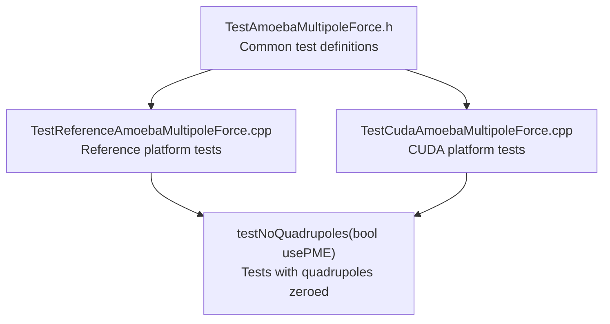

The common test header defines test cases that are executed on each platform. Platform-specific test files call `runPlatformTests()` [plugins/amoeba/platforms/cuda/tests/TestCudaAmoebaMultipoleForce.cpp:33-36]().

**Sources:** [plugins/amoeba/platforms/cuda/tests/TestCudaAmoebaMultipoleForce.cpp:30-37](), [plugins/amoeba/platforms/reference/tests/TestReferenceAmoebaMultipoleForce.cpp:30-34]()

## Summary

The AMOEBA implementation in OpenMM provides:

1. **Multipole electrostatics** with charge, dipole, and quadrupole moments
2. **Three polarization methods**: Direct, Mutual (iterative SCF), and Extrapolated (accelerated)
3. **Thole damping** to prevent polarization catastrophe at short range
4. **PME support** for long-range electrostatics via reciprocal space summation
5. **Platform implementations** optimized for CPU (Reference) and GPU (CUDA/OpenCL)
6. **Flexible coordinate frames** via five axis type options
7. **Covalent scaling** through detailed connectivity maps

The modular design allows the same API to leverage different computational backends while maintaining consistent physics across platforms.

**Sources:** [plugins/amoeba/openmmapi/include/openmm/AmoebaMultipoleForce.h:43-50](), [plugins/amoeba/platforms/reference/src/SimTKReference/AmoebaReferenceMultipoleForce.h:232-319]()

---