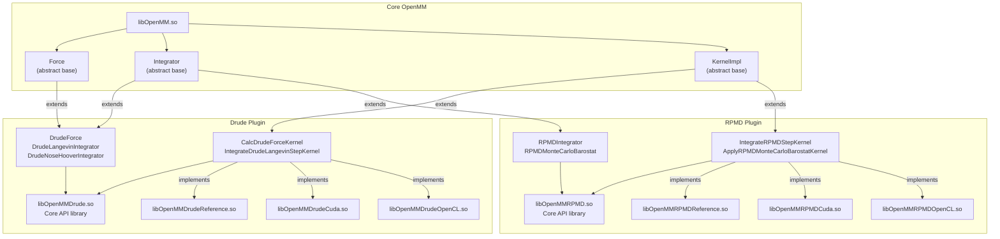
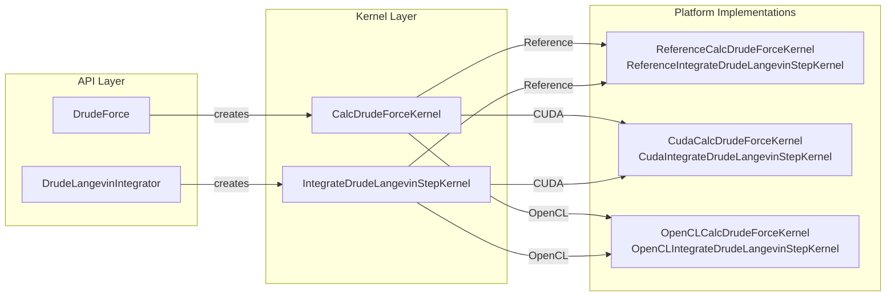
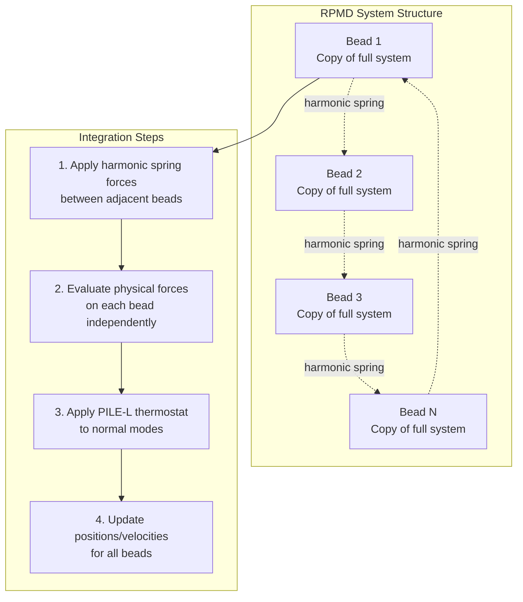
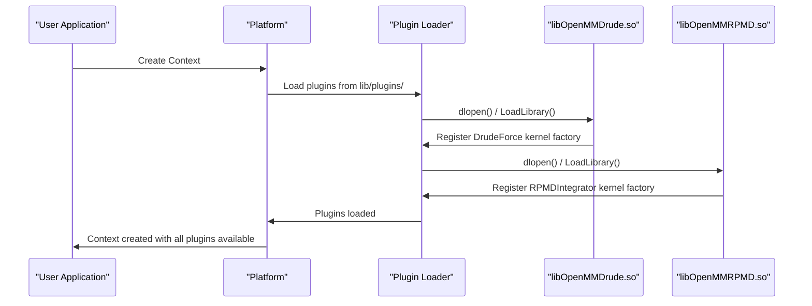

# Other Force Field Plugins

<details>
<summary>Relevant source files</summary>

The following files were used as context for generating this wiki page:

- [CMakeLists.txt](CMakeLists.txt)
- [docs-source/api-c++/forces.rst](docs-source/api-c++/forces.rst)
- [olla/include/openmm/kernels.h](olla/include/openmm/kernels.h)
- [openmmapi/include/OpenMM.h](openmmapi/include/OpenMM.h)
- [platforms/common/include/openmm/common/CommonKernels.h](platforms/common/include/openmm/common/CommonKernels.h)
- [platforms/common/include/openmm/common/ComputeContext.h](platforms/common/include/openmm/common/ComputeContext.h)
- [platforms/common/src/CommonKernels.cpp](platforms/common/src/CommonKernels.cpp)
- [platforms/common/src/ComputeContext.cpp](platforms/common/src/ComputeContext.cpp)
- [platforms/cpu/CMakeLists.txt](platforms/cpu/CMakeLists.txt)
- [platforms/cuda/include/CudaContext.h](platforms/cuda/include/CudaContext.h)
- [platforms/cuda/include/CudaKernels.h](platforms/cuda/include/CudaKernels.h)
- [platforms/cuda/src/CudaContext.cpp](platforms/cuda/src/CudaContext.cpp)
- [platforms/cuda/src/CudaKernelFactory.cpp](platforms/cuda/src/CudaKernelFactory.cpp)
- [platforms/cuda/src/CudaKernels.cpp](platforms/cuda/src/CudaKernels.cpp)
- [platforms/cuda/src/CudaPlatform.cpp](platforms/cuda/src/CudaPlatform.cpp)
- [platforms/opencl/include/OpenCLContext.h](platforms/opencl/include/OpenCLContext.h)
- [platforms/opencl/include/OpenCLKernels.h](platforms/opencl/include/OpenCLKernels.h)
- [platforms/opencl/src/OpenCLContext.cpp](platforms/opencl/src/OpenCLContext.cpp)
- [platforms/opencl/src/OpenCLKernelFactory.cpp](platforms/opencl/src/OpenCLKernelFactory.cpp)
- [platforms/opencl/src/OpenCLKernels.cpp](platforms/opencl/src/OpenCLKernels.cpp)
- [platforms/opencl/src/OpenCLPlatform.cpp](platforms/opencl/src/OpenCLPlatform.cpp)
- [platforms/reference/include/ReferenceKernels.h](platforms/reference/include/ReferenceKernels.h)
- [platforms/reference/src/ReferenceKernelFactory.cpp](platforms/reference/src/ReferenceKernelFactory.cpp)
- [platforms/reference/src/ReferenceKernels.cpp](platforms/reference/src/ReferenceKernels.cpp)
- [platforms/reference/src/ReferencePlatform.cpp](platforms/reference/src/ReferencePlatform.cpp)
- [plugins/amoeba/CMakeLists.txt](plugins/amoeba/CMakeLists.txt)
- [plugins/amoeba/platforms/reference/CMakeLists.txt](plugins/amoeba/platforms/reference/CMakeLists.txt)
- [plugins/drude/CMakeLists.txt](plugins/drude/CMakeLists.txt)
- [plugins/drude/platforms/reference/CMakeLists.txt](plugins/drude/platforms/reference/CMakeLists.txt)
- [plugins/drude/wrappers/CMakeLists.txt](plugins/drude/wrappers/CMakeLists.txt)
- [plugins/drude/wrappers/Doxyfile.in](plugins/drude/wrappers/Doxyfile.in)
- [plugins/drude/wrappers/generateDrudeWrappers.py](plugins/drude/wrappers/generateDrudeWrappers.py)
- [plugins/rpmd/CMakeLists.txt](plugins/rpmd/CMakeLists.txt)
- [plugins/rpmd/platforms/reference/CMakeLists.txt](plugins/rpmd/platforms/reference/CMakeLists.txt)
- [serialization/CMakeLists.txt](serialization/CMakeLists.txt)
- [serialization/src/SerializationProxyRegistration.cpp](serialization/src/SerializationProxyRegistration.cpp)

</details>


This page describes the Drude oscillator and RPMD plugins, which extend OpenMM with additional physics models. For information about the AMOEBA polarizable force field plugin, see [AMOEBA Polarizable Force Field](#5.1). For general information about OpenMM's plugin architecture, see [Plugin System and Extensions](#5).

## Overview

OpenMM includes three additional force field plugins beyond AMOEBA:

- **Drude Plugin**: Implements the Drude oscillator model for polarizable force fields, an alternative polarizable model to AMOEBA
- **RPMD Plugin**: Implements Ring Polymer Molecular Dynamics for including quantum nuclear effects via path integral methods
- **CPU PME Plugin**: Provides CPU-based Particle Mesh Ewald calculations as an alternative to GPU-based PME

Each plugin follows the same architectural pattern established by the core OpenMM plugin system, providing:
1. High-level API classes (Force or Integrator)
2. Abstract kernel interfaces
3. Platform-specific implementations (Reference, CUDA, OpenCL)
4. Serialization support for checkpointing
5. Python bindings integrated with the main OpenMM package

Sources: [CMakeLists.txt:374-408](), [plugins/drude/CMakeLists.txt:1-120](), [plugins/rpmd/CMakeLists.txt:1-118]()

## Build Configuration

The plugins are configured via CMake options during the OpenMM build process:

| Plugin | CMake Option | Default | Required for Python |
|--------|-------------|---------|-------------------|
| Drude | `OPENMM_BUILD_DRUDE_PLUGIN` | ON | Yes |
| RPMD | `OPENMM_BUILD_RPMD_PLUGIN` | ON | Yes |
| CPU PME | `OPENMM_BUILD_PME_PLUGIN` | ON | No |

The Python wrappers have mandatory dependencies on Drude and RPMD plugins. The build system enforces this requirement:

Sources: [CMakeLists.txt:383-408](), [CMakeLists.txt:437-448]()

## Plugin Architecture Pattern



**Diagram: Plugin Architecture for Drude and RPMD**

Each plugin consists of:
1. A core library containing the API classes
2. Kernel interface definitions for platform-independent operations
3. Platform-specific implementations as separate libraries
4. Dynamic loading mechanism that makes plugin forces and integrators available to all OpenMM platforms

Sources: [CMakeLists.txt:374-408](), Diagram 3 from context

## Drude Oscillator Plugin

The Drude plugin implements polarizable force fields using the classical Drude oscillator model. In this model, electronic polarizability is represented by adding a massless charged particle (the Drude particle) to each polarizable atom, connected by a harmonic spring. The Drude particle responds to the local electric field, creating an induced dipole.

### Drude Plugin Components

**Library Structure:**

```
plugins/drude/
├── openmmapi/          # Public API classes
│   ├── include/openmm/
│   │   └── DrudeForce.h, DrudeLangevinIntegrator.h, etc.
│   └── src/
├── serialization/      # XML serialization support
├── platforms/
│   ├── reference/      # libOpenMMDrudeReference
│   ├── cuda/          # libOpenMMDrudeCuda
│   └── opencl/        # libOpenMMDrudeOpenCL
└── wrappers/          # Python wrapper generation
```

**Key Classes:**

| Class | Purpose |
|-------|---------|
| `DrudeForce` | Defines Drude oscillator interactions and screening |
| `DrudeLangevinIntegrator` | Integrates equations of motion with dual-temperature scheme |
| `DrudeNoseHooverIntegrator` | Nose-Hoover thermostat for Drude particles |
| `DrudeSCFIntegrator` | Self-consistent field integrator for Drude particles |

The dual-temperature integration scheme maintains different temperatures for real atoms and Drude particles, allowing the Drude degrees of freedom to remain near their ground state while real atoms sample the desired temperature.

Sources: [plugins/drude/CMakeLists.txt:1-120](), [plugins/drude/wrappers/CMakeLists.txt:1-35]()

### Drude Kernel Implementation



**Diagram: Drude Plugin Kernel Dispatch**

The kernel factory pattern allows the same `DrudeForce` and integrator classes to work across all platforms through runtime dispatch.

Sources: [platforms/cuda/src/CudaKernelFactory.cpp:41-134](), [platforms/opencl/src/OpenCLKernelFactory.cpp:41-134](), [platforms/reference/src/ReferenceKernelFactory.cpp:30-141]()

### Drude Platform Implementations

Each platform provides optimized implementations:

**Reference Platform** ([plugins/drude/platforms/reference/CMakeLists.txt:1-87]()):
- Pure C++ implementation for validation
- Single-threaded execution
- Serves as the correctness baseline

**CUDA Platform** (if `OPENMM_BUILD_CUDA_LIB` is enabled):
- GPU-accelerated kernels
- Parallel force evaluation and integration
- Optimized for NVIDIA GPUs

**OpenCL Platform** (if `OPENMM_BUILD_OPENCL_LIB` is enabled):
- GPU-accelerated kernels
- Cross-vendor GPU support
- Parallel execution on OpenCL devices

The build system automatically includes the appropriate platform implementations based on available dependencies:

Sources: [plugins/drude/platforms/reference/CMakeLists.txt:1-87](), [CMakeLists.txt:322-357]()

## RPMD Plugin

The RPMD (Ring Polymer Molecular Dynamics) plugin implements path integral molecular dynamics using the ring polymer representation. This method allows simulation of quantum nuclear effects such as zero-point energy, tunneling, and quantum delocalization by representing each quantum nucleus as a classical ring polymer of beads.

### RPMD Plugin Components

**Library Structure:**

```
plugins/rpmd/
├── openmmapi/          # Public API classes
│   ├── include/openmm/
│   │   └── RPMDIntegrator.h, RPMDMonteCarloBarostat.h
│   └── src/
├── platforms/
│   ├── reference/      # libOpenMMRPMDReference
│   ├── cuda/          # libOpenMMRPMDCuda
│   └── opencl/        # libOpenMMRPMDOpenCL
└── No serialization subdirectory (serialization not implemented)
```

**Key Classes:**

| Class | Purpose |
|-------|---------|
| `RPMDIntegrator` | Integrates ring polymer equations of motion with PILE-L thermostat |
| `RPMDMonteCarloBarostat` | Monte Carlo barostat for constant pressure RPMD simulations |

The RPMD method uses multiple copies (beads) of the system connected by harmonic springs to represent the quantum partition function. The number of beads determines the accuracy of the quantum approximation.

Sources: [plugins/rpmd/CMakeLists.txt:1-118]()

### RPMD Integration Scheme



**Diagram: RPMD Ring Polymer Structure and Integration**

Each bead represents a complete copy of the system, with harmonic springs connecting adjacent beads in the ring. The `RPMDIntegrator` manages the coupled dynamics of all beads.

Sources: [plugins/rpmd/CMakeLists.txt:21-35]()

### RPMD Kernel Implementation

The RPMD plugin provides kernel implementations for the integrator:

| Kernel | Responsibility |
|--------|---------------|
| `IntegrateRPMDStepKernel` | Performs one integration step for all ring polymer beads |
| `ApplyRPMDMonteCarloBarostatKernel` | Attempts Monte Carlo volume moves for NPT ensemble |

Each platform implements these kernels to efficiently handle the multiple copies of the system:

- **Reference Platform**: Sequential evaluation of forces and integration for each bead
- **CUDA/OpenCL Platforms**: Parallel evaluation across all beads simultaneously

The parallel GPU implementations achieve significant performance gains by evaluating forces on all beads concurrently, as the beads are independent for physical force evaluation.

Sources: [plugins/rpmd/platforms/reference/CMakeLists.txt:1-84](), [platforms/cuda/src/CudaKernelFactory.cpp:41-134]()

## CPU PME Plugin

The CPU PME plugin provides a CPU-based implementation of Particle Mesh Ewald for long-range electrostatics. This plugin is primarily useful when:
- GPU memory is limited
- The system is too large for GPU PME grids
- Running on CPU-only platforms but desiring PME accuracy

Unlike Drude and RPMD, the CPU PME plugin is not required for Python wrappers and operates transparently as an alternative PME implementation selected by platform properties.

Sources: [CMakeLists.txt:401-408](), [CMakeLists.txt:437-448]()

## Plugin Discovery and Loading

OpenMM discovers and loads plugins at runtime through a platform-specific mechanism. When a `Context` is created, OpenMM automatically loads all available plugin libraries from the plugin directory.

**Plugin Loading Sequence:**



**Diagram: Runtime Plugin Discovery**

Each plugin library exports a registration function that is called during loading. This registration makes the plugin's forces and integrators available to the platform's kernel factory.

The plugin directory location:
- Linux/macOS: `<install_prefix>/lib/plugins/`
- Windows: `<install_prefix>\lib\plugins\`

Sources: [CMakeLists.txt:374-408](), [platforms/opencl/src/OpenCLPlatform.cpp:41-223]()

## Creating Custom Plugins

Developers can create custom plugins following the same pattern used by the built-in plugins:

1. **Define API classes** extending `Force` or `Integrator`
2. **Create kernel interfaces** extending `KernelImpl`
3. **Implement kernels** for each target platform
4. **Register kernel factories** in each platform implementation
5. **Build as separate library** that loads at runtime

The plugin pattern allows extending OpenMM without modifying core code, enabling:
- Third-party force field development
- Custom integration schemes
- Specialized algorithms for specific problems
- Proprietary force calculations

Example plugin structure:

```
my_custom_plugin/
├── openmmapi/
│   ├── include/openmm/MyCustomForce.h
│   └── src/MyCustomForceImpl.cpp
├── platforms/
│   ├── reference/
│   │   └── src/ReferenceMyCustomForceKernel.cpp
│   ├── cuda/
│   │   └── src/CudaMyCustomForceKernel.cpp
│   └── opencl/
│       └── src/OpenCLMyCustomForceKernel.cpp
└── CMakeLists.txt
```

Sources: [plugins/drude/CMakeLists.txt:1-120](), [plugins/rpmd/CMakeLists.txt:1-118](), Diagram 3 from context

## Summary

The Drude and RPMD plugins demonstrate OpenMM's extensibility through the plugin architecture:

- **Drude Plugin**: Polarizable force fields via classical Drude oscillators with dual-temperature integration
- **RPMD Plugin**: Quantum nuclear effects via ring polymer path integrals
- **CPU PME Plugin**: Alternative PME implementation for CPU-intensive scenarios

All plugins follow the same architectural pattern:
1. Core library with API classes
2. Abstract kernel interfaces  
3. Platform-specific implementations
4. Runtime dynamic loading
5. Seamless integration with existing OpenMM platforms

This plugin system enables OpenMM to support diverse physics models and algorithms while maintaining a clean separation between the API, platform abstraction layer, and hardware-specific implementations.

Sources: [CMakeLists.txt:374-408](), [plugins/drude/CMakeLists.txt:1-120](), [plugins/rpmd/CMakeLists.txt:1-118]()

---