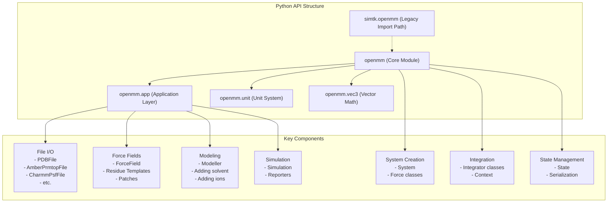
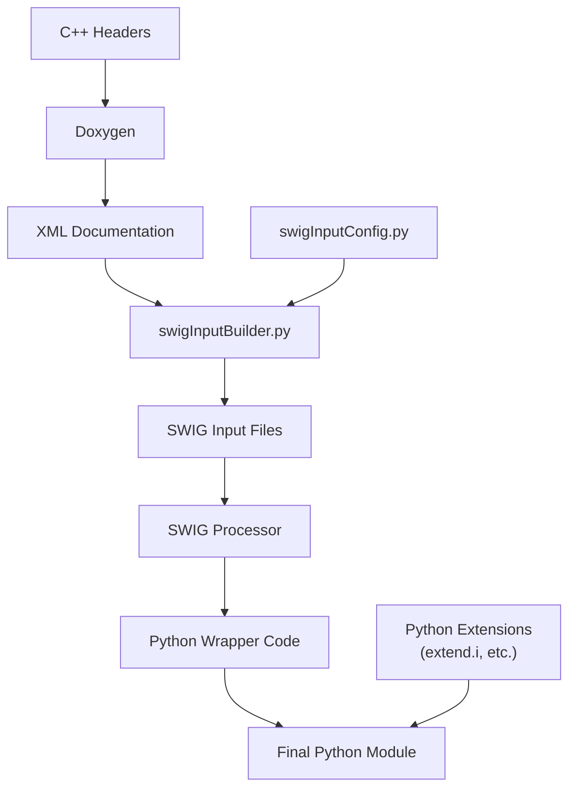
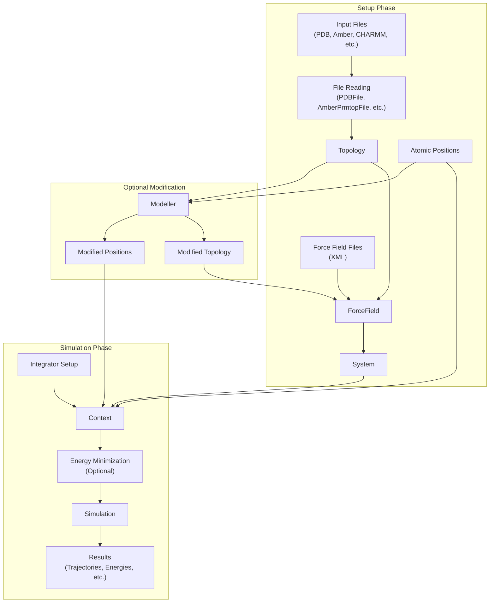
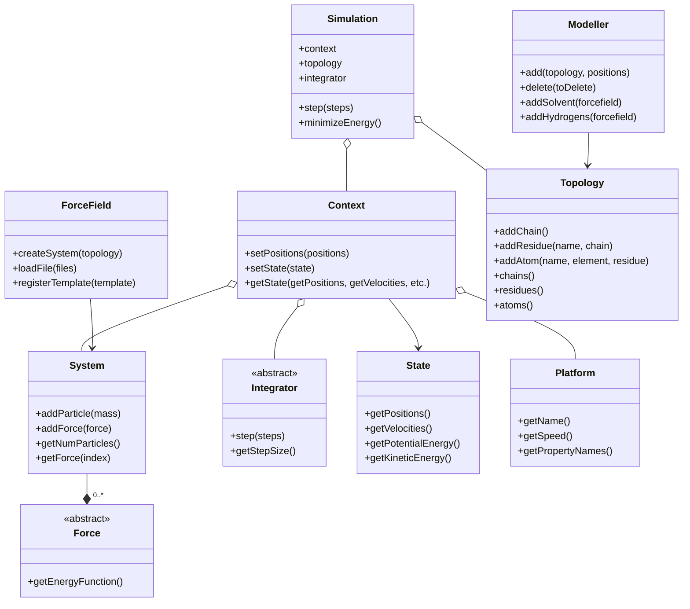
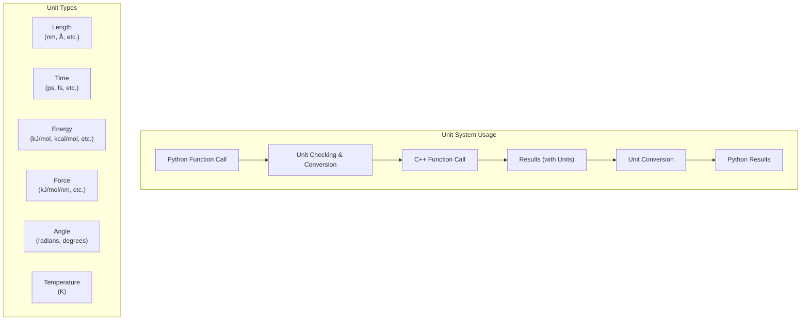
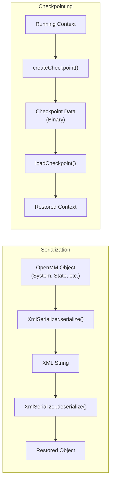
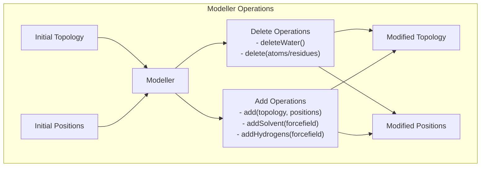
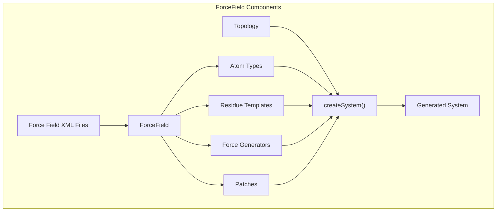

# Python API

<details>
<summary>Relevant source files</summary>

The following files were used as context for generating this wiki page:

- [docs-source/CMakeLists.txt](docs-source/CMakeLists.txt)
- [docs-source/api-python/process-docstring.py](docs-source/api-python/process-docstring.py)
- [docs-source/developerguide/05_cpu_platform.rst](docs-source/developerguide/05_cpu_platform.rst)
- [docs-source/developerguide/07_cuda_platform.rst](docs-source/developerguide/07_cuda_platform.rst)
- [docs-source/developerguide/index.rst](docs-source/developerguide/index.rst)
- [docs-source/developerguide/make.bat](docs-source/developerguide/make.bat)
- [docs-source/sphinx/autonumber.py](docs-source/sphinx/autonumber.py)
- [docs-source/usersguide/application.rst](docs-source/usersguide/application.rst)
- [docs-source/usersguide/application/01_getting_started.rst](docs-source/usersguide/application/01_getting_started.rst)
- [docs-source/usersguide/application/02_running_sims.rst](docs-source/usersguide/application/02_running_sims.rst)
- [docs-source/usersguide/application/05_add_on_packages.rst](docs-source/usersguide/application/05_add_on_packages.rst)
- [docs-source/usersguide/application/06_creating_ffs.rst](docs-source/usersguide/application/06_creating_ffs.rst)
- [docs-source/usersguide/index.rst](docs-source/usersguide/index.rst)
- [docs-source/usersguide/library.rst](docs-source/usersguide/library.rst)
- [docs-source/usersguide/library/01_introduction.rst](docs-source/usersguide/library/01_introduction.rst)
- [docs-source/usersguide/library/02_compiling.rst](docs-source/usersguide/library/02_compiling.rst)
- [docs-source/usersguide/library/04_platform_specifics.rst](docs-source/usersguide/library/04_platform_specifics.rst)
- [docs-source/usersguide/make.bat](docs-source/usersguide/make.bat)
- [docs-source/usersguide/references.bib](docs-source/usersguide/references.bib)
- [docs-source/usersguide/theory.rst](docs-source/usersguide/theory.rst)
- [plugins/amoeba/wrappers/generateAmoebaWrappers.py](plugins/amoeba/wrappers/generateAmoebaWrappers.py)
- [wrappers/generateWrappers.py](wrappers/generateWrappers.py)
- [wrappers/python/CMakeLists.txt](wrappers/python/CMakeLists.txt)
- [wrappers/python/openmm/app/amberprmtopfile.py](wrappers/python/openmm/app/amberprmtopfile.py)
- [wrappers/python/openmm/app/charmmparameterset.py](wrappers/python/openmm/app/charmmparameterset.py)
- [wrappers/python/openmm/app/charmmpsffile.py](wrappers/python/openmm/app/charmmpsffile.py)
- [wrappers/python/openmm/app/desmonddmsfile.py](wrappers/python/openmm/app/desmonddmsfile.py)
- [wrappers/python/openmm/app/forcefield.py](wrappers/python/openmm/app/forcefield.py)
- [wrappers/python/openmm/app/internal/amber_file_parser.py](wrappers/python/openmm/app/internal/amber_file_parser.py)
- [wrappers/python/openmm/app/internal/amoebaforces.py](wrappers/python/openmm/app/internal/amoebaforces.py)
- [wrappers/python/openmm/app/tinkerfiles.py](wrappers/python/openmm/app/tinkerfiles.py)
- [wrappers/python/setup.py](wrappers/python/setup.py)
- [wrappers/python/src/swig_doxygen/OpenMM.i](wrappers/python/src/swig_doxygen/OpenMM.i)
- [wrappers/python/src/swig_doxygen/swigInputBuilder.py](wrappers/python/src/swig_doxygen/swigInputBuilder.py)
- [wrappers/python/src/swig_doxygen/swigInputConfig.py](wrappers/python/src/swig_doxygen/swigInputConfig.py)
- [wrappers/python/src/swig_doxygen/swig_lib/python/extend.i](wrappers/python/src/swig_doxygen/swig_lib/python/extend.i)
- [wrappers/python/src/swig_doxygen/swig_lib/python/header.i](wrappers/python/src/swig_doxygen/swig_lib/python/header.i)
- [wrappers/python/src/swig_doxygen/swig_lib/python/pythoncode.i](wrappers/python/src/swig_doxygen/swig_lib/python/pythoncode.i)
- [wrappers/python/src/swig_doxygen/swig_lib/python/typemaps.i](wrappers/python/src/swig_doxygen/swig_lib/python/typemaps.i)
- [wrappers/python/tests/TestAPIUnits.py](wrappers/python/tests/TestAPIUnits.py)
- [wrappers/python/tests/TestAmberInpcrdFile.py](wrappers/python/tests/TestAmberInpcrdFile.py)
- [wrappers/python/tests/TestAmberPrmtopFile.py](wrappers/python/tests/TestAmberPrmtopFile.py)
- [wrappers/python/tests/TestCharmmFiles.py](wrappers/python/tests/TestCharmmFiles.py)
- [wrappers/python/tests/TestElement.py](wrappers/python/tests/TestElement.py)
- [wrappers/python/tests/TestForceField.py](wrappers/python/tests/TestForceField.py)
- [wrappers/python/tests/TestForceGroups.py](wrappers/python/tests/TestForceGroups.py)
- [wrappers/python/tests/TestPatches.py](wrappers/python/tests/TestPatches.py)
- [wrappers/python/tests/TestPickle.py](wrappers/python/tests/TestPickle.py)
- [wrappers/python/tests/TestTinkerFiles.py](wrappers/python/tests/TestTinkerFiles.py)
- [wrappers/python/tests/systems/4TVP-dmj_wat-ion.psf](wrappers/python/tests/systems/4TVP-dmj_wat-ion.psf)
- [wrappers/python/tests/systems/ala_ala_ala.crd](wrappers/python/tests/systems/ala_ala_ala.crd)
- [wrappers/python/tests/systems/amoebabio18.prm](wrappers/python/tests/systems/amoebabio18.prm)

</details>


The Python API for OpenMM provides a high-level interface to the OpenMM molecular simulation toolkit. It wraps the core C++ functionality with an intuitive, object-oriented Python interface while adding convenience classes and utilities that make it easier to set up, run, and analyze molecular simulations. This page describes the structure and key components of the Python API, how to use it effectively, and the relation between Python classes and the underlying C++ implementation.

For information about the C++ library that OpenMM is built on, see [The OpenMM Library](#2).

## API Structure

The OpenMM Python API is organized into several modules:



Sources: [wrappers/python/setup.py:140-153](), [wrappers/python/simtk/openmm/__init__.py]()

### Core Module (`openmm`)

The core module contains the fundamental classes that correspond directly to the C++ API:

- `System`: Represents a complete molecular system with particles and forces
- `Force`: Base class for all force calculations (subclasses like `HarmonicBondForce`, `NonbondedForce`, etc.)
- `Integrator`: Base class for integration algorithms (subclasses like `VerletIntegrator`, `LangevinIntegrator`, etc.)
- `Context`: Manages the state of a simulation and coordinates calculations
- `State`: Represents the state of a simulation at a point in time
- `Platform`: Represents computation platforms (CPU, CUDA, OpenCL, etc.)

These classes are generated through SWIG from the C++ API, with Python-specific extensions added to make them more Pythonic.

Sources: [wrappers/python/src/swig_doxygen/OpenMM.i](), [wrappers/python/src/swig_doxygen/swig_lib/python/extend.i]()

### Application Layer (`openmm.app`)

The application layer provides higher-level functionality for setting up and running simulations:

- File I/O classes (`PDBFile`, `AmberPrmtopFile`, etc.)
- `ForceField`: Manages force field parameters and creates systems
- `Topology`: Represents the topological structure of a molecule
- `Modeller`: Provides tools for editing molecular models
- `Simulation`: High-level coordination of simulation runs
- Reporter classes for outputting simulation data

This layer is written primarily in Python and provides a more convenient interface for common molecular simulation tasks.

Sources: [wrappers/python/openmm/app/forcefield.py](), [wrappers/python/openmm/app/modeller.py]()

### Unit System (`openmm.unit`)

OpenMM's unit system provides types for physical quantities with units, ensuring that calculations are dimensionally correct:

- Quantity classes for values with units
- Standard unit definitions (nm, ps, kJ/mol, etc.)
- Unit conversion utilities

This system helps prevent common errors in scientific computation by tracking units explicitly.

Sources: [wrappers/python/src/swig_doxygen/swigInputConfig.py:157-456]()

## API Generation Process

The Python API is generated from the C++ API using a multi-step process:



This process ensures that the Python API accurately reflects the C++ implementation while adding Python-specific features.

Sources: [wrappers/python/CMakeLists.txt:103-212](), [wrappers/python/src/swig_doxygen/swigInputBuilder.py]()

## Core Workflow and Data Flow

Here's the typical workflow when using the OpenMM Python API:



Sources: [examples/simulateAmber.py](), [examples/simulatePdb.py](), [examples/simulateCharmm.py]()

## Key Classes and Their Relationships

The following diagram shows the key classes in the OpenMM Python API and their relationships:



Sources: [wrappers/python/tests/TestForceField.py](), [wrappers/python/tests/TestModeller.py](), [wrappers/python/src/swig_doxygen/extend.i]()

## Units and Type Handling

OpenMM's Python API uses an integrated unit system to ensure physical quantities are properly tracked:



Units are automatically handled during the conversions between Python and C++, with quantities in Python being converted to the appropriate internal units for C++ calculations.

Sources: [wrappers/python/src/swig_doxygen/swig_lib/python/typemaps.i:21-112](), [wrappers/python/tests/TestAPIUnits.py]()

## Example Usage

Here's a basic example showing how to use the OpenMM Python API to set up and run a simulation:

```python
from openmm.app import *
from openmm import *
from openmm.unit import *

# Load input files
pdb = PDBFile('input.pdb')
forcefield = ForceField('amber14-all.xml', 'amber14/tip3pfb.xml')

# Create system and add forces
system = forcefield.createSystem(
    pdb.topology,
    nonbondedMethod=PME,
    nonbondedCutoff=1*nanometer,
    constraints=HBonds
)

# Set up integrator
integrator = LangevinMiddleIntegrator(
    300*kelvin,  # Temperature
    1/picosecond,  # Friction coefficient
    0.004*picoseconds  # Step size
)

# Create simulation
simulation = Simulation(pdb.topology, system, integrator)
simulation.context.setPositions(pdb.positions)

# Minimize energy
simulation.minimizeEnergy()

# Add reporters for output
simulation.reporters.append(DCDReporter('output.dcd', 1000))
simulation.reporters.append(
    StateDataReporter('output.txt', 1000, 
                      step=True, 
                      potentialEnergy=True, 
                      temperature=True)
)

# Run simulation
simulation.step(10000)
```

Sources: [examples/simulatePdb.py](), [examples/simulateAmber.py](), [examples/simulateCharmm.py]()

## Serialization and State Management

OpenMM provides mechanisms to save and load simulation states:



This allows for saving and restoring simulations, as well as transferring states between different platforms or machines.

Sources: [wrappers/python/src/swig_doxygen/swig_lib/python/extend.i:93-128](), [wrappers/python/tests/TestPickle.py]()

## Advanced Features

### Modeller for System Modification

The `Modeller` class provides tools for modifying molecular models:



Sources: [wrappers/python/openmm/app/modeller.py:54-722](), [wrappers/python/tests/TestModeller.py]()

### Force Fields and Customization

The `ForceField` class provides extensive customization options:



Sources: [wrappers/python/openmm/app/forcefield.py:195-673](), [wrappers/python/tests/TestForceField.py]()

## Legacy Import Path

For backward compatibility, OpenMM maintains the legacy import path `simtk.openmm`, which redirects to the modern `openmm` module with a deprecation warning. New code should use the `openmm` import path directly.

Sources: [wrappers/python/simtk/openmm/__init__.py]()

## Conclusion

The OpenMM Python API provides a powerful and flexible interface for molecular simulations, combining the performance of the C++ core with the convenience and readability of Python. The object-oriented design and integrated unit system make it straightforward to set up complex simulations while avoiding common errors. The API is designed to be extensible, allowing for customization and integration with other Python tools for scientific computing.

---