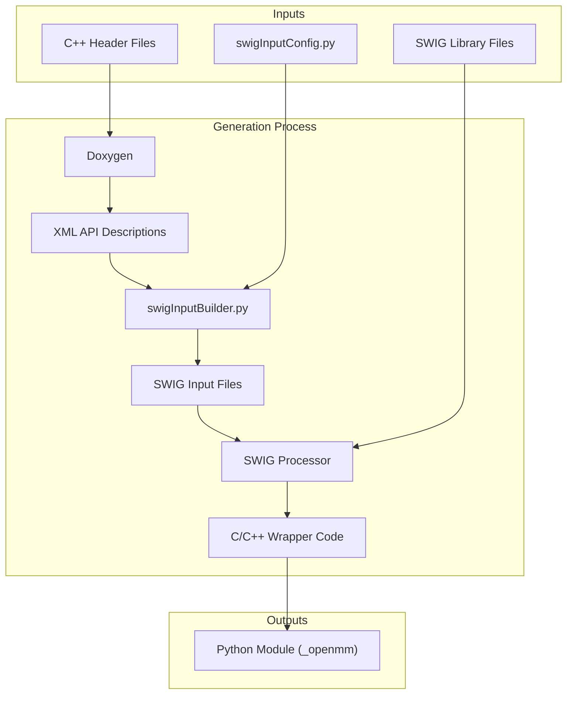
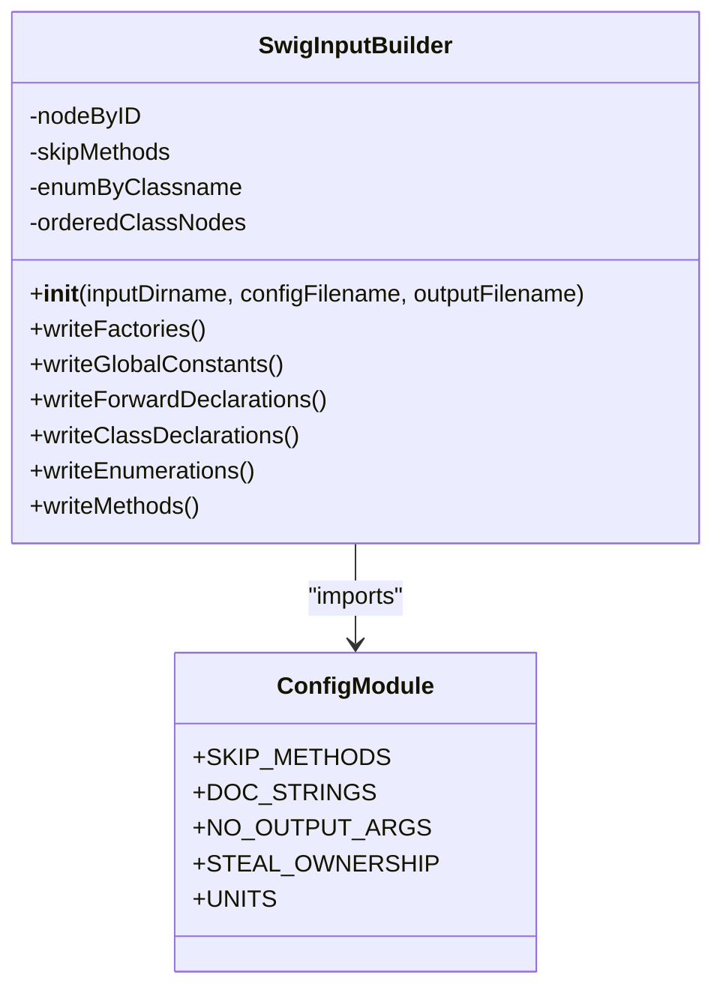
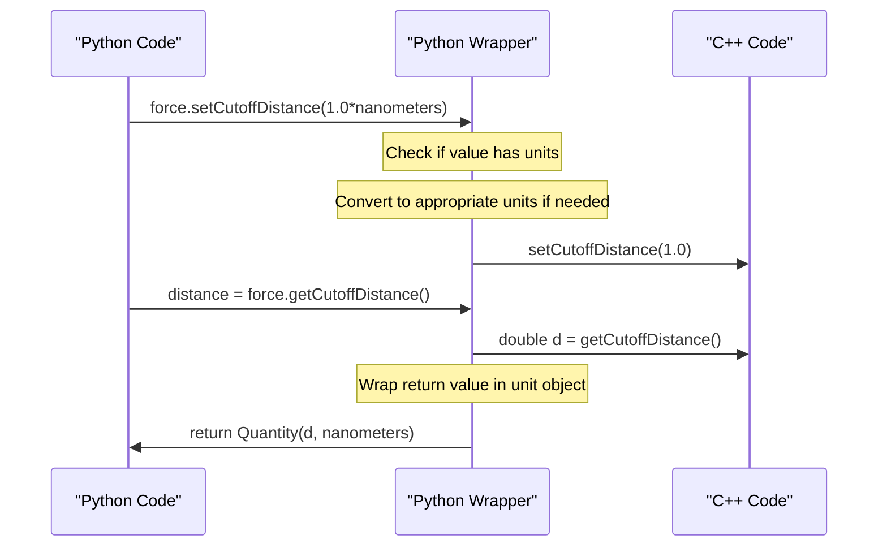
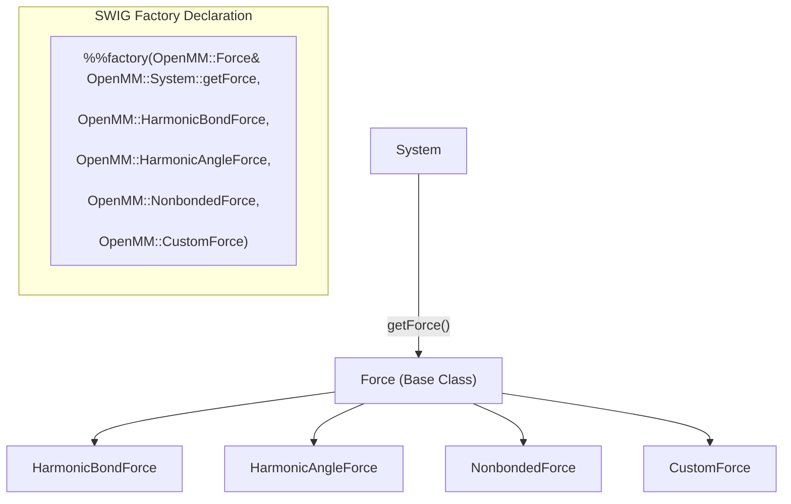
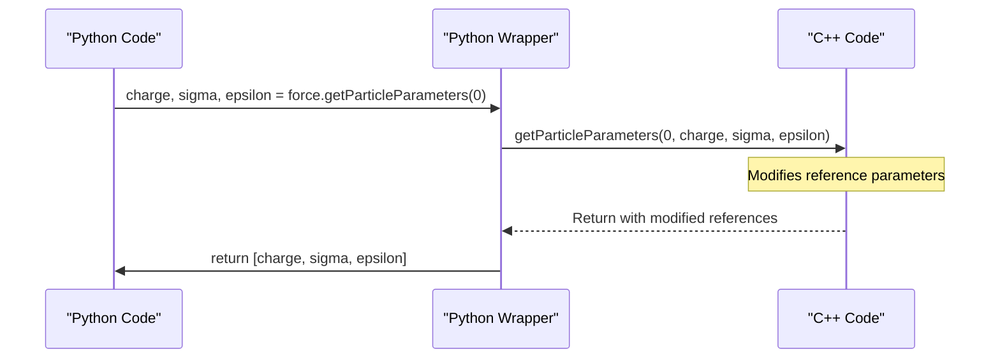
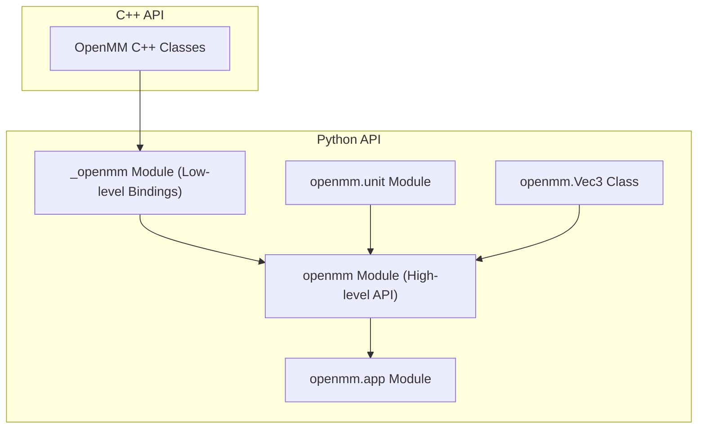

# Python Wrapper Generation

<details>
<summary>Relevant source files</summary>

The following files were used as context for generating this wiki page:

- [plugins/amoeba/wrappers/generateAmoebaWrappers.py](plugins/amoeba/wrappers/generateAmoebaWrappers.py)
- [wrappers/generateWrappers.py](wrappers/generateWrappers.py)
- [wrappers/python/CMakeLists.txt](wrappers/python/CMakeLists.txt)
- [wrappers/python/setup.py](wrappers/python/setup.py)
- [wrappers/python/src/swig_doxygen/OpenMM.i](wrappers/python/src/swig_doxygen/OpenMM.i)
- [wrappers/python/src/swig_doxygen/swigInputBuilder.py](wrappers/python/src/swig_doxygen/swigInputBuilder.py)
- [wrappers/python/src/swig_doxygen/swigInputConfig.py](wrappers/python/src/swig_doxygen/swigInputConfig.py)
- [wrappers/python/src/swig_doxygen/swig_lib/python/extend.i](wrappers/python/src/swig_doxygen/swig_lib/python/extend.i)
- [wrappers/python/src/swig_doxygen/swig_lib/python/header.i](wrappers/python/src/swig_doxygen/swig_lib/python/header.i)
- [wrappers/python/src/swig_doxygen/swig_lib/python/pythoncode.i](wrappers/python/src/swig_doxygen/swig_lib/python/pythoncode.i)
- [wrappers/python/src/swig_doxygen/swig_lib/python/typemaps.i](wrappers/python/src/swig_doxygen/swig_lib/python/typemaps.i)
- [wrappers/python/tests/TestAPIUnits.py](wrappers/python/tests/TestAPIUnits.py)
- [wrappers/python/tests/TestForceGroups.py](wrappers/python/tests/TestForceGroups.py)
- [wrappers/python/tests/TestPickle.py](wrappers/python/tests/TestPickle.py)

</details>


This page documents how OpenMM's Python wrappers are generated from the C++ API. The Python wrapper system translates OpenMM's C++ classes and methods into Python, handling complexities like type conversions, unit management, and memory ownership. For information about the high-level Python API components like the ForceField and Modeller classes, see [ForceField and Modeller Classes](#6.2).

## Overview of the Wrapper Generation Process

OpenMM uses SWIG (Simplified Wrapper and Interface Generator) along with custom processing scripts to generate its Python bindings. The overall process follows these steps:



Sources: [wrappers/python/src/swig_doxygen/swigInputBuilder.py:1-155](), [wrappers/generateWrappers.py:1-32]()

## Key Components

### 1. XML API Extraction

Doxygen processes the C++ header files to generate XML documentation that describes all classes, methods, and parameters. This structured representation of the API is then used by the custom scripts.

### 2. SWIG Input Generation (swigInputBuilder.py)

This script reads the XML documentation and generates SWIG interface files with:
- Class declarations
- Method declarations
- Type mappings
- Factory declarations for polymorphic types
- Documentation strings



Sources: [wrappers/python/src/swig_doxygen/swigInputBuilder.py:169-574](). 

### 3. Configuration (swigInputConfig.py)

This file contains configuration settings that control the wrapper generation:

- **SKIP_METHODS**: Methods that should not be exposed to Python
- **DOC_STRINGS**: Custom documentation for methods
- **NO_OUTPUT_ARGS**: Reference parameters that shouldn't be treated as outputs
- **STEAL_OWNERSHIP**: Methods where C++ takes ownership of objects
- **UNITS**: Unit specifications for method parameters and return values

Sources: [wrappers/python/src/swig_doxygen/swigInputConfig.py:1-100](), [wrappers/python/src/swig_doxygen/swigInputConfig.py:126-152]()

### 4. SWIG Library Files

These files provide additional customizations for the Python API:

- **typemaps.i**: Defines type conversions between C++ and Python
- **extend.i**: Adds methods to C++ classes that are only available in Python
- **pythoncode.i**: Adds pure Python code to the module

Sources: [wrappers/python/src/swig_doxygen/swig_lib/python/typemaps.i:1-156](), [wrappers/python/src/swig_doxygen/swig_lib/python/extend.i:1-129]()

## Unit Handling

One of the most important features of OpenMM's Python API is its comprehensive unit system. The wrapper generation process automatically adds unit handling code based on the UNITS configuration.



The `UNITS` dictionary in swigInputConfig.py maps methods to their return and parameter unit types:

```python
UNITS = {
    ("*", "getCutoffDistance") : ("unit.nanometers", ()),
    ("*", "setCutoffDistance") : (None, ("unit.nanometers",)),
    # Many more methods...
}
```

Sources: [wrappers/python/src/swig_doxygen/swigInputConfig.py:157-530](), [wrappers/python/tests/TestAPIUnits.py:10-138]()

## Polymorphism Handling

OpenMM uses C++ inheritance extensively. The Python wrappers ensure proper polymorphism handling through SWIG factory declarations.



When a method returns a base class pointer (like `Force*`), the factory declaration ensures that Python receives an object of the correct derived type.

Sources: [wrappers/python/src/swig_doxygen/swigInputBuilder.py:248-336]()

## Reference Parameters and Output Values

C++ often uses reference parameters for output values. The wrapper generation automatically converts these to return values in Python.



The wrapper generation code detects non-const reference parameters and applies SWIG typemaps to treat them as output values, unless they are listed in `NO_OUTPUT_ARGS`.

Sources: [wrappers/python/src/swig_doxygen/swigInputBuilder.py:467-487](), [wrappers/python/src/swig_doxygen/swigInputConfig.py:108-125]()

## Ownership Management

When objects are passed between Python and C++, ownership management is crucial to prevent memory leaks. The `STEAL_OWNERSHIP` dictionary specifies methods where C++ takes ownership of objects:

```python
STEAL_OWNERSHIP = {
    ("System", "addForce") : [0],  # System takes ownership of the Force
    ("CustomNonbondedForce", "addTabulatedFunction") : [1],
    # More methods...
}
```

For these methods, the Python wrapper transfers ownership from Python to C++, preventing Python from trying to delete objects that C++ will delete.

Sources: [wrappers/python/src/swig_doxygen/swigInputConfig.py:133-147](), [wrappers/python/src/swig_doxygen/swigInputBuilder.py:526-532]()

## Special Method Handling

Some methods receive special treatment in the Python API:

### Context.getState()

This method is converted to have Python-friendly optional parameters:

```python
def getState(self, positions=False, velocities=False,
             forces=False, energy=False, parameters=False,
             parameterDerivatives=False, integratorParameters=False,
             enforcePeriodicBox=False, groups=-1):
    # Implementation...
```

Sources: [wrappers/python/src/swig_doxygen/swig_lib/python/extend.i:12-91]()

### Serialization Support

The wrapper adds support for Python's pickle protocol and deep copying:

```python
def __getstate__(self):
    serializationString = XmlSerializer.serialize(self)
    return serializationString

def __setstate__(self, serializationString):
    system = XmlSerializer.deserialize(serializationString)
    self.this = system.this
```

Sources: [wrappers/python/src/swig_doxygen/swig_lib/python/extend.i:435-454](), [wrappers/python/tests/TestPickle.py:12-94]()

### NumPy Integration

Methods that deal with vectors (positions, forces, etc.) have optional NumPy support:

```python
def getPositions(self, asNumpy=False):
    # Return as list or NumPy array depending on asNumpy
```

Sources: [wrappers/python/src/swig_doxygen/swig_lib/python/extend.i:518-533](), [wrappers/python/src/swig_doxygen/swig_lib/python/typemaps.i:163-276]()

## Generated Python API Structure

The wrapper generation process creates a low-level `_openmm` module that directly wraps the C++ API. This is then used by the high-level `openmm` module that provides a more Pythonic interface.



This layered structure provides a Pythonic interface to OpenMM while maintaining the performance of the underlying C++ implementation.

Sources: [wrappers/python/src/swig_doxygen/OpenMM.i:1-63]()

---