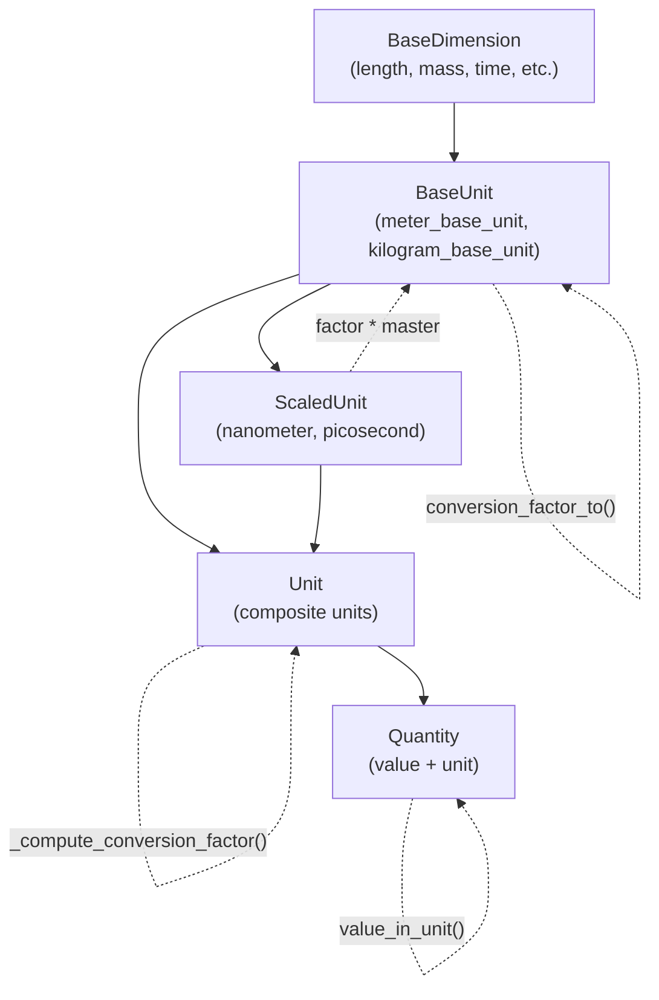
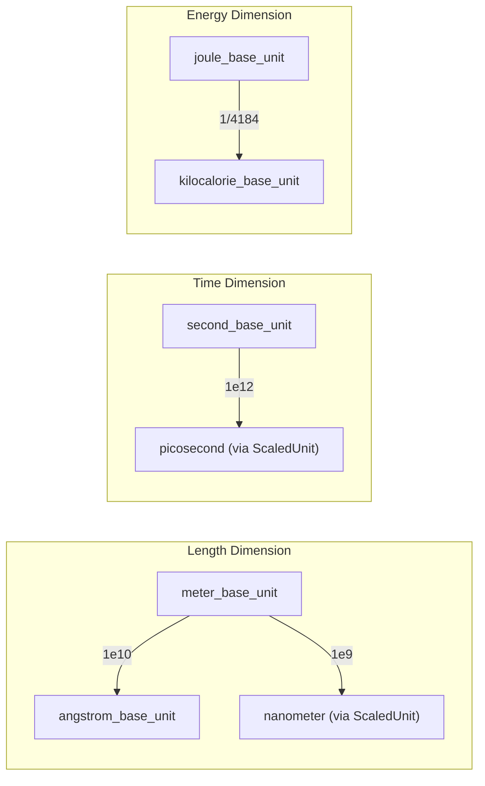
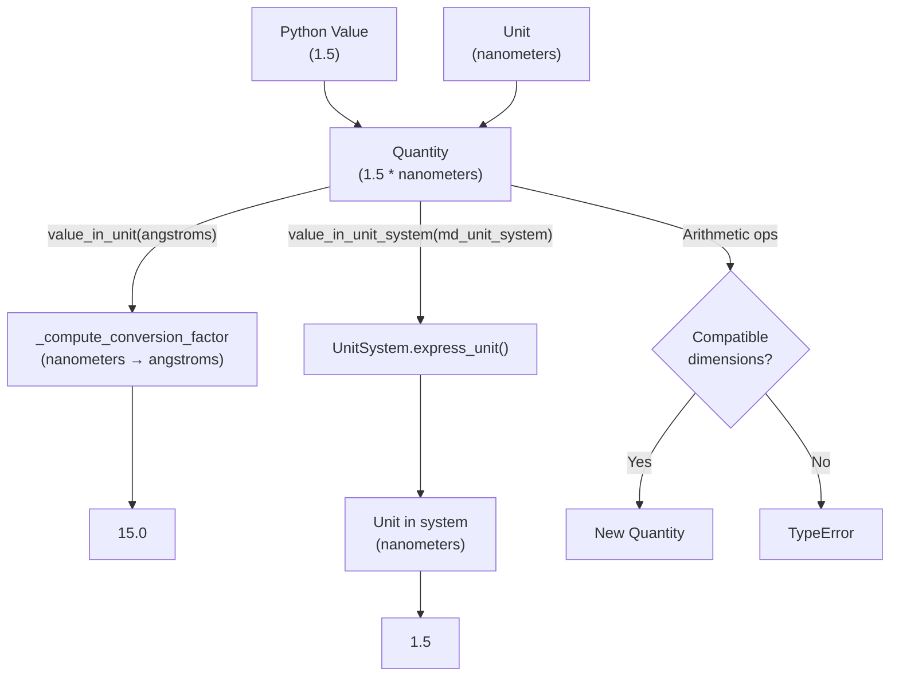
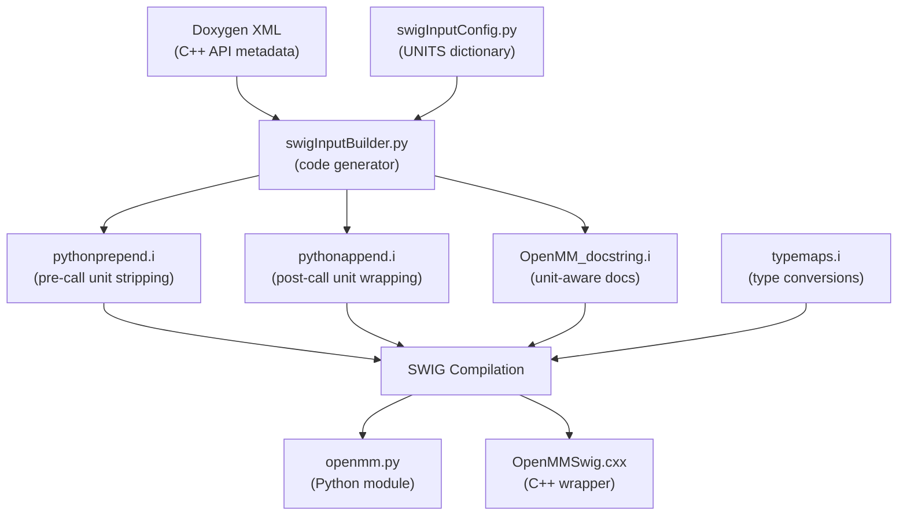
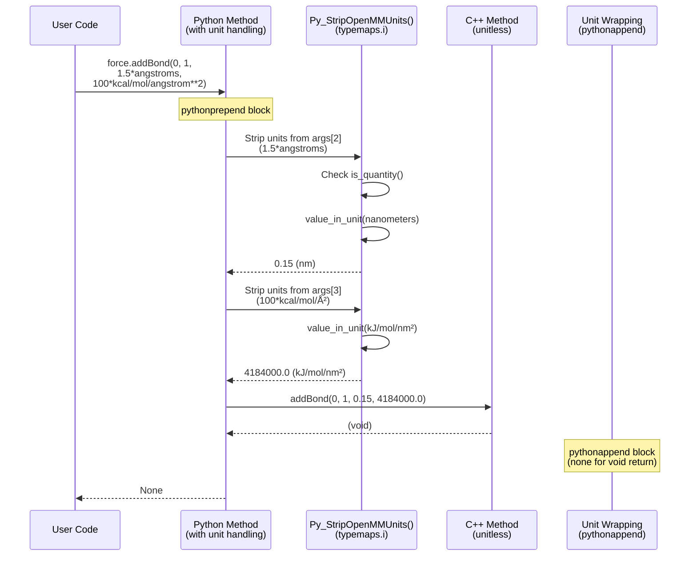
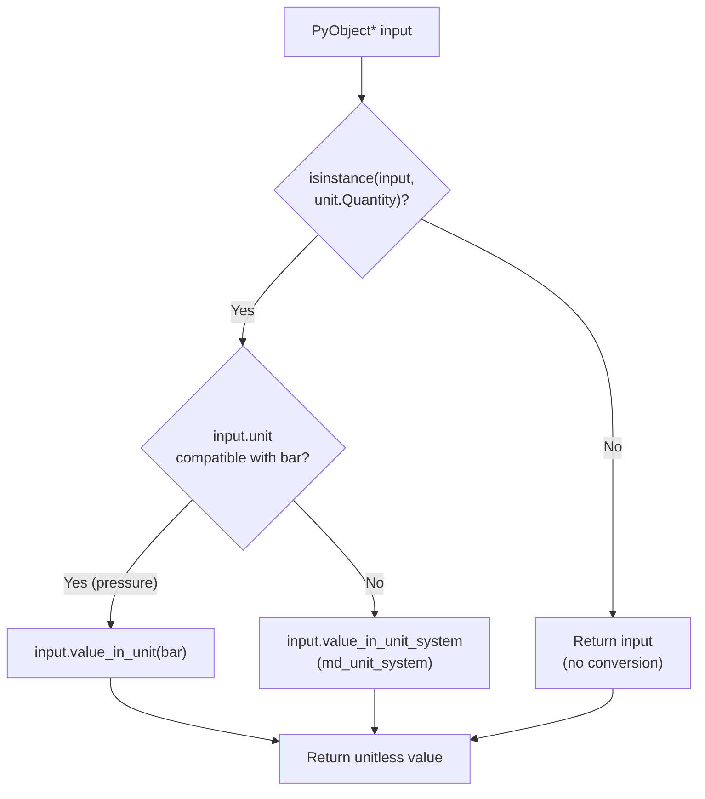
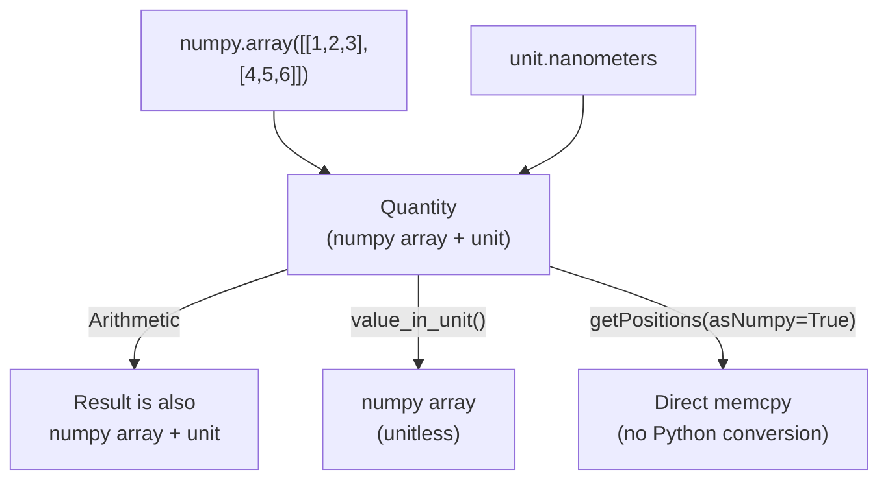

# Unit System

<details>
<summary>Relevant source files</summary>

The following files were used as context for generating this wiki page:

- [.travis.yml](.travis.yml)
- [appveyor.yml](appveyor.yml)
- [devtools/run-ctest.py](devtools/run-ctest.py)
- [examples/python-examples/argon-chemical-potential.py](examples/python-examples/argon-chemical-potential.py)
- [plugins/amoeba/wrappers/generateAmoebaWrappers.py](plugins/amoeba/wrappers/generateAmoebaWrappers.py)
- [wrappers/generateWrappers.py](wrappers/generateWrappers.py)
- [wrappers/python/CMakeLists.txt](wrappers/python/CMakeLists.txt)
- [wrappers/python/openmm/unit/mymatrix.py](wrappers/python/openmm/unit/mymatrix.py)
- [wrappers/python/openmm/unit/quantity.py](wrappers/python/openmm/unit/quantity.py)
- [wrappers/python/openmm/unit/unit.py](wrappers/python/openmm/unit/unit.py)
- [wrappers/python/setup.py](wrappers/python/setup.py)
- [wrappers/python/src/swig_doxygen/OpenMM.i](wrappers/python/src/swig_doxygen/OpenMM.i)
- [wrappers/python/src/swig_doxygen/swigInputBuilder.py](wrappers/python/src/swig_doxygen/swigInputBuilder.py)
- [wrappers/python/src/swig_doxygen/swigInputConfig.py](wrappers/python/src/swig_doxygen/swigInputConfig.py)
- [wrappers/python/src/swig_doxygen/swig_lib/python/extend.i](wrappers/python/src/swig_doxygen/swig_lib/python/extend.i)
- [wrappers/python/src/swig_doxygen/swig_lib/python/header.i](wrappers/python/src/swig_doxygen/swig_lib/python/header.i)
- [wrappers/python/src/swig_doxygen/swig_lib/python/pythoncode.i](wrappers/python/src/swig_doxygen/swig_lib/python/pythoncode.i)
- [wrappers/python/src/swig_doxygen/swig_lib/python/typemaps.i](wrappers/python/src/swig_doxygen/swig_lib/python/typemaps.i)
- [wrappers/python/tests/TestAPIUnits.py](wrappers/python/tests/TestAPIUnits.py)
- [wrappers/python/tests/TestForceGroups.py](wrappers/python/tests/TestForceGroups.py)
- [wrappers/python/tests/TestPickle.py](wrappers/python/tests/TestPickle.py)
- [wrappers/python/tests/TestUnits.py](wrappers/python/tests/TestUnits.py)
- [wrappers/python/tests/pytest.ini](wrappers/python/tests/pytest.ini)

</details>


## Purpose and Scope

The OpenMM Unit System provides dimensional analysis and automatic unit conversions for physical quantities in the Python API. It ensures type safety by tracking units alongside numerical values, automatically converting between compatible unit systems (e.g., nanometers ↔ angstroms), and raising errors when incompatible units are combined. This system operates exclusively in the Python layer, wrapping the unitless C++ API with automatic unit handling at the boundary.

For information about the Python wrapper generation system that integrates units into the API, see [Python Wrapper Generation System](#6.1). For the high-level application layer that uses units, see [ForceField System](#6.3) and [Simulation Management and Reporters](#6.6).

## Core Architecture

The unit system consists of four fundamental classes in the `openmm.unit` module:

| Class | Purpose | Location |
|-------|---------|----------|
| `BaseUnit` | Fundamental unit like meter or kilogram | [wrappers/python/openmm/unit/baseunit.py]() |
| `ScaledUnit` | Scaled version of a base unit (e.g., kilometer = 1000×meter) | [wrappers/python/openmm/unit/unit.py:73-209]() |
| `Unit` | Composite unit from base/scaled units (e.g., meter/second) | [wrappers/python/openmm/unit/unit.py:44-700]() |
| `Quantity` | Value with attached unit (e.g., 1.5 nanometers) | [wrappers/python/openmm/unit/quantity.py:79-834]() |

### Unit Hierarchy



**Diagram: Unit Class Hierarchy and Relationships**

Sources: [wrappers/python/openmm/unit/unit.py:44-700](), [wrappers/python/openmm/unit/quantity.py:79-834]()

### BaseUnit and Dimension System

Each `BaseUnit` belongs to a `BaseDimension` (length, mass, time, etc.) and maintains conversion factors to other units in the same dimension. The system supports arbitrary dimensional analysis without requiring a canonical set of base units.



**Diagram: Base Units with Conversion Factors**

Sources: [wrappers/python/openmm/unit/baseunit.py](), [wrappers/python/openmm/unit/standard_dimensions.py]()

## Quantity Class

The `Quantity` class wraps any Python value (scalar, list, tuple, numpy array) with a `Unit`. It overloads arithmetic operators to enforce dimensional correctness.

### Key Operations

| Operation | Example | Result |
|-----------|---------|--------|
| Addition | `1.0*nanometers + 5.0*angstroms` | `1.5*nanometers` |
| Multiplication | `2.0*meters * 3.0*seconds` | `6.0*meter*seconds` |
| Division | `10.0*meters / 2.0*seconds` | `5.0*meters/second` |
| Power | `(2.0*meters)**2` | `4.0*meters**2` |
| Unit conversion | `x.value_in_unit(angstroms)` | Numeric value in angstroms |
| Unit system | `x.value_in_unit_system(md_unit_system)` | Value in MD units |

### Quantity Creation and Conversion Flow



**Diagram: Quantity Value Access and Conversion**

Sources: [wrappers/python/openmm/unit/quantity.py:79-834](), [wrappers/python/openmm/unit/unit.py:210-280]()

## Integration with Python Wrappers

The unit system is tightly integrated with the SWIG-generated Python wrappers through automatic code generation that adds unit handling to every API method.

### Configuration-Driven Unit System

The `UNITS` dictionary in `swigInputConfig.py` declares the expected units for each method's parameters and return values:

```python
# Format: (ClassName, MethodName) : (return_unit, (arg1_unit, arg2_unit, ...))
UNITS = {
    ("HarmonicBondForce", "addBond") : (None, (None, None, "unit.nanometer", "unit.kilojoule_per_mole/unit.nanometer**2")),
    ("Context", "setPositions") : (None, ("unit.nanometer",)),
    ("State", "getPositions") : ("unit.nanometer", ()),
    ("NonbondedForce", "setCutoffDistance") : (None, ("unit.nanometers",)),
    ("*", "getTemperature") : ("unit.kelvin", ()),
    # ... hundreds more entries
}
```

Sources: [wrappers/python/src/swig_doxygen/swigInputConfig.py:159-531]()

### Wrapper Generation Process



**Diagram: Unit Integration in Wrapper Generation**

Sources: [wrappers/python/src/swig_doxygen/swigInputBuilder.py:196-796](), [wrappers/python/CMakeLists.txt:172-189]()

### Unit Stripping and Application

At the Python/C++ boundary, units are automatically stripped from input arguments and reapplied to return values:



**Diagram: Unit Conversion at API Boundary**

Sources: [wrappers/python/src/swig_doxygen/swig_lib/python/typemaps.i:37-112](), [wrappers/python/src/swig_doxygen/swigInputBuilder.py:560-621]()

### Type Conversion Implementation

The `Py_StripOpenMMUnits()` function handles unit removal:



**Diagram: Unit Stripping Logic in Py_StripOpenMMUnits()**

Sources: [wrappers/python/src/swig_doxygen/swig_lib/python/typemaps.i:37-112]()

## Standard Unit Systems

OpenMM defines three pre-configured unit systems:

| Unit System | Length | Mass | Time | Energy | Temperature |
|-------------|--------|------|------|--------|-------------|
| `si_unit_system` | meter | kilogram | second | joule | kelvin |
| `cgs_unit_system` | centimeter | gram | second | erg | kelvin |
| `md_unit_system` | nanometer | dalton (amu) | picosecond | kilojoule/mole | kelvin |

The MD unit system is the default for OpenMM simulations and minimizes numerical overflow/underflow at molecular scales.

### MD Unit System Details

The `md_unit_system` uses internally consistent units optimized for molecular dynamics:

```python
md_unit_system = UnitSystem([
    nanometer,           # length
    dalton,             # mass (atomic mass unit)
    picosecond,         # time
    elementary_charge,  # charge
    kelvin,            # temperature
    ScaledUnit(1.0, joule/mole, 'kilojoule_per_mole', 'kJ/mol')  # energy
])
```

Sources: [wrappers/python/openmm/unit/unit_definitions.py]()

## Generated Unit Conversion Code

The `swigInputBuilder.py` script generates `pythonprepend` and `pythonappend` blocks for each method based on the `UNITS` configuration.

### Pythonprepend Block Generation

For methods with unit-bearing arguments, code is injected before the C++ call:

```python
# Generated for HarmonicBondForce.addBond(particle1, particle2, length, k)
%pythonprepend OpenMM::HarmonicBondForce::addBond(int, int, double, double) %{
    if unit.is_quantity(length):
        length = length.value_in_unit(unit.nanometer)
    if unit.is_quantity(k):
        k = k.value_in_unit(unit.kilojoule_per_mole/unit.nanometer**2)
%}
```

This code is automatically generated by [wrappers/python/src/swig_doxygen/swigInputBuilder.py:575-621]().

### Pythonappend Block Generation

For methods returning unit-bearing values, code is injected after the C++ call:

```python
# Generated for State.getPositions()
%pythonappend OpenMM::State::getPositions() const %{
    val = val * unit.nanometer
%}

# Generated for Context.getTime()
%pythonappend OpenMM::Context::getTime() const %{
    val = val * unit.picosecond
%}
```

This code is automatically generated by [wrappers/python/src/swig_doxygen/swigInputBuilder.py:623-650]().

Sources: [wrappers/python/src/swig_doxygen/swigInputBuilder.py:196-796]()

## NumPy Integration

The unit system supports NumPy arrays as values while maintaining unit information:



**Diagram: NumPy Array Handling**

The `State` class provides optimized NumPy returns that avoid Python list conversion:

```python
state._positionsNumpy = numpy.empty([numParticles, 3], numpy.float64)
state._getVectorAsNumpy(State.Positions, state._positionsNumpy)
state._positionsNumpy = state._positionsNumpy * unit.nanometers
```

Sources: [wrappers/python/src/swig_doxygen/swig_lib/python/extend.i:518-567](), [wrappers/python/src/swig_doxygen/swig_lib/python/typemaps.i:235-314]()

## Wildcard Unit Specifications

The `UNITS` configuration supports wildcards for common patterns:

```python
UNITS = {
    # Applies to all classes
    ("*", "getTemperature") : ("unit.kelvin", ()),
    ("*", "getCutoffDistance") : ("unit.nanometers", ()),
    ("*", "getStepSize") : ("unit.picosecond", ()),
    # ...
}
```

When processing a method, the system checks both `(ClassName, MethodName)` and `("*", MethodName)` entries.

Sources: [wrappers/python/src/swig_doxygen/swigInputConfig.py:160-228](), [wrappers/python/src/swig_doxygen/swigInputBuilder.py:577-582]()

## Special Cases and Edge Handling

### Vec3 Type Conversion

The `Vec3` class is handled specially to strip units from sequence elements:

```python
def Py_SequenceToVec3(obj):
    s = Py_StripOpenMMUnits(obj)  # Strip outer unit
    for i in range(3):
        o = PySequence_GetItem(s, i)
        o1 = Py_StripOpenMMUnits(o)  # Strip element unit
        x[i] = PyFloat_AsDouble(o1)
    return Vec3(x[0], x[1], x[2])
```

Sources: [wrappers/python/src/swig_doxygen/swig_lib/python/typemaps.i:115-155]()

### Vector Conversion

For `std::vector<double>` parameters, units are stripped from each element:

```python
def Py_SequenceToVecDouble(obj):
    stripped = Py_StripOpenMMUnits(obj)
    # Fast path for numpy arrays
    if PyArray_Check(stripped):
        # Direct memory copy if contiguous
    # Fallback: iterate and convert each element
    for item in iterator:
        item1 = Py_StripOpenMMUnits(item)
        out.push_back(PyFloat_AsDouble(item1))
```

Sources: [wrappers/python/src/swig_doxygen/swig_lib/python/typemaps.i:157-233]()

### Periodic Box Vectors

The `State.getPeriodicBoxVectors()` method demonstrates multi-dimensional unit handling:

```python
def getPeriodicBoxVectors(self, asNumpy=False):
    vectors = _openmm.State_getPeriodicBoxVectors(self)
    if asNumpy:
        vectors = numpy.array(vectors)
    return vectors * unit.nanometers  # Each Vec3 gets units
```

Sources: [wrappers/python/src/swig_doxygen/swig_lib/python/extend.i:511-516]()

## Testing Infrastructure

The unit system has comprehensive test coverage:

### Unit Module Tests

Located in [wrappers/python/tests/TestUnits.py](), these test core functionality:

- Base unit creation and conversion factors
- Scaled unit relationships
- Composite unit arithmetic
- Quantity operations (add, multiply, divide, power)
- Unit system conversions
- Dimensional analysis
- NumPy integration

### API Unit Tests

Located in [wrappers/python/tests/TestAPIUnits.py](), these verify API integration:

```python
def testHarmonicBondForce(self):
    force = HarmonicBondForce()
    # Test with units
    force.addBond(2, 3, 1.0*angstroms, 1.0*kilocalories_per_mole/angstroms**2)
    i, j, length, K = force.getBondParameters(1)
    # Verify correct unit types returned
    self.assertIs(length.unit, nanometers)
    self.assertIs(K.unit, kilojoules_per_mole/nanometers**2)
    # Verify automatic conversion
    self.assertEqual(length, 1.0*angstroms)
    self.assertAlmostEqualUnit(K, 1*kilocalories_per_mole/angstroms**2)
```

Sources: [wrappers/python/tests/TestAPIUnits.py:20-98](), [wrappers/python/tests/TestUnits.py:19-752]()

## Error Handling

The unit system raises `TypeError` for incompatible operations:

```python
try:
    distance = 1.0*nanometers + 2.0*kilograms  # Incompatible dimensions
except TypeError as e:
    # "Cannot add or subtract when units are not compatible"
```

Unit conversion attempts between incompatible units also raise errors:

```python
try:
    time_value = (5.0*nanometers).value_in_unit(picoseconds)
except TypeError:
    # Attempting to convert length to time
```

Sources: [wrappers/python/openmm/unit/quantity.py:282-324]()

## Performance Considerations

### Unit Stripping Overhead

Unit checking and conversion occurs at every API call boundary. The system caches frequently used objects (like `unit.Quantity` class reference) to minimize lookup overhead.

### Optimization Strategies

1. **NumPy Fast Paths**: Direct memory copying for contiguous NumPy arrays [wrappers/python/src/swig_doxygen/swig_lib/python/typemaps.i:163-202]()
2. **Cached Type Checks**: Module and class references cached as static variables [wrappers/python/src/swig_doxygen/swig_lib/python/typemaps.i:38-81]()
3. **Lazy Conversion**: Position/velocity/force data only converted when accessed [wrappers/python/src/swig_doxygen/swig_lib/python/extend.i:518-567]()

### C++ is Unitless

The underlying C++ implementation has no unit system. All units exist only in the Python layer, with conversion happening at the boundary. This keeps the C++ performance-critical code fast and avoids runtime overhead.

Sources: [wrappers/python/src/swig_doxygen/swig_lib/python/typemaps.i:1-112](), [wrappers/python/src/swig_doxygen/swig_lib/python/extend.i:498-611]()

---