# ForceField System

<details>
<summary>Relevant source files</summary>

The following files were used as context for generating this wiki page:

- [docs-source/CMakeLists.txt](docs-source/CMakeLists.txt)
- [docs-source/api-python/process-docstring.py](docs-source/api-python/process-docstring.py)
- [docs-source/developerguide/05_cpu_platform.rst](docs-source/developerguide/05_cpu_platform.rst)
- [docs-source/developerguide/07_cuda_platform.rst](docs-source/developerguide/07_cuda_platform.rst)
- [docs-source/developerguide/index.rst](docs-source/developerguide/index.rst)
- [docs-source/developerguide/make.bat](docs-source/developerguide/make.bat)
- [docs-source/sphinx/autonumber.py](docs-source/sphinx/autonumber.py)
- [docs-source/usersguide/application.rst](docs-source/usersguide/application.rst)
- [docs-source/usersguide/application/01_getting_started.rst](docs-source/usersguide/application/01_getting_started.rst)
- [docs-source/usersguide/application/02_running_sims.rst](docs-source/usersguide/application/02_running_sims.rst)
- [docs-source/usersguide/application/05_add_on_packages.rst](docs-source/usersguide/application/05_add_on_packages.rst)
- [docs-source/usersguide/application/06_creating_ffs.rst](docs-source/usersguide/application/06_creating_ffs.rst)
- [docs-source/usersguide/index.rst](docs-source/usersguide/index.rst)
- [docs-source/usersguide/library.rst](docs-source/usersguide/library.rst)
- [docs-source/usersguide/library/01_introduction.rst](docs-source/usersguide/library/01_introduction.rst)
- [docs-source/usersguide/library/02_compiling.rst](docs-source/usersguide/library/02_compiling.rst)
- [docs-source/usersguide/library/04_platform_specifics.rst](docs-source/usersguide/library/04_platform_specifics.rst)
- [docs-source/usersguide/make.bat](docs-source/usersguide/make.bat)
- [docs-source/usersguide/references.bib](docs-source/usersguide/references.bib)
- [docs-source/usersguide/theory.rst](docs-source/usersguide/theory.rst)
- [wrappers/python/openmm/app/amberprmtopfile.py](wrappers/python/openmm/app/amberprmtopfile.py)
- [wrappers/python/openmm/app/charmmparameterset.py](wrappers/python/openmm/app/charmmparameterset.py)
- [wrappers/python/openmm/app/charmmpsffile.py](wrappers/python/openmm/app/charmmpsffile.py)
- [wrappers/python/openmm/app/desmonddmsfile.py](wrappers/python/openmm/app/desmonddmsfile.py)
- [wrappers/python/openmm/app/forcefield.py](wrappers/python/openmm/app/forcefield.py)
- [wrappers/python/openmm/app/internal/amber_file_parser.py](wrappers/python/openmm/app/internal/amber_file_parser.py)
- [wrappers/python/openmm/app/internal/amoebaforces.py](wrappers/python/openmm/app/internal/amoebaforces.py)
- [wrappers/python/openmm/app/tinkerfiles.py](wrappers/python/openmm/app/tinkerfiles.py)
- [wrappers/python/tests/TestAmberInpcrdFile.py](wrappers/python/tests/TestAmberInpcrdFile.py)
- [wrappers/python/tests/TestAmberPrmtopFile.py](wrappers/python/tests/TestAmberPrmtopFile.py)
- [wrappers/python/tests/TestCharmmFiles.py](wrappers/python/tests/TestCharmmFiles.py)
- [wrappers/python/tests/TestElement.py](wrappers/python/tests/TestElement.py)
- [wrappers/python/tests/TestForceField.py](wrappers/python/tests/TestForceField.py)
- [wrappers/python/tests/TestPatches.py](wrappers/python/tests/TestPatches.py)
- [wrappers/python/tests/TestTinkerFiles.py](wrappers/python/tests/TestTinkerFiles.py)
- [wrappers/python/tests/systems/4TVP-dmj_wat-ion.psf](wrappers/python/tests/systems/4TVP-dmj_wat-ion.psf)
- [wrappers/python/tests/systems/ala_ala_ala.crd](wrappers/python/tests/systems/ala_ala_ala.crd)
- [wrappers/python/tests/systems/amoebabio18.prm](wrappers/python/tests/systems/amoebabio18.prm)

</details>


## Purpose and Scope

This document explains the `ForceField` class in OpenMM's Python application layer, which provides XML-based force field definitions, template-based topology parameterization, and automatic `System` object creation. The `ForceField` class is the primary high-level interface for applying force field parameters to molecular systems.

For information about the lower-level `System` class and force objects it creates, see the library documentation. For file format parsers that directly create systems (AMBER, CHARMM, Gromacs), see [File Format Support](#6.5).

## Overview

The `ForceField` class serves as a bridge between human-readable XML force field definitions and OpenMM's computational `System` objects. It provides:

- **XML-based parameter storage**: Force field parameters defined in modular XML files
- **Template matching**: Automatic identification of residues and assignment of parameters
- **Topology-to-System conversion**: Creation of complete simulation systems from structural information
- **Extensibility**: Support for custom force fields, template generators, and force types

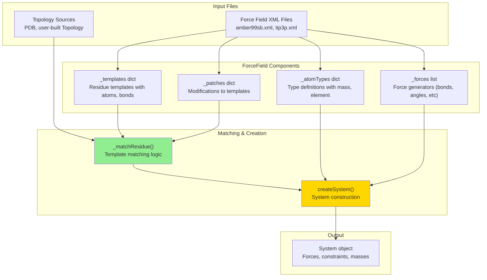

**Diagram: ForceField Architecture Overview**

Sources: [wrappers/python/openmm/app/forcefield.py:194-433]()

## Loading and Initialization

The `ForceField` constructor accepts one or more XML files that define force field parameters. Files can be specified as absolute paths, relative paths, paths relative to OpenMM's data directory, or file-like objects.

### File Loading Process

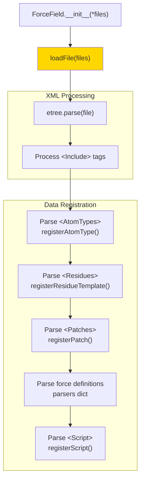

**Diagram: ForceField Loading Workflow**

### Key Data Structures

| Structure | Type | Purpose |
|-----------|------|---------|
| `_atomTypes` | `dict[str, _AtomType]` | Maps type names to mass, element, and class |
| `_templates` | `dict[str, _TemplateData]` | Maps residue names to template definitions |
| `_patches` | `dict[str, _PatchData]` | Maps patch names to template modifications |
| `_templateSignatures` | `dict[tuple, list]` | Maps element signatures to candidate templates |
| `_forces` | `list` | Ordered list of force generators |
| `_templateGenerators` | `list` | Custom functions for unmatched residues |

Sources: [wrappers/python/openmm/app/forcefield.py:194-282](), [wrappers/python/openmm/app/forcefield.py:427-501]()

## Atom Types and Residue Templates

### Atom Type System

Atom types define the fundamental building blocks with associated physical properties. Each type has:

- **Name**: Unique identifier (e.g., `"amber99_1"`)
- **Class**: Grouping for parameter lookup (e.g., `"CT"`)
- **Mass**: Atomic mass in daltons
- **Element**: Optional element reference

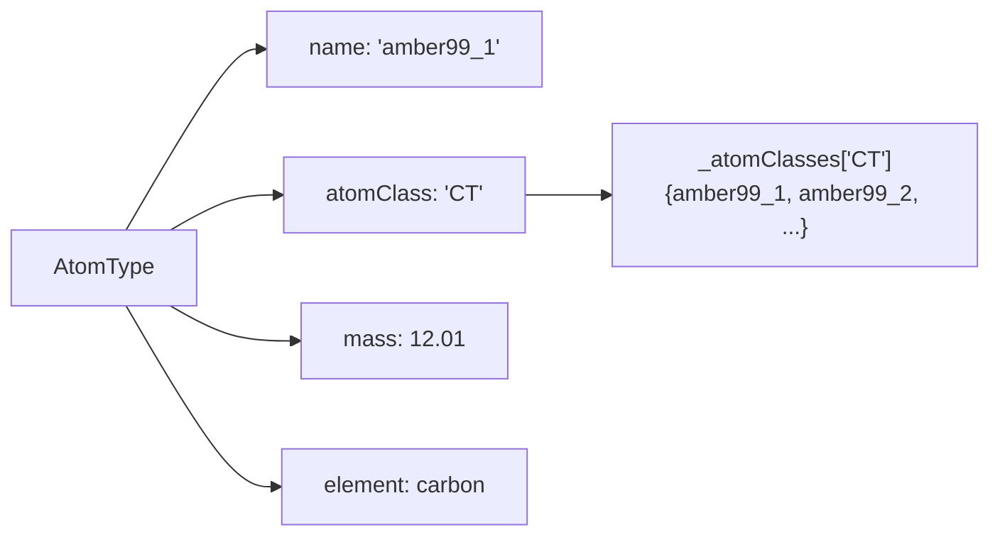

**Diagram: Atom Type Data Model**

### Residue Templates

Residue templates (`_TemplateData`) define the structure and properties of molecular residues:

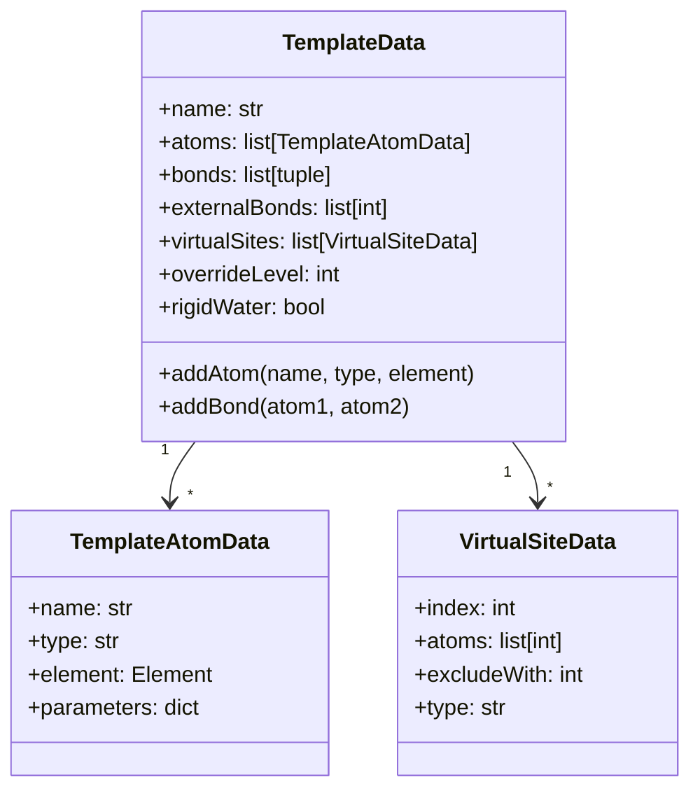

**Diagram: Residue Template Structure**

Sources: [wrappers/python/openmm/app/forcefield.py:685-730](), [wrappers/python/openmm/app/forcefield.py:290-334]()

## Template Matching System

Template matching is the process of identifying which force field template best describes each residue in a topology. This occurs in the `_matchResidue()` method during system creation.

### Matching Algorithm

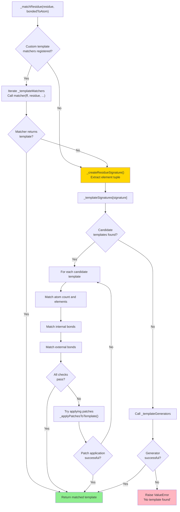

**Diagram: Template Matching Decision Flow**

### Signature-Based Lookup

Templates are indexed by element signatures for efficient lookup:

1. **Signature Creation**: Extract ordered tuple of elements from residue atoms
2. **Candidate Retrieval**: Look up templates with matching signatures
3. **Detailed Matching**: Verify atom names, bonds, and connectivity
4. **Patch Application**: Attempt to apply patches to near-matches

Sources: [wrappers/python/openmm/app/forcefield.py:1671-1867](), [wrappers/python/openmm/app/forcefield.py:2787-2810]()

## System Creation Workflow

The `createSystem()` method is the primary interface for converting a `Topology` into a `System` object. It coordinates template matching, parameter assignment, and force generation.

### Method Signature

```python
def createSystem(self, topology, nonbondedMethod=NoCutoff, 
                 nonbondedCutoff=1.0*nanometer, constraints=None,
                 rigidWater=True, removeCMMotion=True, 
                 hydrogenMass=None, **args)
```

### Creation Pipeline

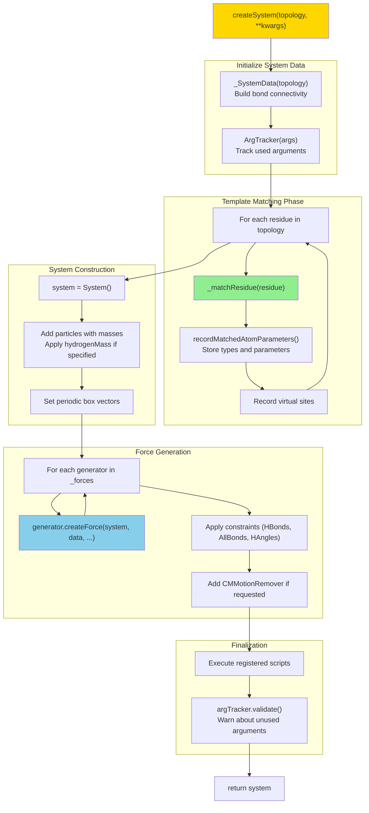

**Diagram: createSystem() Execution Flow**

### System Data Structure

The `_SystemData` class accumulates information during system creation:

| Field | Type | Purpose |
|-------|------|---------|
| `atoms` | `list[Atom]` | All atoms from topology |
| `atomType` | `dict[Atom, str]` | Atom type assignments |
| `atomParameters` | `dict[Atom, dict]` | Per-atom parameters |
| `bonds` | `list[_BondData]` | Bond connectivity |
| `bondedToAtom` | `list[set]` | Adjacency lists |
| `virtualSites` | `dict[Atom, tuple]` | Virtual site definitions |
| `constraints` | `dict[tuple, float]` | Constraint distances |
| `excludeAtomWith` | `list[list]` | Nonbonded exclusions |

Sources: [wrappers/python/openmm/app/forcefield.py:1247-1669](), [wrappers/python/openmm/app/forcefield.py:623-684]()

## Force Generators

Force generators are objects that create `Force` objects and add them to the `System`. Each generator corresponds to a specific XML tag and force type.

### Generator Registration

Generators are registered through the `parsers` dictionary, which maps XML tag names to parser functions:

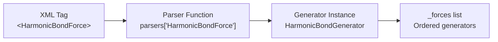

**Diagram: Generator Registration Pattern**

### Common Generator Types

| Generator Class | XML Tag | Force Created | Purpose |
|----------------|---------|---------------|---------|
| `HarmonicBondGenerator` | `<HarmonicBondForce>` | `HarmonicBondForce` | Bond stretching |
| `HarmonicAngleGenerator` | `<HarmonicAngleForce>` | `HarmonicAngleForce` | Angle bending |
| `PeriodicTorsionGenerator` | `<PeriodicTorsionForce>` | `PeriodicTorsionForce` | Proper dihedrals |
| `NonbondedGenerator` | `<NonbondedForce>` | `NonbondedForce` | Electrostatics and LJ |
| `GBSAOBCGenerator` | `<GBSAOBCForce>` | `GBSAOBCForce` | Implicit solvent |

### Generator Interface

Each generator implements the `createForce()` method:

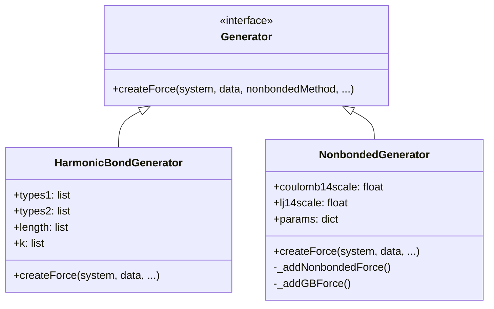

**Diagram: Force Generator Class Hierarchy**

### Force Creation Process

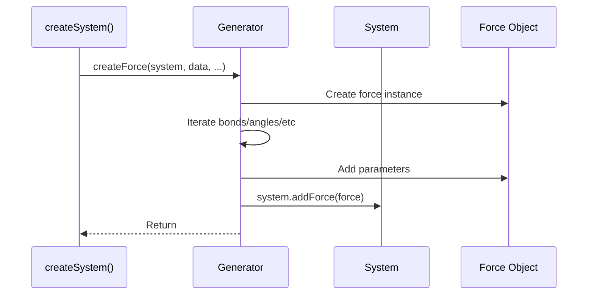

**Diagram: Force Generation Sequence**

Sources: [wrappers/python/openmm/app/forcefield.py:2027-2150]() (HarmonicBondGenerator), [wrappers/python/openmm/app/forcefield.py:2677-3113]() (NonbondedGenerator)

## Programmatic API

The `ForceField` class provides a programmatic API for building force fields entirely in Python, without XML files.

### Registration Methods

| Method | Purpose | Parameters |
|--------|---------|------------|
| `registerAtomType(parameters)` | Define new atom type | Dict with name, class, mass, element |
| `registerResidueTemplate(template)` | Add residue template | `_TemplateData` object |
| `registerPatch(patch)` | Add patch definition | `_PatchData` object |
| `registerGenerator(generator)` | Add force generator | Generator object |
| `registerScript(script)` | Add post-processing script | Python code string |

### Example: Building Water Model Programmatically

```python
# From test case in TestForceField.py
ff = ForceField()

# Register atom types
ff.registerAtomType({'name':'tip3p-O', 'class':'OW', 
                     'mass':15.99943*daltons, 'element':elem.oxygen})
ff.registerAtomType({'name':'tip3p-H', 'class':'HW', 
                     'mass':1.007947*daltons, 'element':elem.hydrogen})

# Create residue template
residue = ForceField._TemplateData('HOH')
residue.atoms.append(ForceField._TemplateAtomData('O', 'tip3p-O', elem.oxygen))
residue.atoms.append(ForceField._TemplateAtomData('H1', 'tip3p-H', elem.hydrogen))
residue.atoms.append(ForceField._TemplateAtomData('H2', 'tip3p-H', elem.hydrogen))
residue.addBond(0, 1)
residue.addBond(0, 2)
ff.registerResidueTemplate(residue)

# Add force generators
bonds = forcefield.HarmonicBondGenerator(ff)
bonds.registerBond({'class1':'OW', 'class2':'HW', 
                    'length':0.09572*nanometers, 'k':462750.4*kilojoules_per_mole/nanometer})
ff.registerGenerator(bonds)
```

Sources: [wrappers/python/tests/TestForceField.py:368-401](), [wrappers/python/openmm/app/forcefield.py:435-500]()

## Extensibility Mechanisms

### Template Generators

Template generators are callables that parameterize residues not found in existing templates. This enables integration with external tools for small molecule parameterization.

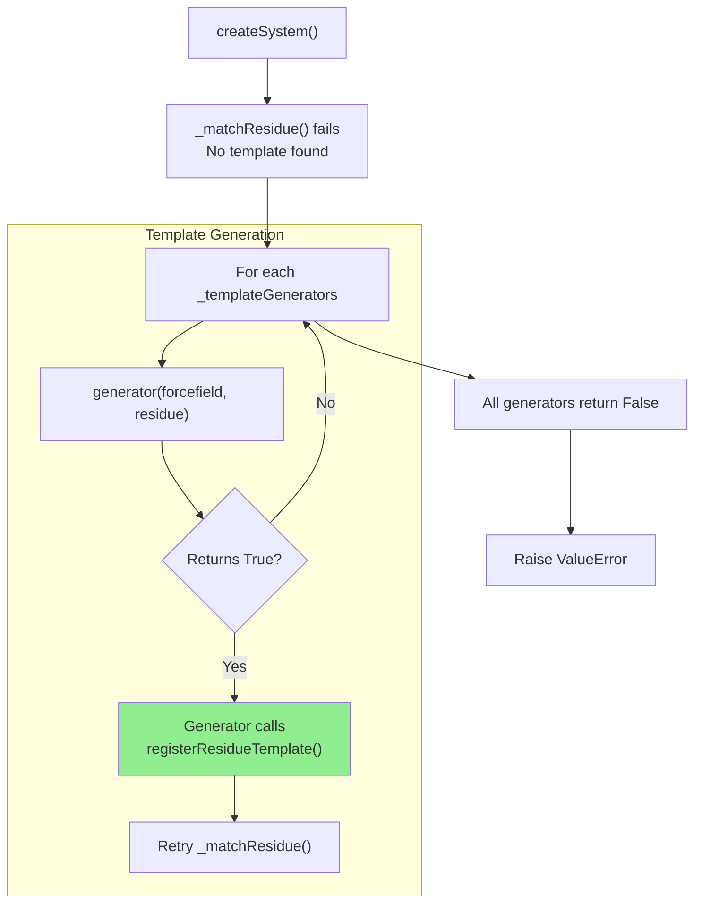

**Diagram: Template Generator Workflow**

Registration:
```python
def my_generator(forcefield, residue):
    # Attempt to parameterize residue
    if can_parameterize(residue):
        template = create_template(residue)
        forcefield.registerResidueTemplate(template)
        return True
    return False

ff.registerTemplateGenerator(my_generator)
```

### Template Matchers

Template matchers override the default matching logic to handle special cases:

```python
def custom_matcher(forcefield, residue, bondedToAtom, 
                  ignoreExternalBonds, ignoreExtraParticles):
    if residue.name == 'SPECIAL':
        return forcefield._templates['SPECIAL_TEMPLATE']
    return None  # Use default matching

ff.registerTemplateMatcher(custom_matcher)
```

### Custom Force Generators

Subclass generator base classes or create new ones for custom forces:

```python
class MyCustomGenerator:
    def __init__(self, forcefield):
        self.forcefield = forcefield
    
    def createForce(self, system, data, nonbondedMethod, 
                   nonbondedCutoff, args):
        force = CustomBondForce("k*(r-r0)^2")
        # Add parameters and interactions
        system.addForce(force)

ff.registerGenerator(MyCustomGenerator(ff))
```

Sources: [wrappers/python/openmm/app/forcefield.py:502-565](), [wrappers/python/tests/TestForceField.py:665-754]()

## XML Format Overview

Force field XML files contain several key sections:

### File Structure

```xml
<ForceField>
  <AtomTypes>
    <Type name="..." class="..." element="..." mass="..."/>
  </AtomTypes>
  
  <Residues>
    <Residue name="...">
      <Atom name="..." type="..." charge="..."/>
      <Bond from="..." to="..."/>
      <ExternalBond from="..."/>
      <VirtualSite type="..." .../>
    </Residue>
  </Residues>
  
  <Patches>
    <Patch name="..." residues="...">
      <AddAtom name="..." type="..."/>
      <ChangeAtom name="..." type="..."/>
      <RemoveAtom name="..."/>
      <AddBond atomName1="..." atomName2="..."/>
      <ApplyToResidue name="..."/>
    </Patch>
  </Patches>
  
  <HarmonicBondForce>
    <Bond class1="..." class2="..." length="..." k="..."/>
  </HarmonicBondForce>
  
  <HarmonicAngleForce>
    <Angle class1="..." class2="..." class3="..." angle="..." k="..."/>
  </HarmonicAngleForce>
  
  <PeriodicTorsionForce>
    <Proper class1="..." class2="..." class3="..." class4="..." 
            periodicity1="..." phase1="..." k1="..."/>
  </PeriodicTorsionForce>
  
  <NonbondedForce coulomb14scale="..." lj14scale="...">
    <Atom type="..." charge="..." sigma="..." epsilon="..."/>
  </NonbondedForce>
  
  <Script>
    # Python code executed after system creation
  </Script>
</ForceField>
```

### Include Directives

XML files can include other files:
```xml
<Include file="amber99sb.xml"/>
```

This enables modular force field definitions where water models, ion parameters, and protein parameters can be maintained separately.

Sources: [wrappers/python/openmm/app/forcefield.py:269-281](), documentation in [docs-source/usersguide/application/06_creating_ffs.rst:1-50]()

## Common Usage Patterns

### Basic System Creation

```python
from openmm.app import ForceField, PDBFile

# Load force field
forcefield = ForceField('amber14-all.xml', 'amber14/tip3pfb.xml')

# Load structure
pdb = PDBFile('input.pdb')

# Create system with options
system = forcefield.createSystem(
    pdb.topology,
    nonbondedMethod=PME,
    nonbondedCutoff=1.0*nanometer,
    constraints=HBonds,
    rigidWater=True,
    hydrogenMass=4*amu
)
```

### Handling Unmatched Residues

```python
# Get list of unmatched residues before system creation
unmatched = forcefield.getUnmatchedResidues(topology)
for residue in unmatched:
    print(f"No template for {residue.name} at position {residue.id}")

# Generate templates for unmatched residues
templates, residues = forcefield.generateTemplatesForUnmatchedResidues(topology)
```

### Multiple Force Fields

```python
# Combine multiple force field definitions
forcefield = ForceField(
    'amber14-all.xml',      # Protein parameters
    'amber14/tip3pfb.xml',  # Water model
    'amber14/lipid17.xml',  # Lipid parameters
    'ions.xml'              # Ion parameters
)
```

Sources: [wrappers/python/tests/TestForceField.py:28-38](), [wrappers/python/tests/TestForceField.py:756-806](), [docs-source/usersguide/application/02_running_sims.rst:75-103]()

## Integration with Other Components

### Relationship to System and Topology

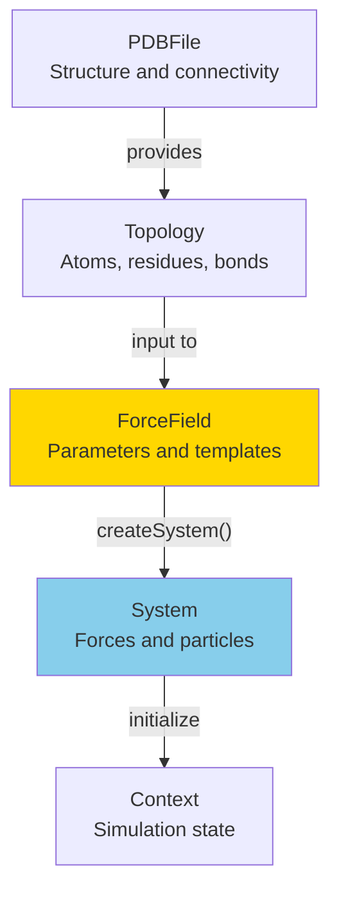

**Diagram: ForceField in Simulation Setup Pipeline**

### Comparison with File-Based System Creators

| Approach | Input Files | Flexibility | Use Case |
|----------|------------|-------------|----------|
| `ForceField.createSystem()` | PDB + XML | High - mix force fields | General purpose |
| `AmberPrmtopFile.createSystem()` | prmtop + inpcrd | Low - fixed parameters | AMBER workflows |
| `CharmmPsfFile.createSystem()` | PSF + PDB + parameters | Medium - CHARMM-specific | CHARMM workflows |
| `GromacsTopFile.createSystem()` | TOP + GRO | Medium - Gromacs-specific | Gromacs workflows |

The `ForceField` approach offers maximum flexibility at the cost of requiring proper template matching, while file-based approaches embed all parameters and work immediately but cannot easily combine different force fields.

Sources: [wrappers/python/openmm/app/forcefield.py:1247-1270](), [wrappers/python/openmm/app/amberprmtopfile.py:184-280](), [wrappers/python/openmm/app/charmmpsffile.py:516-750]()

---