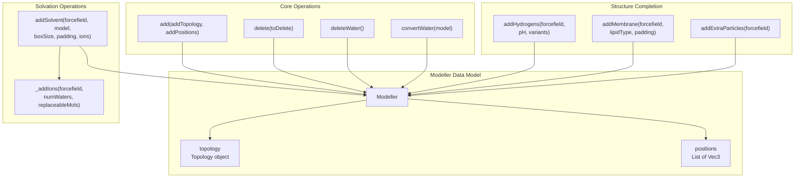
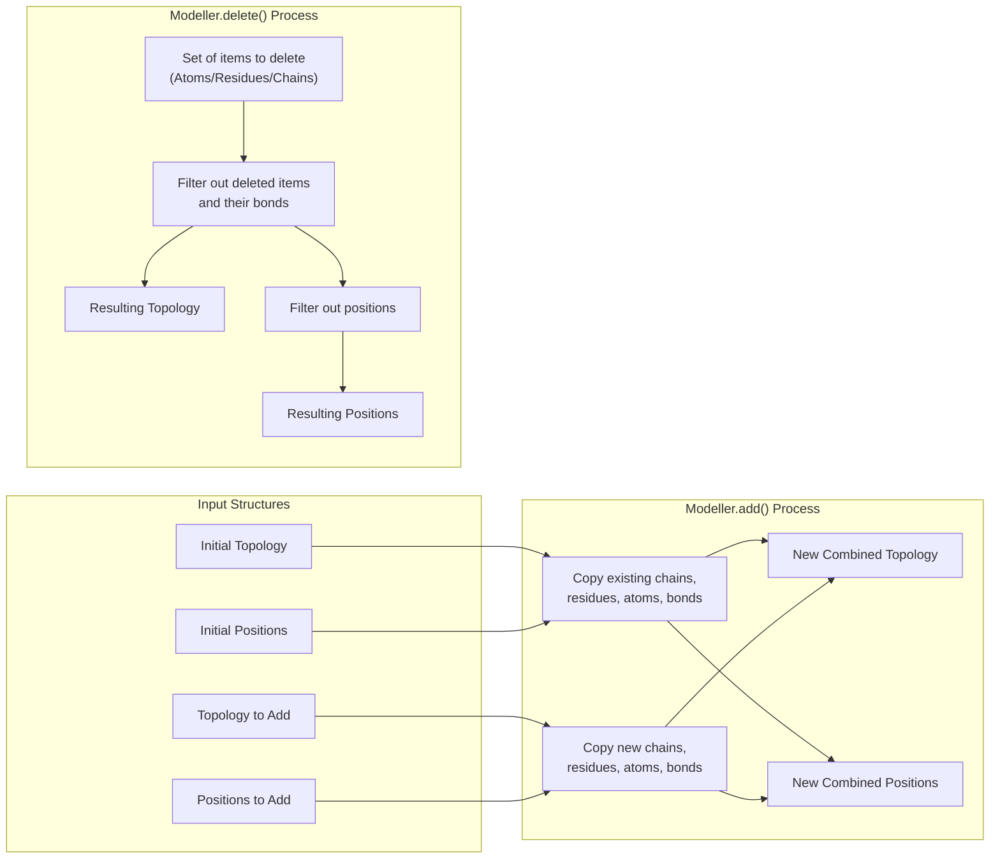
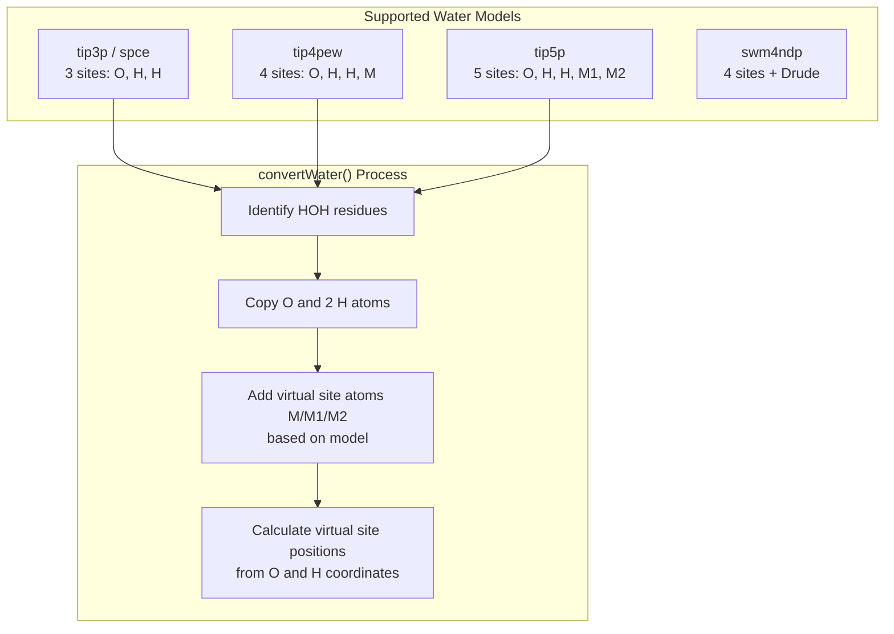
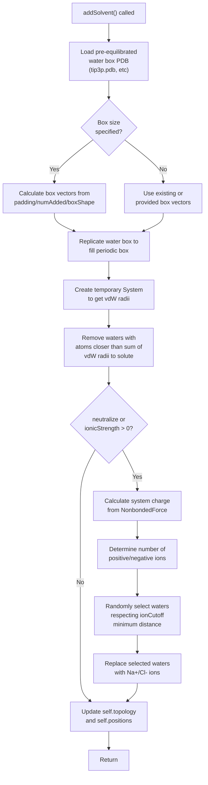
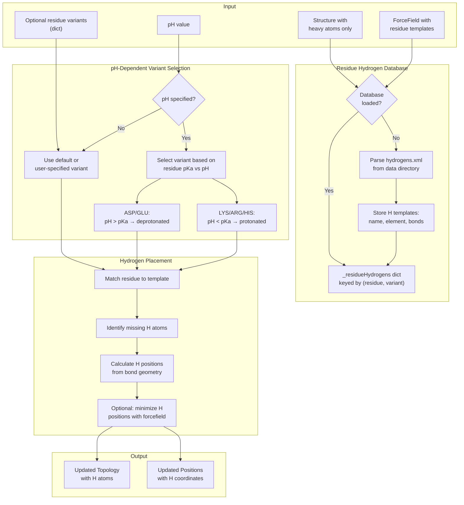
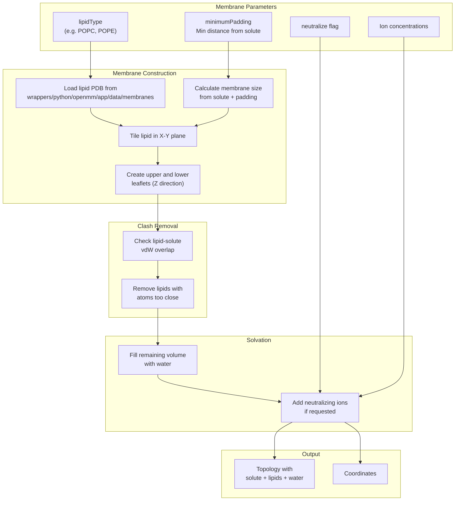
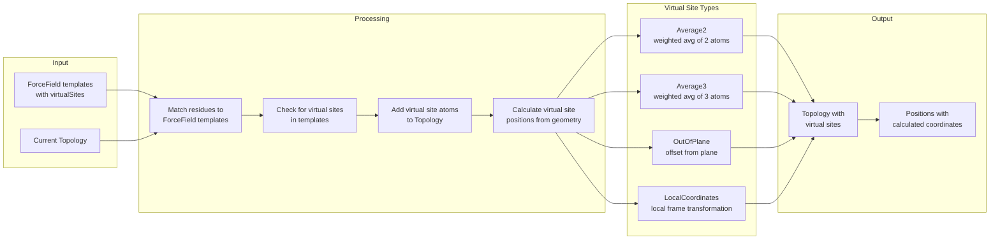

# Molecular Modeller

<details>
<summary>Relevant source files</summary>

The following files were used as context for generating this wiki page:

- [wrappers/python/openmm/app/amberprmtopfile.py](wrappers/python/openmm/app/amberprmtopfile.py)
- [wrappers/python/openmm/app/charmmparameterset.py](wrappers/python/openmm/app/charmmparameterset.py)
- [wrappers/python/openmm/app/charmmpsffile.py](wrappers/python/openmm/app/charmmpsffile.py)
- [wrappers/python/openmm/app/data/amber19-all.xml](wrappers/python/openmm/app/data/amber19-all.xml)
- [wrappers/python/openmm/app/data/amber19/lipid21.xml](wrappers/python/openmm/app/data/amber19/lipid21.xml)
- [wrappers/python/openmm/app/data/swm4ndp.pdb](wrappers/python/openmm/app/data/swm4ndp.pdb)
- [wrappers/python/openmm/app/desmonddmsfile.py](wrappers/python/openmm/app/desmonddmsfile.py)
- [wrappers/python/openmm/app/forcefield.py](wrappers/python/openmm/app/forcefield.py)
- [wrappers/python/openmm/app/internal/amber_file_parser.py](wrappers/python/openmm/app/internal/amber_file_parser.py)
- [wrappers/python/openmm/app/internal/amoebaforces.py](wrappers/python/openmm/app/internal/amoebaforces.py)
- [wrappers/python/openmm/app/modeller.py](wrappers/python/openmm/app/modeller.py)
- [wrappers/python/openmm/app/tinkerfiles.py](wrappers/python/openmm/app/tinkerfiles.py)
- [wrappers/python/tests/TestAmberInpcrdFile.py](wrappers/python/tests/TestAmberInpcrdFile.py)
- [wrappers/python/tests/TestAmberPrmtopFile.py](wrappers/python/tests/TestAmberPrmtopFile.py)
- [wrappers/python/tests/TestCharmmFiles.py](wrappers/python/tests/TestCharmmFiles.py)
- [wrappers/python/tests/TestElement.py](wrappers/python/tests/TestElement.py)
- [wrappers/python/tests/TestForceField.py](wrappers/python/tests/TestForceField.py)
- [wrappers/python/tests/TestModeller.py](wrappers/python/tests/TestModeller.py)
- [wrappers/python/tests/TestPatches.py](wrappers/python/tests/TestPatches.py)
- [wrappers/python/tests/TestTinkerFiles.py](wrappers/python/tests/TestTinkerFiles.py)
- [wrappers/python/tests/systems/4TVP-dmj_wat-ion.psf](wrappers/python/tests/systems/4TVP-dmj_wat-ion.psf)
- [wrappers/python/tests/systems/ala_ala_ala.crd](wrappers/python/tests/systems/ala_ala_ala.crd)
- [wrappers/python/tests/systems/amoebabio18.prm](wrappers/python/tests/systems/amoebabio18.prm)
- [wrappers/python/tests/systems/gpcr.cif](wrappers/python/tests/systems/gpcr.cif)

</details>


The `Modeller` class provides tools for editing molecular structures before simulation, including adding solvent, ions, missing hydrogens with pH-aware protonation, and membranes. It operates on OpenMM `Topology` and coordinate lists, producing modified versions suitable for system creation with `ForceField`.

For force field parameter assignment and system creation, see [ForceField System](#6.3). For file format parsing, see [File Format Support](#6.5). For running simulations, see [Simulation Management and Reporters](#6.6).

## Class Overview and Data Model

The `Modeller` class maintains a `Topology` object and a list of atomic positions, providing methods to modify both in a consistent manner.



**Sources:** [wrappers/python/openmm/app/modeller.py:52-88]()

## Constructor and Basic Access Methods

The `Modeller` is initialized with an existing topology and positions, which can come from file parsers like `PDBFile`.

| Method | Description | Returns |
|--------|-------------|---------|
| `__init__(topology, positions)` | Creates a new Modeller with initial structure | `Modeller` |
| `getTopology()` | Returns current topology | `Topology` |
| `getPositions()` | Returns current atomic positions | `List[Vec3]` with units |

**Sources:** [wrappers/python/openmm/app/modeller.py:64-87]()

## Structure Editing Operations

### Add and Delete Methods



**Sources:** [wrappers/python/openmm/app/modeller.py:89-181]()

#### add() Method Details

The `add()` method combines two molecular structures:

1. Copies all existing chains, residues, atoms, and bonds to a new topology
2. Preserves existing positions in a new list
3. Appends the new topology's chains, residues, atoms, and bonds
4. Appends the new positions
5. Updates `self.topology` and `self.positions`

**Sources:** [wrappers/python/openmm/app/modeller.py:89-134]()

#### delete() Method Details

The `delete()` method accepts a list containing any combination of:
- `Atom` objects (deletes individual atoms)
- `Residue` objects (deletes residues and all their atoms)
- `Chain` objects (deletes chains and all their residues/atoms)
- Tuples of `(Atom, Atom)` (deletes specific bonds without removing atoms)

When an atom is deleted, all bonds involving that atom are automatically removed.

**Sources:** [wrappers/python/openmm/app/modeller.py:136-181]()

#### deleteWater() Method

Convenience method that deletes all residues with name "HOH".

**Sources:** [wrappers/python/openmm/app/modeller.py:183-185]()

## Water Model Conversion

The `convertWater()` method transforms water molecules between different models by manipulating virtual site atoms.



**Sources:** [wrappers/python/openmm/app/modeller.py:187-256]()

Virtual site position formulas:
- **TIP4P**: M position = 0.786646558*O + 0.106676721*H1 + 0.106676721*H2
- **TIP5P**: M1/M2 positions use cross products of O-H vectors with scale factors

**Sources:** [wrappers/python/openmm/app/modeller.py:236-245]()

## Solvation and Ion Addition

The `addSolvent()` method is the primary interface for solvating molecular systems with water and ions.

### Method Signature

```python
addSolvent(forcefield, model='tip3p', boxSize=None, boxVectors=None, 
           padding=None, numAdded=None, boxShape='cube', 
           positiveIon='Na+', negativeIon='Cl-', 
           ionicStrength=0*molar, neutralize=True, residueTemplates=dict())
```

### Box Size Specification (5 methods)

| Method | Parameters | Use Case |
|--------|-----------|----------|
| Use existing | (none specified) | Topology already has box vectors |
| Explicit vectors | `boxVectors` | Non-rectangular or triclinic boxes |
| Rectangular size | `boxSize` | Simple rectangular boxes |
| Padding distance | `padding` | Ensure minimum solute-image distance |
| Molecule count | `numAdded` | Add specific number of molecules |

**Sources:** [wrappers/python/openmm/app/modeller.py:386-518]()

### Box Shape Options

When using `padding` or `numAdded`, the `boxShape` parameter determines the periodic box geometry:

| Shape | Description | Volume Ratio |
|-------|-------------|--------------|
| `'cube'` | Rectangular box | 100% |
| `'dodecahedron'` | Rhombic dodecahedron | 70.7% |
| `'octahedron'` | Truncated octahedron | ~68% |

Non-rectangular boxes reduce the number of solvent molecules needed for the same minimum image distance.

**Sources:** [wrappers/python/openmm/app/modeller.py:410-413](), [wrappers/python/openmm/app/modeller.py:692-714]()

### Solvation Algorithm



**Sources:** [wrappers/python/openmm/app/modeller.py:386-620]()

### Ion Placement Details

The `_addIons()` method implements ion placement with distance checking:

1. Creates a temporary `Modeller` copy
2. Randomly selects water molecules for replacement
3. Enforces minimum ion-ion distance (default 0.05 nm)
4. Adds positive ions first, then negative ions
5. Creates new ion chain and residues
6. Replaces selected water positions with ion positions

**Sources:** [wrappers/python/openmm/app/modeller.py:258-384]()

#### Charge Calculation

System charge is calculated from the `NonbondedForce` or `AmoebaMultipoleForce`:
- Rounded to nearest integer
- Used to determine neutralization requirements
- Must not exceed number of available replacement positions

**Sources:** [wrappers/python/openmm/app/modeller.py:308-326]()

## pH-Aware Hydrogen Addition

The `addHydrogens()` method adds missing hydrogen atoms with pH-dependent protonation states.



**Sources:** [wrappers/python/openmm/app/modeller.py:622-1037]()

### Residue Variant Selection by pH

Default pKa values for ionizable residues:

| Residue | pKa | pH > pKa | pH < pKa |
|---------|-----|----------|----------|
| ASP | 3.9 | ASH (neutral) | ASP (charged -1) |
| GLU | 4.3 | GLH (neutral) | GLU (charged -1) |
| HIS | 6.5 | HIS (neutral) | HIP (charged +1) |
| LYS | 10.4 | LYS (charged +1) | LYN (neutral) |
| ARG | 12.0 | ARG (charged +1) | AR0 (neutral) |
| CYS | 8.5 | CYS (thiolate -1) | CYX (thiol) |

**Sources:** [wrappers/python/openmm/app/modeller.py:690]()

### Hydrogen Position Calculation

For each missing hydrogen:

1. **Single bond case**: Position calculated from ideal bond length and angles
2. **Two bonds case**: Calculate using geometry of two heavy atom bonds
3. **Three or more bonds**: Use average normal vector from bonded atoms

Terminal hydrogens (multiple H on one heavy atom):
- Place first H using single bond geometry
- Place subsequent H atoms by rotating around heavy atom bond axis

**Sources:** [wrappers/python/openmm/app/modeller.py:820-987]()

### Energy Minimization

If `platform` parameter is specified:
1. Creates temporary `System` with all atoms
2. Restrains non-hydrogen atoms with harmonic forces (10 kJ/mol/nm²)
3. Minimizes using `LocalEnergyMinimizer`
4. Extracts optimized hydrogen positions

**Sources:** [wrappers/python/openmm/app/modeller.py:989-1012]()

## Membrane Addition

The `addMembrane()` method builds lipid bilayer membranes around solutes.



**Sources:** [wrappers/python/openmm/app/modeller.py:1039-1218]()

### Lipid Types and Files

Supported lipid types are stored as pre-equilibrated structures in `wrappers/python/openmm/app/data/membranes/`:
- `POPC` (1-palmitoyl-2-oleoyl-sn-glycero-3-phosphocholine)
- `POPE` (1-palmitoyl-2-oleoyl-sn-glycero-3-phosphoethanolamine)
- `DLPC`, `DLPE`, `DMPC`, `DOPC`, `DPPC`, etc.

Each file contains a small membrane patch that is tiled to create the desired size.

**Sources:** [wrappers/python/openmm/app/modeller.py:1046-1074]()

### Membrane Positioning Algorithm

1. Determine solute bounding box in Z dimension
2. Calculate required membrane dimensions with padding
3. Tile lipid structure in X-Y plane (periodic wrapping)
4. Position upper leaflet above solute (Z > maxZ + padding)
5. Position lower leaflet below solute (Z < minZ - padding)
6. Remove lipids with atoms within vdW radius sum of solute atoms
7. Fill remaining space with water using `addSolvent()`

**Sources:** [wrappers/python/openmm/app/modeller.py:1098-1175]()

## Extra Particles and Virtual Sites

The `addExtraParticles()` method adds virtual sites and Drude particles as defined in the force field.



**Sources:** [wrappers/python/openmm/app/modeller.py:1220-1384]()

### Virtual Site Calculation Formulas

**Average2**: position = weight1 * atom1 + weight2 * atom2

**Average3**: position = weight1 * atom1 + weight2 * atom2 + weight3 * atom3

**OutOfPlane**: 
- Creates local coordinate system from 3 atoms
- Offsets position perpendicular to plane by specified distance

**LocalCoordinates**:
- Defines origin, X-axis direction, Y-axis direction from atom positions
- Transforms local coordinates (wo, wx, wy, wz) to global frame

**Sources:** [wrappers/python/openmm/app/modeller.py:1305-1384]()

### Drude Particles

Drude particles are also added via this method when using polarizable force fields (e.g., CHARMM Drude):
- Massless particles tethered to parent atoms
- Represent induced polarization
- Positions initialized at parent atom location

**Sources:** [wrappers/python/openmm/app/modeller.py:1264-1265]()

## Usage Patterns

### Typical Solvation Workflow

```python
from openmm.app import PDBFile, Modeller, ForceField

# Load structure
pdb = PDBFile('protein.pdb')
modeller = Modeller(pdb.topology, pdb.positions)

# Add missing hydrogens with pH-dependent protonation
forcefield = ForceField('amber14-all.xml', 'amber14/tip3pfb.xml')
modeller.addHydrogens(forcefield, pH=7.4)

# Solvate with 1.0 nm padding, add ions to neutralize
modeller.addSolvent(forcefield, padding=1.0*nanometer, 
                   neutralize=True, ionicStrength=0.15*molar)

# Create system
system = forcefield.createSystem(modeller.topology)
```

**Sources:** [wrappers/python/tests/TestModeller.py:18-30]()

### Membrane Protein Workflow

```python
# Load membrane protein structure
pdb = PDBFile('gpcr.pdb')
modeller = Modeller(pdb.topology, pdb.positions)

# Add hydrogens
forcefield = ForceField('amber14-all.xml', 'amber14/tip3p.xml', 'amber14/lipid17.xml')
modeller.addHydrogens(forcefield, pH=7.4)

# Add POPC membrane with 2.5 nm padding
modeller.addMembrane(forcefield, lipidType='POPC', 
                    minimumPadding=2.5*nanometer,
                    neutralize=True, ionicStrength=0.15*molar)

system = forcefield.createSystem(modeller.topology)
```

**Sources:** [wrappers/python/tests/TestModeller.py:405-487]()

## Implementation Details

### Internal Helper Methods

| Method | Purpose |
|--------|---------|
| `_computeBoxVectors(width, shape)` | Calculates periodic box vectors for cube/dodecahedron/octahedron |
| `_createVirtualSite(element, weights)` | Factory for creating virtual site position objects |

**Sources:** [wrappers/python/openmm/app/modeller.py:692-715](), [wrappers/python/openmm/app/modeller.py:1386-1426]()

### Data Files

Pre-equilibrated structures used by Modeller:

| File Pattern | Location | Purpose |
|--------------|----------|---------|
| `{model}.pdb` | `openmm/app/data/` | Water box PDBs (tip3p.pdb, spce.pdb, etc.) |
| `hydrogens.xml` | `openmm/app/data/` | Hydrogen placement templates |
| `{lipid}.pdb` | `openmm/app/data/membranes/` | Lipid membrane patches |

**Sources:** [wrappers/python/openmm/app/modeller.py:475](), [wrappers/python/openmm/app/modeller.py:650-669](), [wrappers/python/openmm/app/modeller.py:1046]()

### Position Tracking

Throughout all operations, the `Modeller` maintains synchronization between:
- `self.topology`: The `Topology` object with structural information
- `self.positions`: A list of `Vec3` positions with units (typically nanometers)

The list index correspondence is: `self.positions[atom.index]` gives the position for `atom` in `self.topology`.

**Sources:** [wrappers/python/openmm/app/modeller.py:74-79]()

---