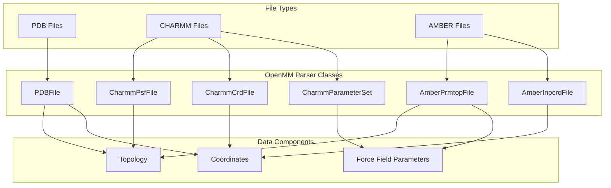
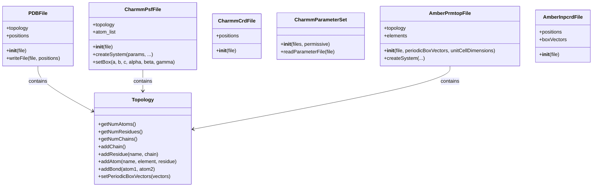
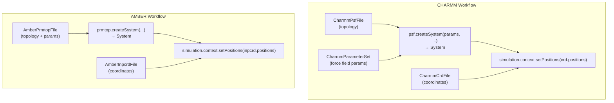
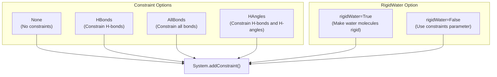

# File Format Support

<details>
<summary>Relevant source files</summary>

The following files were used as context for generating this wiki page:

- [docs-source/CMakeLists.txt](docs-source/CMakeLists.txt)
- [docs-source/api-python/process-docstring.py](docs-source/api-python/process-docstring.py)
- [docs-source/developerguide/05_cpu_platform.rst](docs-source/developerguide/05_cpu_platform.rst)
- [docs-source/developerguide/07_cuda_platform.rst](docs-source/developerguide/07_cuda_platform.rst)
- [docs-source/developerguide/index.rst](docs-source/developerguide/index.rst)
- [docs-source/developerguide/make.bat](docs-source/developerguide/make.bat)
- [docs-source/sphinx/autonumber.py](docs-source/sphinx/autonumber.py)
- [docs-source/usersguide/application.rst](docs-source/usersguide/application.rst)
- [docs-source/usersguide/application/01_getting_started.rst](docs-source/usersguide/application/01_getting_started.rst)
- [docs-source/usersguide/application/02_running_sims.rst](docs-source/usersguide/application/02_running_sims.rst)
- [docs-source/usersguide/application/05_add_on_packages.rst](docs-source/usersguide/application/05_add_on_packages.rst)
- [docs-source/usersguide/application/06_creating_ffs.rst](docs-source/usersguide/application/06_creating_ffs.rst)
- [docs-source/usersguide/index.rst](docs-source/usersguide/index.rst)
- [docs-source/usersguide/library.rst](docs-source/usersguide/library.rst)
- [docs-source/usersguide/library/01_introduction.rst](docs-source/usersguide/library/01_introduction.rst)
- [docs-source/usersguide/library/02_compiling.rst](docs-source/usersguide/library/02_compiling.rst)
- [docs-source/usersguide/library/04_platform_specifics.rst](docs-source/usersguide/library/04_platform_specifics.rst)
- [docs-source/usersguide/make.bat](docs-source/usersguide/make.bat)
- [docs-source/usersguide/references.bib](docs-source/usersguide/references.bib)
- [docs-source/usersguide/theory.rst](docs-source/usersguide/theory.rst)
- [wrappers/python/openmm/app/amberprmtopfile.py](wrappers/python/openmm/app/amberprmtopfile.py)
- [wrappers/python/openmm/app/charmmparameterset.py](wrappers/python/openmm/app/charmmparameterset.py)
- [wrappers/python/openmm/app/charmmpsffile.py](wrappers/python/openmm/app/charmmpsffile.py)
- [wrappers/python/openmm/app/desmonddmsfile.py](wrappers/python/openmm/app/desmonddmsfile.py)
- [wrappers/python/openmm/app/forcefield.py](wrappers/python/openmm/app/forcefield.py)
- [wrappers/python/openmm/app/internal/amber_file_parser.py](wrappers/python/openmm/app/internal/amber_file_parser.py)
- [wrappers/python/openmm/app/internal/amoebaforces.py](wrappers/python/openmm/app/internal/amoebaforces.py)
- [wrappers/python/openmm/app/tinkerfiles.py](wrappers/python/openmm/app/tinkerfiles.py)
- [wrappers/python/tests/TestAmberInpcrdFile.py](wrappers/python/tests/TestAmberInpcrdFile.py)
- [wrappers/python/tests/TestAmberPrmtopFile.py](wrappers/python/tests/TestAmberPrmtopFile.py)
- [wrappers/python/tests/TestCharmmFiles.py](wrappers/python/tests/TestCharmmFiles.py)
- [wrappers/python/tests/TestElement.py](wrappers/python/tests/TestElement.py)
- [wrappers/python/tests/TestForceField.py](wrappers/python/tests/TestForceField.py)
- [wrappers/python/tests/TestPatches.py](wrappers/python/tests/TestPatches.py)
- [wrappers/python/tests/TestTinkerFiles.py](wrappers/python/tests/TestTinkerFiles.py)
- [wrappers/python/tests/systems/4TVP-dmj_wat-ion.psf](wrappers/python/tests/systems/4TVP-dmj_wat-ion.psf)
- [wrappers/python/tests/systems/ala_ala_ala.crd](wrappers/python/tests/systems/ala_ala_ala.crd)
- [wrappers/python/tests/systems/amoebabio18.prm](wrappers/python/tests/systems/amoebabio18.prm)

</details>


This document provides an overview of the molecular file formats supported by OpenMM, how they are implemented, and how they are used to set up simulations. For information on using force fields directly without file formats, see [ForceField and Modeller Classes](#6.2).

## Overview

Molecular simulation requires three fundamental types of information:
1. **Topology**: Structure of the molecular system (atoms, bonds, residues, chains)
2. **Force Field Parameters**: Parameters defining interactions between atoms
3. **Coordinates**: Initial positions of atoms in 3D space

OpenMM provides parsers for standard molecular file formats that contain this information. These parsers load data from files and convert it into OpenMM's data structures for simulation.

## Supported File Formats



Sources: [wrappers/python/tests/TestCharmmFiles.py](), [wrappers/python/tests/TestAmberPrmtopFile.py]()

### PDB Files (Protein Data Bank)

PDB files contain:
- Atomic coordinates
- Basic topology information (atoms, residues, chains)
- Optional information like crystal structure data

```python
from openmm.app import PDBFile
pdb = PDBFile('protein.pdb')
```

PDB files provide both topology information and coordinates, but not force field parameters.

Sources: [wrappers/python/tests/TestTopology.py:18-29]()

### CHARMM Files

CHARMM (Chemistry at HARvard Macromolecular Mechanics) file formats require multiple files to define a complete system:

1. **PSF Files (Protein Structure File)**: Contains topology information
   ```python
   from openmm.app import CharmmPsfFile
   psf = CharmmPsfFile('protein.psf')
   ```

2. **CRD Files (Coordinate File)**: Contains atom coordinates
   ```python
   from openmm.app import CharmmCrdFile
   crd = CharmmCrdFile('protein.crd')
   ```

3. **Parameter Files**: Contains force field parameters
   ```python
   from openmm.app import CharmmParameterSet
   params = CharmmParameterSet('param.rtf', 'param.prm', 'param.str')
   ```

Sources: [wrappers/python/tests/TestCharmmFiles.py:24-30](), [wrappers/python/tests/TestCharmmFiles.py:232-233]()

### AMBER Files

AMBER (Assisted Model Building with Energy Refinement) file formats include:

1. **PRMTOP Files (Parameter/Topology)**: Contains both topology and force field parameters
   ```python
   from openmm.app import AmberPrmtopFile
   prmtop = AmberPrmtopFile('protein.prmtop')
   ```

2. **INPCRD/RST7 Files (Input Coordinates)**: Contains atom coordinates and optionally box dimensions
   ```python
   from openmm.app import AmberInpcrdFile
   inpcrd = AmberInpcrdFile('protein.inpcrd')  # or .rst7
   ```

Sources: [wrappers/python/tests/TestAmberPrmtopFile.py:10-20]()

## Class Relationships



Sources: [wrappers/python/tests/TestTopology.py](), [wrappers/python/tests/TestCharmmFiles.py](), [wrappers/python/tests/TestAmberPrmtopFile.py]()

## Creating Systems from Files

The `createSystem()` method is available on both `CharmmPsfFile` and `AmberPrmtopFile` classes to construct an OpenMM `System` object:



Sources: [wrappers/python/tests/TestCharmmFiles.py:232-246](), [wrappers/python/tests/TestAmberPrmtopFile.py:357-374]()

### System Creation Options

Both `CharmmPsfFile.createSystem()` and `AmberPrmtopFile.createSystem()` accept numerous options to customize the resulting system:

#### Nonbonded Methods and Cutoffs

```python
system = prmtop.createSystem(
    nonbondedMethod=PME,
    nonbondedCutoff=1*nanometer,
    ewaldErrorTolerance=0.0005,
    switchDistance=0.8*nanometer
)
```

Sources: [wrappers/python/tests/TestAmberPrmtopFile.py:26-40](), [wrappers/python/tests/TestAmberPrmtopFile.py:323-334]()

#### Constraints

```python
system = psf.createSystem(
    params,
    constraints=HBonds,  # Options: None, HBonds, AllBonds, HAngles
    rigidWater=True,
    flexibleConstraints=False
)
```

Sources: [wrappers/python/tests/TestCharmmFiles.py:78-90](), [wrappers/python/tests/TestCharmmFiles.py:278-481](), [wrappers/python/tests/TestAmberPrmtopFile.py:78-89](), [wrappers/python/tests/TestAmberPrmtopFile.py:220-236]()

#### Implicit Solvent

```python
system = prmtop.createSystem(
    implicitSolvent=OBC2,  # Options: HCT, OBC1, OBC2, GBn, GBn2
    solventDielectric=78.5,
    soluteDielectric=1.0,
    implicitSolventSaltConc=0.1*moles/liter,
    gbsaModel='ACE'  # Options: 'ACE' or None
)
```

Sources: [wrappers/python/tests/TestCharmmFiles.py:67-83](), [wrappers/python/tests/TestAmberPrmtopFile.py:91-144](), [wrappers/python/app/amberprmtopfile.py:46-71]()

#### Other Options

```python
system = psf.createSystem(
    params,
    removeCMMotion=True,
    hydrogenMass=4*amu
)
```

Sources: [wrappers/python/tests/TestCharmmFiles.py:60-65](), [wrappers/python/tests/TestCharmmFiles.py:85-101](), [wrappers/python/tests/TestAmberPrmtopFile.py:70-76](), [wrappers/python/tests/TestAmberPrmtopFile.py:143-159]()

## Detailed Format Implementation and Features

### PDB File Format

The `PDBFile` class parses standard PDB format files according to Protein Data Bank specifications:

1. Reads ATOM and HETATM records for coordinates
2. Creates topology structure (chains, residues, atoms)
3. Processes CONECT records for bonds

Sources: [wrappers/python/tests/TestTopology.py:18-29]()

### CHARMM File Formats

#### PSF Files

The `CharmmPsfFile` class parses CHARMM PSF files containing:
- Atoms with names, types, charges, and masses
- Bonds between atoms
- Angles, dihedrals, and improper torsions
- CMAP cross-terms (for newer force fields)
- Nonbonded interaction exclusions

Special features include:
- Setting periodic box dimensions:
  ```python
  psf.setBox(32.7*angstroms, 32.9*angstroms, 33.0*angstroms)
  # For non-orthogonal boxes:
  psf.setBox(a, b, c, alpha, beta, gamma)
  ```

Sources: [wrappers/python/tests/TestCharmmFiles.py:198-226](), [wrappers/python/tests/UnitCell.py]()

#### Parameter Files

The `CharmmParameterSet` class loads CHARMM force field parameter files, including:
- RTF files (Residue Topology Files)
- PAR/PRM files (Parameter Files)
- STR files (Stream Files)

It supports special force field features:
- NBFIX parameters (pair-specific Lennard-Jones parameters)
- CMAP cross-terms
- Drude oscillators for polarizable force fields
- Improper torsion wildcards

Sources: [wrappers/python/tests/TestCharmmFiles.py:130-196](), [wrappers/python/tests/TestCharmmFiles.py:228-246](), [wrappers/python/tests/TestCharmmFiles.py:362-501]()

### AMBER File Formats

#### PRMTOP Files

The `AmberPrmtopFile` class parses AMBER parameter/topology files containing:
- Atom types, charges, and masses
- Bond, angle, dihedral, and improper parameters
- Nonbonded parameters
- Periodic box information (optional)

Special features include:
- Handling various box types (orthogonal and non-orthogonal)
- Special nonbonded interaction models (e.g., 12-6-4 potentials)
- Support for implicit solvent parameters

Sources: [wrappers/python/app/amberprmtopfile.py:82-332](), [wrappers/python/tests/TestAmberPrmtopFile.py:161-276](), [wrappers/python/tests/TestAmberPrmtopFile.py:278-302]()

#### INPCRD/RST7 Files

The `AmberInpcrdFile` class parses AMBER coordinate files to obtain:
- Atomic positions
- Velocities (optional)
- Periodic box dimensions (optional)

Sources: [wrappers/python/tests/TestAmberPrmtopFile.py:10-20](), [wrappers/python/tests/TestAmberPrmtopFile.py:259-265]()

## Working with Elements

All file format classes create `Topology` objects that contain `Atom` objects with associated `Element` information:

```python
# Elements are determined from:
# 1. File information when available (e.g., ATOMIC_NUMBER in PRMTOP)
# 2. Atom name pattern matching
# 3. Default assignment based on atom name first letter
```

The `Element` class provides immutable elements with proper physical properties:

```python
element = atom.element
atomicNumber = element.atomic_number
mass = element.mass
symbol = element.symbol
```

Sources: [wrappers/python/tests/TestElement.py](), [wrappers/python/app/amberprmtopfile.py:132-157]()

## Creating Complete Simulations

The following example demonstrates a complete workflow using CHARMM files:

```python
from openmm import *
from openmm.app import *
from openmm.unit import *

# Load files
psf = CharmmPsfFile('protein.psf')
params = CharmmParameterSet('params.prm')
crd = CharmmCrdFile('protein.crd')

# Create system
system = psf.createSystem(params, 
                         nonbondedMethod=PME,
                         nonbondedCutoff=1*nanometer,
                         constraints=HBonds)

# Create integrator
integrator = LangevinIntegrator(300*kelvin, 1/picosecond, 2*femtoseconds)

# Create simulation
simulation = Simulation(psf.topology, system, integrator)
simulation.context.setPositions(crd.positions)

# Run simulation
simulation.minimizeEnergy()
simulation.step(10000)
```

And with AMBER files:

```python
from openmm import *
from openmm.app import *
from openmm.unit import *

# Load files
prmtop = AmberPrmtopFile('protein.prmtop')
inpcrd = AmberInpcrdFile('protein.inpcrd')

# Create system
system = prmtop.createSystem(
    nonbondedMethod=PME,
    nonbondedCutoff=1*nanometer,
    constraints=HBonds)

# Create simulation
simulation = Simulation(prmtop.topology, system, VerletIntegrator(2*femtoseconds))
simulation.context.setPositions(inpcrd.positions)

# Run simulation
simulation.minimizeEnergy()
simulation.step(10000)
```

Sources: [wrappers/python/tests/TestAmberPrmtopFile.py:356-374](), [wrappers/python/tests/TestCharmmFiles.py:232-246]()

## Supported File Format Features

| Feature | PDB | CHARMM | AMBER |
|---------|-----|--------|-------|
| Topology | ✓ | ✓ (PSF) | ✓ (PRMTOP) |
| Coordinates | ✓ | ✓ (CRD) | ✓ (INPCRD) |
| Force Field Parameters | ✗ | ✓ (PRM/RTF/STR) | ✓ (PRMTOP) |
| Periodic Box | ✓ | ✓ | ✓ |
| Implicit Solvent Parameters | ✗ | ✗ | ✓ |
| CMAP Terms | ✗ | ✓ | ✓ |
| Drude Oscillators | ✗ | ✓ | ✗ |
| NBFIX Parameters | ✗ | ✓ | ✓ |
| Virtual Sites | ✗ | ✓ | ✓ |

Sources: [wrappers/python/tests/TestCharmmFiles.py](), [wrappers/python/tests/TestAmberPrmtopFile.py]()

## Constraints Implementation

Both CHARMM and AMBER file parsers provide consistent options for applying constraints to molecules:



Sources: [wrappers/python/tests/TestCharmmFiles.py:591-617](), [wrappers/python/tests/TestAmberPrmtopFile.py:78-89](), [wrappers/python/tests/TestAmberPrmtopFile.py:220-236]()

---