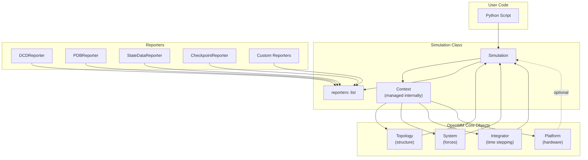
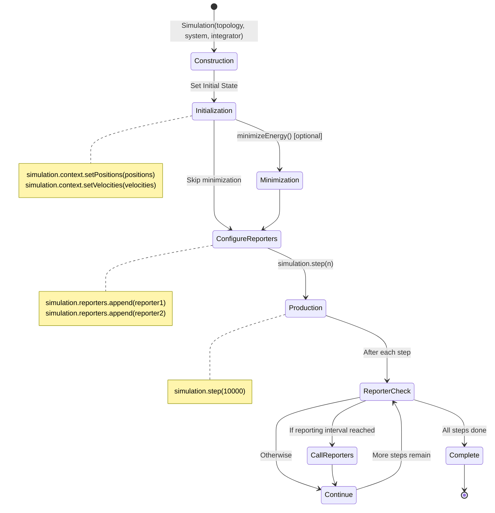
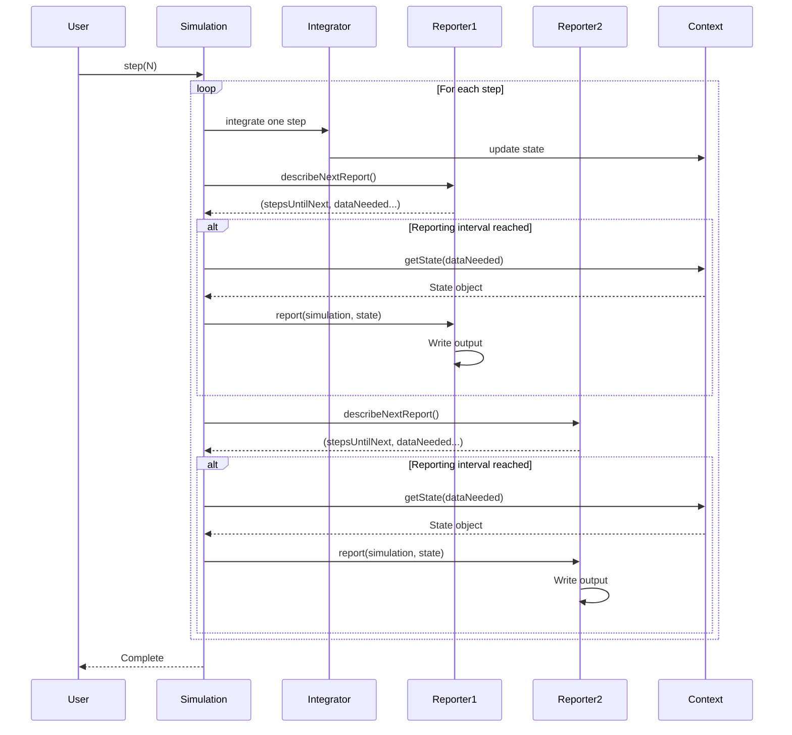
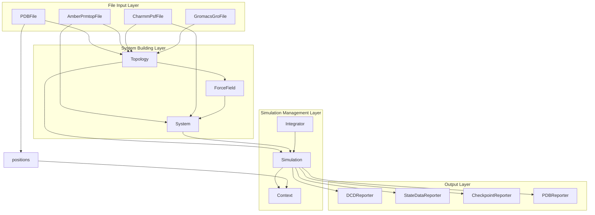

# Simulation Management and Reporters

<details>
<summary>Relevant source files</summary>

The following files were used as context for generating this wiki page:

- [docs-source/CMakeLists.txt](docs-source/CMakeLists.txt)
- [docs-source/api-python/process-docstring.py](docs-source/api-python/process-docstring.py)
- [docs-source/developerguide/05_cpu_platform.rst](docs-source/developerguide/05_cpu_platform.rst)
- [docs-source/developerguide/07_cuda_platform.rst](docs-source/developerguide/07_cuda_platform.rst)
- [docs-source/developerguide/index.rst](docs-source/developerguide/index.rst)
- [docs-source/developerguide/make.bat](docs-source/developerguide/make.bat)
- [docs-source/sphinx/autonumber.py](docs-source/sphinx/autonumber.py)
- [docs-source/usersguide/application.rst](docs-source/usersguide/application.rst)
- [docs-source/usersguide/application/01_getting_started.rst](docs-source/usersguide/application/01_getting_started.rst)
- [docs-source/usersguide/application/02_running_sims.rst](docs-source/usersguide/application/02_running_sims.rst)
- [docs-source/usersguide/application/05_add_on_packages.rst](docs-source/usersguide/application/05_add_on_packages.rst)
- [docs-source/usersguide/application/06_creating_ffs.rst](docs-source/usersguide/application/06_creating_ffs.rst)
- [docs-source/usersguide/index.rst](docs-source/usersguide/index.rst)
- [docs-source/usersguide/library.rst](docs-source/usersguide/library.rst)
- [docs-source/usersguide/library/01_introduction.rst](docs-source/usersguide/library/01_introduction.rst)
- [docs-source/usersguide/library/02_compiling.rst](docs-source/usersguide/library/02_compiling.rst)
- [docs-source/usersguide/library/04_platform_specifics.rst](docs-source/usersguide/library/04_platform_specifics.rst)
- [docs-source/usersguide/make.bat](docs-source/usersguide/make.bat)
- [docs-source/usersguide/references.bib](docs-source/usersguide/references.bib)
- [docs-source/usersguide/theory.rst](docs-source/usersguide/theory.rst)
- [wrappers/python/openmm/app/amberprmtopfile.py](wrappers/python/openmm/app/amberprmtopfile.py)
- [wrappers/python/openmm/app/charmmparameterset.py](wrappers/python/openmm/app/charmmparameterset.py)
- [wrappers/python/openmm/app/charmmpsffile.py](wrappers/python/openmm/app/charmmpsffile.py)
- [wrappers/python/openmm/app/desmonddmsfile.py](wrappers/python/openmm/app/desmonddmsfile.py)
- [wrappers/python/openmm/app/forcefield.py](wrappers/python/openmm/app/forcefield.py)
- [wrappers/python/openmm/app/internal/amber_file_parser.py](wrappers/python/openmm/app/internal/amber_file_parser.py)
- [wrappers/python/openmm/app/internal/amoebaforces.py](wrappers/python/openmm/app/internal/amoebaforces.py)
- [wrappers/python/openmm/app/tinkerfiles.py](wrappers/python/openmm/app/tinkerfiles.py)
- [wrappers/python/tests/TestAmberInpcrdFile.py](wrappers/python/tests/TestAmberInpcrdFile.py)
- [wrappers/python/tests/TestAmberPrmtopFile.py](wrappers/python/tests/TestAmberPrmtopFile.py)
- [wrappers/python/tests/TestCharmmFiles.py](wrappers/python/tests/TestCharmmFiles.py)
- [wrappers/python/tests/TestElement.py](wrappers/python/tests/TestElement.py)
- [wrappers/python/tests/TestForceField.py](wrappers/python/tests/TestForceField.py)
- [wrappers/python/tests/TestPatches.py](wrappers/python/tests/TestPatches.py)
- [wrappers/python/tests/TestTinkerFiles.py](wrappers/python/tests/TestTinkerFiles.py)
- [wrappers/python/tests/systems/4TVP-dmj_wat-ion.psf](wrappers/python/tests/systems/4TVP-dmj_wat-ion.psf)
- [wrappers/python/tests/systems/ala_ala_ala.crd](wrappers/python/tests/systems/ala_ala_ala.crd)
- [wrappers/python/tests/systems/amoebabio18.prm](wrappers/python/tests/systems/amoebabio18.prm)

</details>


## Purpose and Scope

This document describes the `Simulation` class and the Reporter pattern in OpenMM's application layer. The `Simulation` class provides high-level orchestration of molecular dynamics simulations, managing the integration of `System`, `Integrator`, and `Context` objects while coordinating output generation through reporters. This page focuses on simulation execution and data output; for information about system construction from force fields, see [6.3](#6.3); for file format support and input parsing, see [6.5](#6.5).

## The Simulation Class

The `Simulation` class is the primary entry point for running molecular dynamics simulations in OpenMM's Python application layer. It encapsulates the three core OpenMM objects (`Topology`, `System`, and `Integrator`) and manages the underlying `Context` that performs the actual computation.

### Core Components



**Sources:** [docs-source/usersguide/application/02_running_sims.rst:32-38](), [wrappers/python/tests/TestForceField.py:334-336]()

### Simulation Constructor

The `Simulation` class is instantiated by combining a topology, system, and integrator:

```python
simulation = Simulation(topology, system, integrator)
# OR with explicit platform selection:
simulation = Simulation(topology, system, integrator, platform, platformProperties)
```

The constructor creates an internal `Context` object that manages the simulation state and performs the actual computation. The `Context` is accessible via `simulation.context` for advanced operations.

**Sources:** [docs-source/usersguide/application/02_running_sims.rst:134-139](), [wrappers/python/tests/TestAmberPrmtopFile.py:408]()

## Simulation Lifecycle



**Sources:** [docs-source/usersguide/application/02_running_sims.rst:141-177](), [wrappers/python/tests/TestCharmmFiles.py:393-410]()

### Initialization

After creating a `Simulation`, the initial molecular state must be set through the `context` property:

- **Positions**: `simulation.context.setPositions(positions)` - Sets atomic coordinates
- **Velocities**: `simulation.context.setVelocities(velocities)` - Sets atomic velocities (optional; will be generated from temperature if not set)
- **Box Vectors**: `simulation.context.setPeriodicBoxVectors(vectors)` - Sets periodic boundary conditions (if applicable)

**Sources:** [docs-source/usersguide/application/02_running_sims.rst:142-145](), [wrappers/python/tests/TestAmberPrmtopFile.py:409-410]()

### Energy Minimization

The `minimizeEnergy()` method performs local energy minimization before production dynamics:

```python
simulation.minimizeEnergy(tolerance=10*kilojoule/mole, maxIterations=0)
```

Parameters:
- `tolerance`: Energy convergence criterion (default: 10 kJ/mol)
- `maxIterations`: Maximum number of iterations (0 = no limit)

Minimization adjusts atomic positions to reduce forces, which is recommended when starting from structures that may have steric clashes or poor geometry.

**Sources:** [docs-source/usersguide/application/02_running_sims.rst:148-152](), [wrappers/python/tests/TestForceField.py:334]()

### Running Dynamics

The `step()` method advances the simulation by integrating equations of motion:

```python
simulation.step(10000)  # Run for 10,000 time steps
```

Each call to `step()` performs the specified number of integration steps. The integrator's step size determines the physical time advanced per step. Reporters are invoked automatically at their specified intervals during execution.

**Sources:** [docs-source/usersguide/application/02_running_sims.rst:175-177](), [wrappers/python/tests/TestAmberPrmtopFile.py:413]()

## The Reporter Pattern

Reporters implement a callback pattern that allows flexible, modular output generation during simulations. The `Simulation` class maintains a list of reporters and invokes them at appropriate intervals.

### Reporter Interface

All reporters must implement the following interface:

| Method | Purpose |
|--------|---------|
| `describeNextReport(simulation)` | Returns tuple `(steps, positions, velocities, forces, energies, parameters, enforcePeriodicBox)` indicating when the next report is due and what data is needed |
| `report(simulation, state)` | Called when reporting interval is reached; receives the `Simulation` object and current `State` |

**Sources:** Based on reporter usage patterns in [wrappers/python/tests/TestAmberPrmtopFile.py:412]() and [docs-source/usersguide/application/02_running_sims.rst:155-172]()

### Reporter Invocation Flow



The `Simulation` class queries each reporter before each step to determine if reporting is needed. When a reporter's interval is reached, the `Simulation` requests the required `State` data from the `Context` and passes it to the reporter's `report()` method.

**Sources:** Inferred from reporter usage in [docs-source/usersguide/application/02_running_sims.rst:155-177]() and test patterns in [wrappers/python/tests/TestAmberPrmtopFile.py:411-413]()

## Built-in Reporter Types

OpenMM provides several standard reporter implementations for common output formats and analysis needs.

### Trajectory Reporters

#### DCDReporter

Writes molecular coordinates to DCD (binary trajectory) format, compatible with VMD, PyMOL, and other visualization tools.

```python
simulation.reporters.append(DCDReporter('output.dcd', reportInterval=1000))
```

Parameters:
- `file`: Output file path or open file object
- `reportInterval`: Number of steps between reports
- `append`: If `True`, append to existing file (default: `False`)
- `enforcePeriodicBox`: If `True`, enforce periodic boundary conditions when writing (default: `None`)

**Sources:** [docs-source/usersguide/application/02_running_sims.rst:155-160](), [wrappers/python/tests/TestAmberPrmtopFile.py:412]()

#### PDBReporter

Writes coordinates to PDB format files. Can write each frame to a separate file or create a multi-model PDB.

```python
simulation.reporters.append(PDBReporter('trajectory.pdb', reportInterval=1000))
```

Parameters:
- `file`: Output file path or open file object
- `reportInterval`: Number of steps between reports
- `enforcePeriodicBox`: If `True`, apply periodic boundary conditions (default: `None`)

**Sources:** Based on DCD reporter pattern in [docs-source/usersguide/application/02_running_sims.rst:155-160]()

### State Data Reporters

#### StateDataReporter

Writes time-series data of system properties (energies, temperature, volume, etc.) in tabular text format.

```python
simulation.reporters.append(StateDataReporter(
    sys.stdout,  # or filename
    reportInterval=1000,
    step=True,
    potentialEnergy=True,
    kineticEnergy=True,
    totalEnergy=True,
    temperature=True,
    volume=True,
    density=True,
    progress=True,
    remainingTime=True,
    speed=True,
    elapsedTime=True,
    separator='\t',
    systemMass=None,
    totalSteps=None
))
```

Common Parameters:
| Parameter | Description |
|-----------|-------------|
| `file` | Output destination (filename, stdout, or file object) |
| `reportInterval` | Steps between reports |
| `step` | Report current step number |
| `time` | Report simulation time |
| `potentialEnergy` | Report potential energy |
| `kineticEnergy` | Report kinetic energy |
| `totalEnergy` | Report total energy |
| `temperature` | Report instantaneous temperature |
| `volume` | Report system volume (periodic systems) |
| `density` | Report system density |
| `speed` | Report simulation performance (ns/day) |
| `progress` | Report percentage completion |
| `remainingTime` | Estimate time remaining |

**Sources:** [docs-source/usersguide/application/02_running_sims.rst:163-172](), [wrappers/python/tests/TestForceField.py:336-337]()

### Checkpoint Reporters

#### CheckpointReporter

Periodically saves complete simulation state to enable restart from interruptions.

```python
simulation.reporters.append(CheckpointReporter('checkpoint.chk', reportInterval=5000))
```

The checkpoint file contains all information needed to resume: positions, velocities, box vectors, simulation time, step count, and integrator state. Load with:

```python
simulation.loadCheckpoint('checkpoint.chk')
```

**Sources:** Based on reporter pattern established in [docs-source/usersguide/application/02_running_sims.rst:155-177]()

## Reporter Data Requests

Reporters specify what data they need through the return value of `describeNextReport()`. The `Simulation` class minimizes computational overhead by only requesting necessary data from the `Context`.

### Data Request Flags

| Flag | Purpose |
|------|---------|
| `positions` | Atomic coordinates |
| `velocities` | Atomic velocities |
| `forces` | Forces on each atom |
| `energies` | Potential and kinetic energies |
| `parameters` | Context parameters (e.g., for alchemical simulations) |
| `enforcePeriodicBox` | Apply periodic boundary conditions before reporting |

When multiple reporters request the same data in the same step, `Simulation` retrieves it only once from the `Context`, improving efficiency.

**Sources:** Inferred from State data retrieval patterns in [wrappers/python/tests/TestForceField.py:337-342]() and [wrappers/python/tests/TestCharmmFiles.py:341-350]()

## Context Management

The `Simulation` class manages the underlying `Context` object, which represents the computational state of the simulation.

### Context Access

The `Context` is accessible through the `context` property:

```python
simulation.context.setPositions(positions)
simulation.context.setVelocities(velocities)
state = simulation.context.getState(getPositions=True, getEnergy=True)
simulation.context.setParameter('lambda', 0.5)
```

### State Retrieval

The `Context.getState()` method retrieves current simulation data:

```python
state = simulation.context.getState(
    getPositions=True,
    getVelocities=True,
    getForces=True,
    getEnergy=True,
    getParameters=True,
    enforcePeriodicBox=True,
    groups=-1  # Force groups to include
)
```

Returned `State` object provides:
- `getPositions()`: Atomic coordinates
- `getVelocities()`: Atomic velocities  
- `getForces()`: Forces on atoms
- `getPotentialEnergy()`: Potential energy
- `getKineticEnergy()`: Kinetic energy
- `getPeriodicBoxVectors()`: Box dimensions
- `getTime()`: Current simulation time

**Sources:** [wrappers/python/tests/TestForceField.py:337-345](), [wrappers/python/tests/TestCharmmFiles.py:342-350]()

## Integration with Application Layer



The `Simulation` class serves as the bridge between system construction ([6.3](#6.3), [6.5](#6.5)) and production simulation execution. It coordinates:

1. **Input Processing**: Receives `Topology` and `System` from file parsers or force field generators
2. **Computation Management**: Creates and manages the `Context` for hardware-accelerated calculation
3. **Output Generation**: Coordinates reporter invocations for trajectory and analysis data

This modular design allows users to mix and match input sources, force fields, integrators, and output formats without modifying the core simulation logic.

**Sources:** [docs-source/usersguide/application/02_running_sims.rst:22-38](), [docs-source/usersguide/application/02_running_sims.rst:199-273]()

## Example: Complete Simulation Workflow

The following table summarizes a typical simulation setup and execution pattern seen throughout the test suite:

| Step | Code Pattern | Purpose |
|------|--------------|---------|
| 1. Load Structure | `pdb = PDBFile('input.pdb')` | Parse molecular topology and coordinates |
| 2. Create System | `system = forcefield.createSystem(pdb.topology, ...)` | Generate force definitions |
| 3. Create Integrator | `integrator = LangevinMiddleIntegrator(...)` | Specify time stepping algorithm |
| 4. Create Simulation | `simulation = Simulation(pdb.topology, system, integrator)` | Combine components |
| 5. Set Initial State | `simulation.context.setPositions(pdb.positions)` | Initialize coordinates |
| 6. Minimize | `simulation.minimizeEnergy()` | Remove bad contacts |
| 7. Add Reporters | `simulation.reporters.append(DCDReporter(...))` | Configure output |
| 8. Run | `simulation.step(10000)` | Execute dynamics |

**Sources:** [docs-source/usersguide/application/02_running_sims.rst:20-38](), [wrappers/python/tests/TestAmberPrmtopFile.py:396-415]()

---