# Build System and CI/CD

<details>
<summary>Relevant source files</summary>

The following files were used as context for generating this wiki page:

- [.travis.yml](.travis.yml)
- [CMakeLists.txt](CMakeLists.txt)
- [appveyor.yml](appveyor.yml)
- [devtools/run-ctest.py](devtools/run-ctest.py)
- [examples/python-examples/argon-chemical-potential.py](examples/python-examples/argon-chemical-potential.py)
- [platforms/cpu/CMakeLists.txt](platforms/cpu/CMakeLists.txt)
- [plugins/amoeba/CMakeLists.txt](plugins/amoeba/CMakeLists.txt)
- [plugins/amoeba/platforms/reference/CMakeLists.txt](plugins/amoeba/platforms/reference/CMakeLists.txt)
- [plugins/drude/CMakeLists.txt](plugins/drude/CMakeLists.txt)
- [plugins/drude/platforms/reference/CMakeLists.txt](plugins/drude/platforms/reference/CMakeLists.txt)
- [plugins/drude/wrappers/CMakeLists.txt](plugins/drude/wrappers/CMakeLists.txt)
- [plugins/drude/wrappers/Doxyfile.in](plugins/drude/wrappers/Doxyfile.in)
- [plugins/drude/wrappers/generateDrudeWrappers.py](plugins/drude/wrappers/generateDrudeWrappers.py)
- [plugins/rpmd/CMakeLists.txt](plugins/rpmd/CMakeLists.txt)
- [plugins/rpmd/platforms/reference/CMakeLists.txt](plugins/rpmd/platforms/reference/CMakeLists.txt)
- [serialization/CMakeLists.txt](serialization/CMakeLists.txt)
- [wrappers/python/openmm/unit/mymatrix.py](wrappers/python/openmm/unit/mymatrix.py)
- [wrappers/python/openmm/unit/quantity.py](wrappers/python/openmm/unit/quantity.py)
- [wrappers/python/openmm/unit/unit.py](wrappers/python/openmm/unit/unit.py)
- [wrappers/python/tests/TestUnits.py](wrappers/python/tests/TestUnits.py)
- [wrappers/python/tests/pytest.ini](wrappers/python/tests/pytest.ini)

</details>


This page documents the build system and continuous integration/continuous deployment (CI/CD) setup used in OpenMM. It covers how OpenMM is built using CMake, how the CI/CD pipeline is configured to test and deploy the software across multiple platforms, and how these systems enable the development workflow.

## Overview of Build System

OpenMM uses CMake as its build system, which provides a platform-independent way to configure, build, and install the software. The build system handles compilation of the core library, platform-specific implementations, plugins, and language wrappers.

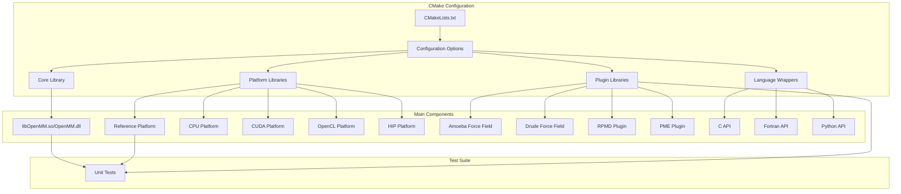

Sources: [CMakeLists.txt:13-38](), [CMakeLists.txt:78-198]()

## Core Build System Architecture

The OpenMM build system is configured through a main CMakeLists.txt file at the root of the project, with additional CMakeLists.txt files in various subdirectories for platforms and plugins. The build process determines which components to build based on available dependencies and user configuration.

### Major Build Components

| Component | Description | Build Option |
|-----------|-------------|--------------|
| Core Library | The core OpenMM API and implementation | Always built |
| Reference Platform | CPU-based reference implementation | Always built |
| CPU Platform | Optimized CPU implementation | `OPENMM_BUILD_CPU_LIB` |
| CUDA Platform | NVIDIA GPU implementation | `OPENMM_BUILD_CUDA_LIB` |
| OpenCL Platform | OpenCL-based GPU implementation | `OPENMM_BUILD_OPENCL_LIB` |
| HIP Platform | AMD GPU implementation | `OPENMM_BUILD_HIP_LIB` |
| Amoeba Plugin | Polarizable force field | `OPENMM_BUILD_AMOEBA_PLUGIN` |
| Drude Plugin | Polarizable force field | `OPENMM_BUILD_DRUDE_PLUGIN` |
| RPMD Plugin | Ring-polymer molecular dynamics | `OPENMM_BUILD_RPMD_PLUGIN` |
| PME Plugin | CPU-based PME implementation | `OPENMM_BUILD_PME_PLUGIN` |
| C/Fortran Wrappers | API bindings for C and Fortran | `OPENMM_BUILD_C_AND_FORTRAN_WRAPPERS` |
| Python Wrappers | API bindings for Python | `OPENMM_BUILD_PYTHON_WRAPPERS` |

Sources: [CMakeLists.txt:317-370](), [CMakeLists.txt:376-408](), [CMakeLists.txt:437-448]()

### Target Architecture Detection

The build system automatically detects the target architecture (x86_64, ARM64, PPC) and enables architecture-specific optimizations.

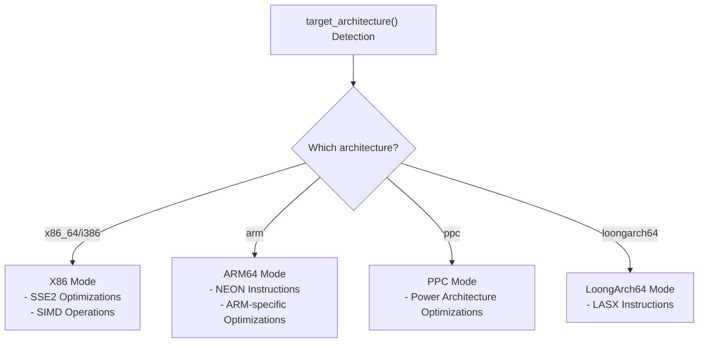

Sources: [CMakeLists.txt:36-53]()

## Build Configuration Options

OpenMM's build system provides numerous configuration options to customize the build process. These are set through CMake variables.

### Key Configuration Options

| Option | Default | Description |
|--------|---------|-------------|
| `CMAKE_BUILD_TYPE` | Release | Debug or Release build |
| `OPENMM_BUILD_SHARED_LIB` | ON | Build shared libraries |
| `OPENMM_BUILD_STATIC_LIB` | OFF | Build static libraries |
| `OPENMM_BUILD_C_AND_FORTRAN_WRAPPERS` | ON | Build API wrappers for C and Fortran |
| `OPENMM_BUILD_PYTHON_WRAPPERS` | ON | Build Python API bindings |
| `OPENMM_BUILD_REFERENCE_TESTS` | TRUE | Build Reference platform test cases |
| `OPENMM_BUILD_CUDA_LIB` | Auto | Build CUDA platform for NVIDIA GPUs |
| `OPENMM_BUILD_OPENCL_LIB` | Auto | Build OpenCL platform |
| `OPENMM_BUILD_HIP_LIB` | Auto | Build HIP platform for AMD GPUs |
| `OPENMM_BUILD_CPU_LIB` | ON | Build optimized CPU platform |
| `OPENMM_BUILD_EXAMPLES` | ON | Build example executables |

Sources: [CMakeLists.txt:72-74](), [CMakeLists.txt:134-136](), [CMakeLists.txt:253-254](), [CMakeLists.txt:316-317](), [CMakeLists.txt:437-438](), [CMakeLists.txt:468-471]()

### Platform-Specific Dependencies

The build system automatically detects the availability of platform-specific dependencies:

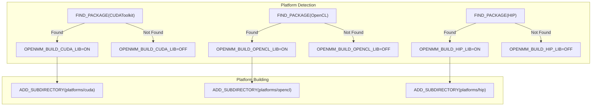

Sources: [CMakeLists.txt:324-357]()

## Plugin Build System Integration

Plugins in OpenMM have their own CMakeLists.txt files but are integrated with the main build system. The main CMakeLists.txt enables plugins and includes their directories based on configuration options.

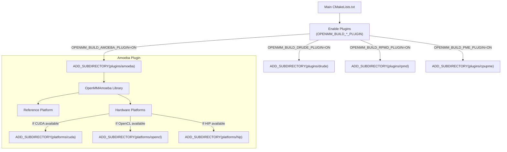

Sources: [CMakeLists.txt:376-408](), [plugins/amoeba/CMakeLists.txt:126-166]()

### Plugin Platform Dependency

The plugin build system checks if the corresponding main platform is being built before enabling the platform-specific implementation for the plugin:

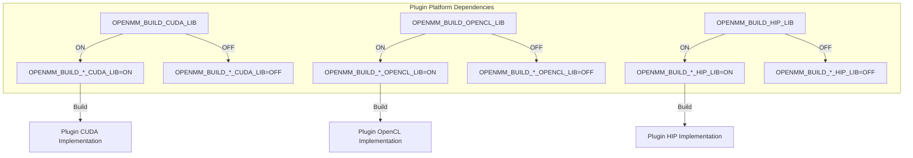

Sources: [plugins/amoeba/CMakeLists.txt:129-145](), [plugins/drude/CMakeLists.txt:124-149](), [plugins/rpmd/CMakeLists.txt:112-138]()

## Wrapper Generation System

OpenMM includes API wrappers for C, Fortran, and Python. The C and Fortran wrappers are generated using a custom process that parses the C++ API with Doxygen.

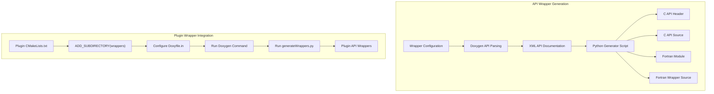

Sources: [CMakeLists.txt:253-258](), [plugins/drude/wrappers/CMakeLists.txt:1-27](), [plugins/drude/wrappers/generateDrudeWrappers.py:64-912]()

## Continuous Integration and Testing

OpenMM uses Travis CI for Linux and macOS builds, and Appveyor for Windows builds. The CI systems run multiple build configurations to ensure cross-platform compatibility and test various feature combinations.

### Travis CI Build Matrix

Travis CI runs several build jobs with different configurations:

| Job Name | Platform | Configuration | Purpose |
|----------|----------|---------------|---------|
| CPU OpenCL | Linux (Xenial) | OpenCL on CPU | Test OpenCL platform without GPU |
| CUDA Compile | Linux (Xenial) | CUDA 7.5 | Verify CUDA compilation |
| Mac OS | macOS (Xcode 9.3) | Default | Test macOS builds |
| Static Lib | Linux (Xenial), Python 3.6 | Static library build | Test static linking |
| Python 3.6 | Linux (Xenial) | Python 3.6 with docs | Main Linux build + documentation |
| Python 3.8 | Linux (Xenial) | Python 3.8 | Test newer Python version |
| PPC | Linux (Bionic), Python 3.8 | PowerPC architecture | Test PPC64LE builds |
| ARM | Linux (Bionic), Python 3.8 | ARM64 architecture | Test ARM64 builds |

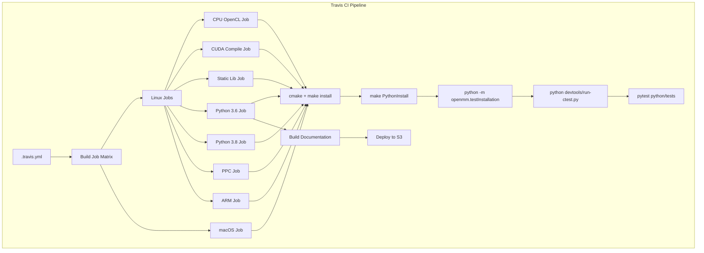

Sources: [.travis.yml:16-248]()

### Appveyor Windows CI

Appveyor handles Windows builds using Visual Studio 2019:

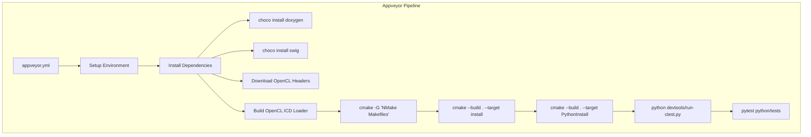

Sources: [appveyor.yml:1-65]()

### CI Environment Setup

Both CI systems perform similar setup steps:

1. **Install ccache**: For faster rebuilds (Travis only)
2. **Install dependencies**: 
   - Doxygen for API documentation
   - SWIG for wrapper generation
   - Python packages (numpy, scipy, pytest, cython)
   - Platform SDKs (CUDA, OpenCL, AMD APP SDK)
3. **Configure CMake**: With platform-specific flags via `CMAKE_FLAGS` environment variable
4. **Build**: Using `make` (Travis) or `nmake` (Appveyor)
5. **Install**: Using `make install` or `cmake --build . --target install`
6. **Test**: Run CTest suite and pytest tests

Sources: [.travis.yml:124-220](), [appveyor.yml:5-56]()

## Testing Infrastructure

OpenMM uses a multi-layered testing approach with CTest for C++ tests and pytest for Python tests. Tests are organized by component and can be selectively enabled or disabled.

### Test Organization and Build Options

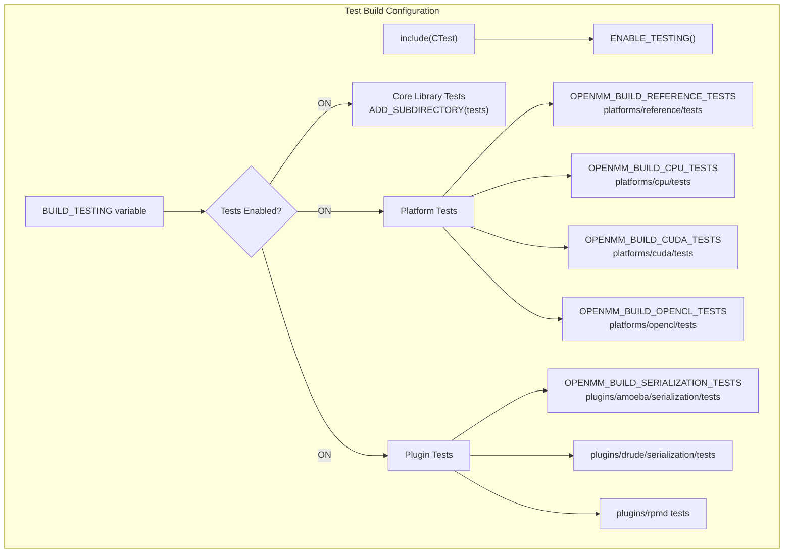

Sources: [CMakeLists.txt:30](), [CMakeLists.txt:312-320](), [CMakeLists.txt:455-469](), [serialization/CMakeLists.txt:9-13](), [plugins/amoeba/CMakeLists.txt:191-193]()

### CTest Runner Script

The `devtools/run-ctest.py` script provides advanced test execution features for CI environments:

#### CTest Runner Architecture

```mermaid
flowchart TD
    subgraph "run-ctest.py Execution Flow"
        Args["Command Line Arguments"] --> ParseArgs["ArgumentParser"]
        ParseArgs --> TimeCalc["Calculate Time Budget"]
        
        TimeCalc --> MainRun["execute_tests()"]
        MainRun --> CleanDir["Remove Testing/ directory"]
        CleanDir --> RunCTest["ctest --output-on-failure"]
        
        RunCTest --> CheckResults["Check Exit Status"]
        CheckResults -->|"Success"| Exit0["Return 0"]
        CheckResults -->|"Failure"| ParseXML["Parse Testing/*/Test.xml"]
        
        ParseXML --> FindFailed["Find Failed Tests\n(exclude timeouts)"]
        FindFailed --> RerunTests["execute_failed_tests()"]
        
        RerunTests --> RerunCTest["ctest -R 'test1|test2|...'"]
        RerunCTest --> FinalStatus["Return Exit Status"]
    end
```

#### Key Features

| Feature | Description | Command Line Argument |
|---------|-------------|----------------------|
| Time Management | Allocates percentage of CI job time to test run | `--job-duration`, `--run-percent` |
| Test Timeout | Sets per-test timeout | `--timeout` (default: 180s) |
| Parallel Execution | Runs tests in parallel | `--parallel` (default: 1) |
| Failure Retry | Reruns failed tests (excluding timeouts) | `--attempts` (default: 1) |
| Random Scheduling | Randomizes test order unless disabled | `--in-order` |

Sources: [devtools/run-ctest.py:1-125]()

#### Time Budget Management

The script manages CI time budgets to prevent jobs from timing out:

```python
# Calculate stop time based on job duration and run percentage
stop_time = start_time + timedelta(
    seconds=(options.run_percent / 100.0) * remaining.seconds)

# Pass to ctest
ctest [...] --stop-time stop_time.strftime('%H:%M:%S')
```

This ensures tests complete within Travis/Appveyor time limits (typically 30-50 minutes per job).

Sources: [devtools/run-ctest.py:72-92]()

### Python Test Suite

Python tests use pytest and are located in `wrappers/python/tests/`. Tests are organized by module:

| Test File | Coverage |
|-----------|----------|
| `TestUnits.py` | Unit system, quantity operations, dimensional analysis |
| `TestForceField.py` | ForceField XML parsing and system creation |
| `TestModeller.py` | Structure editing and solvation |
| `TestSerialization.py` | Object serialization/deserialization |
| `Test*.py` | Various OpenMM API functionality |

Example test structure from `TestUnits.py`:

```python
class QuantityTestCase(unittest.TestCase):
    def assertAlmostEqualQuantities(self, item1, item2, places=6):
        # Custom assertion for quantities with units
        ...

class TestUnits(QuantityTestCase):
    def testBaseUnit(self):
        """Tests the creation of a base unit furlong"""
        furlong = u.BaseUnit(u.length_dimension, "furlong", "fur")
        furlong.define_conversion_factor_to(u.meter_base_unit, 201.168)
        self.assertEqual(furlong.conversion_factor_to(u.angstrom_base_unit),
                         201.168e10)
```

Sources: [wrappers/python/tests/TestUnits.py:1-1050](), [wrappers/python/tests/pytest.ini:1-2]()

### Test Configuration Files

- **pytest.ini**: Configures pytest to discover test files matching `Test*.py` pattern
- **CMakeLists.txt in test directories**: Define CTest test cases using `ADD_TEST()` commands
- **Test enabling flags**: Control which test suites are built (e.g., `OPENMM_BUILD_CPU_TESTS`)

Sources: [wrappers/python/tests/pytest.ini:1-2](), [platforms/cpu/CMakeLists.txt:15-19]()

## Installation and Packaging

The build system handles installation of libraries, headers, and supporting files, and supports multiple distribution methods.

### Installation Targets

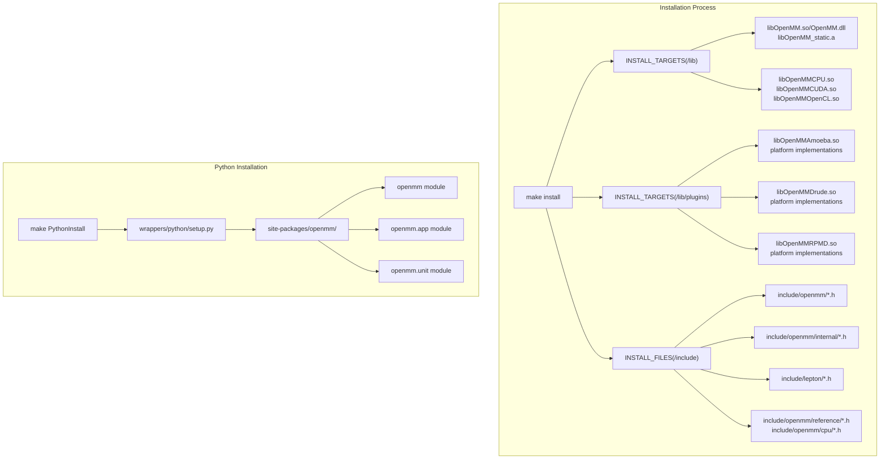

Sources: [CMakeLists.txt:410-427](), [plugins/amoeba/CMakeLists.txt:168-177](), [plugins/drude/CMakeLists.txt:151-160](), [plugins/rpmd/CMakeLists.txt:140-152]()

### Installation Paths

The default installation prefix varies by platform:

| Platform | Default Path | CMake Variable |
|----------|--------------|----------------|
| Windows | `C:/Program Files/OpenMM` | `OPENMM_INSTALL_PREFIX` |
| Linux/macOS | `/usr/local/openmm` | `OPENMM_INSTALL_PREFIX` |
| User Override | Custom path | `CMAKE_INSTALL_PREFIX` |

Installation subdirectories:
- `/lib` - Shared and static libraries
- `/lib/plugins` - Plugin libraries
- `/include` - Public API headers
- Python site-packages - Python modules

Sources: [CMakeLists.txt:57-88]()

### Conda Package Distribution

OpenMM is distributed via Conda packages built from the `tools/conda-recipe/` directory:

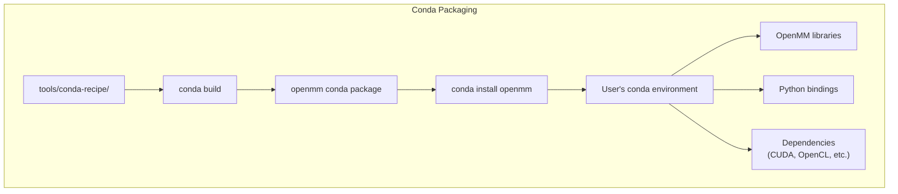

The Conda package includes:
- Pre-compiled binaries for multiple platforms (Linux, macOS, Windows)
- Python bindings for multiple Python versions
- Platform-specific optimizations (CUDA, OpenCL)
- All dependencies properly linked

Sources: [CMakeLists.txt:410-427]() (references conda packaging in comments)

### Documentation Deployment

Documentation is built and deployed as part of the CI process:

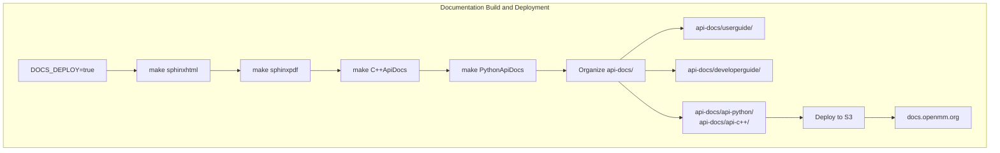

Documentation deployment occurs on successful builds of the master branch when `DOCS_DEPLOY=true`.

Sources: [.travis.yml:222-232](), [.travis.yml:234-247]()

## Cross-Platform Considerations

The build system includes specific handling for different operating systems and architectures:

### Platform-Specific Compiler Flags

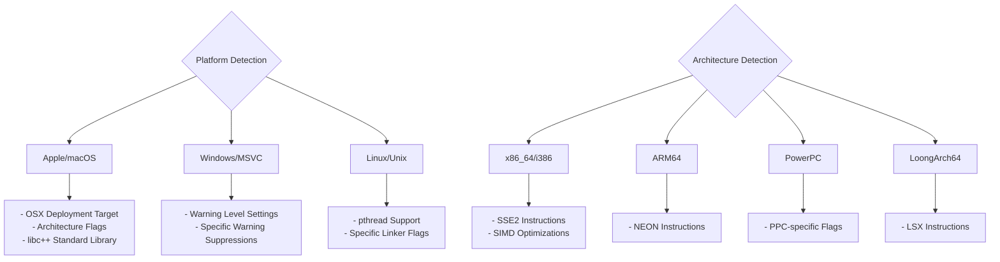

Sources: [CMakeLists.txt:98-132](), [CMakeLists.txt:36-53]()

## Conclusion

OpenMM's build system is designed to be flexible and support multiple platforms, architectures, and configuration options. The CMake-based system automatically detects available dependencies and enables the corresponding features. The CI/CD pipeline ensures that the code builds and passes tests on various platforms, providing reliability for the library across different environments.

For information on the development workflow and contributing to OpenMM, see [Development Workflow](#1.2).