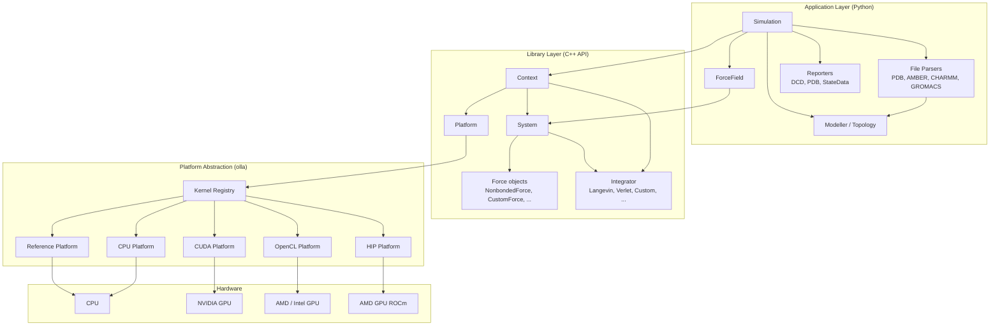

**OpenMM** is a high-performance molecular dynamics (MD) simulation toolkit developed at Stanford University. It serves a dual purpose: as a **stand-alone application** for scientists who want to run simulations quickly, and as a **flexible library** that programmers can embed into their own software. OpenMM distinguishes itself through a combination of extreme customizability (custom forces and integrators defined via the Lepton expression engine), open-source licensing (MIT and LGPL), and exceptional GPU acceleration — making it one of the fastest MD engines available for biomolecular simulation today. The latest major release, OpenMM 8, also introduces support for machine learning potentials, reflecting the toolkit's continued evolution ([README.md](README.md#L1-L14)).

Sources: [README.md](README.md#L1-L14)

## Two-Layer Architecture

OpenMM is intentionally designed around a **two-layer architecture** that cleanly separates simulation infrastructure from end-user workflow. Understanding this separation is the single most important concept for navigating both the codebase and the documentation.

The **Library Layer** lives primarily in [`openmmapi/`](openmmapi/include/OpenMM.h#L1-L93) and [`olla/`](olla/src/Platform.cpp) directories. It provides the core C++ API — the `System`, `Context`, `Integrator`, and `Force` classes — along with the platform abstraction that routes computations to different hardware backends. This is the engine room: every simulation, regardless of how it's launched, ultimately executes through this layer.

The **Application Layer** lives in [`wrappers/python/openmm/app/`](wrappers/python/openmm/app/__init__.py) and provides a high-level Python API oriented around practical simulation workflows. This includes classes like `Simulation`, `ForceField`, `Modeller`, and file parsers for AMBER, CHARMM, GROMACS, PDB, and other formats. The application layer is what most users interact with directly — it translates human-readable inputs (force field XML files, structure files) into the low-level `System` objects the library layer expects ([docs-source/usersguide/introduction.rst](docs-source/usersguide/introduction.rst#L1-L10)).

Sources: [OpenMM.h](openmmapi/include/OpenMM.h#L1-L93), [introduction.rst](docs-source/usersguide/introduction.rst#L1-L10)

## High-Level Architecture

The following diagram illustrates how the major components of OpenMM relate to each other, from user-facing code down to hardware execution:



A user creates a `Simulation` object at the top, which internally assembles a `System` (particles + forces), binds it with an `Integrator` inside a `Context`, and the `Platform` dispatches computation to the fastest available hardware. This indirection means switching from CPU to GPU requires changing only one line of code.

Sources: [Platform.h](olla/include/openmm/Platform.h#L45-L80), [Kernel.h](olla/include/openmm/Kernel.h#L40-L60)

## Repository Structure

The repository is organized into clearly delineated directories, each serving a distinct role in the build and runtime architecture:

```
openmm/
├── openmmapi/          # Core C++ API (System, Context, Integrator, Force classes)
├── olla/               # Platform & Kernel abstraction layer (low-level plugin registry)
├── platforms/          # Hardware backend implementations
│   ├── reference/      #   Reference (debugging, correctness validation)
│   ├── cpu/            #   Optimized CPU (SIMD: SSE/AVX)
│   ├── cuda/           #   NVIDIA GPU (CUDA)
│   ├── opencl/         #   Cross-platform GPU (OpenCL)
│   └── hip/            #   AMD GPU (ROCm/HIP)
├── wrappers/python/    # SWIG-generated Python bindings + app layer
├── serialization/      # XML serialization for checkpointing
├── plugins/            # Optional force field plugins
│   ├── amoeba/         #   Amoeba polarizable force field
│   ├── drude/          #   Drude polarizable model
│   └── rpmd/           #   Ring-polymer molecular dynamics
├── libraries/          # Vendored third-party libraries (Lepton, vecmath, etc.)
├── tests/              # C++ test suite
├── examples/           # Python & C++ example simulations
└── docs-source/        # Sphinx documentation source
```

Sources: [Repository root](openmmapi/include/OpenMM.h), [olla](olla/include/openmm/Platform.h), [platforms](platforms/common/src/ComputeContext.cpp), [plugins](plugins/amoeba/openmmapi)

## Supported Platforms and Hardware

OpenMM's **platform system** is the architectural mechanism that enables hardware portability without code changes. A `Platform` acts as a registry of `Kernel` factories — each kernel implements a specific computation (e.g., "calculate nonbonded forces" or "integrate one time step") for a particular hardware target. When you create a `Context`, OpenMM automatically selects the fastest platform that supports all required kernels ([Platform.h](olla/include/openmm/Platform.h#L45-L65)).

| Platform | Hardware Target | Precision | Best For |
|----------|----------------|-----------|----------|
| **Reference** | Any CPU | Double | Debugging, validation, correctness testing |
| **CPU** | x86 CPUs | Mixed (SP/DP) | Production runs without GPU; uses SSE/AVX SIMD |
| **CUDA** | NVIDIA GPUs | Mixed (configurable) | Highest performance on NVIDIA hardware |
| **OpenCL** | AMD, Intel, NVIDIA GPUs | Mixed (configurable) | Cross-vendor GPU portability |
| **HIP** | AMD GPUs (ROCm) | Mixed (configurable) | Native AMD GPU performance |

The Reference platform always returns a speed of `1.0`, while accelerated platforms return higher values proportional to their estimated throughput, allowing automatic platform selection to pick the fastest option ([Platform.h](olla/include/openmm/Platform.h#L75-L80)).

> [!TIP]
> **Platform selection is automatic but overridable.** By default, `Context` picks the fastest available platform. You can override this with `Platform.getPlatformByName('CUDA')` or pass platform properties (like `'DeviceIndex'` or `'Precision'`) to control GPU selection and numerical precision.

Sources: [Platform.h](olla/include/openmm/Platform.h#L45-L100), [platforms/](platforms/common/src/ComputeContext.cpp)

## Core API Primitives

Three classes form the foundation of every OpenMM simulation:

**`System`** — the molecular system definition. A `System` holds the complete description of what to simulate: the number of particles, their masses, constraints, and a collection of `Force` objects that define interactions (bonded, nonbonded, implicit solvent, custom, etc.). Think of it as the static specification of your physical model ([openmmapi/include/openmm/System.h](openmmapi/include/openmm/System.h)).

**`Integrator`** — the time evolution engine. An `Integrator` advances the system through time by computing forces and updating positions/velocities. OpenMM ships with multiple integrators covering different simulation ensembles and algorithms. The `step(int steps)` method is the primary entry point for simulation ([Integrator.h](openmmapi/include/openmm/Integrator.h#L40-L90)).

**`Context`** — the runtime binding. A `Context` binds a `System`, an `Integrator`, and a `Platform` together into a live simulation state. It holds positions, velocities, time, and provides methods like `getState()` to extract observables. Creating a `Context` is when GPU memory gets allocated and kernels get compiled ([Context.h](openmmapi/include/openmm/Context.h)).

Sources: [System.h](openmmapi/include/openmm/System.h), [Integrator.h](openmmapi/include/openmm/Integrator.h#L40-L90), [Context.h](openmmapi/include/openmm/Context.h)

## Integrators and Forces

OpenMM provides a rich set of integrators covering the most common MD algorithms, alongside a uniquely powerful system of custom and standard forces:

| Category | Available Classes |
|----------|------------------|
| **Standard Integrators** | `VerletIntegrator`, `LangevinIntegrator`, `LangevinMiddleIntegrator`, `BrownianIntegrator`, `VariableLangevinIntegrator`, `VariableVerletIntegrator`, `NoseHooverIntegrator`, `CompoundIntegrator` |
| **Specialized Integrators** | `DPDIntegrator` (dissipative particle dynamics), `QTBIntegrator` (quantum thermal bath), `CustomIntegrator` (user-defined algorithms) |
| **Standard Forces** | `NonbondedForce`, `HarmonicBondForce`, `HarmonicAngleForce`, `PeriodicTorsionForce`, `RBTorsionForce`, `GBSAOBCForce`, `CMAPTorsionForce`, `CMMotionRemover` |
| **Thermostats & Barostats** | `AndersenThermostat`, `MonteCarloBarostat`, `MonteCarloAnisotropicBarostat`, `MonteCarloFlexibleBarostat`, `MonteCarloMembraneBarostat` |
| **Custom Forces** | `CustomBondForce`, `CustomAngleForce`, `CustomTorsionForce`, `CustomNonbondedForce`, `CustomGBForce`, `CustomExternalForce`, `CustomCVForce`, `CustomManyParticleForce`, `CustomHbondForce`, `CustomVolumeForce` |
| **Advanced Forces** | `ATMForce` (alchemical), `GayBerneForce`, `RMSDForce`, `RGForce`, `PythonForce` |

A `Force` object can add forces, contribute to potential energy, modify particle positions/velocities, define parameters, and even alter other forces' parameters at each time step ([Force.h](openmmapi/include/openmm/Force.h#L40-L80)). Forces are organized into **force groups** (0–31) enabling multiple time step integration schemes where fast and slow forces are evaluated at different frequencies.

Sources: [OpenMM.h](openmmapi/include/OpenMM.h#L33-L91), [Force.h](openmmapi/include/openmm/Force.h#L40-L80)

## Application Layer Highlights

The Python application layer, found in [`wrappers/python/openmm/app/`](wrappers/python/openmm/app/__init__.py), wraps the C++ API into a workflow-oriented interface. Its key components include:

- **`Simulation`** — the central orchestrator that combines topology, system, integrator, and platform into a single object with convenience methods like `minimizeEnergy()`, `step()`, and `saveCheckpoint()` ([simulation.py](wrappers/python/openmm/app/simulation.py#L43-L58))
- **`ForceField`** — reads XML force field definition files (AMBER, CHARMM-compatible) and generates `System` objects from a `Topology`
- **`Modeller`** — provides tools for adding missing hydrogens, adding solvent boxes, and editing molecular structures
- **File parsers** — `PDBFile`, `AmberPrmtopFile`/`AmberInpcrdFile`, `CharmmPsfFile`/`CharmmParameterSet`, `GromacsTopFile`/`GromacsGroFile`, `TinkerFiles`, and more
- **Reporters** — `DCDReporter`, `PDBReporter`, `StateDataReporter`, `CheckpointReporter` for outputting trajectory and diagnostic data

A complete simulation can be expressed in as few as 15 lines of Python, as demonstrated in [`examples/python-examples/simulatePdb.py`](examples/python-examples/simulatePdb.py#L1-L16).

Sources: [app/](wrappers/python/openmm/app/__init__.py), [simulation.py](wrappers/python/openmm/app/simulation.py#L43-L58), [simulatePdb.py](examples/python-examples/simulatePdb.py#L1-L16)

## Plugin Ecosystem

OpenMM's plugin architecture extends core functionality without modifying the main library. Plugins are distributed independently and loaded at runtime, following the same platform abstraction pattern as the core. The repository includes four plugins in the [`plugins/`](plugins/amoeba/openmmapi) directory:

| Plugin | Purpose |
|--------|---------|
| **Amoeba** | Polarizable multipole force field with AMOEBA potential, including GPU-accelerated platforms |
| **Drude** | Drude polarizable force field with classical Drude oscillators |
| **RPMD** | Ring-polymer molecular dynamics for nuclear quantum effects |
| **CPU PME** | Alternative CPU-optimized Particle Mesh Ewald implementation |

Each plugin mirrors the core structure: its own `openmmapi/`, `platforms/`, `serialization/`, and `wrappers/` subdirectories, demonstrating how the architecture is designed for extensibility.

Sources: [plugins/](plugins/amoeba/openmmapi), [library.rst](docs-source/usersguide/library.rst#L1-L22)

## Bundled Libraries

The [`libraries/`](libraries) directory contains vendored third-party libraries that OpenMM depends on. These are compiled as part of the OpenMM build rather than linked from the system, ensuring reproducibility across platforms. Key libraries include:

- **Lepton** — a compact expression parser and compiler used by `CustomForce` and `CustomIntegrator` to evaluate arbitrary mathematical expressions at runtime
- **vecmath** — SIMD-vectorized math operations (the performance backbone of the CPU platform)
- **pocketfft** — efficient FFT implementation used in Particle Mesh Ewald (PME) calculations
- **vkfft** — GPU-accelerated FFT library used by CUDA and OpenCL platforms for PME
- **sfmt** — SIMD-oriented fast Mersenne Twister pseudo-random number generator
- **asmjit** — JIT assembler used for dynamic code generation on CPU

Sources: [libraries/](libraries), [common/](platforms/common/src/ExpressionUtilities.cpp)

## A Minimal Working Example

The following Python script demonstrates the end-to-end workflow: load a structure, assign a force field, minimize energy, and run dynamics. This single file exercises all the major architectural layers described above ([simulatePdb.py](examples/python-examples/simulatePdb.py#L1-L16)):

```python
from openmm.app import *
from openmm import *
from openmm.unit import *

pdb = PDBFile('input.pdb')                                                    # Application layer: file parser
forcefield = ForceField('amber19-all.xml', 'amber19/tip3pfb.xml')             # Application layer: force field
system = forcefield.createSystem(pdb.topology, nonbondedMethod=PME,           # Library layer: System + Forces
                                  nonbondedCutoff=1*nanometer, constraints=HBonds)
integrator = LangevinMiddleIntegrator(300*kelvin, 1/picosecond,              # Library layer: Integrator
                                        0.004*picoseconds)
simulation = Simulation(pdb.topology, system, integrator)                      # Application layer: Simulation
simulation.context.setPositions(pdb.positions)
simulation.minimizeEnergy()
simulation.reporters.append(StateDataReporter(stdout, 1000, step=True,
                                              potentialEnergy=True, temperature=True))
simulation.step(10000)
```

Sources: [simulatePdb.py](examples/python-examples/simulatePdb.py#L1-L16)

## Licensing and Acknowledgments

OpenMM is free and open-source. The majority of the codebase is released under the **MIT** and **LGPL** licenses. Portions are copyright © 2008–2025 Stanford University and the Authors ([README.md](README.md#L34-L37)). If you use OpenMM in published research, please cite: P. Eastman *et al.*, "OpenMM 8: Molecular Dynamics Simulation with Machine Learning Potentials," *J. Phys. Chem. B* **128**(1), 109–116 (2023) ([introduction.rst](docs-source/usersguide/introduction.rst#L33-L42)).

Sources: [README.md](README.md#L34-L37), [introduction.rst](docs-source/usersguide/introduction.rst#L33-L42)

## Where to Go Next

This overview has mapped out the architectural landscape of OpenMM. To continue your journey through the codebase and documentation, follow this reading progression:

1. **[Quick Start](2-quick-start)** — Install OpenMM and run your first simulation in minutes
2. **[Installation and Platform Setup](3-installation-and-platform-setup)** — Detailed platform-specific installation, including GPU driver requirements
3. **[Architecture Overview](7-architecture-overview)** — A deeper dive into the internal design patterns, build system, and code organization
4. **[System and Context](11-system-and-context)** — Detailed examination of the core C++ API primitives
5. **[Integrator Hierarchy](12-integrator-hierarchy)** — Complete guide to integration algorithms and their implementations
6. **[Force Classes](13-force classes)** — Comprehensive reference for all standard and custom force types

For hands-on learning, explore the example simulations in [`examples/python-examples/`](examples/python-examples/simulatePdb.py) covering AMBER, CHARMM, GROMACS, PDB, and Tinker file formats, or consult the [OpenMM Cookbook](https://openmm.github.io/openmm-cookbook/latest) for task-oriented tutorials.