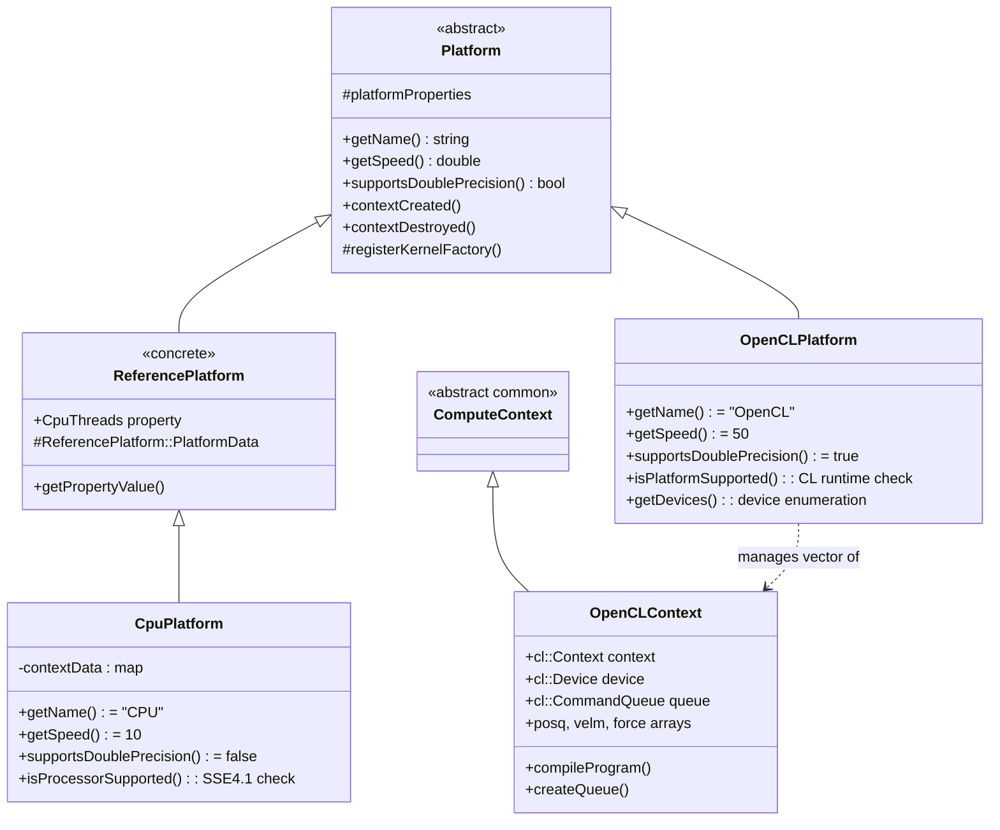

This page provides an architectural deep-dive into two foundational OpenMM execution platforms: the **CPU Platform**, which leverages SIMD vectorization and multi-threading for portable scalar performance, and the **OpenCL Platform**, which offloads computation to heterogeneous devices (GPUs, accelerators) through the OpenCL compute API. Both platforms occupy distinct positions in OpenMM's platform hierarchy and serve different hardware targets, yet share a common goal: translating the platform-agnostic kernel interface into high-performance physics calculations.

For the broader context of how platforms plug into OpenMM's abstraction layer, see [Platform and Kernel System](8-platform-and-kernel-system). For the GPU-dominant counterpart, see [CUDA Platform Implementation](9-cuda-platform-implementation).

## Platform Class Hierarchy: Two Divergent Inheritance Strategies

The most consequential architectural difference between the CPU and OpenCL platforms is their base class inheritance. The CPU platform extends `ReferencePlatform`, while the OpenCL platform extends `Platform` directly. This split determines each platform's kernel coverage, default behavior, and relationship to the common compute infrastructure.

The CPU platform's inheritance from `ReferencePlatform` means it inherits a complete set of reference (unoptimized) kernel implementations as a fallback. It then overrides only the computationally intensive kernels—nonbonded forces, GBSA, custom nonbonded, and Langevin integration—with vectorized variants. Everything else (bond forces, constraints, state updates, most integrators) falls through to the reference implementations via the `ReferencePlatform::PlatformData` stored in the context.

Sources: [CpuPlatform.h](platforms/cpu/include/CpuPlatform.h#L48-L55), [OpenCLPlatform.h](platforms/opencl/include/OpenCLPlatform.h#L40-L47)

## CPU Platform: SIMD-Vectorized Scalar Execution

### Registration and Hardware Gate

The CPU platform registers itself conditionally: it only appears in the available platform list if the host processor supports SSE 4.1, verified through the `isVec4Supported()` function from the internal hardware detection module. This guard is evaluated at library load time inside the `registerPlatforms()` entry point.

Sources: [CpuPlatform.cpp](platforms/cpu/src/CpuPlatform.cpp#L51-L57), [CpuPlatform.cpp](platforms/cpu/src/CpuPlatform.cpp#L110-L112)

### Platform Properties and Defaults

The CPU platform exposes two configuration properties, both set during construction with environment-variable overrides.

| Property | Key | Default | Purpose |
|----------|-----|---------|---------|
| **Threads** | `"Threads"` | `getNumProcessors()` (overridable via `OPENMM_CPU_THREADS` env var) | Controls the thread pool size for parallel force evaluation |
| **DeterministicForces** | `"DeterministicForces"` | `"false"` | Reduces floating-point non-determinism from thread scheduling at a performance cost |

The thread count default is determined by querying the operating system for available processors, but the `OPENMM_CPU_THREADS` environment variable takes precedence. The `DeterministicForces` flag is important for reproducible simulations: multi-threaded floating-point accumulation is inherently order-dependent, and enabling this property applies strategies to reduce that variability.

Sources: [CpuPlatform.cpp](platforms/cpu/src/CpuPlatform.cpp#L78-L88), [CpuPlatform.h](platforms/cpu/include/CpuPlatform.h#L65-L77)

### PlatformData: The Per-Context Execution Environment

The `CpuPlatform::PlatformData` class is the heart of the CPU platform's runtime state. It maintains the data structures required for vectorized, multi-threaded force evaluation. Notably, because the CPU platform inherits from `ReferencePlatform`—which already has its own platform data mechanism—the CPU platform maintains a **separate static map** (`contextData`) to store its additional data alongside the reference data.

Key fields in `PlatformData` include:

- **`posq`**: An `AlignedArray<float>` of size `4 * numParticles`, storing positions (x, y, z) and charge (w) in a SIMD-friendly layout
- **`threadForce`**: A per-thread vector of `AlignedArray<float>` force buffers, one per thread in the pool, each sized `4 * numParticles`. This eliminates contention during parallel force accumulation
- **`threads`**: A reference to the `ThreadPool` that orchestrates parallel computation
- **`neighborList`**: A lazily-constructed `CpuNeighborList` shared across all nonbonded force kernels
- **`random`**: A `CpuRandom` instance for stochastic integrator support
- **`cutoff` / `paddedCutoff`**: The maximum cutoff and padded cutoff across all nonbonded forces, used to determine neighbor list validity

The `requestNeighborList()` method implements a cooperative pattern: multiple force kernels (NonbondedForce, CustomNonbondedForce, GBSAOBCForce, etc.) can all request neighbor lists with potentially different cutoffs. The platform tracks the maximum cutoff and padding, ensuring a single neighbor list satisfies all consumers. If any force requires a dense (all-pairs) list (cutoff = 0), all forces must agree on this, otherwise an exception is thrown.

Sources: [CpuPlatform.h](platforms/cpu/include/CpuPlatform.h#L88-L118), [CpuPlatform.cpp](platforms/cpu/src/CpuPlatform.cpp#L151-L192)

### Context Lifecycle

During `contextCreated()`, the CPU platform performs a two-phase initialization: first, it delegates to `ReferencePlatform::contextCreated()` to establish the base reference infrastructure (including its own thread pool and constraint solver). Then, it constructs a `CpuPlatform::PlatformData` and installs it in the static `contextData` map. Critically, if the reference platform created a SETTLE constraint solver, the CPU platform replaces it with a `CpuSETTLE` instance that is aware of the multi-threaded force buffer layout.

During `contextDestroyed()`, both the CPU platform data and the reference platform data are cleaned up, ensuring no memory leaks across the dual-data-layer design.

Sources: [CpuPlatform.cpp](platforms/cpu/src/CpuPlatform.cpp#L114-L141)

### Kernel Coverage: Selective Override

The CPU platform registers a `CpuKernelFactory` for only 13 kernel types. The remaining kernel types are implicitly handled by the reference platform's factory. This selective override strategy concentrates optimization effort where it matters most.

| Kernel | Implementation | Strategy |
|--------|---------------|----------|
| `CalcForcesAndEnergyKernel` | `CpuCalcForcesAndEnergyKernel` | Wraps reference; manages begin/end computation lifecycle |
| `UpdateStateDataKernel` | `CpuUpdateStateDataKernel` | Extends reference; adds checkpoint support for CPU data |
| `CalcHarmonicAngleForceKernel` | `CpuCalcHarmonicAngleForceKernel` | Uses `CpuBondForce` for vectorized angle evaluation |
| `CalcPeriodicTorsionForceKernel` | `CpuCalcPeriodicTorsionForceKernel` | Uses `CpuBondForce` for vectorized torsion evaluation |
| `CalcRBTorsionForceKernel` | `CpuCalcRBTorsionForceKernel` | Uses `CpuBondForce` for RB torsion evaluation |
| `CalcNonbondedForceKernel` | `CpuCalcNonbondedForceKernel` | Full SIMD-vectorized nonbonded + PME |
| `CalcConstantPotentialForceKernel` | `CpuCalcConstantPotentialForceKernel` | SIMD-vectorized constant potential electrostatics |
| `CalcCustomNonbondedForceKernel` | `CpuCalcCustomNonbondedForceKernel` | SIMD-vectorized custom nonbonded |
| `CalcCustomManyParticleForceKernel` | `CpuCalcCustomManyParticleForceKernel` | Multi-threaded custom N-body |
| `CalcGBSAOBCForceKernel` | `CpuCalcGBSAOBCForceKernel` | Vectorized GBSA-OBC implicit solvent |
| `CalcCustomGBForceKernel` | `CpuCalcCustomGBForceKernel` | Vectorized custom GB with neighbor list |
| `CalcGayBerneForceKernel` | `CpuCalcGayBerneForceKernel` | Anisotropic LJ with custom interaction engine |
| `CalcLCPOForceKernel` | `CpuCalcLCPOForceKernel` | LCPO surface area implicit solvent |
| `IntegrateLangevinMiddleStepKernel` | `CpuIntegrateLangevinMiddleStepKernel` | Multi-threaded Langevin middle integrator |

**All other kernels** (Verlet, Brownian, custom integrators, harmonic bonds, barostats, thermostats, virtual sites, energy minimization, etc.) are handled by the reference platform's default implementations.

Sources: [CpuPlatform.cpp](platforms/cpu/src/CpuPlatform.cpp#L63-L77), [CpuKernelFactory.cpp](platforms/cpu/src/CpuKernelFactory.cpp#L38-L70)

### SIMD Vectorization Architecture

The nonbonded force computation is the primary target of SIMD optimization. The architecture uses a **templated strategy pattern** via `CpuNonbondedForceFvec<FVEC>`, where `FVEC` can be any SIMD floating-point type. The `blockSize` static constant—computed as `sizeof(FVEC) / sizeof(float)`—determines how many particles are processed simultaneously in a single SIMD block.

The implementation chain works as follows: `CpuNonbondedForceFvec` extends `CpuNonbondedForce` and overrides `calculateBlockIxn()` and `calculateBlockEwaldIxn()`. These dispatch to `calculateBlockIxnHandler<BlockType>`, which further dispatches to `calculateBlockIxnImpl<PERIODIC_TYPE, BlockType>`. The `PERIODIC_TYPE` template parameter is an enum with five variants (`NoCutoff`, `NoPeriodic`, `PeriodicPerAtom`, `PeriodicPerInteraction`, `PeriodicTriclinic`), allowing the compiler to generate optimized code paths for each boundary condition scenario without runtime branching.

Specialized source files—`CpuNonbondedForceAvx.cpp`, `CpuNonbondedForceAvx2.cpp`, `CpuNonbondedForceVec4.cpp`—provide explicit template instantiations for different SIMD instruction sets, ensuring the optimizer can exploit architecture-specific instructions without relying on auto-vectorization alone.

> [!TIP]
> The CPU platform's SIMD nonbonded implementation uses a **SoA (Structure of Arrays)** neighbor list layout where particles are organized into blocks of `blockSize` elements. This maximizes SIMD lane utilization by ensuring that all elements in a vector register contain valid, non-excluded particle data. The `CpuNeighborList` is constructed with the current vector width at creation time, binding it to the specific SIMD capability detected at startup.

Sources: [CpuNonbondedForceFvec.h](platforms/cpu/include/CpuNonbondedForceFvec.h#L46-L99)

### Multi-Threaded Force Accumulation

The `CpuCalcForcesAndEnergyKernel` orchestrates the force computation lifecycle through `beginComputation()` and `finishComputation()`. During `beginComputation()`, each thread's force buffer is zeroed. Individual force kernels then accumulate forces into `threadForce[threadIndex]` during their `execute()` calls. In `finishComputation()`, the per-thread buffers are reduced into the final force array. The `DeterministicForces` flag, when enabled, applies additional ordering constraints to this reduction to improve reproducibility.

This design avoids lock contention during the computationally dominant force evaluation phase—each thread writes exclusively to its own buffer—while concentrating synchronization overhead into the single reduction step at the end.

Sources: [CpuKernels.h](platforms/cpu/include/CpuKernels.h#L59-L97)

## OpenCL Platform: Heterogeneous Compute via Common Infrastructure

### Registration and Platform Detection

The OpenCL platform conditionally registers only if a valid OpenCL runtime is detected. On Apple platforms, it additionally gates on macOS version 10.10.3 or later (Darwin kernel 14.3.0+), due to critical bugs in earlier Apple OpenCL implementations. The `isPlatformSupported()` function attempts to enumerate `cl::Platform` objects and returns `false` if none are found or if the call throws an exception.

Sources: [OpenCLPlatform.cpp](platforms/opencl/src/OpenCLPlatform.cpp#L131-L165)

### Platform Properties and Device Enumeration

The OpenCL platform exposes seven configuration properties, reflecting the complexity of heterogeneous device selection.

| Property | Key | Default | Purpose |
|----------|-----|---------|---------|
| **DeviceIndex** | `"DeviceIndex"` | `""` (auto-select) | Comma-separated list of device indices for multi-GPU |
| **DeviceName** | `"DeviceName"` | `""` (read-only) | Reports the name(s) of selected device(s) |
| **PlatformIndex** | `"OpenCLPlatformIndex"` | `""` (auto-select) | Selects which OpenCL platform (vendor runtime) to use |
| **PlatformName** | `"OpenCLPlatformName"` | `""` (read-only) | Reports the selected OpenCL platform name |
| **Precision** | `"Precision"` | `"single"` | Numerical precision: `"single"`, `"mixed"`, or `"double"` |
| **UseCpuPme** | `"UseCpuPme"` | `"false"` | Offloads PME reciprocal space to CPU threads |
| **DisablePmeStream** | `"DisablePmeStream"` | `"false"` | Disables asynchronous PME stream for debugging |

The `getDevices()` method supports programmatic device enumeration with filtering. When multiple devices are specified via `DeviceIndex`, the platform creates multiple `OpenCLContext` instances—one per device—and distributes the force computation using parallel kernels (`OpenCLParallelCalcForcesAndEnergyKernel` and related `CommonParallelCalc*` variants). This multi-device capability is a distinguishing feature of the OpenCL (and CUDA) platforms.

Sources: [OpenCLPlatform.cpp](platforms/opencl/src/OpenCLPlatform.cpp#L107-L121), [OpenCLPlatform.cpp](platforms/opencl/src/OpenCLPlatform.cpp#L182-L200)

### The Common Compute Abstraction Layer

Unlike the CPU platform, which implements its own kernel infrastructure, the OpenCL platform delegates heavily to the `platforms/common` shared library. This library provides a **hardware-agnostic compute abstraction** that both the OpenCL and CUDA platforms consume. The key abstraction is `ComputeContext`, which defines a uniform interface for memory management, program compilation, queue creation, and data access.

`OpenCLContext` extends `ComputeContext` and provides the OpenCL-specific implementation: it wraps `cl::Context`, `cl::Device`, and `cl::CommandQueue`, and exposes device arrays as `OpenCLArray` objects. The kernel implementations in `platforms/common/src/` are written against the `ComputeContext` interface, making them portable across OpenCL and CUDA without modification.

Sources: [OpenCLContext.h](platforms/opencl/include/OpenCLContext.h#L122-L131), [OpenCLPlatform.h](platforms/opencl/include/OpenCLPlatform.h#L108-L124)

### PlatformData: Multi-Device Orchestration

The `OpenCLPlatform::PlatformData` is architecturally richer than its CPU counterpart. It manages:

- **`contexts`**: A vector of `OpenCLContext*` pointers, one per compute device. In single-device mode, this vector has length 1 and no worker thread is created
- **`contextEnergy`**: A per-device energy workspace for parallel reduction across devices
- **`threads`**: A `ThreadPool` for CPU-side PME and multi-device coordination
- **`useCpuPme` / `disablePmeStream`**: PME execution strategy flags
- **`computeForceCount` / `stepCount` / `time`**: Simulation state tracking across devices

The `initializeContexts()` method is called after all forces have been added, triggering compilation of all OpenCL programs and allocation of device buffers. The `syncContexts()` method ensures all devices have completed their computations before proceeding.

Sources: [OpenCLPlatform.h](platforms/opencl/include/OpenCLPlatform.h#L108-L124)

### OpenCL Kernel Sources

The OpenCL platform's compute kernels are written in OpenCL C (`.cl` files) in `platforms/opencl/src/kernels/`. These are embedded into the binary at build time via the CMake `EncodeKernelFiles.cmake` module. The kernel files include:

- **`common.cl`**: Shared data types, macros, and utility functions
- **`nonbonded.cl`** / **`nonbonded_cpu.cl`**: Nonbonded pair interaction kernels (GPU and CPU device variants)
- **`findInteractingBlocks.cl`** / **`findInteractingBlocks_cpu.cl`**: Neighbor list construction
- **`fft.cl`** / **`fftR2C.cl`**: FFT for PME reciprocal space
- **`compact.cl`**: Stream compaction for filtering
- **`sort.cl`**: Radix sort for atom reordering
- **`utilities.cl`**: Mathematical utility functions

The `_cpu` suffixed variants provide optimized paths when the OpenCL device is actually a CPU, adjusting work-group sizes and memory access patterns accordingly.

Sources: [platforms/opencl/src/kernels/](platforms/opencl/src/kernels/)

### Kernel Factory: Common Kernels with Platform-Specific Overlays

The `OpenCLKernelFactory` demonstrates a layered architecture. For most kernel types, it returns instances from the `CommonKernels` namespace (e.g., `CommonCalcHarmonicBondForceKernel`, `CommonIntegrateLangevinMiddleStepKernel`). However, certain kernels require OpenCL-specific implementations:

| Kernel | Implementation | Reason for Override |
|--------|---------------|---------------------|
| `CalcForcesAndEnergyKernel` | `OpenCLCalcForcesAndEnergyKernel` / `OpenCLParallelCalcForcesAndEnergyKernel` | Manages multi-device force dispatch |
| `CalcNonbondedForceKernel` | `OpenCLCalcNonbondedForceKernel` / `OpenCLParallelCalcNonbondedForceKernel` | OpenCL-specific nonbonded utilities |
| `CalcConstantPotentialForceKernel` | `OpenCLCalcConstantPotentialForceKernel` | Electrode-specific GPU computation |
| `CalcCustomCVForceKernel` | `OpenCLCalcCustomCVForceKernel` | Collective variable force |
| `CalcATMForceKernel` | `OpenCLCalcATMForceKernel` | Alchemical transfer mapping |

When running on multiple devices (`data.contexts.size() > 1`), the factory first checks for parallel kernel variants (`CommonParallelCalc*`, `OpenCLParallelCalc*`) that distribute work across devices, falling back to single-device kernels otherwise. The parallel kernels handle work partitioning, per-device force accumulation, and cross-device reduction.

Sources: [OpenCLKernelFactory.cpp](platforms/opencl/src/OpenCLKernelFactory.cpp#L42-L76), [OpenCLKernelFactory.cpp](platforms/opencl/src/OpenCLKernelFactory.cpp#L77-L165)

### Comprehensive Kernel Coverage

Compared to the CPU platform's 13 registered kernels, the OpenCL platform registers **43 kernel factories**, providing complete coverage of every force, integrator, thermostat, barostat, and utility kernel in the OpenMM API. This is because the common infrastructure provides pre-built implementations for the full kernel set, whereas the CPU platform relies on the reference fallback for uncovered kernels.

The full list includes all bonded forces (HarmonicBond, CustomBond, HarmonicAngle, CustomAngle, PeriodicTorsion, RBTorsion, CMAPTorsion, CustomTorsion), all nonbonded variants, all integrators (Verlet, Langevin, Brownian, VariableLangevin, VariableVerlet, Custom, DPD, QTB, NoseHoover), constraint handling (ApplyConstraints, VirtualSites), barostats, thermostats, energy minimization, and specialized forces (ATM, Python, CV, RG, RMSD, OrientationRestraint).

Sources: [OpenCLPlatform.cpp](platforms/opencl/src/OpenCLPlatform.cpp#L63-L106)

## Comparative Architecture Summary

| Dimension | CPU Platform | OpenCL Platform |
|-----------|-------------|-----------------|
| **Base class** | `ReferencePlatform` | `Platform` |
| **Speed rating** | 10 | 50 |
| **Double precision** | No | Yes (configurable) |
| **Kernel count** | 13 (selective override) | 43 (full coverage) |
| **Parallelism model** | Thread pool + SIMD vectors | OpenCL work-groups + multi-device |
| **Nonbonded strategy** | Templated SIMD (`CpuNonbondedForceFvec<FVEC>`) | OpenCL C kernels + sorting |
| **Memory model** | Host `AlignedArray<float>` with per-thread buffers | Device `OpenCLArray` via `ComputeContext` |
| **PME** | CPU PME (via CpuPme plugin or reference) | GPU PME with optional CPU offload |
| **Integrator support** | Langevin Middle only (native) | All integrators |
| **Common library use** | None | Extensive (`platforms/common`) |
| **Hardware gate** | SSE 4.1 required | OpenCL 1.2 runtime required |
| **Multi-device** | Not supported | Supported via `DeviceIndex` |

The CPU platform trades kernel completeness for build simplicity and zero external dependencies: it requires only a C++ compiler with SSE4.1 support. Its reliance on `ReferencePlatform` as a base means it inherits correct (if unoptimized) implementations for all operations it doesn't explicitly override. This makes it ideal for validation, platforms without GPU support, and as a development baseline.

The OpenCL platform provides maximum kernel coverage and the flexibility to target GPUs, CPUs, and other accelerators through a single API. Its reliance on the common compute abstraction layer means kernel development effort is shared with the CUDA platform, and the multi-device parallel capability enables scaling across multiple GPUs. The cost is the OpenCL runtime dependency and more complex build requirements.

> [!TIP]
> When developing new force kernels, the CPU platform's selective-override pattern means you can often add a kernel without touching the CPU platform at all—the reference implementation will be used automatically. For the OpenCL (and CUDA) platforms, however, you typically need to add a `CommonCalc*Kernel` in `platforms/common/src/` that implements the kernel against the `ComputeContext` interface, and then register it in both the OpenCL and CUDA kernel factories. This shared implementation strategy avoids code duplication across GPU platforms.

Sources: [CpuPlatform.cpp](platforms/cpu/src/CpuPlatform.cpp#L61-L88), [OpenCLPlatform.cpp](platforms/opencl/src/OpenCLPlatform.cpp#L56-L121)

## Navigating Forward

Having examined the CPU and OpenCL platforms in detail, the natural progression depends on your focus. If you are interested in how the CUDA platform shares the common compute infrastructure with OpenCL but targets NVIDIA hardware specifically, proceed to [CUDA Platform Implementation](9-cuda-platform-implementation). To understand how the `System` and `Context` classes create the environment in which these platforms operate, see [System and Context](11-system-and-context). For practical guidance on building these platforms from source, including SIMD detection and OpenCL discovery, see [Building from Source](24-building-from-source).