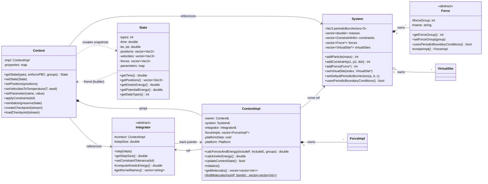
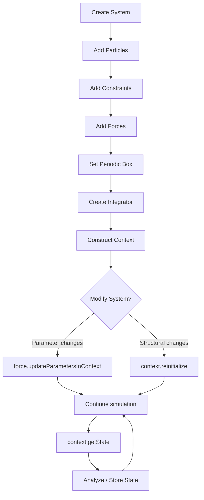

The **System** and **Context** classes form the structural backbone of every OpenMM simulation. Together they separate *what* to simulate (the molecular system definition) from *how* the simulation state is managed at runtime. Understanding this separation—and the lifecycle that bridges them—is essential for writing correct, performant simulations and for debugging unexpected behavior during Context creation or state manipulation.

## Architectural Overview

OpenMM splits the simulation object graph into a **declarative layer** (System + Force + Integrator) and an **operational layer** (Context + ContextImpl + State). The System is an immutable-at-runtime blueprint: once a Context is created, modifying the System does not automatically propagate changes. The Context is the live simulation container that holds positions, velocities, time, platform-specific data, and cached force computations. The State is an immutable snapshot extracted from a Context on demand.

## The System Class: Declarative Blueprint

The `System` class is the top-level container that defines a molecular simulation's physical structure. It holds exactly four categories of information: **particles** (with masses), **forces** (as `Force` subclass instances), **distance constraints** (particle pairs with fixed separations), and **periodic box vectors**. This is a purely declarative object—it describes *what* exists but holds no runtime state such as positions or velocities.

Sources: [System.h](openmmapi/include/openmm/System.h#L42-L62), [System.cpp](openmmapi/src/System.cpp#L39-L43)

### Particle and Virtual Site Model

Particles are added sequentially via `addParticle(double mass)`, which returns a zero-based index. The mass is specified in **atomic mass units (amu)**. A critical convention governs zero-mass particles: **Integrators will ignore particles with mass 0**, neither updating their positions nor their velocities. This is the standard mechanism for virtual sites, whose positions are computed algebraically from parent particles rather than integrated.

Virtual sites are registered by calling `setVirtualSite(int index, VirtualSite* virtualSite)`. The System takes ownership of the `VirtualSite` pointer and deletes it in its destructor. At Context construction time, OpenMM validates that every particle marked as a virtual site has a mass of exactly zero—any violation throws an `OpenMMException`.

Sources: [System.h](openmmapi/include/openmm/System.h#L84-L87), [System.h](openmmapi/include/openmm/System.h#L116-L116), [System.cpp](openmmapi/src/System.cpp#L62-L68), [ContextImpl.cpp](openmmapi/src/ContextImpl.cpp#L62-L65)

### Constraints

Distance constraints fix the separation between two particles to a constant value (in nm). The `addConstraint(int particle1, int particle2, double distance)` method registers each constraint. At Context construction, OpenMM performs several validation checks: no self-constraints, no out-of-range particle indices, no constraints involving massless particles (both particles must have mass > 0 or both must be massless), and no duplicate constraint pairs.

Sources: [System.h](openmmapi/include/openmm/System.h#L145-L145), [ContextImpl.cpp](openmmapi/src/ContextImpl.cpp#L66-L83)

### Force Ownership and Force Groups

Forces are added with `addForce(Force* force)`, which transfers ownership to the System—the System's destructor calls `delete` on every Force it holds. Each Force belongs to a **force group** (an integer from 0 to 31, defaulting to 0), enabling **multiple time step integration** where subsets of forces are evaluated at different frequencies. The `getForce()` method provides both const and mutable access to individual Force objects by index.

Sources: [System.h](openmmapi/include/openmm/System.h#L172-L198), [System.cpp](openmmapi/src/System.cpp#L45-L50), [Force.h](openmmapi/include/openmm/Force.h#L56-L61)

### Periodic Box Vectors

The System stores default periodic box vectors that are copied into any newly created Context. OpenMM supports **triclinic boxes** but enforces a **reduced form**: vector **a** must be parallel to the x-axis, vector **b** must lie in the x-y plane, and vector **c** must point "mostly" in the z-direction. Concretely, `a[1] == a[2] == 0`, `b[2] == 0`, and all diagonal components (`a[0]`, `b[1]`, `c[2]`) must be positive with specific magnitude relationships enforced. The initial default is a 2 nm × 2 nm × 2 nm cubic box.

Sources: [System.cpp](openmmapi/src/System.cpp#L122-L132)

## The Context Class: Live Simulation Container

The `Context` is where simulation actually happens. It binds together a System, an Integrator, and a Platform, and holds the complete mutable simulation state: current time, particle positions, particle velocities, and all adjustable parameters defined by Force objects. The Context uses the **pimpl idiom**—all internal machinery lives in `ContextImpl`, accessed through a private pointer.

Sources: [Context.h](openmmapi/include/openmm/Context.h#L49-L63), [Context.h](openmmapi/include/openmm/Context.h#L285-L296)

### Context Construction and Platform Selection

The Context offers three constructor overloads with increasing specificity:

| Constructor Signature | Platform Behavior |
|---|---|
| `Context(system, integrator)` | Auto-selects fastest platform supporting all required kernels; respects `OPENMM_DEFAULT_PLATFORM` environment variable |
| `Context(system, integrator, platform)` | Uses the explicitly specified platform |
| `Context(system, integrator, platform, properties)` | Uses specified platform with custom device/precision properties |

During construction, `ContextImpl` performs a multi-phase initialization: first it validates the System (particles, constraints, virtual sites), then calls `createImpl()` on every Force to produce platform-specific `ForceImpl` objects, collects all kernel names from both ForceImpls and the Integrator, and finally selects or validates the Platform. If no platform is specified, it scores all registered platforms by speed (highest first) and attempts creation from fastest to slowest until one succeeds.

Sources: [Context.cpp](openmmapi/src/Context.cpp#L41-L60), [ContextImpl.cpp](openmmapi/src/ContextImpl.cpp#L54-L150)

### State Retrieval with `getState()`

The `getState(int types, bool enforcePeriodicBox, int groups)` method is the primary interface for extracting simulation data. The `types` parameter is a **bitmask** combining `State::DataType` flags, giving fine-grained control over what is computed and returned. This is a lazy-evaluation design: requesting `State::Forces` triggers a full force calculation only when needed, and omitting it avoids that cost entirely.

Sources: [State.h](openmmapi/include/openmm/State.h#L60-L60), [Context.cpp](openmmapi/src/Context.cpp#L87-L152)

| `DataType` Flag | Bit Value | Computation Trigger |
|---|---|---|
| `Positions` | 1 | No computation needed; copies from internal state |
| `Velocities` | 2 | No computation needed; copies from internal state |
| `Forces` | 4 | Triggers `calcForcesAndEnergy()` |
| `Energy` | 8 | Triggers `calcForcesAndEnergy()` + `calcKineticEnergy()` |
| `Parameters` | 16 | Copies parameter map; no force evaluation |
| `ParameterDerivatives` | 32 | Triggers `calcForcesAndEnergy()` |
| `IntegratorParameters` | 64 | Calls `Integrator::serializeParameters()` |

The `groups` parameter controls which force groups contribute to the computed forces and energies, using the same bit-flag scheme: group `i` is included if `(groups & (1 << i)) != 0`. The default value `0xFFFFFFFF` includes all 32 possible groups.

When `enforcePeriodicBox` is `true`, the Context performs **molecule-wise centering**: it identifies molecules via `getMolecules()`, computes each molecule's center of mass, translates the center into the primary periodic box, and shifts all particles in the molecule by the same displacement. This prevents molecules from appearing "broken" across periodic boundaries.

> [!TIP]
> The kinetic energy returned by `State.getKineticEnergy()` is **not** simply Σmv²/2. For leapfrog integrators (like `LangevinMiddleIntegrator`), velocities are stored offset by half a time step and must be adjusted before computing kinetic energy. The `Integrator::kineticEnergyRequiresForce()` method signals whether forces must be pre-computed for this correction—when `true`, calling `getState(State::Energy)` implicitly triggers a force calculation even if `State::Forces` was not requested.

Sources: [Context.cpp](openmmapi/src/Context.cpp#L92-L104), [Context.cpp](openmmapi/src/Context.cpp#L117-L141), [Integrator.h](openmmapi/include/openmm/Integrator.h#L132-L148)

### State Restoration with `setState()`

The `setState(const State&)` method selectively restores Context state from a previously created `State` object. It only updates the data types present in the State—missing data types leave the Context unchanged. This is intentionally **less complete** than `loadCheckpoint()`: it does not restore random number generator states or platform-specific internal data. However, it has the advantage of being **hardware-agnostic**, making it suitable for transferring state between different platforms or machines.

Sources: [Context.h](openmmapi/include/openmm/Context.h#L127-L137), [Context.cpp](openmmapi/src/Context.cpp#L154-L169)

### Velocity Initialization

The `setVelocitiesToTemperature(double temperature, int randomSeed)` method assigns velocities from a Maxwell-Boltzmann distribution at the specified temperature. The implementation delegates to `Integrator::getVelocitiesForTemperature()` (which can be overridden for specialized integrators like Drude), then applies a **velocity time offset correction** for leapfrog integrators. When the integrator's `getVelocityTimeOffset()` returns non-zero, the method computes forces and adjusts velocities to account for the half-step offset between positions and velocities in leapfrog schemes.

Sources: [Context.cpp](openmmapi/src/Context.cpp#L199-L216), [Integrator.h](openmmapi/include/openmm/Integrator.h#L150-L165)

### Reinitialization and System Mutation

After a Context is created, it **caches** its internal representation of the System. Modifying the System's structure (adding/removing particles, forces, or constraints) will **not** be reflected in the Context. The `reinitialize(bool preserveState)` method forces a full rebuild: it destroys the current `ContextImpl`, creates a new one from the (potentially modified) System, and optionally preserves runtime state by internally checkpointing and restoring. When `preserveState` is `true`, a binary checkpoint is taken before destruction and loaded after reconstruction—but if the System has changed incompatibly (e.g., different particle count), this throws an exception.

Most Force subclasses provide `updateParametersInContext()` methods as a lighter-weight alternative for changing force parameters (like spring constants or charges) without full reinitialization. Only structural changes require `reinitialize()`.

> [!TIP]
> Never call `reinitialize()` inside a tight loop. The cost includes destroying and recreating all ForceImpl objects, reallocating platform-specific memory buffers, and re-running kernel compilation. Use per-Force `updateParametersInContext()` for parameter sweeps and reserve `reinitialize()` for structural topology changes.

Sources: [Context.h](openmmapi/include/openmm/Context.h#L230-L248), [Context.cpp](openmmapi/src/Context.cpp#L246-L262)

### Checkpointing

The `createCheckpoint()` and `loadCheckpoint()` methods provide **full binary state persistence** including internal data such as random number generator states. Checkpoints are opaque binary blobs written to/read from `std::ostream`/`std::istream`. They are **highly platform-specific**: they depend on the System definition, the Platform implementation, and the hardware/software environment. Loading a checkpoint created on different hardware or with a different OpenMM version will typically throw an exception. For portable state transfer, prefer `getState()`/`setState()` with the understanding that some internal state will not be preserved.

Sources: [Context.h](openmmapi/include/openmm/Context.h#L250-L275)

## The State Class: Immutable Snapshots

The `State` class is a value object that records a point-in-time snapshot of a simulation. It is constructed internally by `ContextImpl` via the `StateBuilder` pattern and returned as immutable to the caller. Every accessor throws an exception if the requested data type was not included when the State was created—there is no implicit computation on access.

Sources: [State.h](openmmapi/include/openmm/State.h#L42-L51), [State.h](openmmapi/include/openmm/State.h#L129-L152)

## ContextImpl: The Hidden Engine

`ContextImpl` is the non-public implementation that does the actual work behind every Context method call. It holds direct references to the System (const) and Integrator (mutable), owns the vector of `ForceImpl` objects, stores the platform-specific data pointer (`void* platformData`), and manages several platform kernels (`initializeForcesKernel`, `updateStateDataKernel`, `applyConstraintsKernel`, `virtualSitesKernel`, `minimizeKernel`).

The core computation pathway flows through `calcForcesAndEnergy(bool includeForces, bool includeEnergy, int groups)`, which iterates over all `ForceImpl` objects and accumulates their contributions. The `updateContextState()` method is called at the beginning of each time step, giving ForceImpls (particularly thermostats and barostats) an opportunity to modify state variables before force evaluation.

Sources: [ContextImpl.h](openmmapi/include/openmm/internal/ContextImpl.h#L52-L58), [ContextImpl.h](openmmapi/include/openmm/internal/ContextImpl.h#L308-L322)

## Typical Usage Pattern

The canonical workflow separates construction from simulation: build the System completely, create an Integrator, then instantiate a Context once. Runtime modifications should prefer per-Force update methods over full reinitialization, and state extraction should request only the data types actually needed to avoid unnecessary force calculations.

## Next Steps

To continue exploring the core API, proceed to [Integrator Hierarchy](12-integrator-hierarchy) for a detailed examination of how different integration algorithms interact with the Context, or to [Force Classes](13-force classes) for a comprehensive guide to the Force subclass hierarchy and how each contributes to the simulation.

For broader architectural context, revisit [Platform and Kernel System](8-platform-and-kernel-system) to understand how ContextImpl bridges the platform-agnostic API to hardware-specific implementations. If you are approaching OpenMM from the Python layer, the [Simulation Class](14-simulation-class) page shows how these C++ primitives are wrapped into a higher-level convenience interface.