Every molecular dynamics simulation in OpenMM is driven by an **Integrator** — the component responsible for advancing the equations of motion through time. Rather than offering a single monolithic integration engine, OpenMM provides a carefully layered class hierarchy that separates common lifecycle management from algorithm-specific logic. This page traces that hierarchy from the abstract base class through every concrete integrator, revealing the design contracts that make the system extensible and the trade-offs that inform integrator selection.

## The Abstract Contract: `Integrator`

All integrators descend from the abstract `Integrator` class defined in [Integrator.h](openmmapi/include/openmm/Integrator.h). This base class establishes a minimal but complete contract that every integration algorithm must fulfill. It owns three pieces of mutable state — `stepSize`, `constraintTol`, and `forceGroups` — and exposes pure virtual methods that the platform invokes at well-defined lifecycle boundaries.

The public interface is intentionally narrow. Users interact almost exclusively with `step(int steps)` to advance the simulation, `getStepSize()`/`setStepSize()` to control the time increment, and `getConstraintTolerance()`/`setConstraintTolerance()` to tune constraint satisfaction accuracy. Force group filtering via `getIntegrationForceGroups()`/`setIntegrationForceGroups()` allows an integrator to operate on a subset of the forces defined in the System, interpreting the integer as a bitmask where bit *i* corresponds to force group *i* ([Integrator.h#L128-L140](openmmapi/include/openmm/Integrator.h#L128-L140)).

The protected interface is where the real architectural design lives. When a `Context` is created, it calls `initialize(ContextImpl&)` on the integrator, giving it a reference to the internal context implementation. The `ContextImpl*` pointer stored in the `context` member is the integrator's gateway to platform-level kernels. The companion `cleanup()` method fires on Context destruction or reinitialization. The pure virtual `getKernelNames()` returns a vector of string identifiers that the platform uses to locate the appropriate compiled kernels for the target hardware ([Integrator.h#L149-L157](openmmapi/include/openmm/Integrator.h#L149-L157)).

Two additional protected methods are critical for correct thermodynamic observables. `computeKineticEnergy()` must return the kinetic energy evaluated *at the current simulation time*, which for leapfrog-style integrators requires correcting for the half-step velocity offset. The boolean `kineticEnergyRequiresForce()` defaults to `true` and can be overridden to `false` by non-leapfrog integrators, avoiding an unnecessary force evaluation when the user queries the state ([Integrator.h#L169-L178](openmmapi/include/openmm/Integrator.h#L169-L178)). Similarly, `getVelocityTimeOffset()` returns 0.0 by default but is overridden by leapfrog integrators to return `dt/2`, ensuring that `setVelocitiesToTemperature()` applies the correct adjustment ([Integrator.h#L193-L196](openmmapi/include/openmm/Integrator.h#L193-L196)).

The base class also provides default no-op implementations for checkpoint serialization (`createCheckpoint`, `loadCheckpoint`, `serializeParameters`, `deserializeParameters`) and state invalidation (`stateChanged`), which subclasses override as needed ([Integrator.h#L181-L206](openmmapi/include/openmm/Integrator.h#L181-L206)).

```mermaid
classDiagram
    class Integrator {
        <<abstract>>
        +step(int steps)$
        +getStepSize() double
        +setStepSize(double size)
        +getConstraintTolerance() double
        +setConstraintTolerance(double tol)
        +getIntegrationForceGroups() int
        +setIntegrationForceGroups(int groups)
        #context : ContextImpl*
        #owner : Context*
        #initialize(ContextImpl&)$
        #cleanup()
        #getKernelNames()$ vector~string~
        #computeKineticEnergy()$ double
        #kineticEnergyRequiresForce() bool
        #getVelocityTimeOffset() double
    }

    class VerletIntegrator {
        -kernel : Kernel
        +VerletIntegrator(double stepSize)
        +step(int steps)
        #computeKineticEnergy() double
        #getVelocityTimeOffset() double
    }

    class LangevinMiddleIntegrator {
        -temperature : double
        -friction : double
        -randomNumberSeed : int
        -kernel : Kernel
        +getTemperature() double
        +setTemperature(double temp)
        +getFriction() double
        +setFriction(double coeff)
        #kineticEnergyRequiresForce() bool
        #getVelocityTimeOffset() double
    }

    class LangevinIntegrator {
        +LangevinIntegrator(double temp, double friction, double dt)
    }

    class BrownianIntegrator {
        -temperature : double
        -friction : double
        -randomNumberSeed : int
        -kernel : Kernel
        +getTemperature() double
        +setTemperature(double temp)
        +getFriction() double
        +setFriction(double coeff)
        #kineticEnergyRequiresForce() bool
    }

    class VariableLangevinIntegrator {
        -errorTol : double
        -maxStepSize : double
        +getErrorTolerance() double
        +setErrorTolerance(double tol)
        +getMaximumStepSize() double
        +setMaximumStepSize(double size)
        +stepTo(double time)
    }

    class VariableVerletIntegrator {
        -errorTol : double
        -maxStepSize : double
        +getErrorTolerance() double
        +stepTo(double time)
    }

    class NoseHooverIntegrator {
        -noseHooverChains : vector~NoseHooverChain~
        -forcesAreValid : bool
        -hasSubsystemThermostats_ : bool
        -maxPairDistance_ : double
        +addThermostat(...) int
        +addSubsystemThermostat(...) int
        +getTemperature(int chainID) double
        +computeHeatBathEnergy() double
        +getNumThermostats() int
    }

    class DPDIntegrator {
        -temperature : double
        -defaultFriction : double
        -defaultCutoff : double
        +getParticleType(int index) int
        +setParticleType(int index, int type)
        +addTypePair(int t1, int t2, double f, double c) int
    }

    class QTBIntegrator {
        -temperature : double
        -friction : double
        +getSegmentLength() double
        +getCutoffFrequency() double
        +getAdaptedFriction(int particle, vector~double~& friction)
    }

    class CustomIntegrator {
        -computations : vector~Computation~
        -globalVariables : vector~string~
        -perDofVariables : vector~string~
        +addGlobalVariable(name, initialValue) int
        +addPerDofVariable(name, initialValue) int
        +addComputeGlobal(variable, expression) int
        +addComputePerDof(variable, expression) int
        +addComputeSum(variable, expression) int
        +addConstrainPositions() int
        +addConstrainVelocities() int
        +addUpdateContextState() int
        +beginIfBlock(condition)
        +beginWhileBlock(condition)
        +endBlock()
        +setKineticEnergyExpression(expression)
    }

    class CompoundIntegrator {
        -currentIntegrator : int
        -integrators : vector~Integrator*~
        +addIntegrator(Integrator*) int
        +getIntegrator(int index) Integrator&
        +setCurrentIntegrator(int index)
        +getCurrentIntegrator() int
        +getNumIntegrators() int
    }

    Integrator <|-- VerletIntegrator
    Integrator <|-- LangevinMiddleIntegrator
    Integrator <|-- BrownianIntegrator
    Integrator <|-- VariableLangevinIntegrator
    Integrator <|-- VariableVerletIntegrator
    Integrator <|-- NoseHooverIntegrator
    Integrator <|-- DPDIntegrator
    Integrator <|-- QTBIntegrator
    Integrator <|-- CustomIntegrator
    Integrator <|-- CompoundIntegrator
    LangevinMiddleIntegrator <|-- LangevinIntegrator
```

## Deterministic Integrators: Verlet and Its Variants

### `VerletIntegrator`

The simplest integrator in the hierarchy is `VerletIntegrator`, which implements the **leap-frog Verlet** algorithm ([VerletIntegrator.h](openmmapi/include/openmm/VerletIntegrator.h)). It requires only a step size at construction time and performs no temperature regulation — it conserves energy exactly (to machine precision) in the absence of thermostats and barostats. The constructor signature is minimal: `VerletIntegrator(double stepSize)` ([VerletIntegrator.h#L50-L54](openmmapi/include/openmm/VerletIntegrator.h#L50-L54)).

Because it is a leapfrog integrator, velocities are stored offset from positions by half a time step. This is reflected in the override of `getVelocityTimeOffset()`, which returns `getStepSize()/2` ([VerletIntegrator.h#L79-L81](openmmapi/include/openmm/VerletIntegrator.h#L79-L81)). The `computeKineticEnergy()` method must therefore project velocities forward by half a step to report the instantaneous kinetic energy. Since `kineticEnergyRequiresForce()` is not overridden, it defaults to `true` — forces must be computed before kinetic energy can be evaluated, because the correction depends on them.

### `VariableVerletIntegrator`

`VariableVerletIntegrator` extends the Verlet approach with **adaptive step size control** ([VariableVerletIntegrator.h](openmmapi/include/openmm/VariableVerletIntegrator.h)). It compares the result of a leap-frog Verlet step against an explicit Euler step, using the discrepancy as a local error estimate. The step size is then adjusted to keep this error below a user-specified tolerance. The constructor takes only `errorTol`; there is no fixed step size ([VariableVerletIntegrator.h#L51-L54](openmmapi/include/openmm/VariableVerletIntegrator.h#L51-L54)).

A critical caveat documented in the header is that the variable-step Verlet is **not symplectic**, meaning long-term energy conservation is degraded compared to the fixed-step version. This makes it best suited for constant-temperature simulations where a thermostat compensates for energy drift. The `stepTo(double time)` method advances to an exact target time, useful for synchronized multi-simulation workflows ([VariableVerletIntegrator.h#L98-L106](openmmapi/include/openmm/VariableVerletIntegrator.h#L98-L106)). A `maxStepSize` parameter (default 0, meaning unlimited) prevents excessively large steps at energy minima ([VariableVerletIntegrator.h#L73-L81](openmmapi/include/openmm/VariableVerletIntegrator.h#L73-L81)).

## Stochastic Thermostatted Integrators

### `LangevinMiddleIntegrator` and `LangevinIntegrator`

The primary Langevin dynamics engine is `LangevinMiddleIntegrator` ([LangevinMiddleIntegrator.h](openmmapi/include/openmm/LangevinMiddleIntegrator.h)). It uses the **LFMiddle discretization** from *J. Phys. Chem. A* 2019, 123, 6056–6079, which is closely related to the well-known BAOAB splitting. Both produce identical trajectories, but LFMiddle returns half-step (leapfrog) velocities, which yield more accurate configurational sampling of the thermal ensemble ([LangevinMiddleIntegrator.h#L51-L58](openmmapi/include/openmm/LangevinMiddleIntegrator.h#L51-L58)).

The constructor takes three parameters: `temperature` (K), `frictionCoeff` (1/ps), and `stepSize` (ps). Temperature and friction are independently mutable at runtime via getters and setters ([LangevinMiddleIntegrator.h#L66-L91](openmmapi/include/openmm/LangevinMiddleIntegrator.h#L66-L91)). A `randomNumberSeed` parameter controls stochastic force reproducibility — a default value of 0 causes a unique seed to be generated at Context creation time ([LangevinMiddleIntegrator.h#L108-L124](openmmapi/include/openmm/LangevinMiddleIntegrator.h#L108-L124)).

Importantly, `kineticEnergyRequiresForce()` returns `false` for this integrator because the stochastic noise term provides the thermostat coupling without needing force recomputation for energy queries ([LangevinMiddleIntegrator.h#L148-L150](openmmapi/include/openmm/LangevinMiddleIntegrator.h#L148-L150)). The `getVelocityTimeOffset()` returns `dt/2`, consistent with the leapfrog velocity storage ([LangevinMiddleIntegrator.h#L153-L155](openmmapi/include/openmm/LangevinMiddleIntegrator.h#L153-L155)).

`LangevinIntegrator` is a thin historical wrapper that **simply subclasses `LangevinMiddleIntegrator` without adding or changing anything**. Both classes exist solely for backward compatibility — new code should use `LangevinMiddleIntegrator` directly ([LangevinIntegrator.h#L40-L44](openmmapi/include/openmm/LangevinIntegrator.h#L40-L44)).

### `BrownianIntegrator`

`BrownianIntegrator` implements **Brownian dynamics** (overdamped Langevin), where inertia is neglected and particle positions evolve under the balance of systematic forces and random thermal kicks ([BrownianIntegrator.h](openmmapi/include/openmm/BrownianIntegrator.h)). It shares the same three-parameter constructor pattern (temperature, friction, step size) and the same random seed mechanism as LangevinMiddleIntegrator.

The key difference is that `kineticEnergyRequiresForce()` returns `false` and there is no `getVelocityTimeOffset()` override (it defaults to 0.0), because velocities in Brownian dynamics are not stored as persistent state — they are instantaneous quantities ([BrownianIntegrator.h#L134-L136](openmmapi/include/openmm/BrownianIntegrator.h#L134-L136)).

### `VariableLangevinIntegrator`

`VariableLangevinIntegrator` combines Langevin dynamics with **error-controlled adaptive stepping**, using the same Euler-comparison technique as `VariableVerletIntegrator` ([VariableLangevinIntegrator.h](openmmapi/include/openmm/VariableLangevinIntegrator.h)). The constructor takes `temperature`, `frictionCoeff`, and `errorTol` — note the absence of a fixed step size ([VariableLangevinIntegrator.h#L52-L56](openmmapi/include/openmm/VariableLangevinIntegrator.h#L52-L56)). The recommended starting tolerance is 0.001, though the documentation stresses that this parameter has no absolute physical meaning and should be tuned empirically ([VariableLangevinIntegrator.h#L37-L43](openmmapi/include/openmm/VariableLangevinIntegrator.h#L37-L43)). It also provides `stepTo(double time)` for time-synchronized advancement and optional `maxStepSize` clamping.

## Deterministic Thermostats: `NoseHooverIntegrator`

`NoseHooverIntegrator` implements **Nosé-Hoover chain thermostats** using the middle leapfrog propagation described in the same 2019 paper as LFMiddle ([NoseHooverIntegrator.h](openmmapi/include/openmm/NoseHooverIntegrator.h)). Unlike Langevin integrators, the Nosé-Hoover method is fully deterministic — it achieves canonical sampling through extended-phase-space dynamics rather than stochastic forces.

The integrator supports two construction modes. A simple form takes `temperature`, `collisionFrequency`, `stepSize`, `chainLength` (default 3), `numMTS` (default 3), and `numYoshidaSuzuki` (default 7, must be 1, 3, 5, or 7) ([NoseHooverIntegrator.h#L69-L76](openmmapi/include/openmm/NoseHooverIntegrator.h#L69-L76)). An advanced form creates a bare integrator with no thermostats, to which chains are added incrementally via `addThermostat()` or `addSubsystemThermostat()` ([NoseHooverIntegrator.h#L86-L95](openmmapi/include/openmm/NoseHooverIntegrator.h#L86-L95)).

Subsystem thermostatting is the distinguishing feature. `addSubsystemThermostat()` accepts lists of particle IDs and connected pairs, allowing independent temperature control for different parts of the system — critical for Drude polarizable force fields where the relative motion of Drude pairs is thermostated separately from center-of-mass motion ([NoseHooverIntegrator.h#L108-L121](openmmapi/include/openmm/NoseHooverIntegrator.h#L108-L121)). The `maxPairDistance` parameter enforces a hard-wall constraint on pair separation to prevent numerical explosion ([NoseHooverIntegrator.h#L215-L221](openmmapi/include/openmm/NoseHooverIntegrator.h#L215-L221)).

> [!TIP]
> The Nose-Hoover integrator tracks whether it was configured with subsystem thermostats via `hasSubsystemThermostats_`, which is required for correct serialization and deserialization of its state. If you modify a Nose-Hoover integrator's configuration after Context creation, you must call `reinitialize()` on the Context for changes to take effect.

## Specialized Integrators

### `DPDIntegrator`

`DPDIntegrator` implements **dissipative particle dynamics**, a mesoscopic method in which friction and random forces act on inter-particle distances rather than Cartesian coordinates ([DPDIntegrator.h](openmmapi/include/openmm/DPDIntegrator.h)). Only particles within a cutoff distance exert dissipative forces on each other, making the method inherently multi-body and suited for coarse-grained simulations.

The constructor takes `temperature`, `defaultFriction`, `defaultCutoff`, and `stepSize`. Heterogeneous interactions are supported through a particle type system: `setParticleType()` assigns types, and `addTypePair()` overrides the default friction and cutoff for specific type pairs ([DPDIntegrator.h#L95-L130](openmmapi/include/openmm/DPDIntegrator.h#L95-L130)). Particle types and type pairs must be configured before Context creation.

### `QTBIntegrator`

`QTBIntegrator` implements the **Adaptive Quantum Thermal Bath (adQTB)** algorithm, a fast method for approximating nuclear quantum effects by applying a Langevin thermostat whose random force spectrum matches the expected energy of a quantum harmonic oscillator ([QTBIntegrator.h](openmmapi/include/openmm/QTBIntegrator.h)). The noise spectrum is adjusted automatically by dividing the trajectory into segments, evaluating the frequency-resolved energy distribution, and adapting friction coefficients to match the quantum target.

The integrator provides methods for monitoring convergence: `getAdaptedFriction()` returns the current per-frequency friction coefficients for a particle, and the particle type system allows averaging data over chemically equivalent particles to accelerate convergence ([QTBIntegrator.h#L100-L150](openmmapi/include/openmm/QTBIntegrator.h#L100-L150)). A critical caveat is that classical thermodynamic observables (instantaneous temperature, pressure) computed from adQTB velocities are not physically meaningful, since the velocity distribution is quantum rather than classical ([QTBIntegrator.h#L60-L64](openmmapi/include/openmm/QTBIntegrator.h#L60-L64)).

> [!TIP]
> Most QTBIntegrator properties (step size, friction, segment length, cutoff frequency, particle types) are fixed at Context creation. Only `temperature` can be changed at runtime, and even that change does not take effect until the beginning of the next segment. Changing temperature is expensive, scaling as O(n³) where n is the number of time steps per segment.

## The Meta-Integrators: `CustomIntegrator` and `CompoundIntegrator`

### `CustomIntegrator`

`CustomIntegrator` is the most powerful and complex member of the hierarchy — a programmable integration engine that can express arbitrary algorithms through a sequence of symbolic computation steps ([CustomIntegrator.h](openmmapi/include/openmm/CustomIntegrator.h)). Rather than overriding C++ virtual methods, users build algorithms by calling methods like `addComputePerDof()`, `addComputeGlobal()`, `addComputeSum()`, `addConstrainPositions()`, `addConstrainVelocities()`, and `addUpdateContextState()` ([CustomIntegrator.h#L503-L581](openmmapi/include/openmm/CustomIntegrator.h#L503-L581)).

The integrator provides predefined variables: `dt` (step size), `energy` (potential energy), `x`/`v`/`f` (positions, velocities, forces), `m` (mass), and `uniform`/`gaussian` (random numbers). Users add their own global and per-DOF variables with `addGlobalVariable()` and `addPerDofVariable()` ([CustomIntegrator.h#L83-L112](openmmapi/include/openmm/CustomIntegrator.h#L83-L112)). Force-group-specific energy and force variables (`energy0`, `f0`, etc.) enable multiple time step (r-RESPA) algorithms.

Flow control via `beginIfBlock()`/`beginWhileBlock()`/`endBlock()` enables conditional execution — essential for Metropolis acceptance/rejection steps. The `ComputationType` enumeration formalizes the nine possible step types: `ComputeGlobal`, `ComputePerDof`, `ComputeSum`, `ConstrainPositions`, `ConstrainVelocities`, `UpdateContextState`, `IfBlockStart`, `WhileBlockStart`, and `BlockEnd` ([CustomIntegrator.h#L393-L413](openmmapi/include/openmm/CustomIntegrator.h#L393-L413)).

The `setKineticEnergyExpression()` method defines how kinetic energy is computed, with a default of `"m*v*v/2"`. Leapfrog integrators must override this to project velocities forward by half a step, e.g., `"m*v1*v1/2; v1=v+0.5*dt*f/m"` ([CustomIntegrator.h#L364-L375](openmmapi/include/openmm/CustomIntegrator.h#L364-L375)).

### `CompoundIntegrator`

`CompoundIntegrator` provides a structural rather than algorithmic extension — it acts as a container for multiple `Integrator` objects, allowing runtime switching between different integration methods within a single simulation ([CompoundIntegrator.h](openmmapi/include/openmm/CompoundIntegrator.h)). Integrators are added via `addIntegrator()` (the CompoundIntegrator takes ownership), and `setCurrentIntegrator(int index)` selects which one handles `step()` calls ([CompoundIntegrator.h#L110-L155](openmmapi/include/openmm/CompoundIntegrator.h#L110-L155)).

The delegating pattern is visible throughout: `getStepSize()`, `setStepSize()`, `computeKineticEnergy()`, and `step()` all forward to the current integrator. `initialize()` and `cleanup()` propagate to *all* contained integrators, while `getKernelNames()` returns the union of all kernel names ([CompoundIntegrator.h#L209-L236](openmmapi/include/openmm/CompoundIntegrator.h#L209-L236)). Serialization methods (`createCheckpoint`, `loadCheckpoint`, `serializeParameters`, `deserializeParameters`) are overridden to handle the state of all child integrators ([CompoundIntegrator.h#L246-L260](openmmapi/include/openmm/CompoundIntegrator.h#L246-L260)).

A critical caveat documented in the header is that switching between leapfrog and non-leapfrog integrators, or between leapfrog integrators with different step sizes, requires explicit velocity adjustment to account for the different time offsets at which velocities are stored ([CompoundIntegrator.h#L87-L96](openmmapi/include/openmm/CompoundIntegrator.h#L87-L96)).

## Integrator Selection Guide

The following table summarizes the key characteristics of each integrator to help you choose the right one for your simulation.

| Integrator | Thermostat | Step Size | Velocity Storage | Symplectic | Key Use Case |
|---|---|---|---|---|---|
| `VerletIntegrator` | None | Fixed | Half-step offset (dt/2) | Yes | NVE / energy minimization testing |
| `LangevinMiddleIntegrator` | Langevin (stochastic) | Fixed | Half-step offset (dt/2) | No | Standard MD at constant T |
| `LangevinIntegrator` | Langevin (stochastic) | Fixed | Half-step offset (dt/2) | No | Legacy alias for LangevinMiddle |
| `BrownianIntegrator` | Overdamped Langevin | Fixed | Not persisted | N/A | Implicit solvent / coarse-grained |
| `VariableVerletIntegrator` | None | Adaptive | Varies | **No** | NVT with Verlet-like dynamics |
| `VariableLangevinIntegrator` | Langevin (stochastic) | Adaptive | Varies | No | Automatic step tuning |
| `NoseHooverIntegrator` | Nosé-Hoover chain | Fixed | Half-step offset | No | Deterministic T control, Drude, subsystems |
| `DPDIntegrator` | DPD (pair-wise) | Fixed | Varies | No | Coarse-grained / mesoscopic |
| `QTBIntegrator` | Colored-noise Langevin | Fixed | Varies | No | Nuclear quantum effects |
| `CustomIntegrator` | User-defined | Fixed | User-defined | User-defined | Novel algorithms, r-RESPA, MC |
| `CompoundIntegrator` | Delegated | Varies by child | Varies by child | Varies | Switching methods mid-simulation |

## Lifecycle and Kernel Binding

The integrator's relationship to the platform kernel system is established through the `Kernel` member stored in most concrete integrators. When `initialize(ContextImpl&)` is called, the integrator requests a kernel from the context's platform by name. For example, `LangevinMiddleIntegrator` requests a kernel to execute its integration loop ([LangevinMiddleIntegrator.h#L131-L138](openmmapi/include/openmm/LangevinMiddleIntegrator.h#L131-L138)). The kernel is an opaque handle — the same `step()` call dispatches to CUDA, OpenCL, CPU, or Reference implementations depending on which platform was selected at Context creation.

This kernel-binding pattern is why the `getKernelNames()` method is pure virtual: each integrator declares which kernel(s) it needs, and the platform must provide implementations for all of them. `CompoundIntegrator` returns the union of all child kernel names, ensuring every required kernel is available before the Context can be created ([CompoundIntegrator.h#L228-L230](openmmapi/include/openmm/CompoundIntegrator.h#L228-L230)).

## Next Steps

- To understand how integrators are bound to simulation contexts and how the kernel dispatch works in practice, see [System and Context](11-system-and-context).
- For a detailed treatment of how to express custom integration algorithms using `CustomIntegrator`'s computation language, proceed to [Custom Forces and Integrators](17-custom-forces-and-integrators).
- To see how integrators interact with the `Simulation` convenience class in Python, read [Simulation Class](14-simulation-class).