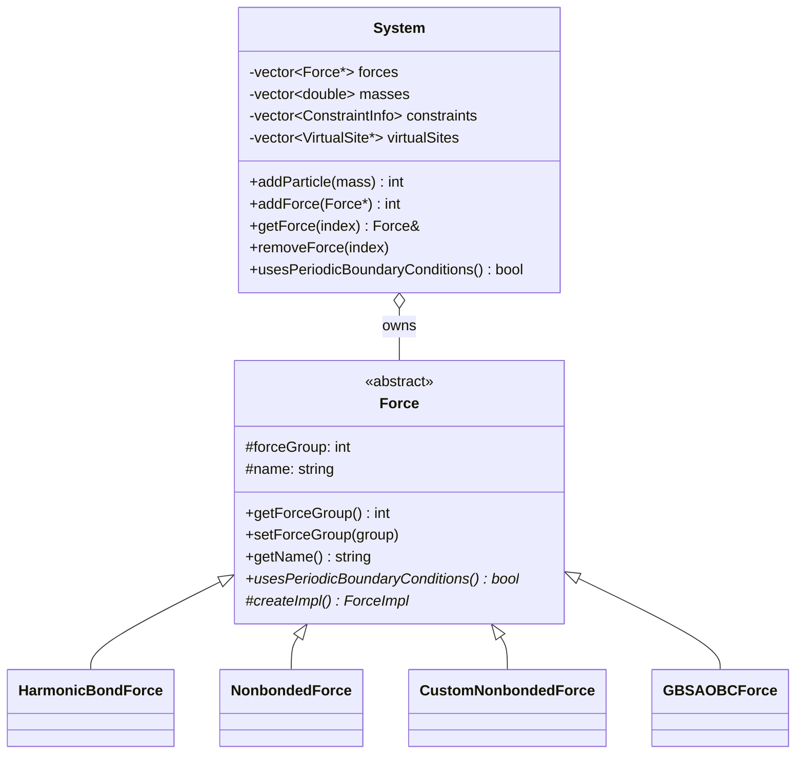

Every molecular simulation in OpenMM is built from the same fundamental contract: a **System** owns particles and a collection of **Force** objects, and each Force defines how those particles interact. This page maps the complete Force class hierarchy, explains the patterns that bind them together, and provides the grounding you need to choose, configure, and extend forces correctly.

## The Force Abstraction

At the top of the hierarchy sits the abstract `Force` class in [Force.h](openmmapi/include/openmm/Force.h#L64-L121). It is deliberately minimal—its public interface provides only three capabilities: **force grouping** for multiple time step integration, **naming** for identification, and a periodic boundary condition query. The real weight of the abstraction lives in a single pure virtual method:

```cpp
virtual ForceImpl* createImpl() const = 0;
```

When a `Context` is created from a `System`, it iterates over every `Force` and calls `createImpl()` to obtain a platform-specific implementation object. This **Factory Method** pattern is the bridge between the platform-independent API and the platform-specific execution backends described in [Platform and Kernel System](8-platform-and-kernel-system). The `ForceImpl` objects live in the `internal/` namespace and are never directly referenced by user code—there is exactly one `ForceImpl` subclass per `Force` subclass, and they are the objects that actually perform force calculations on each platform.

Sources: [Force.h](openmmapi/include/openmm/Force.h#L64-L121), [ForceImpl.h](openmmapi/include/openmm/internal/ForceImpl.h)

## System-Force Lifecycle

A `System` in [System.h](openmmapi/include/openmm/System.h#L64-L246) owns all forces through a `std::vector<Force*>`. When you call `addForce()`, the System takes heap ownership and will delete the Force when the System itself is destroyed. Forces are indexed sequentially—`getForce(index)` returns either a const or mutable reference, and `removeForce(index)` deletes the object and shifts remaining indices.



The `System::usesPeriodicBoundaryConditions()` method at [System.h#L238](openmmapi/include/openmm/System.h#L231-L238) queries every Force and returns true if *any* force reports periodic boundary usage. This is critical for the Context to decide whether to enforce periodic box geometry. If any Force subclass fails to override `usesPeriodicBoundaryConditions()`, an `OpenMMException` is thrown—a deliberate guard against incomplete implementations.

Sources: [System.h](openmmapi/include/openmm/System.h#L179-L205), [System.h](openmmapi/include/openmm/System.h#L231-L238)

## Force Group Architecture

Every Force defaults to group 0. By assigning different group indices (0–31) via `setForceGroup()`, you enable **multiple time step (MTS) integration** where the Integrator evaluates different subsets of forces at different frequencies. The force group is a simple integer stored in the `Force` base class at [Force.h#L119](openmmapi/include/openmm/Force.h#L118-L120). Some complex Force subclasses (notably `NonbondedForce`) expose additional sub-group splitting methods to divide their own computation—for instance, separating direct-space from reciprocal-space PME contributions into different groups.

Platform-specific restrictions may apply: some platforms require all nonbonded forces to reside in the same group, or may limit the total number of distinct groups that can be evaluated efficiently. These constraints are documented per-platform and should be verified when designing MTS schemes.

Sources: [Force.h](openmmapi/include/openmm/Force.h#L56-L62)

## Bonded Forces

Bonded forces model covalent interactions and operate on fixed sets of particles, making them inherently O(N) in cost. They share a consistent API pattern: an `add*()` method to register each interaction, `get*Parameters()`/`set*Parameters()` for inspection and modification, and `updateParametersInContext()` for efficient in-place updates without reinitializing the Context.

### HarmonicBondForce

Defined in [HarmonicBondForce.h](openmmapi/include/openmm/HarmonicBondForce.h#L48-L117), this implements the standard harmonic bond stretch: E = k(r − r₀)². Each bond is registered between two particle indices with an equilibrium length (nm) and force constant (kJ/mol/nm²). Periodic boundary conditions are disabled by default since bonded interactions are local, but can be enabled explicitly for unusual topologies.

### HarmonicAngleForce

Defined in [HarmonicAngleForce.h](openmmapi/include/openmm/HarmonicAngleForce.h#L48-L119), this implements the harmonic angle bend: E = k(θ − θ₀)² over three particle indices. The angle is measured in radians, and the force constant in kJ/mol/radian². The internal `AngleInfo` struct at [HarmonicAngleForce.h#L125-L136](openmmapi/include/openmm/HarmonicAngleForce.h#L125-L136) mirrors the same pattern as `BondInfo`.

### PeriodicTorsionForce and RBTorsionForce

`PeriodicTorsionForce` at [PeriodicTorsionForce.h](openmmapi/include/openmm/PeriodicTorsionForce.h#L48-L126) implements a Fourier-series torsion: E = k(1 + cos(nφ − φ₀)) over four particle indices, where n is the periodicity, φ₀ is the phase, and k is the force constant. Multiple torsion terms can be added for the same dihedral (as is common in force fields like AMBER) by registering them separately.

`RBTorsionForce` implements the Ryckaert-Bellemans torsion polynomial used in OPLS force fields: E = Σ Cᵢ(cos φ)ⁱ, with coefficients C₀ through C₅. It follows the identical API pattern.

### CMAPTorsionForce

Defined in [CMAPTorsionForce.h](openmmapi/include/openmm/CMAPTorsionForce.h#L53-L80), this implements coupled correction maps for pairs of dihedral angles. It stores one or more grid-based energy tables (created via `addMap()`) and then registers interactions between two consecutive torsion angles (five or eight particles depending on overlap). Natural cubic spline interpolation evaluates energies and forces at arbitrary (φ, ψ) angles. This is the mechanism used by the CHARMM force field for backbone torsion corrections.

Sources: [HarmonicBondForce.h](openmmapi/include/openmm/HarmonicBondForce.h#L42-L117), [HarmonicAngleForce.h](openmmapi/include/openmm/HarmonicAngleForce.h#L42-L119), [PeriodicTorsionForce.h](openmmapi/include/openmm/PeriodicTorsionForce.h#L42-L126), [CMAPTorsionForce.h](openmmapi/include/openmm/CMAPTorsionForce.h#L40-L80)

## Nonbonded Forces

Nonbonded forces model pairwise interactions between all particles (or all particles within a cutoff) and are the computational bottleneck of any simulation. OpenMM provides two distinct approaches: a fixed-form `NonbondedForce` and an expression-based `CustomNonbondedForce`.

### NonbondedForce

Defined in [NonbondedForce.h](openmmapi/include/openmm/NonbondedForce.h#L109-L146), this is the workhorse of molecular dynamics. It combines **Coulomb electrostatics** with a **Lennard-Jones 12-6 potential** using the Lorentz-Berthelot combining rule (arithmetic mean for σ, geometric mean for ε). Each particle in the System must have parameters registered via `addParticle(charge, sigma, epsilon)`.

The `NonbondedMethod` enum at [NonbondedForce.h#L114-L146](openmmapi/include/openmm/NonbondedForce.h#L114-L146) provides six long-range handling strategies:

| Method | Description | PBC | Electrostatics | Van der Waals |
|--------|-------------|-----|----------------|---------------|
| `NoCutoff` | Full N² exact | ✗ | Direct sum | Direct sum |
| `CutoffNonPeriodic` | Truncated at cutoff | ✗ | Reaction field | Sharp cutoff |
| `CutoffPeriodic` | Truncated, minimum image | ✓ | Reaction field | Sharp cutoff |
| `Ewald` | Ewald summation | ✓ | Full Ewald | Sharp cutoff |
| `PME` | Particle-Mesh Ewald | ✓ | PME | Sharp cutoff (switching optional) |
| `LJPME` | PME for both terms | ✓ | PME | LJ-PME |

**Exceptions** override the default pairwise parameters for specific particle pairs. This mechanism handles the standard exclusion pattern: 1-2 (bonded) and 1-3 pairs are excluded entirely (chargeProd=0, epsilon=0), while 1-4 pairs receive scaled parameters. The convenience method `createExceptionsFromBonds()` at [NonbondedForce.h#L390-L399](openmmapi/include/openmm/NonbondedForce.h#L390-L399) automates this by analyzing the bond topology and generating all exclusion/exception entries given Coulomb and LJ scale factors.

**Parameter offsets** provide a mechanism for smoothly interpolating particle parameters during a simulation. By calling `addGlobalParameter()` and `addParticleParameterOffset()`, you define a Context-level variable that linearly scales charge, sigma, and epsilon—enabling workflows like lambda-based alchemical free energy calculations without modifying the base Force definition.

Sources: [NonbondedForce.h](openmmapi/include/openmm/NonbondedForce.h#L109-L146), [NonbondedForce.h](openmmapi/include/openmm/NonbondedForce.h#L308-L399), [NonbondedForce.h](openmmapi/include/openmm/NonbondedForce.h#L78-L107)

### GBSAOBCForce

Defined in [GBSAOBCForce.h](openmmapi/include/openmm/GBSAOBCForce.h#L56-L76), this implements the Generalized Born model with the Onufriev-Bashford-Case (OBC) variant for implicit solvation. Each particle requires charge, radius, and a scaling factor. The force computes both the polar solvation (GB) energy and a nonpolar surface area term. Critical constraint: the companion `NonbondedForce` must define identical charges, and its reaction field dielectric should be set to 1.0 when using cutoffs, as documented in the class header at [GBSAOBCForce.h#L49-L54](openmmapi/include/openmm/GBSAOBCForce.h#L49-L54).

Sources: [GBSAOBCForce.h](openmmapi/include/openmm/GBSAOBCForce.h#L40-L76)

## Custom Forces

Custom forces allow you to define arbitrary energy expressions using algebraic formulas interpreted by the [Lepton Expression Engine](18-lepton-expression-engine). They share a common architecture: you provide an energy expression as a string, declare per-particle and global parameters, and the framework handles parsing, differentiation, and compilation for each platform.

### CustomNonbondedForce

The most flexible custom force is [CustomNonbondedForce](openmmapi/include/openmm/CustomNonbondedForce.h#L175-L173). You define an energy expression as a function of `r` (inter-particle distance) and any per-particle parameters (referenced with suffixes `1` and `2`, e.g., `sigma1`, `sigma2`). Intermediate variables can be defined using semicolons as separators. It supports cutoffs, switching functions, interaction groups for selective pair evaluation, exclusions, computed values for per-particle quantities that depend on global parameters, and energy derivatives with respect to global parameters.

```cpp
// Example: re-implementing Lennard-Jones as a CustomNonbondedForce
CustomNonbondedForce* force = new CustomNonbondedForce(
    "4*epsilon*((sigma/r)^12-(sigma/r)^6); "
    "sigma=0.5*(sigma1+sigma2); "
    "epsilon=sqrt(epsilon1*epsilon2)");
force->addPerParticleParameter("sigma");
force->addPerParticleParameter("epsilon");
```

The expression must be symmetric with respect to particle ordering—since it is evaluated once per pair with no guaranteed ordering of which particle is "1" versus "2".

Sources: [CustomNonbondedForce.h](openmmapi/include/openmm/CustomNonbondedForce.h#L44-L173)

### Other Custom Force Variants

OpenMM provides custom force variants for every bonded topology and several nonbonded scenarios:

| Custom Force Class | Interaction Pattern | Topology |
|--------------------|--------------------| ---------|
| `CustomBondForce` | Pair (2 particles) | 1D bonded |
| `CustomAngleForce` | Triplet (3 particles) | 2D bonded |
| `CustomTorsionForce` | Quartet (4 particles) | 3D bonded |
| `CustomExternalForce` | Single particle + global params | External field |
| `CustomGBForce` | All pairs (GB implicit solvent) | Nonbonded |
| `CustomHbondForce` | Donor-acceptor pairs | Nonbonded |
| `CustomCentroidBondForce` | Group centroids | Coarse-grained |
| `CustomCompoundBondForce` | Arbitrary particle sets | General bonded |
| `CustomManyParticleForce` | N-body interactions | General |
| `CustomNonbondedForce` | All pairs | Nonbonded |
| `CustomCVForce` | Collective variables | Metadynamics/CV |
| `CustomVolumeForce` | System volume | Barostat coupling |

### CustomCVForce

[CustomCVForce](openmmapi/include/openmm/CustomCVForce.h#L72-L119) is architecturally unique: collective variables are themselves defined as `Force` objects. Each variable's "energy" output becomes the CV value, and a top-level algebraic expression maps CV values to a biasing energy. This enables metadynamics, umbrella sampling, and any CV-based biasing technique. Because CVs are forces, you can compose them from any other force type—including other custom forces—creating an arbitrarily deep hierarchy.

Sources: [CustomCVForce.h](openmmapi/include/openmm/CustomCVForce.h#L42-L70)

## Utility and Special-Purpose Forces

Several forces exist primarily as building blocks for more complex simulation setups rather than as standalone energy terms.

`RMSDForce` at [RMSDForce.h](openmmapi/include/openmm/RMSDForce.h#L53-L66) computes the root-mean-square deviation between current positions and a reference structure (with optimal alignment). Its energy output is the RMSD value itself, making it meaningful only when wrapped inside a `CustomCVForce` for biasing or restraint.

`ATMForce` implements the Accelerated Molecular Dynamics method. `GayBerneForce` provides anisotropic Lennard-Jones interactions for coarse-grained ellipsoidal particles. `ConstantPotentialForce` enables constant-potential electrostatics. `LCPOForce` computes surface areas using the Linear Combination of Pairwise Overlaps method. `RGForce` computes the radius of gyration as an energy term (again, for CV-based use). `OrientationRestraintForce` applies orientational restraints between particle frames.

Sources: [RMSDForce.h](openmmapi/include/openmm/RMSDForce.h#L40-L51), [ATMForce.h](openmmapi/include/openmm/ATMForce.h), [GayBerneForce.h](openmmapi/include/openmm/GayBerneForce.h), [ConstantPotentialForce.h](openmmapi/include/openmm/ConstantPotentialForce.h)

## Parameter Update Patterns

All Force subclasses that store per-interaction parameters expose a consistent pattern for modifying parameters during simulation. The workflow is:

1. **Modify** the Force object in memory using `set*Parameters()`.
2. **Propagate** changes to the Context using `updateParametersInContext()`.
3. The Context applies changes **without reinitialization**, preserving velocities, positions, and internal state.

This pattern is visible across every bonded force (e.g., [HarmonicBondForce.h#L88-L97](openmmapi/include/openmm/HarmonicBondForce.h#L88-L97)), nonbonded forces ([NonbondedForce.h](openmmapi/include/openmm/NonbondedForce.h#L339-L339)), and custom forces. The constraint is that you cannot change the *topology*—the set of particles involved in each interaction is immutable after Context creation. Only numeric parameter values (force constants, charges, distances) can be updated in place.

> [!TIP]
> When using `updateParametersInContext()` with `NonbondedForce`, exception parameters are also updatable. However, the number of exceptions and the particles they involve cannot change. For alchemical transformations where you need to modify which pairs interact, use parameter offsets (`addParticleParameterOffset`) instead of modifying exceptions directly.

## Complete Force Class Reference

The following table provides a comprehensive index of every standard Force class in the `openmmapi/include/openmm/` directory:

| Force Class | Category | PBC Required | Particle Scope | Energy Expression |
|------------|----------|-------------|----------------|-------------------|
| `HarmonicBondForce` | Bonded | Optional (off) | Pairs | k(r−r₀)² |
| `HarmonicAngleForce` | Bonded | Optional (off) | Triplets | k(θ−θ₀)² |
| `PeriodicTorsionForce` | Bonded | Optional (off) | Quartets | k(1+cos(nφ−φ₀)) |
| `RBTorsionForce` | Bonded | Optional (off) | Quartets | Σ Cᵢ(cos φ)ⁱ |
| `CMAPTorsionForce` | Bonded | Optional (off) | 5/8 particles | Spline-interpolated grid |
| `NonbondedForce` | Nonbonded | Method-dependent | All pairs | Coulomb + LJ 12-6 |
| `GBSAOBCForce` | Implicit solvent | Optional | All pairs | GB-OBC + surface area |
| `CustomNonbondedForce` | Custom | Optional | All pairs / groups | User expression |
| `CustomBondForce` | Custom | No | Pairs | User expression |
| `CustomAngleForce` | Custom | No | Triplets | User expression |
| `CustomTorsionForce` | Custom | No | Quartets | User expression |
| `CustomExternalForce` | Custom | No | Single particles | User expression |
| `CustomGBForce` | Custom | Optional | All pairs | User expression |
| `CustomHbondForce` | Custom | Optional | Donor-acceptor | User expression |
| `CustomCVForce` | Custom CV | Per sub-force | Collective variables | User expression |
| `CustomCentroidBondForce` | Custom | Optional | Group centroids | User expression |
| `CustomCompoundBondForce` | Custom | No | Arbitrary sets | User expression |
| `CustomManyParticleForce` | Custom | No | N-body | User expression |
| `CustomVolumeForce` | Custom | N/A | System volume | User expression |
| `RMSDForce` | Utility | No | All / subset | RMSD value |
| `ATMForce` | Enhanced sampling | N/A | N/A | Accelerated MD |
| `GayBerneForce` | Anisotropic | Optional | All pairs | Gay-Berne |
| `ConstantPotentialForce` | Electrostatics | Yes | All pairs | Constant potential |
| `RGForce` | Utility | No | All / subset | Radius of gyration |
| `LCPOForce` | Surface area | No | All particles | LCPO surface area |
| `OrientationRestraintForce` | Restraint | No | Particle frames | Orientational restraint |

## Relationship to Other Architecture Layers

Force classes occupy a central position in OpenMM's architecture. They are consumed by the `System`, instantiated into platform-specific `ForceImpl` objects by the `Context`, and their execution is orchestrated by the `Integrator`. The force group mechanism at the `Force` base class level directly feeds into the multiple time step logic described in [Integrator Hierarchy](12-integrator-hierarchy).

For plugin developers, the Force/ForceImpl duality is the extension point: a new force type requires a new `Force` subclass in the public API and corresponding `ForceImpl` subclasses for each target platform, as detailed in [Plugin Architecture](20-plugin-architecture). The Amoeba polarizable force field plugin demonstrates this pattern extensively with force types like `AmoebaMultipoleForce` and `AmoebaVdwForce` that live outside the core API.

For users who prefer a higher-level interface, the [ForceField and System Generation](15-forcefield-and-system-generation) page describes how XML force field definitions are automatically translated into these Force objects, and [Custom Forces and Integrators](17-custom-forces-and-integrators) provides deeper treatment of the expression language and advanced custom force composition patterns.