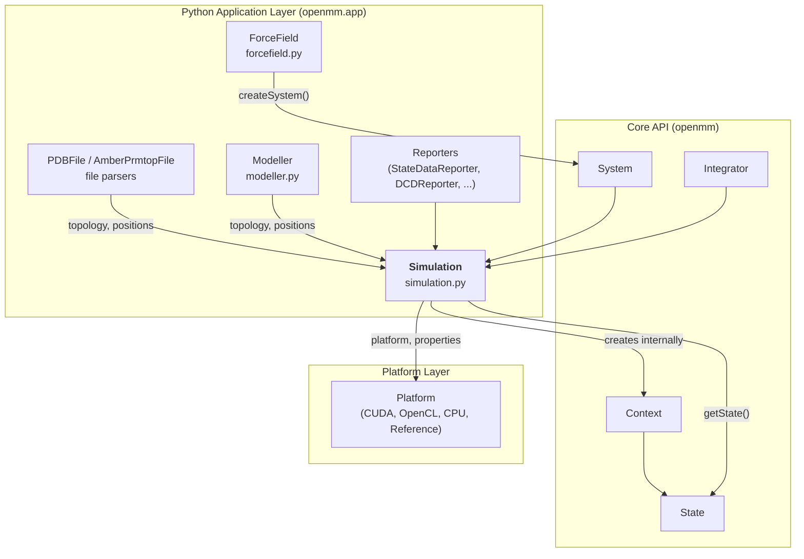
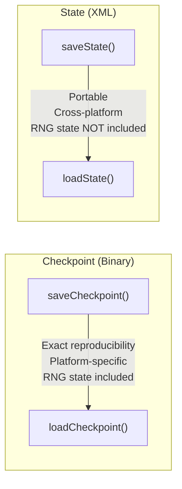
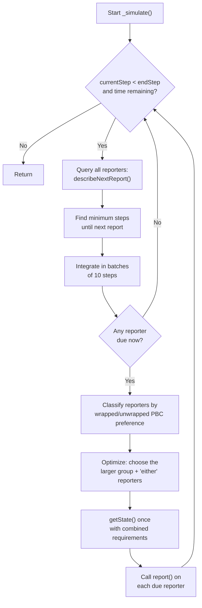
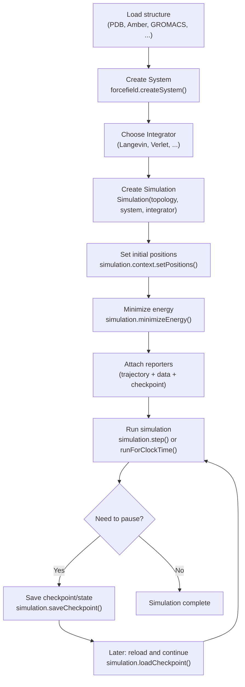

The `Simulation` class is your primary entry point for running molecular dynamics simulations with OpenMM in Python. It wraps the lower-level OpenMM objects — **Topology**, **System**, **Integrator**, and **Context** — into a single, convenient interface that handles the most common simulation workflows: minimizing energy, advancing time steps, collecting trajectory data, and checkpointing progress. If you are just getting started with OpenMM, this is the class you will use most often.

Sources: [simulation.py](wrappers/python/openmm/app/simulation.py#L43-L56), [__init__.py](wrappers/python/openmm/app/__init__.py#L20)

## How Simulation Fits Into OpenMM

Before diving into the API, it helps to see where `Simulation` lives in the broader OpenMM architecture. The class sits in the **Python application layer** (`openmm.app`), bridging the gap between the core C++ simulation engine (exposed through `openmm` as `mm`) and the high-level tools for loading molecular structures and force fields.



The key insight is that `Simulation` **creates the `Context` for you**. At the core API level (described in [System and Context](11-system-and-context)), you would manually call `mm.Context(system, integrator, platform)`. The `Simulation` class automates this step while also managing reporters and providing convenience methods for common operations.

Sources: [simulation.py](wrappers/python/openmm/app/simulation.py#L97-L105)

## The Reporter Architecture

One of the most important design patterns in `Simulation` is the **reporter system**. Instead of manually extracting positions and energies every N steps, you attach reporter objects to the simulation's `reporters` list. Each reporter declares when it needs data and what data it needs, and the simulation loop coordinates all reporters efficiently.

Every reporter implements two methods:

| Method | Purpose | Return Value |
|---|---|---|
| `describeNextReport(simulation)` | Declares how many steps until the next report is needed, and which state data (positions, velocities, forces, energy) is required | A `dict` with keys: `steps`, `periodic`, `include` |
| `report(simulation, state)` | Processes the current state to write output files, print data, or save checkpoints | None |

The simulation's internal loop ([`_simulate()`](wrappers/python/openmm/app/simulation.py#L197-L262)) queries every reporter before each batch of steps to find the earliest requested report, takes only as many steps as needed, then collects the shared state data once and passes it to all reporters that are due. This avoids redundant `getState()` calls when multiple reporters trigger at the same step.

Sources: [simulation.py](wrappers/python/openmm/app/simulation.py#L197-L282)

## Creating a Simulation

The constructor requires three core objects and accepts optional arguments for platform selection and state restoration:

```python
simulation = Simulation(topology, system, integrator, platform=None, platformProperties=None, state=None)
```

| Parameter | Type | Required | Description |
|---|---|---|---|
| `topology` | `Topology` | Yes | Describes the molecular structure (atoms, bonds, residues) |
| `system` | `System` or XML filename | Yes | The OpenMM `System` defining forces and constraints |
| `integrator` | `Integrator` or XML filename | Yes | The integration algorithm and its parameters |
| `platform` | `Platform` | No | If specified, runs on this platform (e.g., CUDA, OpenCL, CPU) |
| `platformProperties` | `dict` | No | Platform-specific properties (e.g., `{'DeviceIndex': '0'}`) |
| `state` | XML filename | No | A serialized `State` to restore positions, velocities, and parameters |

All three core arguments (`topology`, `system`, `integrator`) can also be provided as **XML filenames** — OpenMM will deserialize them automatically. This is useful for restarting simulations from saved files.

Sources: [simulation.py](wrappers/python/openmm/app/simulation.py#L58-L114)

## A Minimal Working Example

Here is the most common pattern for creating and running a simulation, taken directly from OpenMM's official examples. This pattern is identical across all supported file formats (PDB, Amber, CHARMM, GROMACS, Tinker):

```python
from openmm.app import *
from openmm import *
from openmm.unit import *

# 1. Load structure and create the system
pdb = PDBFile('input.pdb')
forcefield = ForceField('amber19-all.xml', 'amber19/tip3pfb.xml')
system = forcefield.createSystem(pdb.topology,
    nonbondedMethod=PME,
    nonbondedCutoff=1*nanometer,
    constraints=HBonds)

# 2. Choose an integrator
integrator = LangevinMiddleIntegrator(
    300*kelvin,       # temperature
    1/picosecond,     # friction coefficient
    0.004*picoseconds # time step
)

# 3. Create the Simulation
simulation = Simulation(pdb.topology, system, integrator)

# 4. Set initial positions
simulation.context.setPositions(pdb.positions)

# 5. Minimize energy
simulation.minimizeEnergy()

# 6. Attach reporters
simulation.reporters.append(DCDReporter('output.dcd', 1000))
simulation.reporters.append(StateDataReporter(stdout, 1000,
    step=True, potentialEnergy=True, temperature=True))

# 7. Run
simulation.step(10000)
```

Sources: [simulateAmber.py](examples/python-examples/simulateAmber.py#L1-L16), [simulatePdb.py](examples/python-examples/simulatePdb.py#L1-L16)

## Core Methods

### `step(steps)` — Advance the Simulation

This is the simplest way to advance the simulation. It integrates the system forward by exactly `steps` time steps. During execution, it delegates to the internal [`_simulate()`](wrappers/python/openmm/app/simulation.py#L197) method, which also triggers any reporters whose `reportInterval` has been reached.

```python
simulation.step(10000)  # Advance 10,000 time steps
```

Internally, the integrator is called in batches of 10 steps at a time. This design ensures that Python can respond to `Ctrl+C` interrupts promptly, rather than being blocked inside a single long C++ call for thousands of steps.

Sources: [simulation.py](wrappers/python/openmm/app/simulation.py#L144-L149), [simulation.py](wrappers/python/openmm/app/simulation.py#L227-L232)

### `minimizeEnergy()` — Local Energy Minimization

Before running dynamics, it is standard practice to minimize the system's energy to remove bad contacts in the initial structure. This method delegates to `mm.LocalEnergyMinimizer.minimize()`.

```python
simulation.minimizeEnergy()
```

| Parameter | Default | Description |
|---|---|---|
| `tolerance` | 10 kJ/mol/nm | RMS force convergence criterion |
| `maxIterations` | 0 (unlimited) | Maximum minimization iterations |
| `reporter` | None | Optional `MinimizationReporter` callback |

Sources: [simulation.py](wrappers/python/openmm/app/simulation.py#L125-L142)

### `runForClockTime(time)` — Time-Bounded Simulation

This method is designed for cluster or cloud environments where you have a fixed wall-clock budget. It runs the simulation until the specified time elapses, then optionally writes checkpoint and state files.

```python
# Run for 4 hours, saving checkpoints every 30 minutes
simulation.runForClockTime(4*hours,
    checkpointFile='checkpoint.chk',
    stateFile='state.xml',
    checkpointInterval=0.5*hours)
```

If no units are attached to the time arguments, they default to **hours**. This is the only method in `Simulation` with implicit unit behavior.

Sources: [simulation.py](wrappers/python/openmm/app/simulation.py#L151-L195)

### `currentStep` — Tracking Progress

A property that reads and writes the current step counter through the underlying `Context`:

```python
print(simulation.currentStep)   # Read current step
simulation.currentStep = 1000   # Set step counter (useful when restarting)
```

Sources: [simulation.py](wrappers/python/openmm/app/simulation.py#L116-L123)

## Built-In Reporters

OpenMM ships with six reporter classes that cover the most common output needs. Each is added to the simulation via `simulation.reporters.append()`.

### Trajectory Reporters

| Reporter | File Format | Key Parameters | Best For |
|---|---|---|---|
| `PDBReporter` | PDB | `file`, `reportInterval`, `enforcePeriodicBox`, `atomSubset` | Visual inspection, small systems |
| `PDBxReporter` | mmCIF/PDBx | Same as PDBReporter | Macromolecular Crystallographic Info standard |
| `DCDReporter` | DCD | `file`, `reportInterval`, `append`, `enforcePeriodicBox`, `atomSubset` | Long trajectories, efficient binary format |
| `XTCReporter` | XTC | `file`, `reportInterval`, `append`, `enforcePeriodicBox`, `atomSubset` | GROMACS-compatible trajectories, compressed |

Both `DCDReporter` and `XTCReporter` support the `append` parameter to continue writing to an existing file, and the `atomSubset` parameter to write only selected atoms (e.g., protein-only output from a solvated system).

Sources: [pdbreporter.py](wrappers/python/openmm/app/pdbreporter.py#L36-L44), [dcdreporter.py](wrappers/python/openmm/app/dcdreporter.py#L35-L42), [xtcreporter.py](wrappers/python/openmm/app/xtcreporter.py#L32-L56)

### Data Reporter

`StateDataReporter` writes simulation observables to a file (or `stdout`) in CSV format. You control exactly which columns appear via boolean flags:

```python
simulation.reporters.append(StateDataReporter(
    'data.csv', 1000,                # file, interval
    step=True,                       # step number
    time=True,                       # simulation time
    potentialEnergy=True,            # potential energy
    kineticEnergy=True,              # kinetic energy
    totalEnergy=True,                # total energy
    temperature=True,                # instantaneous temperature
    volume=True,                     # periodic box volume
    density=True,                    # system density
    progress=True,                   # progress bar
    remainingTime=True,              # estimated time remaining
    speed=True,                      # steps/second
    separator=','                    # column delimiter
))
```

The reporter automatically detects the total system mass on first invocation and calculates derived quantities (temperature, density) from kinetic energy and box volume.

Sources: [statedatareporter.py](wrappers/python/openmm/app/statedatareporter.py#L49-L58), [statedatareporter.py](wrappers/python/openmm/app/statedatareporter.py#L214-L289)

### Checkpoint Reporter

`CheckpointReporter` periodically saves either a full **checkpoint** (binary, platform-specific) or a serialized **State** (XML, portable). Checkpoints include internal data like random number generator states for exact reproducibility; states contain only public data (positions, velocities, parameters).

```python
# Binary checkpoint (exact restart, same platform required)
simulation.reporters.append(CheckpointReporter('checkpoint.chk', 5000))

# XML state (portable across platforms)
simulation.reporters.append(CheckpointReporter('state.xml', 5000, writeState=True))
```

Each checkpoint **overwrites** the previous one — only the latest state is retained in the file.

Sources: [checkpointreporter.py](wrappers/python/openmm/app/checkpointreporter.py#L36-L77)

## Saving and Restoring Simulation State

Beyond the reporter-based approach, `Simulation` provides four methods for manual state persistence. Understanding the distinction between **checkpoints** and **states** is critical.



| Feature | `saveCheckpoint()` / `loadCheckpoint()` | `saveState()` / `loadState()` |
|---|---|---|
| **Format** | Binary | XML |
| **Portability** | Same platform, hardware, and OpenMM version only | Cross-platform, cross-version |
| **RNG State** | Included (exact trajectory reproducibility) | Not included (trajectory will differ) |
| **Restored Data** | Positions, velocities, internal states | Positions, velocities, parameters |
| **Use Case** | Interrupted job recovery on same machine | Transferring state to different hardware |

Both methods use **safe saving** internally — they write to a temporary file first and then atomically rename it. This prevents data corruption if the process is killed mid-write.

> [!TIP]
> When restarting a simulation after loading a checkpoint or state, you do **not** need to call `setPositions()` again. The loaded data fully restores the context state. However, you should still re-attach your reporters since the `reporters` list is not serialized.

Sources: [simulation.py](wrappers/python/openmm/app/simulation.py#L283-L360), [checkpointreporter.py](wrappers/python/openmm/app/checkpointreporter.py#L54-L76)

## Selecting a Platform and Device

You can control which hardware platform the simulation runs on by passing a `Platform` object. This is useful for GPU acceleration or reproducible benchmarking:

```python
from openmm import Platform

# Run on CUDA (NVIDIA GPU)
platform = Platform.getPlatformByName('CUDA')
simulation = Simulation(topology, system, integrator, platform,
    platformProperties={'DeviceIndex': '0', 'Precision': 'mixed'})

# Run on the Reference platform (CPU, slow, for debugging)
platform = Platform.getPlatformByName('Reference')
simulation = Simulation(topology, system, integrator, platform)
```

Platform properties are passed as a dictionary. Available properties vary by platform — see [Platform and Kernel System](8-platform-and-kernel-system) for details. Each platform also exposes a `getDevices()` method that returns available hardware devices with their properties, which can be passed directly as `platformProperties`.

Sources: [simulation.py](wrappers/python/openmm/app/simulation.py#L97-L105), [TestSimulation.py](wrappers/python/tests/TestSimulation.py#L299-L321)

## Internal Simulation Loop

For deeper understanding (or if you plan to write custom reporters), it is worth knowing how the simulation loop works. The [`_simulate()`](wrappers/python/openmm/app/simulation.py#L197-L262) method orchestrates everything:



Two important optimization details in this loop: (1) the integrator steps in batches of 10 to keep Python responsive to interrupts, and (2) when multiple reporters need state data at the same step, the simulation computes a **union** of their requested data fields and calls `getState()` only once, then passes the shared state to each reporter individually.

Sources: [simulation.py](wrappers/python/openmm/app/simulation.py#L197-L282)

## Typical Simulation Workflow

Putting it all together, here is the canonical flowchart for a complete simulation pipeline using the `Simulation` class:



## Next Steps

Now that you understand the `Simulation` class, here are the natural next topics to explore:

- **[ForceField and System Generation](15-forcefield-and-system-generation)** — Learn how `ForceField.createSystem()` builds the `System` object with specific force field parameters, cutoffs, and constraints.
- **[Integrator Hierarchy](12-integrator-hierarchy)** — Understand the different integration algorithms (Langevin, Verlet, Brownian, Nosé-Hoover) and when to use each.
- **[Modeller and Topology](16-modeller-and-topology)** — Explore how to modify systems (add solvent, add ions, delete atoms) before creating your simulation.
- **[System and Context](11-system-and-context)** — For advanced use cases, learn how to bypass `Simulation` and work directly with the core API for maximum control.