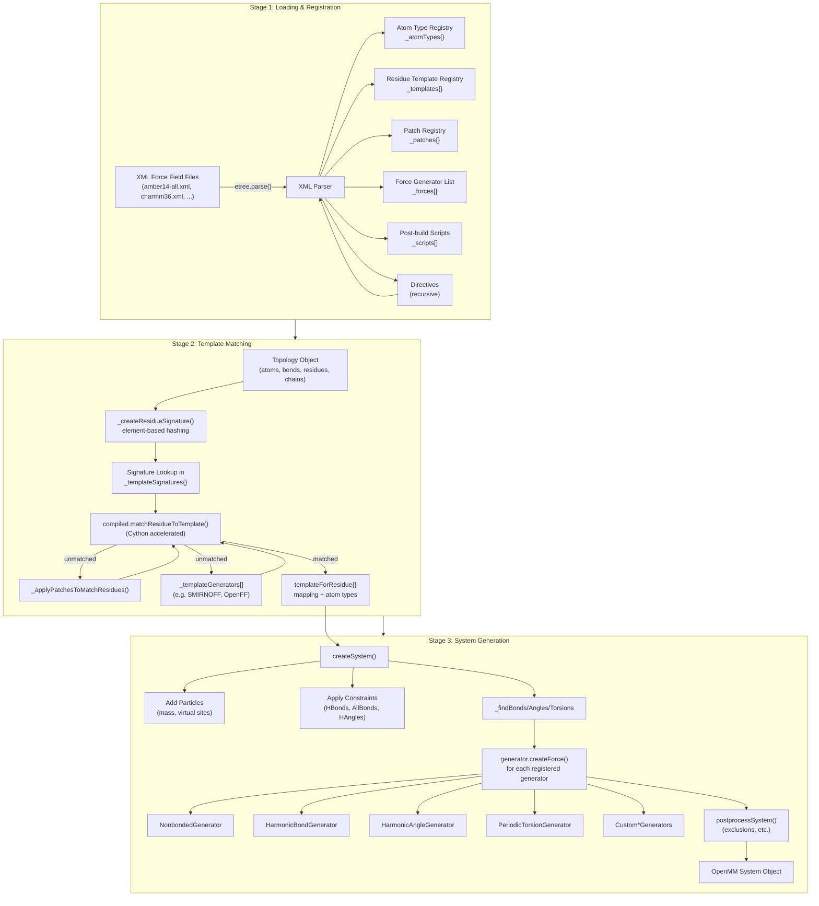

The `ForceField` class is the central bridge between chemical topology and executable simulation systems in OpenMM. It accepts a molecular `Topology` — a purely structural description of atoms, bonds, residues, and chains — and transforms it into a fully parameterized `System` object containing all the physics: forces, constraints, masses, virtual sites, and periodic boundary conditions. This page dissects the architecture of that transformation, from XML definition through template matching to force generation, providing intermediate developers with the knowledge needed to extend, debug, and customize the system-building pipeline.

Sources: [forcefield.py](wrappers/python/openmm/app/forcefield.py#L195-L220)

## Architectural Overview

The ForceField system follows a three-stage pipeline that converts declarative XML force field definitions into a concrete `System` object. At a high level, the flow is: **load** XML definitions into in-memory registries, **match** residues in a `Topology` to registered templates, and **generate** forces by invoking registered generator objects. Each stage is independently extensible, and the pipeline is orchestrated by a single `ForceField` instance.



Sources: [forcefield.py](wrappers/python/openmm/app/forcefield.py#L222-L429), [forcefield.py](wrappers/python/openmm/app/forcefield.py#L1231-L1508)

## ForceField Initialization and XML Loading

### Constructor and File Resolution

A `ForceField` is instantiated with one or more XML file paths. The constructor accepts absolute paths, relative paths (resolved against the current working directory), names of built-in force fields (resolved against the `openmm/app/data/` directory), or open file-like objects. Internally, it delegates to `loadFile()` which handles the full parsing pipeline.

Sources: [forcefield.py](wrappers/python/openmm/app/forcefield.py#L198-L220)

The file resolution mechanism consults a list of data directories via `_getDataDirectories()`, which returns paths to the bundled `openmm/app/data/` directory as well as any user-configured directories from the `OPENMM_DATA_PATH` environment variable. This is how a simple call like `ForceField('amber14-all.xml')` locates the bundled definition without requiring absolute paths.

Sources: [forcefield.py](wrappers/python/openmm/app/forcefield.py#L53-L78)

### XML Structure and Include Directives

Force field XML files follow a hierarchical `<ForceField>` root element structure. They support `<Include>` directives for modular composition — the file `amber14-all.xml` is a minimal aggregator that includes four sub-files for proteins, DNA, RNA, and lipids:

```xml
<ForceField>
 <Include file="amber14/protein.ff14SB.xml"/>
 <Include file="amber14/DNA.OL15.xml"/>
 <Include file="amber14/RNA.OL3.xml"/>
 <Include file="amber14/lipid17.xml"/>
</ForceField>
```

The parser resolves `<Include>` paths relative to the parent file's directory and processes them recursively. Circular includes are prevented by tracking already-loaded files. Each sub-file contributes atom types, residue templates, patches, force generators, and scripts to the shared registries.

Sources: [forcefield.py](wrappers/python/openmm/app/forcefield.py#L270-L282), [amber14-all.xml](wrappers/python/openmm/app/data/amber14-all.xml#L1-L6)

### Registry Loading Sequence

`loadFile()` processes XML trees in a strict, ordered sequence to ensure dependencies are satisfied before use:

1. **Atom types** — parsed from `<AtomTypes>/<Type>` elements into `_atomTypes{}`, keyed by type name. Each atom type records a `class`, `mass`, and optional `element`.
2. **Residue templates** — parsed from `<Residues>/<Residue>` elements into `_templates{}`, keyed by residue name. Templates store atom definitions (name, type, charge), internal bonds, external bonds, virtual sites, and constraints. An `override` attribute governs precedence when multiple files define the same residue name.
3. **Patches** — parsed from `<Patches>/<Patch>` elements into `_patches{}`. Patches can add, remove, or change atoms and bonds in matched templates.
4. **Force generators** — each XML child element whose tag is in the `parsers` dictionary triggers a `parseElement()` static method that creates and registers a generator. The `parsers` dictionary maps tag names like `"HarmonicBondForce"`, `"NonbondedForce"`, etc. to their respective generator class methods.
5. **Scripts** — `<Script>` elements register Python code strings that execute after system building completes. `<InitializationScript>` elements execute immediately during loading.

Sources: [forcefield.py](wrappers/python/openmm/app/forcefield.py#L284-L428)

### The Atom Type Registry

Atom types are the fundamental vocabulary of the force field. Each type maps a name to a class, mass, and element. The `registerAtomType()` method enforces consistency — if a type is registered twice, the definitions must be identical, or a `ValueError` is raised. Atom classes group related types into sets within `_atomClasses{}`; the empty string key `'': set()` always contains all registered types. This class grouping is essential for parameter lookup by class rather than exact type name.

Sources: [forcefield.py](wrappers/python/openmm/app/forcefield.py#L438-L462)

### The Residue Template Registry

Residue templates define the atomic composition, connectivity, and default parameters for each residue type. The `registerResidueTemplate()` method implements a **priority-based override system**: each template carries an `overrideLevel` (default 0). When a duplicate name is registered, the higher-override-level template replaces the lower one; equal levels raise an error. Templates are also indexed by **element signature** — a tuple of sorted element symbols in the residue — via `_createResidueSignature()`, enabling fast candidate filtering during template matching.

Sources: [forcefield.py](wrappers/python/openmm/app/forcefield.py#L464-L488), [forcefield.py](wrappers/python/openmm/app/forcefield.py#L1715-L1730)

## Built-in Force Field Bundles

OpenMM ships with a substantial library of pre-defined force fields in `wrappers/python/openmm/app/data/`. These cover the major biomolecular and small-molecule force field families:

| Category | Files | Description |
|----------|-------|-------------|
| **AMBER Protein** | `amber14-all.xml`, `amber19-all.xml` | Bundled protein + nucleic acid + lipid definitions |
| **AMBER Legacy** | `amber96.xml`, `amber99sb.xml`, `amber99sbildn.xml`, `amber99sbnmr.xml`, `amberfb15.xml` | Individual historical protein force fields |
| **AMBER Implicit** | `amber03_obc.xml`, `amber10_obc.xml`, `amber96_obc.xml`, `amber99_obc.xml` | GBSA-OBC implicit solvent variants |
| **CHARMM** | `charmm36.xml`, `charmm36_2024.xml` | Protein + nucleic acid + lipid parameters |
| **CHARMM Polarizable** | `charmm_polar_2013.xml`, `charmm_polar_2019.xml`, `charmm_polar_2023.xml` | Drude polarizable force fields |
| **Amoeba** | `amoeba2009.xml`, `amoeba2013.xml`, `amoeba2018.xml` | Multipole-based polarizable force fields |
| **Water Models** | `tip3p.xml`, `tip3pfb.xml`, `tip4pew.xml`, `tip4pfb.xml`, `tip5p.xml`, `spce.xml`, `opc.xml`, `opc3.xml`, `swm4ndp.xml` | Standard and optimized water models |
| **Implicit Solvent** | `implicit/*.xml` | GB-Neck and related implicit solvent models |
| **Carbohydrates** | `glycam-hydrogens.xml` | GLYCAM force field |

Sources: [data/](wrappers/python/openmm/app/data)

## Nonbonded Methods and Constraint Enums

The `ForceField` module defines a set of **singleton enum classes** that serve as symbolic constants for nonbonded treatment and constraint strategies. Each is instantiated once at module level and used by name throughout the API.

### Nonbonded Treatment Methods

| Singleton | `NonbondedForce` Method Constant | Description |
|-----------|----------------------------------|-------------|
| `NoCutoff` | `NoCutoff` | No cutoff; all pairs interact directly. Suitable for gas phase or very small systems. |
| `CutoffNonPeriodic` | `CutoffNonPeriodic` | Truncate interactions at a cutoff distance; no periodic boundary conditions. Gas phase clusters. |
| `CutoffPeriodic` | `CutoffPeriodic` | Truncate interactions at a cutoff distance; use periodic boundary conditions for minimum image convention. |
| `Ewald` | `Ewald` | Standard Ewald summation for electrostatics with a cutoff. Accurate but slower than PME. |
| `PME` | `PME` | Particle Mesh Ewald for electrostatics; Lennard-Jones uses reaction field. The default for biomolecular simulations. |
| `LJPME` | `LJPME` | PME for both electrostatics and Lennard-Jones. More accurate dispersion treatment at additional cost. |

### Constraint Strategies

| Singleton | Constraints Applied | Typical Use |
|-----------|--------------------|-------------|
| `None` | None (besides template-specified) | Gas phase, maximum flexibility |
| `HBonds` | Bonds involving hydrogen | SHAKE-like; allows 2 fs timestep |
| `AllBonds` | All bonds | SETTLE-like; bonds fully constrained |
| `HAngles` | All bonds + angles with two H atoms (or H-X-H where X=O) | Maximum constraint; allows 4+ fs timestep with LINCS/SETTLE |

Sources: [forcefield.py](wrappers/python/openmm/app/forcefield.py#L144-L190)

## The `createSystem()` Method

`createSystem()` is the primary public interface that transforms a `Topology` into an `System`. It accepts the topology and a rich set of configuration parameters that control nonbonded treatment, constraints, mass repartitioning, and force field-specific options.

### Parameter Reference

| Parameter | Type | Default | Description |
|-----------|------|---------|-------------|
| `topology` | `Topology` | *(required)* | The molecular topology to parameterize |
| `nonbondedMethod` | Singleton | `NoCutoff` | Nonbonded interaction treatment (see table above) |
| `nonbondedCutoff` | `Quantity` | `1.0*nm` | Cutoff distance for nonbonded interactions |
| `constraints` | Singleton | `None` | Constraint strategy (`None`, `HBonds`, `AllBonds`, `HAngles`) |
| `rigidWater` | `bool` or `None` | `None` | Force rigid water regardless of constraints; `None` uses force field default |
| `removeCMMotion` | `bool` | `True` | Add a `CMMotionRemover` to prevent global drift |
| `hydrogenMass` | `Quantity` | `None` | Repartition mass to hydrogens; mass subtracted from parent heavy atom |
| `residueTemplates` | `dict` | `{}` | Manual override of template selection per residue |
| `ignoreExternalBonds` | `bool` | `False` | Skip external bond checking during template matching |
| `switchDistance` | `Quantity` | `None` | Enable Lennard-Jones switching function at this distance |
| `flexibleConstraints` | `bool` | `False` | Add force parameters even for constrained degrees of freedom |
| `drudeMass` | `Quantity` | `0.4*amu` | Mass assigned to Drude particles |
| `**args` | `dict` | — | Force-field-specific keyword arguments (e.g., `ewaldErrorTolerance`) |

Sources: [forcefield.py](wrappers/python/openmm/app/forcefield.py#L1231-L1288)

### System Generation Pipeline

The `createSystem()` method executes a carefully ordered sequence of operations to produce the final `System`:

**Step 1 — Template Matching.** The method calls `_matchAllResiduesToTemplates()`, which iterates over every residue in the topology and attempts to find a matching template. For user-specified templates (via `residueTemplates`), a direct match is attempted first. For all other residues, the element-signature-based lookup runs, followed by patch application, template generators, and whole-molecule merging as fallback strategies.

**Step 2 — Atom Class Assignment.** After templates are matched, `data.setAtomClasses(self)` computes atom classes once for reuse by all generators — this is critical for Amoeba multipole forces where class-based lookups are frequent.

**Step 3 — Particle Creation.** An empty `mm.System()` is created and particles are added with masses from the matched atom types. If `hydrogenMass` is specified, mass is transferred from each heavy atom to its bonded hydrogens (excluding rigid water residues) to enable longer timesteps.

**Step 4 — Periodic Box Setup.** If the topology provides box vectors (e.g., from a PDB with CRYST1 records), they are set as default periodic box vectors. If a periodic nonbonded method is requested but no box vectors exist, a `ValueError` is raised.

**Step 5 — Topology Enumeration.** Bonds, angles, proper torsions, and improper torsions are enumerated from the bond graph. Angles are derived from all pairs of bonds sharing an atom; proper torsions from all pairs of angles sharing two atoms; impropers from all atoms with more than two bonds (all 3-atom subsets).

**Step 6 — Constraint Identification.** Bonds and angles are flagged for constraints based on the `constraints` parameter, `rigidWater` setting, and template-specified constraints. Template-specified constraints always take precedence.

**Step 7 — Virtual Site Setup.** Virtual sites defined in templates (types: `average2`, `average3`, `outOfPlane`, `localCoords`) are added to the System, and exclusion pairs are registered.

**Step 8 — Force Generation.** Each registered generator's `createForce()` method is called in registration order, receiving the System, the system data, nonbonded method, cutoff, and extra arguments. This is the core extensibility point — every `<HarmonicBondForce>`, `<NonbondedForce>`, etc. in the XML has been parsed into a generator that now materializes the actual `Force` object.

**Step 9 — Post-processing.** Generators that define a `postprocessSystem()` method are called to perform work that requires the complete set of forces. The most important example is `NonbondedGenerator.postprocessSystem()`, which creates 1-2-3 and 1-4 exclusion exceptions from the bond topology after all forces are present.

**Step 10 — Template Constraints.** Constraints explicitly defined in residue templates are applied last, overriding any previously-set constraint distances for the same atom pairs.

**Step 11 — Script Execution.** Any Python code registered via `<Script>` XML elements is executed in the local namespace, allowing force fields to perform arbitrary post-processing (e.g., adding custom forces or modifying parameters programmatically).

Sources: [forcefield.py](wrappers/python/openmm/app/forcefield.py#L1290-L1508)

## Template Matching Mechanism

Template matching is the most architecturally interesting component of the ForceField system. It must reliably map each residue in an arbitrary topology to exactly one parameterized template, handling ambiguity, missing templates, terminal modifications, and novel molecules.

### Element Signature Filtering

When matching a residue, the system first computes its **element signature** — a tuple of sorted element symbols for all atoms in the residue. For example, alanine (C₃H₇NO₂) produces the signature `('C', 'C', 'C', 'H', 'H', 'H', 'H', 'H', 'H', 'H', 'N', 'O', 'O')`. This signature is used as a key into `_templateSignatures{}`, which maps each signature to a list of candidate templates. This pre-filtering dramatically reduces the search space from all templates to only those with the same elemental composition.

Sources: [forcefield.py](wrappers/python/openmm/app/forcefield.py#L1069-L1078), [forcefield.py](wrappers/python/openmm/app/forcefield.py#L1715-L1730)

### The Matching Cascade

`_matchAllResiduesToTemplates()` implements a multi-level fallback strategy for each residue:

1. **User override** — If the residue is in the `residueTemplates` dictionary, use that template directly.
2. **Custom matchers** — Iterate over `_templateMatchers[]` (registered via `registerTemplateMatcher()`), giving each a chance to override default matching logic.
3. **Signature-based lookup** — Find all templates with the same element signature, then call `compiled.matchResidueToTemplate()` (Cython-accelerated) to verify full structural compatibility (atom names, bond connectivity, external bond count, etc.).
4. **Patch application** — For unmatched residues, try applying registered patches via `_applyPatchesToMatchResidues()`. Patches modify templates by adding, removing, or changing atoms and bonds (e.g., N-terminal and C-terminal capping in AMBER force fields).
5. **Whole-molecule merging** — If a single residue still has no match, `_mergeMolecule()` performs a DFS from that residue through all bonded residues to create a `MergedResidue` spanning the entire molecule. This handles small molecule cases where a multi-atom molecule is stored as separate residues in the topology.
6. **Template generators** — Iterate over `_templateGenerators[]` (registered via `registerTemplateGenerator()`). Each generator is called with the ForceField and the unmatched residue; it may register new atom types, residue templates, and parameters. If a generator succeeds, matching is retried.
7. **Final error** — If all strategies fail, a `ValueError` is raised with a diagnostic message from `_findMatchErrors()` that suggests possible causes.

Sources: [forcefield.py](wrappers/python/openmm/app/forcefield.py#L1511-L1583), [forcefield.py](wrappers/python/openmm/app/forcefield.py#L1586-L1608)

### Ambiguity Resolution

When multiple templates match a single residue, the system checks whether they assign **identical types and parameters** to all atoms via `areParametersIdentical()`. If they do, any one of them is used silently (this commonly occurs with ion templates like Fe²⁺ and Fe³⁺ that differ only in charge). If they differ, an exception is raised directing the user to specify the desired template via the `residueTemplates` argument.

Sources: [forcefield.py](wrappers/python/openmm/app/forcefield.py#L1081-L1088)

## The Generator Architecture

Force generators are the mechanism by which XML force field definitions are translated into concrete `Force` objects. Each generator is a class that implements two required methods: a `parseElement()` static method that constructs the generator from an XML element, and a `createForce()` instance method that adds a Force to the System.

### Generator Registration and the `parsers` Dictionary

During XML loading, each child element of `<ForceField>` whose tag appears in the `parsers` dictionary triggers the corresponding `parseElement()` method. The parser typically creates a new generator instance and registers it with the ForceField via `registerGenerator()`. Multiple XML files can contribute to the same generator — for example, `NonbondedGenerator.parseElement()` checks if a NonbondedForce generator already exists and, if so, adds atom definitions to it rather than creating a duplicate.

Sources: [forcefield.py](wrappers/python/openmm/app/forcefield.py#L411-L416), [forcefield.py](wrappers/python/openmm/app/forcefield.py#L2765-L2793)

### Standard Generator Catalog

The `forcefield.py` module defines generators for the full range of standard OpenMM force types:

| Generator Class | XML Tag | OpenMM Force Produced |
|----------------|---------|----------------------|
| `HarmonicBondGenerator` | `<HarmonicBondForce>` | `HarmonicBondForce` |
| `HarmonicAngleGenerator` | `<HarmonicAngleForce>` | `HarmonicAngleForce` |
| `PeriodicTorsionGenerator` | `<PeriodicTorsionForce>` | `PeriodicTorsionForce` |
| `RBTorsionGenerator` | `<RBTorsionForce>` | `RBTorsionForce` |
| `CMAPTorsionGenerator` | `<CMAPTorsionForce>` | `CMAPTorsionForce` |
| `NonbondedGenerator` | `<NonbondedForce>` | `NonbondedForce` |
| `LennardJonesGenerator` | `<LennardJonesForce>` | `CustomNonbondedForce` (NBFix lookup table) |
| `GBSAOBCGenerator` | `<GBSAOBCForce>` | `GBSAOBCForce` |
| `CustomBondGenerator` | `<CustomBondForce>` | `CustomBondForce` |
| `CustomAngleGenerator` | `<CustomAngleForce>` | `CustomAngleForce` |
| `CustomTorsionGenerator` | `<CustomTorsionForce>` | `CustomTorsionForce` |
| `CustomNonbondedGenerator` | `<CustomNonbondedForce>` | `CustomNonbondedForce` |
| `CustomGBGenerator` | `<CustomGBForce>` | `CustomGBForce` |
| `CustomHbondGenerator` | `<CustomHbondForce>` | `CustomHbondForce` |
| `CustomManyParticleGenerator` | `<CustomManyParticleForce>` | `CustomManyParticleForce` |
| `DrudeGenerator` | `<DrudeForce>` | `DrudeForce` |

Additionally, for the Amoeba polarizable force field plugin, generators include: `AmoebaBondGenerator`, `AmoebaAngleGenerator`, `AmoebaOutOfPlaneBendGenerator`, `AmoebaTorsionGenerator`, `AmoebaPiTorsionGenerator`, `AmoebaStretchTorsionGenerator`, `AmoebaAngleTorsionGenerator`, `AmoebaTorsionTorsionGenerator`, `AmoebaStretchBendGenerator`, `AmoebaVdwGenerator`, `AmoebaMultipoleGenerator`, `AmoebaWcaDispersionGenerator`, `AmoebaGeneralizedKirkwoodGenerator`, `AmoebaUreyBradleyGenerator`, and `HippoNonbondedGenerator`.

Sources: [forcefield.py](wrappers/python/openmm/app/forcefield.py#L2295-L2300), [forcefield.py](wrappers/python/openmm/app/forcefield.py#L2359), [forcefield.py](wrappers/python/openmm/app/forcefield.py#L2444), [forcefield.py](wrappers/python/openmm/app/forcefield.py#L2573), [forcefield.py](wrappers/python/openmm/app/forcefield.py#L2652), [forcefield.py](wrappers/python/openmm/app/forcefield.py#L2747), [forcefield.py](wrappers/python/openmm/app/forcefield.py#L2837), [forcefield.py](wrappers/python/openmm/app/forcefield.py#L3036), [forcefield.py](wrappers/python/openmm/app/forcefield.py#L3088)

### Generator Execution Pattern

Every generator follows a consistent execution pattern within `createForce()`:

1. Map the symbolic `nonbondedMethod` singleton (e.g., `PME`) to the corresponding `mm.NonbondedForce` integer constant.
2. Instantiate the appropriate OpenMM `Force` object.
3. Iterate over topology data (atoms, bonds, angles, torsions), looking up parameters by atom type or atom class.
4. Add parameters to the force object (e.g., `force.addParticle(charge, sigma, epsilon)`).
5. Configure force-level settings (cutoff, switching, error tolerance).
6. Add the force to the System via `sys.addForce(force)`.

The `postprocessSystem()` hook runs after all forces are added. The `NonbondedGenerator` uses this to call `nonbonded.createExceptionsFromBonds()`, which automatically creates 1-2-3 and 1-4 pair exceptions with the configured Coulomb and Lennard-Jones scaling factors.

Sources: [forcefield.py](wrappers/python/openmm/app/forcefield.py#L2795-L2836)

> [!TIP]
> The `NonbondedGenerator` uses a tolerance constant `SCALETOL = 1e-5` when validating that multiple `<NonbondedForce>` tags from different XML files specify consistent 1-4 scaling factors. If you encounter "different 1-4 scales" errors when combining force field files, check that the `coulomb14scale` and `lj14scale` attributes agree across all files to within this tolerance.

## Patches: Modifying Templates at Match Time

Patches provide a mechanism for conditionally modifying residue templates based on context — most commonly, terminal residue modifications in protein chains. Rather than defining separate templates for N-terminal, C-terminal, and internal forms of every amino acid, the force field defines a base template and applies patches to terminal residues.

A `<Patch>` element in the XML can perform five types of modifications: `AddAtom`, `ChangeAtom` (retype), `RemoveAtom`, `AddBond`/`RemoveBond`, and `AddExternalBond`/`RemoveExternalBond`. Patches are associated with residue names via `<ApplyToResidue>` in the patch definition or `<AllowPatch>` in the residue template.

When a residue fails to match any template directly, `_applyPatchesToMatchResidues()` generates all possible combinations of applicable single-residue patches for each unmatched residue and attempts matching with each patched template. For multi-residue patches (controlled by the `residues` attribute), `_matchToMultiResiduePatchedTemplates()` handles matching across clusters of residues.

Sources: [forcefield.py](wrappers/python/openmm/app/forcefield.py#L339-L409), [forcefield.py](wrappers/python/openmm/app/forcefield.py#L1732-L1836)

## Extending the ForceField: Template Generators

For developers who need to parameterize molecules not covered by standard force fields — small drug molecules, non-standard residues, or cofactors — the `registerTemplateGenerator()` API provides a clean extension point. Template generators are callable objects invoked when all standard matching strategies fail.

```python
from openmm.app import ForceField

def my_small_molecule_generator(forcefield, residue):
    """Generate parameters for a custom ligand."""
    # Check if this residue is one we can handle
    if residue.name not in ('LIG', 'DRG'):
        return False
    # Register atom types needed by this molecule
    forcefield.registerAtomType({
        'name': 'lig-CA', 'class': 'CA', 'mass': '12.01', 'element': 'C'
    })
    # Load an ffxml file with the full template and parameters
    forcefield.loadFile('my_ligand.xml')
    return True

ff = ForceField('amber14-all.xml')
ff.registerTemplateGenerator(my_small_molecule_generator)
system = ff.createSystem(topology)
```

The generator function receives the `ForceField` object itself, allowing it to register new atom types (`registerAtomType()`), load additional XML files (`loadFile()`), or directly register residue templates (`registerResidueTemplate()`). If the generator cannot handle the residue, it must return `False` without modifying the ForceField. After a generator returns `True`, the system re-attempts template matching; if the new template still doesn't match, an exception is raised.

This pattern is the integration point used by packages like OpenFF and the SMIRNOFF format to bridge modern small-molecule force fields into the OpenMM ForceField pipeline.

Sources: [forcefield.py](wrappers/python/openmm/app/forcefield.py#L524-L568)

## Diagnostic and Debugging APIs

The ForceField class exposes several methods for diagnosing template matching failures and inspecting the parameter assignment process before committing to a full `createSystem()` call:

| Method | Purpose |
|--------|---------|
| `getUnmatchedResidues(topology)` | Returns a list of `Residue` objects for which no template exists, without raising exceptions. Useful for pre-flight checks. |
| `getMatchingTemplates(topology)` | Returns the template object matched to each residue. Useful for verifying that the intended template was selected. |
| `generateTemplatesForUnmatchedResidues(topology)` | Generates skeleton `_TemplateData` objects (with atom names and elements but no parameters) for unmatched residues, enabling automated template creation workflows. |

These methods build the `bondedToAtom` adjacency list internally via `_buildBondedToAtomList()` and run the matching cascade without the overhead of System creation. They are invaluable when debugging "No template found for residue" errors, as they allow targeted inspection of which residues fail and why.

Sources: [forcefield.py](wrappers/python/openmm/app/forcefield.py#L1112-L1229)

## Typical Usage Patterns

### Basic System Creation

The most common usage pattern loads a bundled force field and calls `createSystem()` with a topology derived from a PDB or structure file:

```python
from openmm.app import *
from openmm import *

pdb = PDBFile('system.pdb')
forcefield = ForceField('amber14-all.xml')
system = forcefield.createSystem(
    pdb.topology,
    nonbondedMethod=PME,
    nonbondedCutoff=1.0*nanometer,
    constraints=HBonds
)
```

### Combining Multiple Force Fields

Multiple XML files can be composed by passing them all to the constructor, or by loading additional files after construction:

```python
# Approach 1: Constructor composition
ff = ForceField('amber14/protein.ff14SB.xml', 'amber14/lipid17.xml')

# Approach 2: Incremental loading
ff = ForceField('amber14-all.xml')
ff.loadFile('my_custom_lipid.xml')
```

When files define overlapping atom types or residue templates, the override level system resolves conflicts. If different files define the same force type (e.g., two `<NonbondedForce>` elements), the generators merge them — but 1-4 scaling factors must be consistent.

### Hydrogen Mass Repartitioning

Enabling longer simulation timesteps through hydrogen mass repartitioning is a single parameter:

```python
system = forcefield.createSystem(
    topology, nonbondedMethod=PME,
    hydrogenMass=3*amu  # Transfer mass to all non-water hydrogens
)
```

This transfers the difference between the requested mass and the current hydrogen mass from each bonded heavy atom, preserving the total mass of each X-H group while allowing a 4 fs timestep.

## Relationship to Other System Components

The ForceField is one part of the OpenMM system-building workflow. The `Modeller` class ([Modeller and Topology](16-modeller-and-topology)) builds and modifies `Topology` objects (adding hydrogens, adding solvents, aligning molecules) before they are passed to `ForceField.createSystem()`. The resulting `System` is then combined with an `Integrator` ([Integrator Hierarchy](12-integrator-hierarchy)) and a `Context` ([System and Context](11-system-and-context)) to begin simulation. The `Simulation` class ([Simulation Class](14-simulation-class)) orchestrates this entire pipeline end-to-end.

For developers looking to create entirely new force types or modify how standard forces are generated, the generator architecture described above provides the extension mechanism. For understanding how the generated `System` interacts with specific computing hardware, see the [Platform and Kernel System](8-platform-and-kernel-system) documentation.