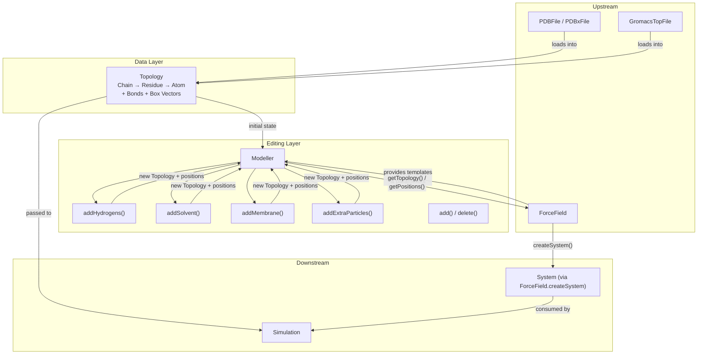
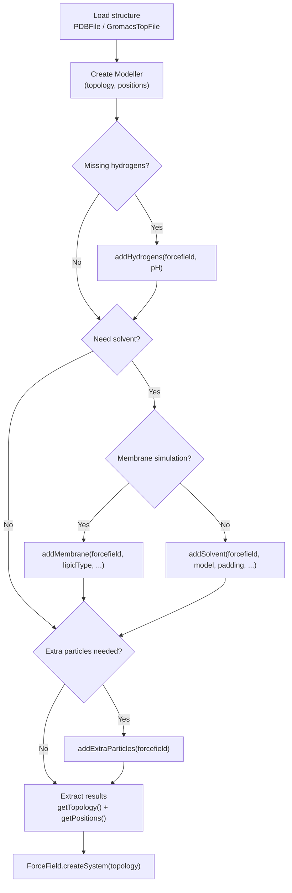

The **Modeller** and **Topology** classes form the structural backbone of OpenMM's Python application layer — the bridge between raw molecular data (PDB files, force field XML) and simulation-ready `System` objects. While `Topology` is a pure data structure encoding the molecular graph, `Modeller` is an imperative editor that transforms topologies through a pipeline of preparation steps: adding hydrogens, solvating, inserting membranes, and converting water models. Together they answer the question: *how do I go from a static structure to a fully prepared simulation model?*

## Architectural Overview

The relationship between these two classes follows a clear separation of concerns. `Topology` owns the data; `Modeller` owns the mutations. Every mutation in `Modeller` produces a **new** `Topology` instance and a corresponding new position array — the original is never modified in place. This immutability-by-convention pattern makes it safe to branch preparation workflows or retry steps without corrupting prior state.



Sources: [modeller.py](wrappers/python/openmm/app/modeller.py#L52-L87), [topology.py](wrappers/python/openmm/app/topology.py#L68-L88)

## Topology: The Molecular Graph

`Topology` is a hierarchically-structured container whose organization mirrors a PDB file. A `Topology` contains `Chain` objects, each `Chain` contains `Residue` objects, and each `Residue` contains `Atom` objects. Separately, the topology stores a flat list of `Bond` objects connecting atom pairs, and optional periodic box vectors defining the simulation cell.

### Core Data Model

The four core entity classes — `Topology`, `Chain`, `Residue`, `Atom` — are constructed exclusively through factory methods on their parent. You never instantiate an `Atom` directly; you call `topology.addAtom()`, which assigns a contiguous global index and attaches the atom to the specified residue. This contiguity invariant is enforced at construction time and is critical for correctly mapping topology atoms to position arrays and `System` particles.

| Class | Factory Method | Key Attributes | Iterable |
|-------|---------------|----------------|----------|
| `Topology` | `Topology()` | `_chains`, `_bonds`, `_periodicBoxVectors` | `chains()`, `residues()`, `atoms()`, `bonds()` |
| `Chain` | `topology.addChain(id)` | `index`, `topology`, `id`, `_residues` | `residues()`, `atoms()` |
| `Residue` | `topology.addResidue(name, chain, ...)` | `name`, `index`, `chain`, `id`, `insertionCode`, `_atoms` | `atoms()`, `bonds()`, `internal_bonds()`, `external_bonds()` |
| `Atom` | `topology.addAtom(name, element, residue, ...)` | `name`, `element`, `index`, `residue`, `id`, `formalCharge` | — |
| `Bond` | `topology.addBond(atom1, atom2, ...)` | `atom1`, `atom2`, `type`, `order` | — (namedtuple) |

Sources: [topology.py](wrappers/python/openmm/app/topology.py#L82-L212), [topology.py](wrappers/python/openmm/app/topology.py#L395-L478)

### Bond Representations

`Bond` extends `namedtuple('Bond', ['atom1', 'atom2'])` with two optional fields: `type` and `order`. The bond type uses a set of singleton instances — `Single`, `Double`, `Triple`, `Aromatic`, and `Amide` — that are module-level constants in `topology.py`. This design allows bonds to be unpacked as plain 2-tuples (`atom1, atom2 = bond`) for backward compatibility while preserving rich metadata when available. Pickle support is carefully implemented via `__getnewargs__` and `__deepcopy__` to survive serialization round-trips.

Sources: [topology.py](wrappers/python/openmm/app/topology.py#L43-L67), [topology.py](wrappers/python/openmm/app/topology.py#L482-L517)

### Automatic Bond and Disulfide Creation

When structures are loaded from formats that lack explicit bond information (such as PDB files), `Topology` provides two methods for inferring connectivity:

`createStandardBonds()` loads an XML definition file ([residues.xml](wrappers/python/openmm/app/data/residues.xml)) containing bond patterns for standard amino acids and nucleotides, then walks each chain's residue sequence to instantiate bonds by atom name. The bond definitions use a prefix convention: `-C` refers to the preceding residue's C atom, and `+N` refers to the following residue's N atom — this elegantly handles peptide and phosphodiester backbone bonds across residue boundaries.

`createDisulfideBonds(positions)` identifies CYS residues with sulfur atoms lacking a hydrogen (the CYX state), then performs an O(n²) pairwise distance check with a 0.3 nm threshold to assign S-S bonds. It guards against multiple bonds to the same sulfur by scanning existing bonds before assignment.

Sources: [topology.py](wrappers/python/openmm/app/topology.py#L297-L394)

### Periodic Box Vectors

`Topology` stores optional periodic box vectors as a 3-tuple of `Vec3` objects, accessible through `getPeriodicBoxVectors()` and `setPeriodicBoxVectors()`. For the common case of rectangular boxes, `getUnitCellDimensions()` and `setUnitCellDimensions()` provide a simpler `Vec3` interface that internally converts to the full vector representation. These dimensions propagate through `Modeller` operations — when a new topology is created, the box vectors are copied from the source via `setPeriodicBoxVectors()`.

Sources: [topology.py](wrappers/python/openmm/app/topology.py#L237-L278)

### MergedResidue: A Parameterization Helper

`MergedResidue` is a pseudo-residue created by combining multiple `Residue` objects into one. It never resides in a `Topology`; instead, it is constructed transiently during force field parameterization to handle cases where multiple residues must be matched to a single template (e.g., terminal residue capping). Its `index` is set to -1, its `name` is `'Merged'`, and it aggregates atoms from all source residues without ownership — they remain the same objects found in the original residues.

Sources: [topology.py](wrappers/python/openmm/app/topology.py#L519-L547)

## Modeller: The Model Editor

`Modeller` wraps a `Topology` and a position array, then exposes a suite of editing methods that each produce a **new** `Topology` + positions pair. This is the central tool for preparing molecular systems for simulation. Its design philosophy is pipeline-oriented: you load a structure, apply a sequence of transformations (add hydrogens, solvate, add ions, add extra particles), then extract the final topology and positions for `ForceField.createSystem()`.



Sources: [modeller.py](wrappers/python/openmm/app/modeller.py#L52-L87)

### Structural Editing: add() and delete()

The `add()` method merges a second topology and its positions into the current model by copying both topologies into a fresh `Topology` instance. It preserves chain IDs, residue insertion codes, atom IDs, formal charges, and bond metadata through an atom-mapping dictionary. The `delete()` method is its inverse — it accepts a heterogeneous list of atoms, residues, chains, and bond tuples, then constructs a new topology excluding everything in the deletion set. Bond references that span deleted and retained atoms are automatically pruned. Both methods use `deepcopy` on positions to ensure complete independence from the source.

A convenience method `deleteWater()` simply delegates to `delete()` with a generator that filters residues named `"HOH"`.

Sources: [modeller.py](wrappers/python/openmm/app/modeller.py#L89-L185)

### addHydrogens(): pH-Aware Protonation

`addHydrogens()` is the most chemically sophisticated method in `Modeller`. It adds missing hydrogen atoms to a model while intelligently selecting protonation states based on pH and local environment. The algorithm proceeds in several phases.

First, hydrogen definitions are loaded from [hydrogens.xml](wrappers/python/openmm/app/data/hydrogens.xml) via the private `_loadStandardHydrogenDefinitions()` method, which populates a class-level `_residueHydrogens` dictionary (loaded once, cached thereafter). Users can extend this with `loadHydrogenDefinitions()` for non-standard residues.

Second, for each residue, a **variant** is selected. The selection follows a priority chain: (1) explicit user override via the `variants` list, (2) disulfide detection for CYS → CYX, (3) pH-dependent selection for HIS (HID vs HIE vs HIP), with a hydrogen bond scoring heuristic that uses the internal `_CellList` spatial index to efficiently find potential hydrogen bond acceptors within 0.35 nm and a 50° angle tolerance. For other titratable residues (ASP/ASH, GLU/GLH, LYS/LYN), pH thresholds stored in the hydrogen definition XML determine the dominant form at the specified pH.

Third, hydrogen positions are computed. If a `ForceField` is provided, the method creates a temporary `System`, performs a local energy minimization on the new hydrogens only (existing atoms are held fixed) using the specified `Platform`. Without a force field, positions are estimated geometrically by projecting 0.1 nm along the anti-parallel direction of the sum of vectors to bonded neighbors.

The method returns a list recording which variant was actually selected for each residue, enabling inspection of the protonation decisions.

| Residue | Variants | Selection Rule |
|---------|----------|---------------|
| HIS | HID, HIE, HIP, HIN | pH > 6.5 → HID/HIE by H-bond scoring; pH ≤ 6.5 → HIP |
| CYS | CYS, CYX | CYX if sulfur has external bond (disulfide) |
| ASP | ASH, ASP | ASH at low pH, ASP at high pH |
| GLU | GLH, GLU | GLH at low pH, GLU at high pH |
| LYS | LYN, LYS | LYN at low pH, LYS at high pH |

Sources: [modeller.py](wrappers/python/openmm/app/modeller.py#L696-L1108)

### addSolvent(): Solvation and Ion Placement

`addSolvent()` adds both water and ions to fill a periodic box, using a multi-step algorithm. It begins by loading a pre-equilibrated water box from the bundled [data/](wrappers/python/openmm/app/data) directory — separate PDB files exist for each supported water model (tip3p, spce, tip4pew, tip5p, swm4ndp). The box size can be specified in five mutually exclusive ways: explicit `boxVectors`, explicit `boxSize`, a `padding` distance around the solute's bounding sphere, a `numAdded` count, or by inheriting the existing topology's box vectors.

Water placement follows a clipping approach: water molecules within the sum of van der Waals radii (scaled by 0.561) of any solute atom are removed. Ion placement is handled by the private `_addIons()` method, which determines the system's total charge by creating a temporary `System` and summing partial charges from the `NonbondedForce` (or `AmoebaMultipoleForce`). Ions are placed by randomly selecting water molecules and replacing them — positive ions are placed at least 0.5 nm from each other and from other positive ions (and similarly for negatives) using the spatial index.

The `boxShape` parameter supports `'cube'`, `'dodecahedron'`, and `'octahedron'`, with non-rectangular shapes computed by the private `_computeBoxVectors()` method. A rhombic dodecahedron achieves the same minimum image distance as a cube at only 70.7% of the volume.

Sources: [modeller.py](wrappers/python/openmm/app/modeller.py#L258-L668)

### addMembrane(): Lipid Bilayer Insertion

`addMembrane()` builds a complete membrane–water system around an already-oriented protein. It is based on the algorithm from Wolf et al., J. Comp. Chem. 31, pp. 2169–2174 (2010). The method includes both membrane and solvent creation in a single call because the two must be coordinated — waters must not intrude into the lipid bilayer, and lipid head groups need proper solvation.

Built-in support covers seven lipid types: POPC, POPE, DLPC, DLPE, DMPC, DOPC, and DPPC, each backed by a pre-equilibrated patch PDB file in the [data/](wrappers/python/openmm/app/data) directory. For other lipid types, users can pass any PDBFile or PDBxFile as the `lipidType` parameter.

The algorithm determines how many patch copies are needed in X and Y by computing `ceil((proteinExtent + 2*padding) / patchExtent)` for each axis, then tiles the membrane accordingly. Lipids are classified into upper and lower leaflets based on their mean Z position relative to the membrane center. The protein is temporarily scaled to 50% along X and Y; lipids within a cutoff of the scaled protein are removed in equal numbers from each leaflet. Finally, a short MD relaxation run scales the protein back to its original size while the membrane re-equilibrates around it.

Sources: [modeller.py](wrappers/python/openmm/app/modeller.py#L1339-L1714)

### addExtraParticles(): Virtual Sites and Drude Particles

`addExtraParticles()` bridges the gap between a "physical" topology (containing only real atoms) and a force field's requirements. Some force fields define "extra particles" — virtual sites for water lone pairs, Drude oscillators for polarizable models — that have no corresponding element (`element is None`). This method matches every residue in the topology to a force field template, then adds or removes extra particles to achieve conformity.

The matching process uses `ForceField._matchAllResiduesToTemplates()` to find templates for each residue. For residues where the template contains more atoms than the topology, the extra atoms are identified as `element is None` entries in the template. Their positions are computed from the template's virtual site definitions or Drude particle type mappings. The method handles `MergedResidue` objects correctly, routing Drude particles and virtual sites to their parent residues within the merged group.

The deprecated `convertWater()` method performs a subset of this functionality — converting TIP3P water to TIP4P-Ew or TIP5P by adding virtual sites with hardcoded geometric parameters — but `addExtraParticles()` is the recommended replacement since it handles any force field generically.

Sources: [modeller.py](wrappers/python/openmm/app/modeller.py#L1109-L1338), [modeller.py](wrappers/python/openmm/app/modeller.py#L187-L257)

### _CellList: Spatial Indexing

The private `_CellList` class provides O(1) expected-time neighbor queries by partitioning atom positions into a uniform grid of cells. It is used internally by `addHydrogens()` for hydrogen bond acceptor lookups and by `addSolvent()` for ion placement distance checks. The constructor computes cell dimensions from the position bounds and a `maxCutoff` parameter, then assigns each position to a cell. The `neighbors()` method returns atom indices from the 3×3×3 cell neighborhood surrounding the query position, handling periodic boundaries when box vectors are provided.

> [!TIP]
> The `_CellList` spatial index is created fresh for each `addHydrogens()` call with a cutoff of 0.35 nm, containing only acceptor atoms (oxygen and nitrogen). This keeps the index small and focused, avoiding the cost of indexing all atoms when only hydrogen bond scoring is needed.

Sources: [modeller.py](wrappers/python/openmm/app/modeller.py#L1716-L1767)

## Typical Preparation Workflow

The most common sequence for preparing a protein simulation from a PDB structure follows this pattern. Each step transforms the model incrementally, and the final topology and positions are extracted for system creation:

```python
from openmm.app import *
from openmm import *

# 1. Load the structure
pdb = PDBFile('protein.pdb')
forcefield = ForceField('amber14-all.xml', 'opc.xml')

# 2. Create the modeller
modeller = Modeller(pdb.topology, pdb.positions)

# 3. Add missing hydrogens
modeller.addHydrogens(forcefield, pH=7.4)

# 4. Solvate with padding
modeller.addSolvent(forcefield, model='opc', padding=1.0*nanometer,
                    ionicStrength=0.15*molar)

# 5. Extract results
topology = modeller.getTopology()
positions = modeller.getPositions()

# 6. Create the simulation system
system = forcefield.createSystem(topology, nonbondedMethod=PME,
                                  nonbondedCutoff=1.0*nanometer)
```

Sources: [modeller.py](wrappers/python/openmm/app/modeller.py#L64-L79)

## Key Design Patterns

**Immutability by reconstruction.** Every `Modeller` method that mutates the model does so by constructing a fresh `Topology` from scratch, copying over the retained entities, and replacing `self.topology` and `self.positions`. This means a method like `addHydrogens()` iterates over every chain, residue, atom, and bond in the source topology — the cost scales linearly with system size. For large systems, this is a deliberate tradeoff favoring correctness and simplicity over incremental mutation.

**Topology-contiguity invariant.** The `addAtom()` and `addResidue()` methods enforce that atoms within a residue must have contiguous global indices, and residues within a chain must be contiguous. This invariant allows position arrays to be sliced by residue or chain without indirection — `positions[residue.atoms()[0].index : residue.atoms()[-1].index + 1]` always yields the correct sub-array. This assumption is deeply embedded in both `Modeller` and `PDBFile`.

**Delegated charge computation.** Ion placement in `_addIons()` determines the system's total charge not from topology metadata but by creating a temporary `System` via `forcefield.createSystem()` and summing partial charges from the `NonbondedForce`. This ensures the charge calculation is always consistent with the force field's actual parameter assignment, even when residue templates or patch modifications alter expected charges.

> [!TIP]
> When using `addHydrogens()` with a `ForceField`, the method internally creates a temporary `System` and performs energy minimization on new hydrogens. If you specify a `platform` argument, this temporary system runs on that platform. For large systems, using `Platform.getPlatformByName('CPU')` can be faster for this brief minimization than waiting for GPU initialization overhead.

Sources: [modeller.py](wrappers/python/openmm/app/modeller.py#L136-L181), [modeller.py](wrappers/python/openmm/app/modeller.py#L308-L326), [topology.py](wrappers/python/openmm/app/topology.py#L167-L195)

## Data Files and Bundled Resources

The `Modeller` relies on a set of pre-equilibrated structural data files bundled in [wrappers/python/openmm/app/data/](wrappers/python/openmm/app/data). These include water box PDB files for each supported model (tip3p, spce, tip4pew, tip5p, swm4ndp), membrane patch PDB files for each lipid type, and XML definition files for standard bonds ([residues.xml](wrappers/python/openmm/app/data/residues.xml)) and hydrogen placements ([hydrogens.xml](wrappers/python/openmm/app/data/hydrogens.xml)). The water boxes are loaded directly by `addSolvent()` via `PDBFile`, and tiled to fill the requested periodic box. The membrane patches are loaded by `addMembrane()` and tiled in the XY plane to span the protein's extent plus padding.

Sources: [modeller.py](wrappers/python/openmm/app/modeller.py#L463-L478), [modeller.py](wrappers/python/openmm/app/modeller.py#L1402-L1407)

## Further Reading

Having understood how `Modeller` and `Topology` prepare structural models, the natural next step is to see how these prepared topologies are consumed by force fields and wrapped into simulation objects:

- **[ForceField and System Generation](15-forcefield-and-system-generation)** — how `ForceField.createSystem()` converts a `Topology` into a complete `System` with forces, constraints, and virtual sites
- **[Simulation Class](14-simulation-class)** — how the `Simulation` object orchestrates the `System`, `Integrator`, and `Topology` into a runnable simulation loop
- **[Custom Forces and Integrators](17-custom-forces-and-integrators)** — for advanced use cases where you need forces beyond what standard `ForceField` templates provide