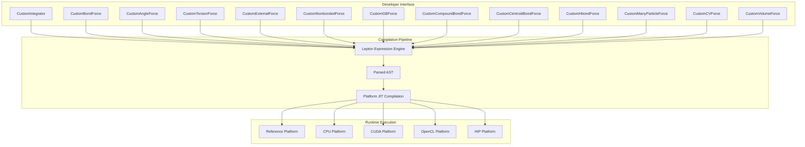
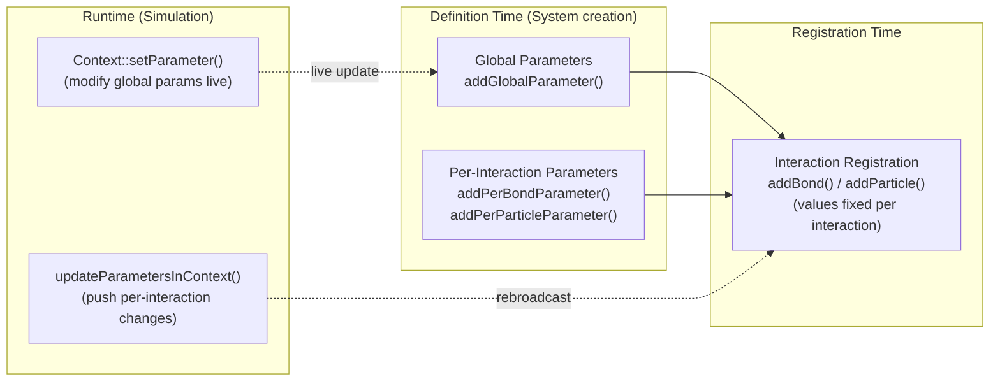
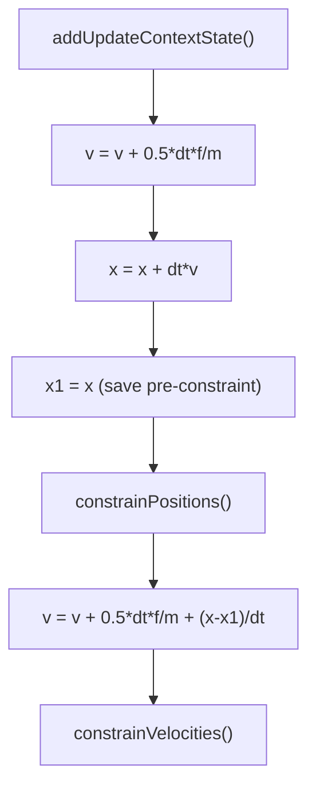

OpenMM's custom force and integrator framework is the system's most powerful extensibility mechanism. It allows developers to define arbitrary potential energy functions and integration algorithms purely through algebraic expressions — no C++ or CUDA code required. Every custom class inherits from the base `Force` or `Integrator` abstract class and feeds expression strings through the [Lepton expression engine](18-lepton-expression-engine), which compiles them into optimized, platform-native kernel code at runtime. This page provides a comprehensive architectural map of the entire custom subsystem, its shared parameter model, and practical implementation patterns for advanced developers.

## Architecture of the Custom Subsystem

The custom force and integrator classes form a unified framework built on three layers: the **API layer** (public headers in `openmmapi/include/openmm/`), the **expression compilation layer** (via the Lepton library in `libraries/lepton/`), and the **platform kernel layer** (implementations in `platforms/*/kernels/`). The architecture follows a clear separation between *what* to compute (the expression) and *how* to compute it (the platform-specific kernel).



The key insight is that every custom class follows the same lifecycle: you construct it with an energy expression string, register parameters (global, per-particle, per-bond, etc.), add interactions, then add it to a `System`. When a `Context` is created, the expression is parsed by Lepton and compiled into the appropriate kernel for the target platform. This means your algebraic expression is evaluated with native performance on GPU hardware without any interpreter overhead.

Sources: [CustomIntegrator.h](openmmapi/include/openmm/CustomIntegrator.h#L43-L392), [CustomBondForce.h](openmmapi/include/openmm/CustomBondForce.h#L40-L86), [CustomNonbondedForce.h](openmmapi/include/openmm/CustomNonbondedForce.h#L44-L120)

## Shared Expression Language

All custom forces and the `CustomIntegrator` share a common expression language powered by Lepton. The language supports standard arithmetic operators (`+`, `-`, `*`, `/`, `^`) and an extensive function library. Expressions may also define intermediate quantities using semicolons as separators, enabling clean multi-step calculations within a single expression string.

### Supported Functions and Operators

| Category | Functions / Operators |
|----------|----------------------|
| **Arithmetic** | `+`, `-`, `*`, `/`, `^` (power) |
| **Transcendental** | `sqrt`, `exp`, `log`, `sin`, `cos`, `tan`, `sec`, `csc`, `cot`, `asin`, `acos`, `atan`, `atan2` |
| **Hyperbolic** | `sinh`, `cosh`, `tanh` |
| **Error functions** | `erf`, `erfc` |
| **Rounding / Discontinuous** | `floor`, `ceil`, `step`, `delta`, `select`, `min`, `max`, `abs` |
| **Special (CustomExternalForce)** | `periodicdistance(x1, y1, z1, x2, y2, z2)` |
| **Special (CustomIntegrator vector)** | `cross(a, b)`, `dot(a, b)`, `_x(a)`, `_y(a)`, `_z(a)`, `vector(a, b, c)` |
| **Special (CustomIntegrator energy)** | `deriv(energy, param)` — derivative of energy w.r.t. context parameter |
| **Random (CustomIntegrator)** | `uniform` (U[0,1]), `gaussian` (N(0,1)) |
| **Intermediate quantities** | Separated by `;` (e.g., `"sigma=0.5*(s1+s2); 4*e*(sigma/r)^12"`) |

> [!TIP]
> The `step(x)` function returns 0 if x < 0 and 1 otherwise, while `delta(x)` returns 1 if x = 0 and 0 otherwise. The `select(x, y, z)` function returns z if x = 0, otherwise y. These three discontinuous functions are essential for implementing conditional logic inside expressions without resorting to flow control.

All trigonometric functions operate in radians, and `log` is the natural logarithm. When `uniform` or `gaussian` appears multiple times within a single expression evaluation, the **same** random value is used at each occurrence site — this is a critical semantic for reproducible stochastic integrators.

Sources: [CustomBondForce.h](openmmapi/include/openmm/CustomBondForce.h#L82-L86), [CustomExternalForce.h](openmmapi/include/openmm/CustomExternalForce.h#L98-L102), [CustomIntegrator.h](openmmapi/include/openmm/CustomIntegrator.h#L371-L389)

## Shared Parameter Model

Every custom force uses the same three-tier parameter hierarchy, though not all classes expose all three tiers. Understanding this model is essential because it governs how parameters flow from definition through simulation to runtime modification.



**Global parameters** are scalar values shared across all interactions. They can be modified at runtime via `Context::setParameter()` without recreating the context — this is the mechanism behind alchemical free energy perturbation. **Per-interaction parameters** (per-bond, per-particle, etc.) are set once when registering interactions and cannot be changed without calling `updateParametersInContext()`. **Tabulated functions** provide a fourth mechanism: piecewise-defined functions (`Continuous1DFunction`, `Continuous2DFunction`, `Continuous3DFunction`, `Discrete1DFunction`, `Discrete2DFunction`, `Discrete3DFunction`) that can appear directly in expressions.

The `addEnergyParameterDerivative()` method, available on several custom forces, requests that the derivative ∂E/∂(parameter) be computed. This value can be retrieved via `getState()` and is the foundation for alchemical free energy calculations using thermodynamic integration.

Sources: [CustomBondForce.h](openmmapi/include/openmm/CustomBondForce.h#L46-L52), [CustomNonbondedForce.h](openmmapi/include/openmm/CustomNonbondedForce.h#L50-L60), [CustomCVForce.h](openmmapi/include/openmm/CustomCVForce.h#L141-L177)

## Custom Force Taxonomy

The custom forces span a design space from simple two-body bonded terms to complex multi-stage implicit solvent models. They differ in three key dimensions: **topology** (what set of particles each energy term involves), **builtin variables** (what geometric quantities the expression can reference), and **advanced features** (exclusions, cutoffs, switching functions, interaction groups, computed values).

### Complete Custom Force Matrix

| Force Class | Topology | Builtin Variables | Per-Interaction Params | Key Advanced Features |
|-------------|----------|-------------------|----------------------|----------------------|
| `CustomBondForce` | Pair (bonded) | `r` | per-bond | Energy derivatives |
| `CustomAngleForce` | Triple (bonded) | `theta` | per-angle | Energy derivatives |
| `CustomTorsionForce` | Quad (bonded) | `theta` (dihedral) | per-torsion | Energy derivatives |
| `CustomExternalForce` | Single particle | `x`, `y`, `z` | per-particle | `periodicdistance()` |
| `CustomNonbondedForce` | All pairs (nonbonded) | `r` | per-particle | Exclusions, cutoffs, switching, interaction groups, computed values, long-range correction |
| `CustomGBForce` | Multi-stage (GB solvation) | `r`, `I`, `B`, etc. | per-particle | Computed values, exclusions, cutoffs, particle pair vs. single particle computation types |
| `CustomCompoundBondForce` | Arbitrary N-body (bonded) | `x_i`, `y_i`, `z_i`, `distance()`, `angle()`, `dihedral()` | per-bond | Tabulated functions, energy derivatives |
| `CustomCentroidBondForce` | Centroid pairs | `x1`, `y1`, `z1`, `x2`, `y2`, `z2` | per-bond | Particle groups as "virtual" centroids |
| `CustomHbondForce` | Donor-acceptor pairs | `r`, `theta`, `dihedral` | per-donor/acceptor | Separate donor/acceptor params, exclusions, cutoffs |
| `CustomManyParticleForce` | N-body (nonbonded) | `x_i`, `y_i`, `z_i`, `distance()`, `angle()`, `dihedral()` | per-particle | Permutation modes, exclusions, cutoffs |
| `CustomCVForce` | Collective variables | User-defined CV names | N/A (global params) | CVs defined as `Force` objects, tabulated functions, energy derivatives |
| `CustomVolumeForce` | System volume | `V` | N/A (global params) | Barostat-like volume-dependent forces |

Sources: [CustomAngleForce.h](openmmapi/include/openmm/CustomAngleForce.h#L1-L309), [CustomTorsionForce.h](openmmapi/include/openmm/CustomTorsionForce.h#L1-L324), [CustomCentroidBondForce.h](openmmapi/include/openmm/CustomCentroidBondForce.h#L1-L470), [CustomHbondForce.h](openmmapi/include/openmm/CustomHbondForce.h#L1-L549), [CustomVolumeForce.h](openmmapi/include/openmm/CustomVolumeForce.h#L1-L157), [CustomManyParticleForce.h](openmmapi/include/openmm/CustomManyParticleForce.h#L42-L100)

## Bonded Custom Forces

The three simplest custom forces follow the same pattern: they evaluate an algebraic expression once per bonded interaction, where the builtin variable (`r` for bonds, `theta` for angles/torsions) provides the geometric input. They all support per-bond parameters, global parameters, tabulated functions, and energy parameter derivatives.

`CustomBondForce` defines pairwise bonded interactions as a function of inter-particle distance `r`. The harmonic bond potential is its canonical example: `"0.5*k*(r-r0)^2"` with per-bond parameters `k` (spring constant) and `r0` (equilibrium distance). Parameters are registered via `addPerBondParameter()`, and bonds are added via `addBond(particle1, particle2, params)`. `CustomAngleForce` replaces `r` with `theta` (the angle in radians) for three-particle angular interactions, while `CustomTorsionForce` uses `theta` as the dihedral angle for four-particle interactions.

`CustomCompoundBondForce` generalizes this to arbitrary N-particle bonded interactions. It provides access to individual particle coordinates (`x1`, `y1`, `z1`, etc.) and geometric functions (`distance(p1, p2)`, `angle(p1, p2, p3)`, `dihedral(p1, p2, p3, p4)`). A Urey-Bradley potential — coupling angle and 1-3 distance terms across three particles — is its canonical use case.

Sources: [CustomBondForce.h](openmmapi/include/openmm/CustomBondForce.h#L40-L86), [CustomCompoundBondForce.h](openmmapi/include/openmm/CustomCompoundBondForce.h#L42-L100)

## Nonbonded and Implicit Solvent Custom Forces

The nonbonded custom forces represent the most complex tier of the framework. They operate over all particle pairs (or filtered subsets) and introduce advanced features like exclusions, cutoffs, switching functions, and interaction groups.

`CustomNonbondedForce` computes pairwise interactions between all particles (or restricted interaction groups). The expression **must** be symmetric with respect to particle labeling — terms like `sigma1 - sigma2` produce undefined results because the framework makes no guarantee about which particle is "particle 1" in a given pair evaluation. The Lennard-Jones potential `"4*epsilon*((sigma/r)^12-(sigma/r)^6); sigma=0.5*(sigma1+sigma2); epsilon=sqrt(epsilon1*epsilon2)"` demonstrates the canonical combining-rule pattern. **Interaction groups** allow restricting computation to specific set-pairs (e.g., solute-solvent only), and pairs appearing in multiple groups are evaluated multiple times. **Computed values** (via `addComputedValue()`) are per-particle quantities computed once per particle rather than once per pair, providing significant optimization for soft-core or lambda-dependent parameters.

`CustomGBForce` implements the most sophisticated computation model in the framework. It defines a **multi-stage pipeline**: first, per-particle **computed values** are calculated (which may depend on particle pairs), then **energy terms** are evaluated (which may also be per-pair or per-particle). Each stage has a **computation type** — `SingleParticle` or `ParticlePair` — that determines how the expression is evaluated. Platform constraints require that the first computed value must be a `ParticlePair` computation. The OBC implementation of GB/SA implicit solvent, shown in the header documentation, demonstrates all four stages: pair-wise Born integral calculation, single-particle Born radius computation, single-particle surface area/self-energy, and pair-wise polarization screening.

Sources: [CustomNonbondedForce.h](openmmapi/include/openmm/CustomNonbondedForce.h#L89-L150), [CustomGBForce.h](openmmapi/include/openmm/CustomGBForce.h#L44-L150)

## Collective Variable Forces

`CustomCVForce` bridges the gap between force-field energetics and collective-variable-based methods (metadynamics, umbrella sampling, etc.). Each collective variable is itself a `Force` object whose potential energy becomes the CV's value. This means *anything computable as a potential* can serve as a CV — including distances, angles, RMSD, coordination numbers (via `RMSDForce` or custom `CustomBondForce`), or even the energy of another custom force.

The energy expression takes the CV names as variables: `"k*(cv1-cv1_0)^2 + k2*(cv2-cv2_0)^2"`. Since each CV is a `Force` object, `CustomCVForce` takes ownership of it via `addCollectiveVariable(name, force)`. This composition pattern enables deeply nested force structures. The CV forces are evaluated by their own platform kernels, and the chain rule is applied automatically to compute forces on particles.

Sources: [CustomCVForce.h](openmmapi/include/openmm/CustomCVForce.h#L41-L70)

## The CustomIntegrator

`CustomIntegrator` is architecturally distinct from the custom forces. Rather than defining a potential energy, it defines a **complete integration algorithm** as a sequence of computation steps. Each step belongs to one of the `ComputationType` enum values and is executed in order during every call to `step()`.

### Computation Step Types

| Computation Type | Method | Scope | Description |
|-----------------|--------|-------|-------------|
| `ComputeGlobal` | `addComputeGlobal(var, expr)` | Single scalar | Evaluates expression → global variable |
| `ComputePerDof` | `addComputePerDof(var, expr)` | Per DOF vector | Evaluates expression → per-DOF variable (vector) |
| `ComputeSum` | `addComputeSum(var, expr)` | DOF → scalar | Evaluates per-DOF, sums → global variable |
| `ConstrainPositions` | `addConstrainPositions()` | System | Applies position constraints (SETTLE/SHAKE) |
| `ConstrainVelocities` | `addConstrainVelocities()` | System | Zeroes velocity along constrained directions |
| `UpdateContextState` | `addUpdateContextState()` | System | Allows Forces to update state (thermostats, barostats) |
| `IfBlockStart` | `beginIfBlock(condition)` | Control flow | Begins conditional block (global condition only) |
| `WhileBlockStart` | `beginWhileBlock(condition)` | Control flow | Begins loop block (global condition only) |
| `BlockEnd` | `endBlock()` | Control flow | Ends innermost if/while block |

### Pre-defined Variables

The integrator provides a rich set of pre-defined variables that serve as inputs to computation steps. **Global read-only variables** include `dt` (step size) and `energy` (total potential energy, with `energy0`, `energy1`, ... for per-force-group energies). **Per-DOF variables** include `x` (position, writable), `v` (velocity, writable), `f` (force, read-only, with `f0`, `f1`, ... for per-force-group forces), and `m` (mass, read-only). The `uniform` and `gaussian` random variables can appear in either global or per-DOF expressions. A single computation step may depend on **only one** energy variable and **only one** force variable.

### User-Defined Variables

Beyond the pre-defined set, you create custom variables with `addGlobalVariable(name, initialValue)` and `addPerDofVariable(name, initialValue)`. All variables are **persistent** between time steps — once set, they retain their value until explicitly changed. This persistence is what enables the RATTLE velocity Verlet algorithm shown below, where `x1` stores pre-constraint positions for use in the velocity correction step.

> [!TIP]
> Force recomputation in `CustomIntegrator` is automatic. When a per-DOF computation references `f` (or a per-force-group variant like `f0`), the integrator checks whether particle positions have changed since the last force evaluation. If they have, forces are recomputed transparently. You never call "compute forces" explicitly — the dependency graph between computation steps and force variables handles this automatically.

Sources: [CustomIntegrator.h](openmmapi/include/openmm/CustomIntegrator.h#L86-L124), [CustomIntegrator.h](openmmapi/include/openmm/CustomIntegrator.h#L396-L434), [CustomIntegrator.h](openmmapi/include/openmm/CustomIntegrator.h#L548-L629)

## Implementing Standard Integrators with CustomIntegrator

The following examples demonstrate how well-known integration algorithms map to `CustomIntegrator` step sequences. These serve as verified starting points for building custom algorithms.

### Velocity Verlet with Constraints (RATTLE)



The key subtlety is the correction term `(x-x1)/dt` in the final velocity update. This accounts for the position shift introduced by constraint projection, ensuring that the velocity field remains consistent with the constrained trajectory. Without this term, the integrator would accumulate energy drift in constrained systems.

### r-RESPA Multiple Time Step Integrator

The r-RESPA algorithm partitions forces into fast (force group 0) and slow (force group 1) components, evaluating the fast forces multiple times per slow force evaluation. In `CustomIntegrator`, this is expressed using per-force-group force variables `f0` and `f1`:

```
v = v + 0.5*dt*f1/m           # slow half-kick (outer step)
for i in range(4):            # 4 inner steps
    v = v + 0.5*(dt/4)*f0/m   # fast half-kick (inner step)
    x = x + (dt/4)*v           # drift
    v = v + 0.5*(dt/4)*f0/m   # fast half-kick
v = v + 0.5*dt*f1/m           # slow half-kick
```

The automatic force recomputation mechanism ensures that `f0` is recomputed every inner step (because `x` changes) while `f1` is only recomputed when it is first referenced after a position change.

### Langevin Middle Integrator

The BAOAB-style Langevin integrator splits the Ornstein-Uhlenbeck process into deterministic and stochastic half-steps. The `CustomIntegrator` version pre-computes the exponential factors `a = exp(-friction*dt)` and `b = sqrt(1 - exp(-2*friction*dt))` as global variables, then applies the O (Ornstein-Uhlenbeck) step via `"a*v + b*sqrt(kT/m)*gaussian"`. This demonstrates the interplay between global variable initialization, per-DOF stochastic expressions, and constraint handling in a single algorithm.

Sources: [CustomIntegrator.h](openmmapi/include/openmm/CustomIntegrator.h#L126-L210), [CustomIntegrator.h](openmmapi/include/openmm/CustomIntegrator.h#L264-L329)

## Flow Control and Monte Carlo Methods

`CustomIntegrator` supports `if` and `while` blocks for implementing Metropolized algorithms and iterative schemes. The condition expression must involve only **global variables** and comparison operators (`=`, `<`, `>`, `!=`, `<=`, `>=`). Blocks can be nested arbitrarily.

The canonical pattern for Metropolis acceptance uses the pre-defined `uniform` random variable:

```
beginIfBlock("uniform < acceptanceProbability")
    addComputePerDof("x", "xnew")     # accept: overwrite positions
endBlock()
```

For Hamiltonian Monte Carlo with step-size adaptation, a `while` block could iteratively reject and retry until an acceptance criterion is met. However, the documentation warns that there is no guard against infinite loops — the developer must ensure that while-conditions are guaranteed to eventually become false.

Sources: [CustomIntegrator.h](openmmapi/include/openmm/CustomIntegrator.h#L212-L242)

## Kinetic Energy and Energy Derivatives

Two advanced features of `CustomIntegrator` require special attention because they affect thermodynamic observables.

The **kinetic energy expression** (`setKineticEnergyExpression()`) defines how the system's kinetic energy is reported. The default `"m*v*v/2"` is correct for velocity Verlet but wrong for leapfrog integrators where velocities are offset by half a time step. The leapfrog correction is `"m*v1*v1/2; v1=v+0.5*dt*f/m"`, which advances velocities by a half-step before squaring. The kinetic energy expression may reference `x`, `v`, `f`, `m`, `dt`, and user-defined variables, but **not** energy, random numbers, or adjustable context parameters.

The **`deriv()` function** provides access to energy derivatives with respect to context parameters: `"deriv(energy, lambda)"` gives ∂E/∂λ for the total energy, and `"deriv(energy1, lambda)"` restricts it to force group 1. These derivatives are only available if the corresponding Force has been configured with `addEnergyParameterDerivative()`. This mechanism enables on-the-fly free energy gradient computation within custom integration algorithms.

Sources: [CustomIntegrator.h](openmmapi/include/openmm/CustomIntegrator.h#L331-L389)

## Platform Implementation Notes

Each platform compiles custom expressions differently, and these differences affect both performance and feature support.

| Platform | Compilation Strategy | Key Constraints |
|----------|---------------------|-----------------|
| **Reference** | Direct Lepton evaluation | Full feature support, slowest execution |
| **CPU** | JIT compilation via Lepton + vectorized execution | Supports most features; `CustomManyParticleForce` limited |
| **CUDA** | OpenMM C++ → CUDA kernel compilation | All custom forces supported; force group indexing optimized |
| **OpenCL** | OpenMM C++ → OpenCL kernel compilation | Same feature set as CUDA |
| **HIP** | OpenMM C++ → HIP kernel compilation | Same feature set as CUDA |

The `CustomGBForce` has the tightest platform constraints: all current platforms require the first computed value to be a `ParticlePair` computation, and all subsequent computed values must be `SingleParticle`. The `CustomManyParticleForce` supports permutation modes (`UniqueCentralParticle`, `SinglePermutation`, `AllPermutations`) that control how particle orderings are enumerated — this directly affects both correctness and computational cost.

Sources: [CustomGBForce.h](openmmapi/include/openmm/CustomGBForce.h#L75-L78), [CustomManyParticleForce.h](openmmapi/include/openmm/CustomManyParticleForce.h#L76-L82)

## Recommended Reading Path

Having understood the custom subsystem architecture, the following pages provide deeper context on the mechanisms discussed here:

- **[Lepton Expression Engine](18-lepton-expression-engine)** — How expressions are parsed, optimized, and compiled into platform kernels
- **[Platform and Kernel System](8-platform-and-kernel-system)** — The compilation pipeline from expression string to GPU kernel
- **[Force Classes](13-force-classes)** — The base `Force` class hierarchy that custom forces extend
- **[Integrator Hierarchy](12-integrator-hierarchy)** — The base `Integrator` class and how `CustomIntegrator` fits within it
- **[Metadynamics and Enhanced Sampling](19-metadynamics-and-enhanced-sampling)** — How `CustomCVForce` integrates with well-tempered metadynamics