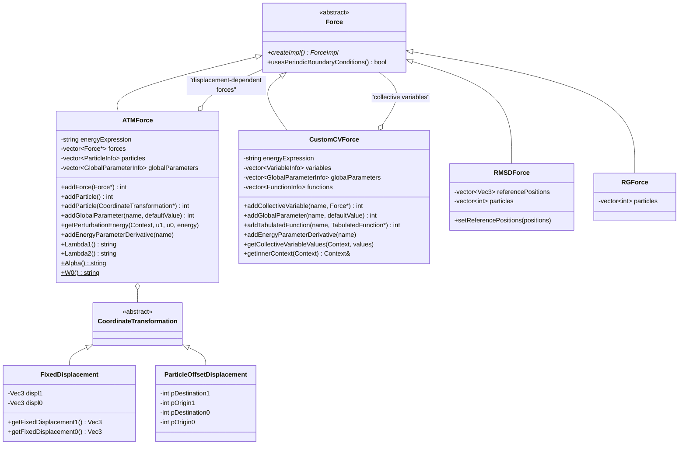
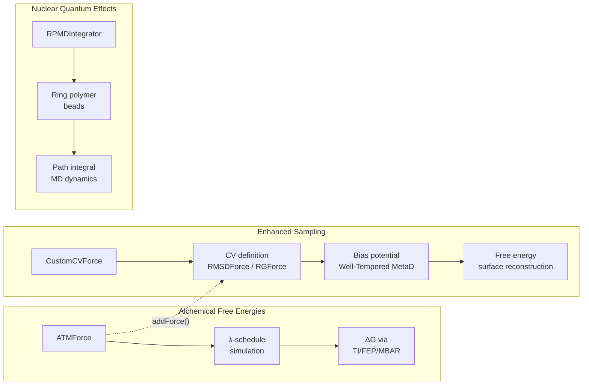

This page documents OpenMM's infrastructure for advanced sampling techniques—alchemical free energy methods, collective variable biasing, and path-integral nuclear quantum effects. Unlike the standard [Integrator Hierarchy](12-integrator-hierarchy) and [Force Classes](13-force-classes), these tools alter the statistical mechanics landscape to accelerate rare event sampling, crossing energy barriers, and computing free energy differences. OpenMM implements this through three complementary subsystems: the **ATMForce** for alchemical transfer, the **CustomCVForce** for arbitrary collective variable biases, and the **RPMD plugin** for ring-polymer molecular dynamics.

## Architectural Overview

The enhanced sampling subsystem occupies a distinct layer in OpenMM's force architecture. Rather than modifying integrators directly, these classes extend the `Force` base class and embed *inner evaluation contexts*—secondary `Context` objects that compute energies at perturbed configurations or along collective variable manifolds. This design preserves platform portability while enabling gradient-chain propagation through the Lepton expression engine documented in [Lepton Expression Engine](18-lepton-expression-engine).



## ATMForce: Alchemical Transfer Method

The `ATMForce` class implements the Alchemical Transfer Method for computing absolute and relative binding free energies, based on the soft-core softplus potential described by Azimi et al. ([J. Chem. Inf. Model. 62, 309 (2022)](https://doi.org/10.1021/acs.jcim.1c01129)). It originated from the [openmm-atmmetaforce-plugin](https://github.com/Gallicchio-Lab/openmm-atmmetaforce-plugin) and was integrated into the core API ([ATMForce.h](openmmapi/include/openmm/ATMForce.h#L1-L36)).

### Core Mechanism

ATMForce works by evaluating the system's potential energy under *two* sets of coordinates simultaneously: the **reference state** (u₀, current positions) and the **target state** (u₁, displaced positions). A custom energy expression combines these into a biasing potential, and alchemical parameters are dialed to sample the transformation path. The force owns a collection of child `Force` objects whose energies depend on the displacement, and computes the energy difference Δu = u₁ − u₀ between the two coordinate sets ([ATMForce.h](openmmapi/include/openmm/ATMForce.h#L62-L76)).

Each particle in the system must be registered with the ATMForce in the same order as the parent `System`. Particles can be stationary (no displacement), fixed-displaced in lab frame, or displaced by a *variable* vector computed from other particle positions at runtime ([ATMForce.h](openmmapi/include/openmm/ATMForce.h#L274-L315)).

### Coordinate Transformation Hierarchy

ATMForce supports three modes of particle displacement through the `CoordinateTransformation` abstract base class ([ATMForce.h](openmmapi/include/openmm/ATMForce.h#L557-L567)):

| Transformation | Class | Displacement Source | State Applicability |
|---|---|---|---|
| None (stationary) | `addParticle()` (no args) | Zero vector | Both states |
| Fixed lab-frame vector | `FixedDisplacement(d1, d0)` | Static `Vec3` values | `d1` for target, `d0` for reference |
| Variable particle offset | `ParticleOffsetDisplacement(dest1, orig1, dest0, orig0)` | `pos[dest] - pos[orig]` at runtime | Separate vectors per state |

The `FixedDisplacement` class stores two displacement vectors: one for the target state and one for the reference state. When only one vector is provided, the reference-state displacement defaults to zero ([ATMForce.h](openmmapi/include/openmm/ATMForce.h#L575-L588)). The `ParticleOffsetDisplacement` class enables dynamic displacements computed from the current positions of other particles—for example, swapping two ligands by displacing each to the other's position ([ATMForce.h](openmmapi/include/openmm/ATMForce.h#L590-L617)).

### Energy Expression Interface

ATMForce provides two constructor signatures with fundamentally different energy function strategies ([ATMForce.h](openmmapi/include/openmm/ATMForce.h#L204-L229)):

**Custom expression mode** accepts an arbitrary algebraic string in variables `u0` and `u1`:
```python
# Linear alchemical interpolation
atm = ATMForce("u0 + Lambda*(u1 - u0)")
atm.addGlobalParameter("Lambda", 0.5)
```

**Default softplus mode** accepts eight numeric parameters that configure the soft-core softplus potential directly:
```python
# Soft-core alchemical transfer
atm = ATMForce(lambda1=0.1, lambda2=0.2, alpha=0.3,
               uh=0.4, w0=0.5, umax=0.7,
               ubcore=0.6, acore=0.8, direction=1.0)
```

The default energy expression ([ATMForce.h](openmmapi/include/openmm/ATMForce.h#L137-L151)) implements the full ATM potential with a Fermi-like soft-core switching function that smoothly limits large energy spikes when particles overlap during transfer.

### Global Parameters

When using the default softplus constructor, ATMForce registers eight named global parameters accessible through static methods ([ATMForce.h](openmmapi/include/openmm/ATMForce.h#L416-L494)):

| Parameter | Static Accessor | Range | Units |
|---|---|---|---|
| `Lambda1` | `ATMForce.Lambda1()` | [0, 1] | dimensionless |
| `Lambda2` | `ATMForce.Lambda2()` | [0, 1] | dimensionless |
| `Alpha` | `ATMForce.Alpha()` | ≥ 0 | (kJ/mol)⁻¹ |
| `Uh` | `ATMForce.Uh()` | — | kJ/mol |
| `W0` | `ATMForce.W0()` | — | kJ/mol |
| `Umax` | `ATMForce.Umax()` | > Ubcore | kJ/mol |
| `Ubcore` | `ATMForce.Ubcore()` | < Umax | kJ/mol |
| `Acore` | `ATMForce.Acore()` | > 0 | dimensionless |
| `Direction` | `ATMForce.Direction()` | {−1, +1} | dimensionless |

These parameters can be modified at runtime via `Context.setParameter()`, enabling real-time alchemical control without reinitializing the context. The `Direction` parameter switches between forward (+1) and backward (−1) transfer protocols.

### Retrieving Perturbation Energies

After each evaluation step, `getPerturbationEnergy()` returns the three key quantities needed for free energy post-processing: the displaced-state energy u₁, the reference-state energy u₀, and the ATMForce's biasing energy itself ([ATMForce.h](openmmapi/include/openmm/ATMForce.h#L407-L415)).

> [!TIP]
> **ATMForce particle registration order matters.** Every particle in the System must be added to the ATMForce in the same index order as `System.addParticle()`. Failure to do so results in incorrect force application, since ATMForce maps particles by position index to compute coordinate transformations. This constraint is enforced by the test suite at [TestATMForce.h](tests/TestATMForce.h#L276-L283).

### Verified Behavior: Force Propagation and Soft-Core Switching

The test suite demonstrates the complete alchemical pipeline. In the basic two-particle case, a harmonic bond is created and one particle is displaced by a fixed vector. At λ = 0, the energy equals u₀ (undisplaced); at λ = 1, it equals u₁ (displaced); and intermediate values linearly interpolate. The forces on the displaced particle scale linearly with λ ([TestATMForce.h](tests/TestATMForce.h#L89-L142)).

The three-particle swap test validates `ParticleOffsetDisplacement` by exchanging particles 1 and 2 through mutual offset vectors. The perturbation energy correctly equals the difference in harmonic bond energies between the swapped and original configurations ([TestATMForce.h](tests/TestATMForce.h#L144-L208)).

The soft-core test activates the Fermi switching function (with `umax=10`, `ubcore=3`, `acore=0.125`) and verifies that the force on the displaced particle is attenuated by the soft-core derivative factor relative to the linear case ([TestATMForce.h](tests/TestATMForce.h#L277-L337)).

## CustomCVForce: Collective Variable Biasing

The `CustomCVForce` class provides a general-purpose framework for constructing biasing potentials that depend on arbitrary collective variables (CVs). Each CV is itself a `Force` object—its computed potential energy becomes the scalar CV value. This architecture provides enormous flexibility: any quantity expressible as a potential function can serve as a CV ([CustomCVForce.h](openmmapi/include/openmm/CustomCVForce.h#L42-L70)).

### Design Architecture

CustomCVForce operates through a **dual-context** model. When a `Context` is created for a `System` containing a CustomCVForce, OpenMM internally constructs a second `System` containing only the CV-defining Forces, creates a secondary `Context` for it, and uses it to evaluate the CV values. This inner context is accessible via `getInnerContext()` ([CustomCVForce.h](openmmapi/include/openmm/CustomCVForce.h#L232-L247)).

The energy expression can reference CV values by name, global parameters, and tabulated functions, using the same Lepton expression grammar that powers [Custom Forces and Integrators](17-custom-forces-and-integrators). This includes arithmetic operators, trigonometric functions, `step()`, `delta()`, `select()`, and standard mathematical functions ([CustomCVForce.h](openmmapi/include/openmm/CustomCVForce.h#L63-L66)).

### Configuration API

| Method | Purpose |
|---|---|
| `addCollectiveVariable(name, Force*)` | Register a CV defined by a Force object |
| `addGlobalParameter(name, defaultValue)` | Add a tunable parameter to the energy expression |
| `addTabulatedFunction(name, TabulatedFunction*)` | Register a lookup table for the energy expression |
| `addEnergyParameterDerivative(name)` | Request ∂E/∂(parameter) for thermodynamic integration |
| `getCollectiveVariableValues(context, values)` | Query current CV values without bias |
| `getInnerContext(context)` | Access the internal CV evaluation Context |

### Energy Parameter Derivatives

CustomCVForce supports chain-rule differentiation through nested parameter dependencies. When a global parameter appears in both the energy expression *and* in a CV-defining Force, the derivative is correctly propagated through the chain rule. The test suite verifies this with a three-parameter example where `g1` and `g2` appear in the energy expression `v1*g1+g2`, while `g3` appears in the CV force but not the outer expression—yet `∂E/∂g3` is still correctly computed as `∂E/∂v1 × ∂v1/∂g3` ([TestCustomCVForce.h](tests/TestCustomCVForce.h#L94-L131)).

### Tabulated Function Support

Arbitrary-dimensional tabulated functions (e.g., `Continuous2DFunction`) can be embedded in the energy expression, enabling metadynamics-style biasing potentials. The test creates a 2D sine-cosine table and verifies energy and force correctness across the entire domain, including table extrapolation boundaries ([TestCustomCVForce.h](tests/TestCustomCVForce.h#L133-L191)).

> [!TIP]
> **Inner Context ownership and parameter updates.** When modifying a CV-defining Force's parameters (e.g., changing `RMSDForce` reference positions), you must call `updateParametersInContext()` on the *inner* Context obtained via `getInnerContext()`, not the outer simulation Context. However, for tabulated functions, `CustomCVForce.updateParametersInContext()` handles the propagation automatically ([CustomCVForce.h](openmmapi/include/openmm/CustomCVForce.h#L248-L258)).

## Built-in Collective Variable Forces

OpenMM provides two dedicated Force classes designed specifically for use as collective variables inside `CustomCVForce`. Each computes a physically meaningful structural quantity as its "potential energy," enabling direct use as CV definitions.

### RMSDForce

`RMSDForce` computes the root mean squared deviation between the current particle positions and a reference structure, after optimal rigid-body alignment. It accepts the full reference position array (matching the System particle count) and an optional subset of particle indices to restrict the alignment/comparison to a specific region ([RMSDForce.h](openmmapi/include/openmm/RMSDForce.h#L40-L67)).

```python
rmsd = RMSDForce(reference_positions, particles=[0, 1, 2, 3, 4, 5])
cv = CustomCVForce("100*rmsd^2")  # Harmonic RMSD restraint
cv.addCollectiveVariable("rmsd", rmsd)
```

The reference positions can be updated at runtime via `setReferencePositions()` followed by `updateParametersInContext()`, making it suitable for adaptive sampling schemes where the target structure evolves ([RMSDForce.h](openmmapi/include/openmm/RMSDForce.h#L77-L97)).

### RGForce

`RGForce` computes the radius of gyration Rg of a specified particle set—the RMS distance of particles from their center of mass. It is a 2025 addition to the core API and follows the same "energy equals scalar value" convention as RMSDForce ([RGForce.h](openmmapi/include/openmm/RGForce.h#L40-L57)).

```python
rg = RGForce(particles=list(range(100)))  # All 100 particles
cv = CustomCVForce("k*(rg - rg0)^2")
cv.addCollectiveVariable("rg", rg)
cv.addGlobalParameter("k", 100.0)
cv.addGlobalParameter("rg0", 2.0)
```

Both `RMSDForce` and `RGForce` return `false` for `usesPeriodicBoundaryConditions()`, meaning they compute distances in absolute coordinates without minimum-image convention ([RMSDForce.h](openmmapi/include/openmm/RMSDForce.h#L104-L106), [RGForce.h](openmmapi/include/openmm/RGForce.h#L76-L78)).

## RPMD Plugin: Nuclear Quantum Effects

The **Ring Polymer Molecular Dynamics** plugin ([plugins/rpmd/](plugins/rpmd/)) implements path-integral methods for incorporating nuclear quantum effects—zero-point energy and tunneling—into molecular dynamics simulations. This is fundamentally different from the CV-biasing approach of CustomCVForce or the alchemical approach of ATMForce; instead, it replicates the classical system into N copies ("beads") connected by harmonic springs, with the quantum partition function emerging from the classical partition function of the ring polymer.

The plugin provides its own platform implementations across CUDA, OpenCL, HIP, and Reference backends ([plugins/rpmd/platforms/](plugins/rpmd/platforms/)), following the same [Platform and Kernel System](8-platform-and-kernel-system) architecture as the core platforms.

### RPMDIntegrator

The `RPMDIntegrator` extends the standard integrator hierarchy to propagate the ring polymer using thermostatted dynamics. It resides in the `openmmrpmd` namespace ([RPMDIntegrator.h](plugins/rpmd/openmmapi/include/openmm/RPMDIntegrator.h)).

### RPMDMonteCarloBarostat

A specialized barostat that correctly handles the extended phase space of the ring polymer during NPT simulations ([RPMDMonteCarloBarostat.h](plugins/rpmd/openmmapi/include/openmm/RPMDMonteCarloBarostat.h)).

## Integration Patterns and Use Cases

The three subsystems serve distinct sampling challenges and can be combined in specific ways:



**ATMForce** targets equilibrium free energy differences (binding, solvation) through thermodynamic perturbation. The `getPerturbationEnergy()` method provides the raw energy differences needed for post-processing with MBAR or similar estimators.

**CustomCVForce** targets conformational sampling along low-dimensional CV manifolds. By combining `RMSDForce` and `RGForce` with tabulated biasing potentials, it supports umbrella sampling, metadynamics, and adaptive biasing force methods. The energy parameter derivative capability enables on-the-fly thermodynamic integration.

**RPMD** targets quantum statistical mechanics. It does not compute free energy differences directly but rather modifies the dynamics to include quantum nuclear effects, producing path-integral-averaged observables.

### Force Group Interaction

The test suite demonstrates an important architectural detail: when `ATMForce` contains a `NonbondedForce`, the original System-level copy should be assigned to a non-evaluated force group (or removed entirely) to avoid double-counting. The ATMForce internally evaluates its owned copy of the force at both displaced and undisplaced configurations ([TestATMForce.h](tests/TestATMForce.h#L340-L398)). Similarly, `CustomCVForce.setForceGroup()` isolates its evaluation from the rest of the system's force groups ([TestCustomCVForce.h](tests/TestCustomCVForce.h#L193-L235)).

## Expression Grammar Reference

Both `ATMForce` and `CustomCVForce` share the same Lepton-based expression grammar for their energy functions ([ATMForce.h](openmmapi/include/openmm/ATMForce.h#L131-L135), [CustomCVForce.h](openmmapi/include/openmm/CustomCVForce.h#L63-L66)):

| Category | Tokens |
|---|---|
| Arithmetic | `+`, `-`, `*`, `/`, `^` |
| Basic functions | `sqrt`, `exp`, `log`, `abs`, `floor`, `ceil` |
| Trigonometric | `sin`, `cos`, `tan`, `sec`, `csc`, `cot`, `asin`, `acos`, `atan`, `atan2` |
| Hyperbolic | `sinh`, `cosh`, `tanh` |
| Special | `erf`, `erfc`, `min`, `max` |
| Piecewise | `step(x)`, `delta(x)`, `select(x, y, z)` |

The `step` function implements the Heaviside function (0 for x < 0, 1 otherwise). The `delta` function is a Kronecker-like indicator (1 if x = 0, 0 otherwise). The `select` function acts as a ternary operator: `select(cond, a, b)` returns `b` if `cond == 0`, otherwise `a`. These piecewise functions are essential for the default ATMForce softplus expression, which uses `step(Direction)` to switch between forward and reverse transfer modes.

## Further Reading

For the expression engine underlying all custom energy functions, see [Lepton Expression Engine](18-lepton-expression-engine). For building biasing forces with the broader custom force framework, see [Custom Forces and Integrators](17-custom-forces-and-integrators). To understand how these forces integrate with the simulation loop via the [Simulation Class](14-simulation-class), and for details on building the RPMD plugin alongside the core library, see [Plugin Architecture](20-plugin-architecture).