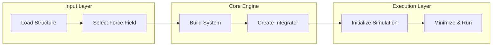

This guide walks you through running your first molecular dynamics simulation with OpenMM in under five minutes. By the end, you will understand the core simulation pipeline, execute a working example, and know where to find resources for deeper exploration. No prior molecular dynamics experience is required.


## The Five-Minute Simulation Pipeline

Every OpenMM simulation follows a consistent, declarative pattern. You do not need to understand the underlying physics engine — you only need to supply the molecule, the force field that defines its interactions, an integrator that advances time, and a few simulation parameters. OpenMM handles everything else, including automatic GPU acceleration when available.

The pipeline has six stages, and the architecture reflects a clean separation of concerns across those stages:



This three-tier architecture is the key mental model for working with OpenMM. The **Input Layer** reads your molecular structure and force field definitions. The **Core Engine** translates those into an internal `System` and `Integrator` that define the physics. The **Execution Layer** wraps everything into a `Simulation` object and drives the actual computation. Each layer communicates through well-defined Python objects, making the entire pipeline composable and testable.

Sources: [simulatePdb.py](examples/python-examples/simulatePdb.py#L1-L16), [simulation.py](wrappers/python/openmm/app/simulation.py#L58-L115)

## Install OpenMM

OpenMM installs with a single command. The default installation includes CPU and Reference platforms. GPU support for NVIDIA (CUDA), AMD (HIP), or Apple/Intel (OpenCL) is available through optional extras.

| Method | Command | GPU Support |
|--------|---------|-------------|
| **conda** (recommended) | `conda install -c conda-forge openmm` | Auto-detected CUDA |
| **pip** (CPU only) | `pip install openmm` | OpenCL, CPU, Reference |
| **pip** + CUDA 12 | `pip install openmm[cuda12]` | NVIDIA CUDA 12 |
| **pip** + HIP 6 | `pip install openmm[hip6]` | AMD ROCm/HIP 6 |

After installation, verify everything works correctly:

```bash
python -m openmm.testInstallation
```

This command confirms the installation, checks for available GPU platforms (CUDA, OpenCL, HIP), and verifies that all platforms produce numerically consistent results against the Reference implementation. If GPU acceleration is available, you will see it listed — OpenMM will use it automatically with no additional configuration required.

> [!TIP]
> You do not need to choose a specific platform in your script. The `Simulation` class automatically selects the fastest available platform at runtime. If you have an NVIDIA GPU with proper drivers, CUDA acceleration is used transparently. This zero-configuration design is intentional — it lets the same script run optimally on laptops, workstations, and HPC clusters without modification.

Sources: [01_getting_started.rst](docs-source/usersguide/application/01_getting_started.rst#L36-L107)

## Your First Simulation Script

The following 16-line script is a complete, production-quality molecular dynamics simulation. It loads a PDB structure, parameterizes it with the Amber19 force field, energy-minimizes the system, runs 10,000 time steps, and saves both trajectory frames and progress reports.

```python
from openmm.app import *
from openmm import *
from openmm.unit import *
from sys import stdout

pdb = PDBFile('input.pdb')
forcefield = ForceField('amber19-all.xml', 'amber19/tip3pfb.xml')
system = forcefield.createSystem(pdb.topology, nonbondedMethod=PME,
        nonbondedCutoff=1*nanometer, constraints=HBonds)
integrator = LangevinMiddleIntegrator(300*kelvin, 1/picosecond, 0.004*picoseconds)
simulation = Simulation(pdb.topology, system, integrator)
simulation.context.setPositions(pdb.positions)
simulation.minimizeEnergy()
simulation.reporters.append(DCDReporter('output.dcd', 1000))
simulation.reporters.append(StateDataReporter(stdout, 1000, step=True,
        potentialEnergy=True, temperature=True))
simulation.step(10000)
```

This script lives in the repository at `examples/python-examples/simulatePdb.py`. Let us walk through every meaningful line and understand what it does.

Sources: [simulatePdb.py](examples/python-examples/simulatePdb.py#L1-L16), [02_running_sims.rst](docs-source/usersguide/application/02_running_sims.rst#L10-L38)

## Line-by-Line Breakdown

### Imports

```python
from openmm.app import *
from openmm import *
from openmm.unit import *
from sys import stdout
```

These four imports pull in the entire application layer (`openmm.app`), the core engine (`openmm`), the physical units system (`openmm.unit`), and the standard output stream for console reporting. The application layer is the high-level API you will use for nearly all tasks. The core engine is only needed directly when working with low-level `System`, `Integrator`, or `Context` objects. Every script you write will start with these same imports.

Sources: [__init__.py](wrappers/python/openmm/app/__init__.py#L1-L61)

### Loading a Molecular Structure

```python
pdb = PDBFile('input.pdb')
```

The `PDBFile` parser reads a standard PDB file and extracts two things: a **Topology** (the chemical connectivity — which atoms exist, what residues they belong to, how they are bonded) and **Positions** (the 3D coordinates of every atom). These two pieces of information are all OpenMM needs to build a simulation. The topology is accessed as `pdb.topology` and positions as `pdb.positions`.

Sources: [simulatePdb.py](examples/python-examples/simulatePdb.py#L6), [__init__.py](wrappers/python/openmm/app/__init__.py#L16)

### Selecting and Loading a Force Field

```python
forcefield = ForceField('amber19-all.xml', 'amber19/tip3pfb.xml')
```

The `ForceField` class accepts one or more XML files that define the physics of atomic interactions. Here we load two files: `amber19-all.xml` contains the complete Amber19 protein and nucleic acid parameters, and `amber19/tip3pfb.xml` specifies the TIP3P-FB water model. Multiple files are composited — the second file augments or overrides definitions from the first. The `ForceField` constructor searches for files in several locations in order: an absolute path, a path relative to the current working directory, and finally the bundled data directory at `openmm/app/data/`.

OpenMM ships with a comprehensive library of force fields across several major families:

| Force Field Family | Bundled Files | Water Models |
|---|---|---|
| **Amber19** | `amber19-all.xml`, `amber19/protein.ff19SB.xml`, `amber19/DNA.OL21.xml`, `amber19/lipid21.xml` | `tip3pfb.xml`, `tip4pfb.xml`, `opc.xml`, `opc3.xml`, `spce.xml` |
| **Amber14** | `amber14-all.xml`, `amber14/protein.ff14SB.xml`, `amber14/DNA.OL15.xml`, `amber14/RNA.OL3.xml`, `amber14/lipid17.xml` | `tip3pfb.xml`, `tip4pew.xml`, `opc.xml` |
| **CHARMM36** | `charmm36.xml`, `charmm36_2024.xml` | `tip3p-pme-b.xml`, `tip4p2005.xml`, `tip5p.xml` |
| **Amoeba** | `amoeba2018.xml`, `amoeba2013.xml` | `tip4pfb.xml` |
| **Implicit Solvent** | `implicit/gbn2.xml`, `implicit/obc2.xml` | — |

Sources: [forcefield.py](wrappers/python/openmm/app/forcefield.py#L195-L220), [data directory](wrappers/python/openmm/app/data)

### Building the Physical System

```python
system = forcefield.createSystem(pdb.topology, nonbondedMethod=PME,
        nonbondedCutoff=1*nanometer, constraints=HBonds)
```

The `createSystem()` method is where the force field is applied to your specific molecule. It matches every residue in the topology against its template library, assigns atom types, computes bond connectivity, and generates all the force objects that govern interatomic interactions. The three parameters shown here are the most commonly used for simulations in explicit solvent:

- **`nonbondedMethod=PME`** — Particle Mesh Ewald, the gold-standard method for handling long-range electrostatic interactions in periodic systems
- **`nonbondedCutoff=1*nanometer`** — the real-space cutoff distance for nonbonded force calculations
- **`constraints=HBonds`** — constrains bonds involving hydrogen to their equilibrium lengths, enabling a larger 4 fs time step

Notice the explicit use of physical units: `1*nanometer`. OpenMM's unit system prevents silent unit errors — you cannot accidentally pass an angstrom where a nanometer is expected, because the types will not match.

Sources: [forcefield.py](wrappers/python/openmm/app/forcefield.py#L1231-L1260), [simulatePdb.py](examples/python-examples/simulatePdb.py#L8)

### Creating the Integrator

```python
integrator = LangevinMiddleIntegrator(300*kelvin, 1/picosecond, 0.004*picoseconds)
```

The integrator advances the simulation through time using a numerical algorithm. The `LangevinMiddleIntegrator` implements the BAOAB Langevin integrator (middle scheme), which provides excellent sampling and temperature control. Its three arguments define the thermodynamic ensemble: **temperature** (300 K), **friction coefficient** (1 ps⁻¹, controlling how strongly the system is coupled to the thermal bath), and **time step** (4 fs, the interval between force evaluations).

Sources: [simulatePdb.py](examples/python-examples/simulatePdb.py#L9)

### Initializing and Running the Simulation

```python
simulation = Simulation(pdb.topology, system, integrator)
simulation.context.setPositions(pdb.positions)
simulation.minimizeEnergy()
```

The `Simulation` class is the unified high-level interface that ties everything together. Its constructor accepts a topology, system, and integrator, then internally creates a `Context` — the low-level object that manages memory, platform selection, and computation. Setting positions loads the atomic coordinates into the simulation state. `minimizeEnergy()` performs a local energy minimization to remove any bad contacts or steric clashes that could cause the simulation to explode, using a default convergence tolerance of 10 kJ/mol/nm.

```python
simulation.reporters.append(DCDReporter('output.dcd', 1000))
simulation.reporters.append(StateDataReporter(stdout, 1000, step=True,
        potentialEnergy=True, temperature=True))
simulation.step(10000)
```

**Reporters** are how you extract data from a running simulation. The `DCDReporter` writes trajectory frames (atomic coordinates at each saved step) to a binary DCD file every 1,000 steps. The `StateDataReporter` prints a formatted line to the console with the step number, potential energy, and temperature, also every 1,000 steps. Finally, `simulation.step(10000)` runs the simulation for 10,000 time steps — at 4 fs per step, this is 40 picoseconds of simulated time.

> [!TIP]
> The `Simulation` object also provides `saveCheckpoint()` and `loadCheckpoint()` methods for long-running simulations. Call `simulation.saveCheckpoint('checkpoint.chk')` periodically (or use the `CheckpointReporter`) so you can resume from the exact simulation state if the process is interrupted. This is essential for production simulations that run for hours or days.

Sources: [simulation.py](wrappers/python/openmm/app/simulation.py#L58-L115), [simulation.py](wrappers/python/openmm/app/simulation.py#L125-L146), [simulation.py](wrappers/python/openmm/app/simulation.py#L283-L315)

## Supporting Multiple File Formats

OpenMM is not tied to PDB files or Amber force fields. The same simulation pattern works with all major biomolecular file formats. The table below shows how each format maps to the standard pipeline — only the first two lines (structure loading and system creation) change; everything else stays identical.

| Format | Loader Class | System Creation | Example File |
|--------|-------------|-----------------|-------------|
| **PDB** | `PDBFile('input.pdb')` | `ForceField(...).createSystem(pdb.topology, ...)` | [simulatePdb.py](examples/python-examples/simulatePdb.py) |
| **Amber** | `AmberPrmtopFile('input.prmtop')` + `AmberInpcrdFile('input.inpcrd')` | `prmtop.createSystem(...)` | [simulateAmber.py](examples/python-examples/simulateAmber.py) |
| **GROMACS** | `GromacsTopFile('input.top')` + `GromacsGroFile('input.gro')` | `top.createSystem(...)` | [simulateGromacs.py](examples/python-examples/simulateGromacs.py) |
| **CHARMM** | `CharmmPsfFile('system.psf')` + `CharmmParameterSet(...)` | `psf.createSystem(params, ...)` | [simulateCharmm.py](examples/python-examples/simulateCharmm.py) |
| **Tinker/Amoeba** | `TinkerFiles('system.xyz', ['params.prm'])` | `tinker.createSystem(...)` | [simulateTinker.py](examples/python-examples/simulateTinker.py) |

For Amber, GROMACS, and CHARMM files, the force field parameters are embedded directly in the topology files, so you do not need to specify a separate `ForceField`. The `createSystem()` method on the loader class handles parameterization internally.

Sources: [simulateAmber.py](examples/python-examples/simulateAmber.py#L1-L16), [simulateGromacs.py](examples/python-examples/simulateGromacs.py#L1-L16), [simulateCharmm.py](examples/python-examples/simulateCharmm.py#L1-L34), [simulateTinker.py](examples/python-examples/simulateTinker.py#L1-L15)

## Where to Find Examples

All example scripts and their accompanying input files live in the `examples/python-examples/` directory of the repository. The directory structure is flat and self-contained — each example script and its required data files are in the same folder:

```
examples/python-examples/
├── simulatePdb.py          ← PDB + ForceField (Amber19)
├── simulateAmber.py        ← Amber PRMTOP + INPCRD
├── simulateGromacs.py      ← GROMACS TOP + GRO
├── simulateCharmm.py       ← CHARMM PSF + parameters
├── simulateTinker.py       ← Tinker XYZ + PRM (Amoeba)
├── argon-chemical-potential.py  ← Custom forces, alchemical free energy
├── input.pdb / input.prmtop / input.inpcrd / input.gro / input.top
└── ...
```

The `argon-chemical-potential.py` example is more advanced — it demonstrates building a system from scratch using the low-level API with `CustomNonbondedForce`, performing alchemical free energy calculations across multiple lambda windows, and analyzing results with the MBAR statistical method. This is an excellent next step once you are comfortable with the basic pipeline.

Sources: [examples directory](examples/python-examples)

## Project Structure at a Glance

Understanding where the key components live in the repository helps you navigate the codebase as you go deeper:

```
openmm/
├── wrappers/python/openmm/
│   ├── __init__.py            ← Core engine: System, Integrator, Context
│   └── app/
│       ├── __init__.py        ← Application layer public API
│       ├── simulation.py      ← Simulation class (high-level runner)
│       ├── forcefield.py      ← ForceField class & built-in force field XML
│       ├── modeller.py        ← Modeller (add solvent, hydrogens, membranes)
│       ├── topology.py        ← Topology, Chain, Residue, Atom
│       ├── pdbfile.py         ← PDB parser
│       ├── amberprmtopfile.py ← Amber file readers
│       ├── gromacstopfile.py  ← GROMACS file readers
│       ├── charmmpsffile.py   ← CHARMM file readers
│       ├── data/              ← Bundled force field XML files
│       └── ...reporters       ← Output: DCD, PDB, XTC, checkpoint, state
├── openmmapi/                ← C++ core API (System, Force, Integrator)
├── platforms/                ← CUDA, OpenCL, HIP, CPU, Reference backends
├── plugins/                  ← Amoeba, Drude, RPMD, CPU-PME plugins
├── examples/python-examples/ ← Ready-to-run example scripts
└── docs-source/              ← Documentation source (Sphinx RST)
```

Sources: [README.md](README.md#L1-L37), [__init__.py](wrappers/python/openmm/app/__init__.py#L1-L61), [simulation.py](wrappers/python/openmm/app/simulation.py#L1-L44)

## Next Steps

You now have everything needed to run a basic simulation. Here is a recommended reading path based on your goals:

- **[Installation and Platform Setup](3-installation-and-platform-setup)** — detailed platform configuration, driver requirements, and performance tuning for CUDA/OpenCL/HIP
- **[System and Context](11-system-and-context)** — understanding the core engine objects (`System`, `Context`, `State`) that power the `Simulation` class
- **[Simulation Class](14-simulation-class)** — deep dive into the `Simulation` API including checkpointing, state management, and reporter configuration
- **[ForceField and System Generation](15-forcefield-and-system-generation)** — customizing force field parameters, handling non-standard residues, and mixing force fields
- **[Modeller and Topology](16-modeller-and-topology)** — adding missing hydrogens, solvating in explicit water, building membranes, and editing molecular models programmatically