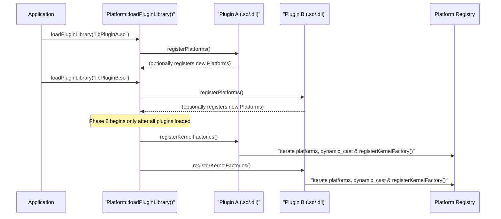
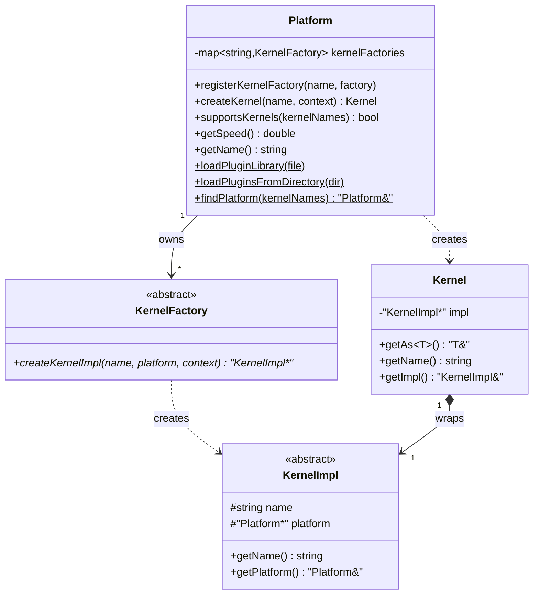
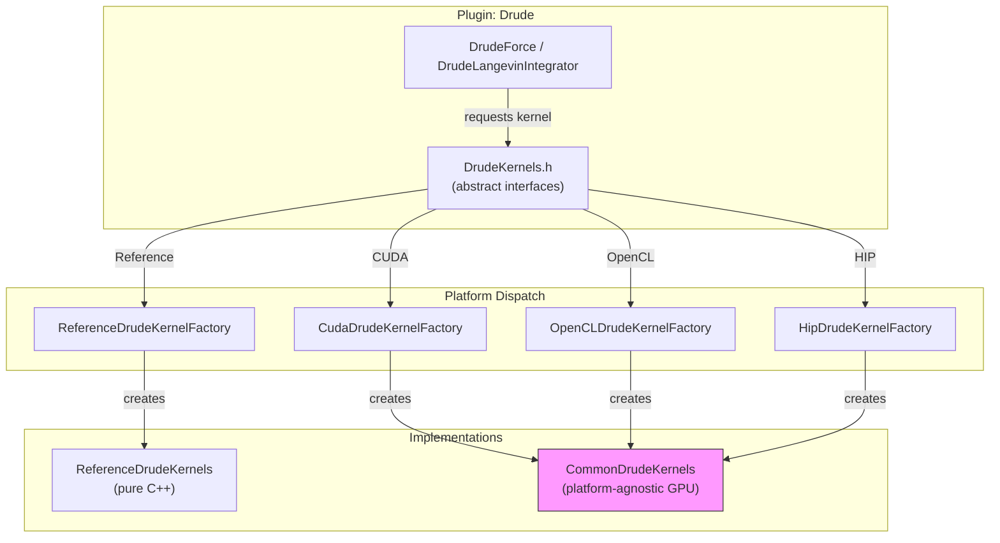

OpenMM's plugin system is the mechanism by which the simulation toolkit extends its capabilities beyond the core library — adding new force fields, integrators, and hardware backends without modifying the OpenMM source itself. This architecture is rooted in a two-phase dynamic loading protocol and a factory-driven kernel dispatch system, both defined in the `olla` (OpenMM Low-Level Abstraction) layer. Understanding this system is essential for any developer intending to contribute new physics or optimize existing kernels for novel hardware.

## The Loading Contract: Two C Entry Points

Every OpenMM plugin shared library must export exactly two `extern "C"` functions declared in [PluginInitializer.h](plugins/../olla/include/openmm/PluginInitializer.h#L49-L57). These form the contractual interface between the dynamic loader and the plugin:

1. **`registerPlatforms()`** — Called first, across all plugins. This is the phase where a plugin may register entirely new `Platform` objects (hardware targets) via `Platform::registerPlatform()`. Most kernel-extension plugins leave this empty, as they target already-registered platforms like Reference, CUDA, OpenCL, or HIP.

2. **`registerKernelFactories()`** — Called second, only after *all* plugins have completed their `registerPlatforms()` pass. This ordering guarantee eliminates initialization-order problems when one plugin needs to register a `KernelFactory` on a `Platform` defined by a different plugin. Within this function, the plugin iterates over `Platform::getNumPlatforms()`, uses `dynamic_cast` to identify the target platform type, and registers its `KernelFactory` instances.

The separation into two passes is the single most critical design decision in the plugin architecture. It means a CUDA-only kernel extension for the Amoeba force field can safely assume the CUDA platform already exists when `registerKernelFactories()` is invoked, even if the Amoeba plugin library happens to be loaded before the CUDA platform library in the dynamic loading sequence.



Sources: [PluginInitializer.h](olla/include/openmm/PluginInitializer.h#L49-L57), [Platform.h](olla/include/openmm/Platform.h#L243-L261)

## The Kernel Dispatch Chain: Platform → Factory → Impl

The runtime kernel dispatch follows a three-layer chain that the plugin architecture plugs into at the factory and impl layers. The [Platform](olla/include/openmm/Platform.h) class acts as a named registry of `KernelFactory` objects, keyed by kernel name strings. When the simulation engine needs a computation (e.g., calculating Drude forces), it requests a kernel by name from the platform associated with the current `Context`.

The [KernelFactory](olla/include/openmm/KernelFactory.h#L43-L49) is an abstract class with a single pure-virtual method:

```cpp
virtual KernelImpl* createKernelImpl(std::string name, const Platform& platform, ContextImpl& context) const = 0;
```

Each concrete factory subclasses this and dispatches on the kernel name string to instantiate the appropriate [KernelImpl](olla/include/openmm/KernelImpl.h#L40-L42) subclass. The returned `KernelImpl` is wrapped in a [Kernel](olla/include/openmm/Kernel.h) object, which provides type-safe access via the templated `getAs<T>()` method — eliminating raw `dynamic_cast` at every call site.



The critical insight for plugin developers: you never subclass `Platform` unless you're introducing a new hardware backend. Instead, you create a `KernelFactory` subclass and register it against an existing platform. This is the extension point used by all four current plugins.

Sources: [Platform.h](olla/include/openmm/Platform.h#L161-L178), [KernelFactory.h](olla/include/openmm/KernelFactory.h#L43-L49), [Kernel.h](olla/include/openmm/Kernel.h#L68-L81), [KernelImpl.h](olla/include/openmm/KernelImpl.h#L40-L42)

## Plugin Internal Structure

Every plugin follows a consistent internal directory layout that mirrors the core OpenMM structure. Examining the four shipped plugins reveals this shared anatomy:

```
plugins/
├── amoeba/          # 6 kernel types, 4 platform targets, serialization, Python wrappers
├── drude/           # 4 kernel types, 4 platform targets, serialization, Python wrappers
├── rpmd/            # 1 kernel type,  4 platform targets, tests only
└── cpupme/          # Minimal: include/, src/, tests/ (no full platform structure)
```

The full-structure plugins (amoeba, drude, rpmd) each contain:

| Directory | Purpose |
|-----------|---------|
| `openmmapi/include/openmm/` | Public API headers — new Force classes, Integrator classes, and their kernel interface definitions |
| `openmmapi/include/openmm/internal/` | `ForceImpl` subclasses that mediate between the public API and the kernel system |
| `platforms/common/src/` | Platform-agnostic kernel implementations shared across CUDA, OpenCL, and HIP |
| `platforms/reference/` | Scalar C++ reference implementation with its own `KernelFactory` |
| `platforms/cuda/` | CUDA-specific `KernelFactory` delegating to common kernels |
| `platforms/opencl/` | OpenCL-specific `KernelFactory` delegating to common kernels |
| `platforms/hip/` | HIP-specific `KernelFactory` delegating to common kernels |
| `serialization/` | XML serialization support for the plugin's Force/Integrator objects |
| `wrappers/` | Python wrapper generation scripts and Doxygen configuration |

The `cpupme` plugin is a notable exception — it provides only an optimized PME implementation for the CPU platform without defining new Force or Integrator classes, and therefore has a minimal structure with just `include/`, `src/`, and `tests/`.

Sources: [plugins/ directory structure](plugins/), [amoeba platforms](plugins/amoeba/platforms), [drude platforms](plugins/drude/platforms), [rpmd platforms](plugins/rpmd/platforms)

## Kernel Interface Definition: The Abstract Contract

Each plugin defines its kernel interfaces in a dedicated header within `openmmapi/include/openmm/`. These headers declare abstract `KernelImpl` subclasses that specify the computation API. For example, the Drude plugin defines three kernel types in [DrudeKernels.h](plugins/drude/openmmapi/include/openmm/DrudeKernels.h):

| Kernel Class | Static Name String | Purpose |
|-------------|-------------------|---------|
| `CalcDrudeForceKernel` | `"CalcDrudeForce"` | Calculate Drude particle forces and energy |
| `IntegrateDrudeLangevinStepKernel` | `"IntegrateDrudeLangevinStep"` | One integration step of the Drude Langevin thermostat |
| `IntegrateDrudeSCFStepKernel` | `"IntegrateDrudeSCFStep"` | One integration step of the Drude SCF integrator |

Each kernel interface follows a consistent pattern: a static `Name()` method returning the canonical kernel name string, a constructor forwarding to `KernelImpl(name, platform)`, and pure-virtual methods defining the computation contract (`initialize()`, `execute()`, `copyParametersToContext()`, etc.). This design enforces that every platform implementation of the same kernel must provide identical method signatures.

The Amoeba plugin defines six kernel interfaces in [amoebaKernels.h](plugins/amoeba/openmmapi/include/openmm/amoebaKernels.h): `CalcAmoebaTorsionTorsionForceKernel`, `CalcAmoebaVdwForceKernel`, `CalcAmoebaMultipoleForceKernel`, `CalcAmoebaGeneralizedKirkwoodForceKernel`, `CalcAmoebaWcaDispersionForceKernel`, and `CalcHippoNonbondedForceKernel`. The RPMD plugin defines a single kernel, `IntegrateRPMDStepKernel`, in [RpmdKernels.h](plugins/rpmd/openmmapi/include/openmm/RpmdKernels.h).

Sources: [DrudeKernels.h](plugins/drude/openmmapi/include/openmm/DrudeKernels.h#L51-L144), [amoebaKernels.h](plugins/amoeba/openmmapi/include/openmm/amoebaKernels.h#L56-L100), [RpmdKernels.h](plugins/rpmd/openmmapi/include/openmm/RpmdKernels.h#L40-L50)

## Factory Registration in Practice

The concrete `KernelFactory` implementations demonstrate two distinct strategies depending on the target platform.

**Reference platform factories** use an iterative search with `dynamic_cast` to locate their platform. This pattern appears in all three reference factories — for example, [ReferenceDrudeKernelFactory.cpp](plugins/drude/platforms/reference/src/ReferenceDrudeKernelFactory.cpp#L41-L53):

```cpp
extern "C" OPENMM_EXPORT void registerKernelFactories() {
    for (int i = 0; i < Platform::getNumPlatforms(); i++) {
        Platform& platform = Platform::getPlatform(i);
        if (dynamic_cast<ReferencePlatform*>(&platform) != NULL) {
            ReferenceDrudeKernelFactory* factory = new ReferenceDrudeKernelFactory();
            platform.registerKernelFactory(CalcDrudeForceKernel::Name(), factory);
            platform.registerKernelFactory(IntegrateDrudeLangevinStepKernel::Name(), factory);
            platform.registerKernelFactory(IntegrateDrudeSCFStepKernel::Name(), factory);
        }
    }
}
```

**GPU platform factories** use `Platform::getPlatformByName()` for direct lookup, wrapped in a try-catch that silently ignores failures if the target platform is not available. This is visible in [CudaDrudeKernelFactory.cpp](plugins/drude/platforms/cuda/src/CudaDrudeKernelFactory.cpp#L41-L52):

```cpp
extern "C" OPENMM_EXPORT void registerKernelFactories() {
    try {
        Platform& platform = Platform::getPlatformByName("CUDA");
        CudaDrudeKernelFactory* factory = new CudaDrudeKernelFactory();
        platform.registerKernelFactory(CalcDrudeForceKernel::Name(), factory);
        // ...
    }
    catch (std::exception ex) {
        // Ignore — CUDA platform not available
    }
}
```

Note that a single factory instance can be registered for multiple kernel names, since the factory's `createKernelImpl()` method dispatches internally based on the name string. The platform takes ownership of all registered factories and deletes them on shutdown.

Sources: [ReferenceDrudeKernelFactory.cpp](plugins/drude/platforms/reference/src/ReferenceDrudeKernelFactory.cpp#L41-L53), [CudaDrudeKernelFactory.cpp](plugins/drude/platforms/cuda/src/CudaDrudeKernelFactory.cpp#L41-L52), [AmoebaReferenceKernelFactory.cpp](plugins/amoeba/platforms/reference/src/AmoebaReferenceKernelFactory.cpp#L55-L70), [ReferenceRpmdKernelFactory.cpp](plugins/rpmd/platforms/reference/src/ReferenceRpmdKernelFactory.cpp#L40-L47)

## Cross-Plugin Kernel Sharing via the Common Layer

A significant architectural optimization is the **common kernel layer** shared across GPU platforms. Each plugin with GPU implementations contains a `platforms/common/src/` directory with platform-agnostic kernel implementations. The CUDA, OpenCL, and HIP factories do not implement kernels directly — instead they delegate to the common layer, which abstracts the differences between GPU compute APIs through an internal abstraction.

This is evident in the Drude CUDA factory: `CudaDrudeKernelFactory::createKernelImpl()` instantiates `CommonCalcDrudeForceKernel`, `CommonIntegrateDrudeLangevinStepKernel`, and `CommonIntegrateDrudeSCFStepKernel` — not CUDA-specific classes. The common layer accesses the GPU context through platform-specific data pointers (`context.getPlatformData()`) but implements the physics once.



Sources: [CommonDrudeKernels.cpp](plugins/drude/platforms/common/src/CommonDrudeKernels.cpp), [CudaDrudeKernelFactory.cpp](plugins/drude/platforms/cuda/src/CudaDrudeKernelFactory.cpp#L58-L67)

## Dynamic Loading at Runtime

The `Platform` class provides two static methods for loading plugins at runtime, declared in [Platform.h](olla/include/openmm/Platform.h#L243-L273):

- **`loadPluginLibrary(file)`** — Loads a single shared library by path. Invokes both `registerPlatforms()` and `registerKernelFactories()` on the loaded library. Throws on failure.
- **`loadPluginsFromDirectory(directory)`** — Scans a directory (or colon/semicolon-separated list of directories) and attempts to load every file. Failures are silently recorded and retrievable via `getPluginLoadFailures()`.
- **`getDefaultPluginsDirectory()`** — Returns the `OPENMM_PLUGIN_DIR` environment variable, or a platform-specific default.

From Python, the canonical loading pattern is:

```python
from openmm import Platform
Platform.loadPluginsFromDirectory(Platform.getDefaultPluginsDirectory())
```

This is typically called automatically by the OpenMM Python package on import, but advanced users may call it explicitly to load plugins from custom locations.

> [!TIP]
> The `OPENMM_PLUGIN_DIR` environment variable is the standard mechanism for installing third-party plugins. Set it to the directory containing your plugin shared libraries, and they will be discovered automatically by `Platform.getDefaultPluginsDirectory()`. On conda installations, this typically points to `$CONDA_PREFIX/lib/openmm/plugins`.

Sources: [Platform.h](olla/include/openmm/Platform.h#L243-L273)

## Serialization Integration

Plugins that define new `Force` or `Integrator` subclasses must also integrate with OpenMM's serialization system for checkpoint/restart support. The Amoeba and Drude plugins include `serialization/` directories with `XmlSerializer` registrations that allow their objects to be written to and read from XML.

The serialization integration follows the standard OpenMM pattern: each serializable class registers itself with `XmlSerializer::registerType()` providing a tag name, type, and serialization proxy. This registration happens within the plugin's initialization code so that it occurs when the plugin is loaded.

## Static Library Build Support

The Amoeba plugin demonstrates support for static linking via the `OPENMM_BUILDING_STATIC_LIBRARY` preprocessor macro. In [AmoebaReferenceKernelFactory.cpp](plugins/amoeba/platforms/reference/src/AmoebaReferenceKernelFactory.cpp#L55-L60), the registration functions are declared as `static` rather than `extern "C"` when building as a static library:

```cpp
#ifdef OPENMM_BUILDING_STATIC_LIBRARY
static void registerPlatforms() {
#else
extern "C" OPENMM_EXPORT void registerPlatforms() {
#endif
```

This allows the same source files to be compiled into either a shared plugin library or linked statically into the OpenMM core, with the registration functions called explicitly by the host application in the static case.

Sources: [AmoebaReferenceKernelFactory.cpp](plugins/amoeba/platforms/reference/src/AmoebaReferenceKernelFactory.cpp#L55-L60)

## Summary of Current Plugins

The following table summarizes the four plugins shipped with the OpenMM repository and their kernel registrations:

| Plugin | New Force Classes | New Integrator Classes | Kernel Types Registered | GPU Common Layer | Python Wrappers | Serialization |
|--------|------------------|----------------------|------------------------|------------------|-----------------|--------------|
| **amoeba** | `AmoebaMultipoleForce`, `AmoebaVdwForce`, `AmoebaTorsionTorsionForce`, `AmoebaGeneralizedKirkwoodForce`, `AmoebaWcaDispersionForce`, `HippoNonbondedForce` | — | 6 | ✅ | ✅ | ✅ |
| **drude** | `DrudeForce` | `DrudeLangevinIntegrator`, `DrudeSCFIntegrator`, `DrudeNoseHooverIntegrator` | 4 | ✅ | ✅ | ✅ |
| **rpmd** | — | `RPMDIntegrator`, `RPMDMonteCarloBarostat` | 1 | ✅ | ❌ | ❌ |
| **cpupme** | — | — | N/A (optimizes existing PME) | ❌ | ❌ | ❌ |

## Continuing the Exploration

The plugin architecture interfaces directly with the platform abstraction layer and the core API class system. To understand how plugins are consumed by the simulation engine, see [Platform and Kernel System](8-platform-and-kernel-system). For concrete examples of how the Amoeba and Drude plugins expose their physics to end users, continue to [Amoeba Polarizable Force Field](21-amoeba-polarizable-force-field) and [Drude and RPMD Plugins](22-drude-and-rpmd-plugins). For the serialization mechanisms plugins integrate with, see [Serialization and Checkpointing](23-serialization-and-checkpointing).