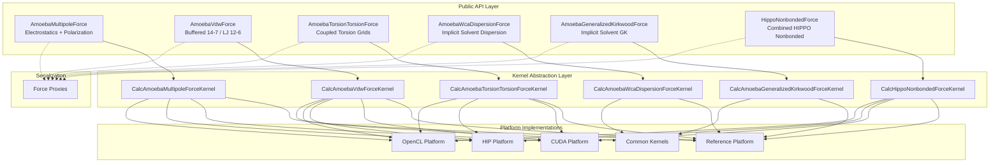

The AMOEBA (Atomic Multipole Optimized Energetics for Biomolecular Applications) plugin is OpenMM's GPU-accelerated implementation of Jay Ponder's polarizable force field. Unlike fixed-charge force fields, AMOEBA models electronic polarization through atomic multipoles (charge, dipole, quadrupole) and mutually induced dipoles, yielding significantly higher accuracy for electrostatic interactions at the cost of greater computational complexity. This page documents the plugin's internal architecture, force class hierarchy, platform kernel dispatch, polarization solver strategies, and serialization infrastructure — everything an advanced developer needs to extend, debug, or integrate AMOEBA simulations.

Sources: [08_amoeba_plugin.rst](docs-source/usersguide/library/08_amoeba_plugin.rst#L1-L15), [OpenMMAmoeba.h](plugins/amoeba/openmmapi/include/OpenMMAmoeba.h#L1-L41)

## Architectural Overview

The AMOEBA plugin follows the same [Platform and Kernel System](8-platform-and-kernel-system) architecture as the core OpenMM library: a set of public API Force classes in `openmmapi/`, platform-specific kernel implementations in `platforms/`, a kernel abstraction layer in `amoebaKernels.h`, and serialization proxies for checkpoint/restart. The critical design difference from core OpenMM forces is the presence of **polarization solvers** — iterative or extrapolative algorithms that must converge induced dipoles self-consistently within each force evaluation. This requirement deeply influences the kernel implementation across all platforms.



The plugin directory at `plugins/amoeba/` contains the following structural layout:

```
plugins/amoeba/
├── openmmapi/          # Public API: Force classes + headers
│   ├── include/openmm/ # AmoebaMultipoleForce.h, AmoebaVdwForce.h, etc.
│   └── src/            # Force implementations + Impl classes
├── platforms/          # Per-platform kernel implementations
│   ├── reference/      # Reference (double-precision) baseline
│   ├── cuda/           # CUDA GPU kernels
│   ├── hip/            # HIP GPU kernels (AMD)
│   ├── opencl/         # OpenCL GPU kernels
│   └── common/         # Shared CPU-based kernels (WCA, Vdw, GK)
├── serialization/      # XML/bytecode serialization proxies
├── tests/              # Unit test headers for each force
└── wrappers/           # SWIG wrapper generation
```

Sources: [CMakeLists.txt](plugins/amoeba/CMakeLists.txt), [amoebaKernels.h](plugins/amoeba/openmmapi/include/openmm/amoebaKernels.h#L1-L40)

## Force Class Hierarchy

The AMOEBA plugin exposes six Force classes through the umbrella header [OpenMMAmoeba.h](plugins/amoeba/openmmapi/include/OpenMMAmoeba.h#L33-L40). All inherit from the core `openmm::Force` base class and follow the established pattern of storing per-particle parameters in internal `Info` structs. Each Force class has a corresponding `ForceImpl` subclass that bridges to the kernel abstraction layer.

### Core Electrostatics: AmoebaMultipoleForce

`AmoebaMultipoleForce` is the computational heart of the AMOEBA model. It handles permanent atomic multipoles (charge, dipole, quadrupole), induced dipole polarization, and optionally PME long-range electrostatics. Each particle stores a complete multipole description defined in its **local molecular frame**, along with axis type information and reference atom indices that define the rotation from the molecular to the laboratory frame.

The class exposes three **polarization strategies** through the `PolarizationType` enum, each representing a fundamentally different trade-off between accuracy and computational cost:

| Polarization Type | Enum Value | Description | Iterative? |
|---|---|---|---|
| Mutual | 0 | Fully self-consistent induced dipoles, iterated until convergence | Yes |
| Direct | 1 | Induced dipoles depend only on fixed multipoles (no mutual coupling) | No |
| Extrapolated | 2 | Few iterative steps followed by analytic extrapolation to converged values | Partially |

The mutual polarization solver is controlled by two key parameters: `getMutualInducedMaxIterations()` (default iteration ceiling) and `getMutualInducedTargetEpsilon()` (convergence threshold). For the extrapolated method, `setExtrapolationCoefficients()` accepts a vector whose length determines the number of SCF iterations before extrapolation; the current default coefficients are `[-0.154, 0.017, 0.658, 0.474]`, though the API documentation warns these may change in future releases.

The `MultipoleAxisTypes` enum defines six axis conventions for rotating multipoles from the molecular to the lab frame: `ZThenX`, `Bisector`, `ZBisect`, `ThreeFold`, `ZOnly`, and `NoAxisType`. Each particle specifies its axis type along with three reference atom indices (`multipoleAtomZ`, `multipoleAtomX`, `multipoleAtomY`) that define the local coordinate system. The covalent topology is encoded via `setCovalentMap()` using `CovalentType` entries (`Covalent12` through `PolarizationCovalent14`) that control polarization group exclusion logic.

Beyond standard force/energy evaluation, the class provides diagnostic accessors for retrieving **lab-frame permanent dipoles**, **induced dipoles**, **total dipoles**, **electrostatic potential** on arbitrary grids, and **system multipole moments** — all queried post-evaluation from a live `Context`.

Sources: [AmoebaMultipoleForce.h](plugins/amoeba/openmmapi/include/openmm/AmoebaMultipoleForce.h#L55-L98), [AmoebaMultipoleForce.h](plugins/amoeba/openmmapi/include/openmm/AmoebaMultipoleForce.h#L227-L298), [AmoebaMultipoleForce.h](plugins/amoeba/openmmapi/include/openmm/AmoebaMultipoleForce.h#L308-L351), [AmoebaMultipoleForce.h](plugins/amoeba/openmmapi/include/openmm/AmoebaMultipoleForce.h#L370-L442)

### Van der Waals: AmoebaVdwForce

`AmoebaVdwForce` implements the repulsion-dispersion term, supporting two potential functions selected via the `PotentialFunction` enum: **Buffered147** (the AMOEBA default, a buffered 14-7 potential) and **LennardJones** (standard 12-6). A distinctive feature is the **hydrogen reduction factor** — each particle can place its interaction site at an offset along the bond vector toward its parent atom, typically used to shift hydrogen vdW sites closer to the heavy atom.

The class supports two parameterization modes. In the **per-particle mode**, each particle carries its own sigma and epsilon values. In the **type-based mode**, particles reference a type index, and per-type parameters are defined via `addParticleType()`, with optional pair-specific overrides via `addTypePair()` that bypass the combining rule for selected type combinations.

Since version 8.0, `AmoebaVdwForce` also supports **alchemical free energy calculations** through the `AlchemicalMethod` enum (`None`, `Decouple`, `Annihilate`). When enabled, per-particle `isAlchemical` flags mark atoms undergoing transformation, and a context parameter `"AmoebaVdwLambda"` (accessible via the static `Lambda()` method) controls the softcore state between 0.0 and 1.0. The softcore functional form follows Jiao et al. (2008) and can be tuned via softcore power (default 5) and alpha (default 0.7) parameters.

Sources: [AmoebaVdwForce.h](plugins/amoeba/openmmapi/include/openmm/AmoebaVdwForce.h#L40-L78), [AmoebaVdwForce.h](plugins/amoeba/openmmapi/include/openmm/AmoebaVdwForce.h#L109-L136), [AmoebaVdwForce.h](plugins/amoeba/openmmapi/include/openmm/AmoebaVdwForce.h#L177-L232)

### Coupled Torsions: AmoebaTorsionTorsionForce

`AmoebaTorsionTorsionForce` implements the coupled torsion-torsion (tortor) energy term, which captures the correlation between two adjacent dihedral angles — a critical correction for protein backbone energetics. The term is represented as a five-dimensional spline grid indexed by the two torsion angles (with one grid per distinct pair of atom types). This class stores per-particle grid data and maps each coupled torsion to its corresponding spline lookup.

Sources: [AmoebaTorsionTorsionForce.h](plugins/amoeba/openmmapi/include/openmm/AmoebaTorsionTorsionForce.h), [08_amoeba_plugin.rst](docs-source/usersguide/library/08_amoeba_plugin.rst#L55-L57)

### Implicit Solvent: AmoebaWcaDispersionForce and AmoebaGeneralizedKirkwoodForce

Implicit solvent in the AMOEBA plugin is split across two complementary Force classes. **AmoebaWcaDispersionForce** computes the WCA (Weeks-Chandler-Andersen) dispersion correction and the ACE-based solvent-accessible surface area (SASA) cavity term, which replaces TINKER's GPU-unfriendly SASA algorithm with the Analytical Continuum Electrostatics approximation. **AmoebaGeneralizedKirkwoodForce** implements the Generalized Kirkwood polar solvation model, computing the reaction field using Grycuk Born radii. Both are implemented as **common kernels** shared across the Reference and CPU platforms rather than having per-platform GPU implementations.

Sources: [AmoebaWcaDispersionForce.h](plugins/amoeba/openmmapi/include/openmm/AmoebaWcaDispersionForce.h), [AmoebaGeneralizedKirkwoodForce.h](plugins/amoeba/openmmapi/include/openmm/AmoebaGeneralizedKirkwoodForce.h), [08_amoeba_plugin.rst](docs-source/usersguide/library/08_amoeba_plugin.rst#L96-L105)

### HIPPO Nonbonded: HippoNonbondedForce

`HippoNonbondedForce` is a monolithic force class that consolidates **all** nonbonded interactions in the HIPPO (Hydrogen-like Intermolecular Polarizable Potential) successor to AMOEBA: electrostatics, induction, charge transfer, dispersion, and Pauli repulsion. The design rationale for merging these into a single Force is efficiency — the terms share multipole definitions and are most naturally computed together on GPUs. The class manages separate PME parameters for electrostatics (`getPMEParameters`) and dispersion (`getDPMEParameters`), supports the same extrapolation coefficient scheme for induced dipoles, and provides a switching function to smooth repulsion and charge-transfer interactions near the cutoff boundary.

Sources: [HippoNonbondedForce.h](plugins/amoeba/openmmapi/include/openmm/HippoNonbondedForce.h#L42-L55), [HippoNonbondedForce.h](plugins/amoeba/openmmapi/include/openmm/HippoNonbondedForce.h#L113-L175), [amoebaKernels.h](plugins/amoeba/openmmapi/include/openmm/amoebaKernels.h#L256-L309)

## Kernel Abstraction and Platform Dispatch

The kernel interface is defined in [amoebaKernels.h](plugins/amoeba/openmmapi/include/openmm/amoebaKernels.h) with six abstract kernel classes. Each follows the standard OpenMM kernel pattern: a `Name()` static factory identifier, an `initialize()` method that receives the System and Force objects, an `execute()` method that performs force/energy computation, and optional query methods for dipole retrieval and parameter introspection.

| Kernel Class | Force | Platform Implementations | GPU Kernel Code |
|---|---|---|---|
| `CalcAmoebaMultipoleForceKernel` | AmoebaMultipoleForce | Reference, CUDA, HIP, OpenCL | `kernels/` subdirectory |
| `CalcAmoebaVdwForceKernel` | AmoebaVdwForce | Reference, CUDA, HIP, OpenCL, Common | `kernels/` subdirectory |
| `CalcAmoebaTorsionTorsionForceKernel` | AmoebaTorsionTorsionForce | Reference, CUDA, HIP, OpenCL | Inline |
| `CalcAmoebaWcaDispersionForceKernel` | AmoebaWcaDispersionForce | Reference, Common | N/A (CPU) |
| `CalcAmoebaGeneralizedKirkwoodForceKernel` | AmoebaGeneralizedKirkwoodForce | Reference, Common | N/A (CPU) |
| `CalcHippoNonbondedForceKernel` | HippoNonbondedForce | Reference, CUDA, HIP, OpenCL | `kernels/` subdirectory |

The GPU platforms (CUDA, HIP, OpenCL) store their kernel source strings in generated files like `CudaAmoebaKernelSources.cpp.in` / `CudaAmoebaKernelSources.h.in`, which embed the actual kernel source code as C++ string constants. This follows the same pattern as the core OpenMM platforms described in [CUDA Platform Implementation](9-cuda-platform-implementation). The **common** platform provides CPU-optimized implementations for forces that don't benefit from GPU parallelism (WCA dispersion and GK solvation).

Sources: [amoebaKernels.h](plugins/amoeba/openmmapi/include/openmm/amoebaKernels.h#L44-L134), [amoebaKernels.h](plugins/amoeba/openmmapi/include/openmm/amoebaKernels.h#L176-L254), [CudaAmoebaKernelSources.cpp.in](plugins/amoeba/platforms/cuda/src/CudaAmoebaKernelSources.cpp.in)

## Polarization Solver Internals

The polarization solver is the most architecturally distinctive component of the AMOEBA plugin. In **Mutual** mode, the solver iterates the induced dipole equation:

```
μ_induced = α · E_fixed + α · T · μ_induced
```

where α is the atomic polarizability, E_fixed is the electric field from permanent multipoles, and T is the dipole-dipole interaction tensor. The iteration continues until the change in induced dipoles falls below `mutualInducedTargetEpsilon` or `mutualInducedMaxIterations` is reached.

In **Extrapolated** mode, the solver performs a small number of SCF iterations (determined by the length of the extrapolation coefficient vector), then applies an analytic extrapolation:

```
μ_final = c_0·μ_0 + c_1·μ_1 + c_2·μ_2 + ... + c_n·μ_n
```

where μ_i is the induced dipole vector after iteration i and c_i are the extrapolation coefficients. This approach can achieve near-mutual accuracy at a fraction of the cost, making it particularly attractive for GPU implementations where iterative convergence is expensive due to global synchronization requirements. The default 4-term coefficient set `[-0.154, 0.017, 0.658, 0.474]` was calibrated to minimize energy error relative to fully converged mutual polarization.

> [!TIP]
> The extrapolated polarization mode is not merely a performance optimization — it fundamentally changes the integration landscape. Because the induced dipoles at each timestep are a deterministic function of the current coordinates (no iterative solver state to carry over), the extrapolated method produces smoother potential energy surfaces and can improve integrator stability in some regimes. However, the coefficients are release-dependent and may change.

The `getInducedDipoles()`, `getLabFramePermanentDipoles()`, and `getTotalDipoles()` methods on `AmoebaMultipoleForce` allow real-time inspection of the polarization state, which is invaluable for debugging convergence issues or validating that polarization groups are correctly configured.

Sources: [AmoebaMultipoleForce.h](plugins/amoeba/openmmapi/include/openmm/AmoebaMultipoleForce.h#L70-L92), [AmoebaMultipoleForce.h](plugins/amoeba/openmmapi/include/openmm/AmoebaMultipoleForce.h#L336-L351), [AmoebaMultipoleForce.h](plugins/amoeba/openmmapi/include/openmm/AmoebaMultipoleForce.h#L371-L392)

## TINKER Compatibility and Unit Conversions

A critical concern for developers working with the AMOEBA plugin is the **unit system mismatch** between TINKER and OpenMM. TINKER parameter files use kcal/mol for energy, Ångströms for distance, and atomic charge units, while OpenMM uses kJ/mol, nanometers, and elementary charges. The mapping requires systematic conversion of all force-field parameters. Standard bonded terms (bonds mapped to `HarmonicBondForce`, angles to `HarmonicAngleForce`, Urey-Bradley to `HarmonicBondForce`) are handled by the TINKER-OpenMM conversion layer. The following table documents the complete TINKER-to-OpenMM force mapping with support status:

| TINKER Force Term | OpenMM Force Class | Supported Options | Notes |
|---|---|---|---|
| `ebond1` (bond) | `HarmonicBondForce` | HARMONIC only | MORSE not implemented |
| `Eangle71` (angle) | `HarmonicAngleForce` | HARMONIC, IN-PLANE | LINEAR, FOURIER not implemented |
| `etors1a` (torsion) | `PeriodicTorsionForce` | All | Smoothing (etors1b) not supported |
| `etortor1` (tortor) | `AmoebaTorsionTorsionForce` | All | — |
| `eopbend1` (opbend) | `AmoebaOutOfPlaneBendForce` | ALLINGER only | W-D-C not implemented |
| `epitors1` (pitor) | `AmoebaPiTorsionForce` | All | — |
| `estrbnd1` (strbnd) | `AmoebaStretchBendForce` | All | — |
| `ehal1a` (vdw) | `AmoebaVdwForce` | All | LIGHTS (ehal1b) not supported |
| `empole1a` (mpole) | `AmoebaMultipoleForce` | MUTUAL, DIRECT | — |
| `empole1c` (PME) | `AmoebaMultipoleForce` | MUTUAL, DIRECT + PME | VACUUM boundary unsupported |
| `esolv1` (solvate) | AmoebaWcaDisp + AmoebaGK | GK + grycuk only | ASP, SASA, ONION, pb unsupported |
| `eurey1` (urey) | `HarmonicBondForce` | All | — |

Sources: [08_amoeba_plugin.rst](docs-source/usersguide/library/08_amoeba_plugin.rst#L47-L82)

## Serialization Infrastructure

Every AMOEBA Force class has a corresponding **serialization proxy** in `plugins/amoeba/serialization/src/` that enables the [Serialization and Checkpointing](23-serialization-and-checkpointing) workflow. The proxy registration is centralized in [AmoebaSerializationProxyRegistration.cpp](plugins/amoeba/serialization/src/AmoebaSerializationProxyRegistration.cpp). Each proxy implements `getProxyTypeName()` for XML type identification and manages the marshaling/unmarshaling of per-particle parameters, covalent maps, PME settings, and polarization configuration.

| Proxy Class | Force | Serialization File |
|---|---|---|
| `AmoebaMultipoleForceProxy` | AmoebaMultipoleForce | `AmoebaMultipoleForceProxy.cpp` |
| `AmoebaVdwForceProxy` | AmoebaVdwForce | `AmoebaVdwForceProxy.cpp` |
| `AmoebaTorsionTorsionForceProxy` | AmoebaTorsionTorsionForce | `AmoebaTorsionTorsionForceProxy.cpp` |
| `AmoebaWcaDispersionForceProxy` | AmoebaWcaDispersionForce | `AmoebaWcaDispersionForceProxy.cpp` |
| `AmoebaGeneralizedKirkwoodForceProxy` | AmoebaGeneralizedKirkwoodForce | `AmoebaGeneralizedKirkwoodForceProxy.cpp` |
| `HippoNonbondedForceProxy` | HippoNonbondedForce | `HippoNonbondedForceProxy.cpp` |

Corresponding serialization test files (`TestSerialize*.cpp`) validate round-trip correctness for each force. When building custom workflows that create AMOEBA systems, ensure the plugin is loaded before deserializing — the proxy registration is triggered by the shared library's static initialization.

> [!TIP]
> AMOEBA serialization includes the extrapolation coefficients and polarization type. If you serialize a System using Extrapolated polarization and later load it with an older plugin version that has different default coefficients, the stored coefficients will be used correctly. However, the warning in the API that "default coefficients may change in a future release" applies to programmatically created forces, not deserialized ones — serialized Systems capture their coefficients explicitly.

Sources: [AmoebaSerializationProxyRegistration.cpp](plugins/amoeba/serialization/src/AmoebaSerializationProxyRegistration.cpp), [serialization tests](plugins/amoeba/serialization/tests/)

## Validation and Numerical Accuracy

The plugin has been validated against TINKER 6.1.01 using dihydrofolate reductase (DHFR) in both implicit and explicit solvent. The validation metric is the per-atom relative force difference: `2·|F_MM - F_T| / (|F_MM| + |F_T|)`, and the reported value is the **median** across all atoms. The results demonstrate that the dominant source of discrepancy in implicit solvent is the SASA cavity term (different algorithms in TINKER vs. OpenMM), not the core electrostatics:

| Solvent Model | CUDA Single Precision | CUDA Double Precision |
|---|---|---|
| Implicit (full) | 1.04 × 10⁻² | 1.04 × 10⁻² |
| Implicit (no cavity) | 9.23 × 10⁻⁶ | 1.17 × 10⁻⁶ |
| Explicit | 3.73 × 10⁻⁵ | 1.83 × 10⁻⁷ |

For developers implementing new AMOEBA features, the explicit-solvent double-precision benchmark (1.83 × 10⁻⁷ median relative difference) represents the achievable accuracy floor. The single-precision explicit result (3.73 × 10⁻⁵) is typical for GPU single-precision electrostatics. The plugin supports both Verlet and Stochastic integrators — the TINKER Beeman integrator has no OpenMM equivalent.

Sources: [08_amoeba_plugin.rst](docs-source/usersguide/library/08_amoeba_plugin.rst#L107-L124)

## Extending the AMOEBA Plugin

Developers wishing to extend the AMOEBA plugin should follow this pattern:

1. **Define the Force class** in `plugins/amoeba/openmmapi/include/openmm/` with per-particle parameter storage in an internal `Info` struct
2. **Create the ForceImpl** in `plugins/amoeba/openmmapi/src/` that calls `ForceImpl::registerKernel()` with the appropriate kernel name
3. **Add the abstract kernel** to [amoebaKernels.h](plugins/amoeba/openmmapi/include/openmm/amoebaKernels.h) following the existing naming convention
4. **Implement per-platform kernels** in each `platforms/*/src/` directory, registering them via each platform's kernel factory
5. **Create the serialization proxy** in `plugins/amoeba/serialization/src/` and register it in [AmoebaSerializationProxyRegistration.cpp](plugins/amoeba/serialization/src/AmoebaSerializationProxyRegistration.cpp)
6. **Register the header** in [OpenMMAmoeba.h](plugins/amoeba/openmmapi/include/OpenMMAmoeba.h) and update the wrapper generation script [generateAmoebaWrappers.py](plugins/amoeba/wrappers/generateAmoebaWrappers.py)

For GPU kernel development, the CUDA platform's `kernels/` subdirectory contains the AMOEBA-specific kernel source strings. HIP and OpenCL implementations are direct translations of the same algorithms with platform-specific syntax.

## Next Steps

- For a deeper understanding of the platform abstraction that dispatches AMOEBA kernels, see [Platform and Kernel System](8-platform-and-kernel-system)
- To learn how AMOEBA forces integrate with the broader force-field generation pipeline, see [ForceField and System Generation](15-forcefield-and-system-generation)
- To explore the Drude polarizable force field — an alternative polarization approach — see [Drude and RPMD Plugins](22-drude-and-rpmd-plugins)
- For the core OpenMM serialization mechanisms that AMOEBA proxies build upon, see [Serialization and Checkpointing](23-serialization-and-checkpointing)
- To build the plugin from source, consult [Building from Source](24-building-from-source)