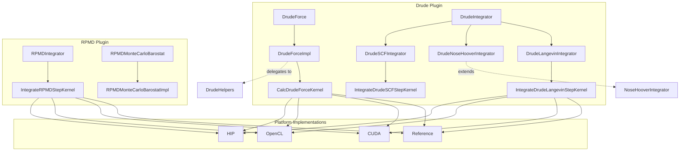

OpenMM's plugin architecture extends the core simulation engine with domain-specific capabilities that would bloat the main library if bundled natively. Two of the most scientifically significant plugins are the **Drude polarizable force field plugin** and the **Ring Polymer Molecular Dynamics (RPMD) plugin**, each addressing fundamentally different physical phenomena—electronic polarization and nuclear quantum effects—through specialized Force and Integrator classes that integrate seamlessly with the existing [System and Context](11-system-and-context) and [Platform and Kernel System](8-platform-and-kernel-system).

## Architectural Overview

Both plugins follow the same architectural blueprint established by the core OpenMM framework: a public API layer defines domain-specific `Force` and `Integrator` classes, abstract kernel interfaces declare platform-agnostic operations, and concrete platform implementations (Reference, CUDA, OpenCL, HIP) provide hardware-accelerated execution. This separation ensures that new platforms automatically gain support for plugin features without modification to the plugin's public API.

Both plugins reside under `plugins/` and share an identical internal layout: `openmmapi/` for the public C++ API, `platforms/` for per-platform kernel implementations, `serialization/` for checkpoint/proxy support (Drude only), and `tests/` for validation suites. A notable structural asymmetry is that the Drude plugin includes a `wrappers/` directory and full serialization proxies, while the RPMD plugin omits these—reflecting its more specialized usage pattern.

Sources: [DrudeForce.h](plugins/drude/openmmapi/include/openmm/DrudeForce.h#L53-L53), [RPMDIntegrator.h](plugins/rpmd/openmmapi/include/openmm/RPMDIntegrator.h#L67-L67), [DrudeKernels.h](plugins/drude/openmmapi/include/openmm/DrudeKernels.h#L47-L139), [RpmdKernels.h](plugins/rpmd/openmmapi/include/openmm/RpmdKernels.h#L46-L85)

## Drude Polarizable Force Field Plugin

The Drude plugin implements the Drude oscillator model for electronic polarization, a computationally efficient alternative to fully self-consistent polarizable force fields like [Amoeba](21-amoeba-polarizable-force-field). In this model, each polarizable atom is augmented with an attached massless (or very low mass) "Drude particle" carrying a partial charge, connected to its parent by an anisotropic harmonic spring. The induced dipole emerges from the displacement of the Drude particle under the local electric field—avoiding the iterative self-consistent field convergence required by induced dipole methods.

### DrudeForce: The Core Force Class

`DrudeForce` is the central class that defines two distinct energetic contributions. First, an **anisotropic harmonic bond** connects each Drude particle to its parent atom, with spring constants derived from the specified polarizability and optional anisotropy scale factors along user-defined molecular axes. Second, a **screened Coulomb (Thole) interaction** between specific dipole pairs replaces the standard Coulomb interaction for 1-2 and 1-3 bonded interactions, preventing unphysical charge penetration that would otherwise occur when Drude pairs approach each other closely.

The `addParticle()` method registers each Drude particle with up to five particle indices and four physical parameters. The particle and particle1 fields define the Drude-parent pair (required), while particle2 through particle4 define auxiliary atoms that establish the local frame for anisotropic polarizability (optional, via -1 sentinel values). The `charge` parameter specifies the Drude particle's charge, `polarizability` sets the isotropic polarizability α (converted internally to a spring constant k = q²/α), and `aniso12`/`aniso34` are scale factors that modulate the spring constant along specific molecular directions.

Sources: [DrudeForce.h](plugins/drude/openmmapi/include/openmm/DrudeForce.h#L72-L88), [DrudeForce.cpp](plugins/drude/openmmapi/src/DrudeForce.cpp#L42-L49)

| Parameter | Type | Description |
|-----------|------|-------------|
| `particle` | `int` | System index of the Drude particle |
| `particle1` | `int` | System index of the parent atom |
| `particle2` | `int` | Second atom defining anisotropy axis 1-2 (-1 to disable) |
| `particle3` | `int` | Third atom defining anisotropy axis 3-4 (-1 to disable) |
| `particle4` | `int` | Fourth atom defining anisotropy axis 3-4 (-1 to disable) |
| `charge` | `double` | Charge on the Drude particle (e or elementary charge units) |
| `polarizability` | `double` | Isotropic polarizability α (must be > 0) |
| `aniso12` | `double` | Scale factor along particle1→particle2 axis (must be > 0 if particle2 set) |
| `aniso34` | `double` | Scale factor along particle3→particle4 axis (must be > 0 if particle3/4 set) |

Screened pairs are added via `addScreenedPair()`, which takes indices into the DrudeForce's particle list (not system indices) and a Thole damping factor. The `DrudeForceImpl` validates at initialization that particle indices are within bounds, no particle participates in multiple Drude pairs, and no duplicate screened pairs exist—providing early error detection before simulation begins.

Sources: [DrudeForce.h](plugins/drude/openmmapi/include/openmm/DrudeForce.h#L126-L133), [DrudeForceImpl.cpp](plugins/drude/openmmapi/src/DrudeForceImpl.cpp#L51-L113)

### Drude Helper Utilities

The `DrudeHelpers` module provides three critical utility functions shared across all Drude integrator implementations. The `getDrudeForce()` function locates the `DrudeForce` in a `ContextImpl` by iterating over the system's forces and, if not found directly, searching within contained forces of other force implementations—a design that accommodates scenarios where the DrudeForce is embedded within a composite force. The `findParticlesAndPairs()` function partitions all system particles into "normal" (non-Drude) particles and Drude-parent pair tuples, which every Drude integrator needs to apply separate thermostats. The `assignDrudeVelocities()` function generates Maxwell-Boltzmann distributed velocities with a critical distinction: normal particles and center-of-mass modes of Drude pairs are thermalized at the system temperature, while internal (relative) motions of Drude pairs are thermalized at the much lower Drude temperature using the reduced mass of each pair.

Sources: [DrudeHelpers.cpp](plugins/drude/openmmapi/src/DrudeHelpers.cpp#L48-L153)

### DrudeIntegrator Hierarchy

All Drude-specific integrators extend `DrudeIntegrator`, which itself extends the base `Integrator` class. The base class provides shared infrastructure: Drude temperature management via `getDrudeTemperature()`/`setDrudeTemperature()`, a hard-wall distance constraint via `getMaxDrudeDistance()`/`setMaxDrudeDistance()` (default 0.02 nm), and the `getVelocitiesForTemperature()` override that dispatches to the helper's velocity assignment logic. This design avoids code duplication across integrator implementations while enforcing a consistent initialization contract.

Sources: [DrudeIntegrator.h](plugins/drude/openmmapi/include/openmm/DrudeIntegrator.h#L43-L135)

| Integrator | Thermostat | Base Class | Strategy |
|------------|-----------|------------|----------|
| `DrudeLangevinIntegrator` | Dual Langevin | `DrudeIntegrator` | Stochastic, velocity-dependent friction on COM and relative modes |
| `DrudeNoseHooverIntegrator` | Dual Nose-Hoover chains | `NoseHooverIntegrator` | Deterministic, MTS with Yoshida-Suzuki decomposition |
| `DrudeSCFIntegrator` | None | `DrudeIntegrator` | Energy minimization of Drude positions each step |

**DrudeLangevinIntegrator** applies two independent Langevin thermostats: one at the system temperature for ordinary particles and the center-of-mass motion of Drude pairs, and a second at the Drude temperature for the relative internal displacement of each pair. The constructor requires five parameters: `temperature`, `frictionCoeff`, `drudeTemperature`, `drudeFrictionCoeff`, and `stepSize`. It exposes `computeSystemTemperature()` and `computeDrudeTemperature()` for monitoring, delegating to the shared `computeTemperaturesFromVelocities()` helper which correctly accounts for constraints and center-of-mass motion removal when computing degrees of freedom.

Sources: [DrudeLangevinIntegrator.h](plugins/drude/openmmapi/include/openmm/DrudeLangevinIntegrator.h#L54-L156), [DrudeHelpers.cpp](plugins/drude/openmmapi/src/DrudeHelpers.cpp#L159-L217)

**DrudeNoseHooverIntegrator** provides a deterministic alternative by extending `NoseHooverIntegrator` directly (bypassing `DrudeIntegrator`'s `Integrator` inheritance path). It maintains separate Nose-Hoover chains for the real and Drude subsystems, with support for multiple time stepping (MTS) through Yoshida-Suzuki decomposition. The constructor signature includes `chainLength` (default 3), `numMTS` (default 3), and `numYoshidaSuzuki` (default 7), giving fine-grained control over integration accuracy. Like the Langevin variant, it provides `computeSystemTemperature()`, `computeDrudeTemperature()`, `computeDrudeKineticEnergy()`, and `computeTotalKineticEnergy()`, along with the hard-wall Drude distance constraint.

Sources: [DrudeNoseHooverIntegrator.h](plugins/drude/openmmapi/include/openmm/DrudeNoseHooverIntegrator.h#L54-L125)

**DrudeSCFIntegrator** takes a fundamentally different approach: rather than dynamically integrating Drude particle motion with a thermostat, it performs a self-consistent minimization of Drude positions at every time step using a leap-frog Verlet scheme for the real atoms. The `getMinimizationErrorTolerance()`/`setMinimizationErrorTolerance()` methods control the convergence criterion (in kJ/mol/nm) for this energy minimization. This integrator is suitable when the Drude degrees of freedom are well-separated in timescale from the nuclear motion and can be treated as adiabatic.

Sources: [DrudeSCFIntegrator.h](plugins/drude/openmmapi/include/openmm/DrudeSCFIntegrator.h#L48-L101)

> [!TIP]
> The `computeTemperaturesFromVelocities()` helper in [DrudeHelpers.cpp](plugins/drude/openmmapi/src/DrudeHelpers.cpp#L159-L217) computes Drude temperature from the **relative** velocity between pair members using the reduced mass, while system temperature uses the **center-of-mass** velocity and the total pair mass. This decomposition is critical for correctly dual-thermostatted simulations and properly handles constraints and CMMotionRemover when counting degrees of freedom.

### Drude Kernel Interface and Platform Coverage

The `DrudeKernels.h` header defines three abstract kernel classes that bridge the public API to platform-specific implementations. `CalcDrudeForceKernel` handles force/energy evaluation for `DrudeForce`, `IntegrateDrudeLangevinStepKernel` handles the dual-thermostatted Langevin time step, and `IntegrateDrudeSCFStepKernel` handles the SCF minimization loop. Each kernel declares `initialize()`, `execute()`, and (where applicable) `copyParametersToContext()` methods that platforms must implement. The Drude plugin provides implementations across all five OpenMM platforms: Reference, CUDA, OpenCL, HIP, and Common (shared utility code).

Sources: [DrudeKernels.h](plugins/drude/openmmapi/include/openmm/DrudeKernels.h#L47-L139)

## RPMD Plugin

The Ring Polymer Molecular Dynamics plugin implements path-integral-based quantum dynamics through the ring polymer representation. Where the Drude plugin adds extra particles to model electronic polarization, the RPMD plugin replicates the *entire* system across multiple "beads" (copies) connected by harmonic springs, with the number of beads determining the level of quantum effects captured.

### RPMDIntegrator

`RPMDIntegrator` extends the base `Integrator` class and manages N copies of the system arranged in a ring (copy *i* connected to copies *i−1* and *i+1* with periodic boundary conditions). By default, it applies a PILE (Pile-Langevin-Estimator) thermostat to maintain canonical sampling across the ring polymer. The constructor accepts `numCopies`, `temperature`, `frictionCoeff`, and `stepSize`, with an optional `contractions` map that enables **ring polymer contraction**—a critical optimization where different force groups are evaluated on different numbers of beads. For example, bonded forces may be computed on all 32 beads while PME reciprocal space is computed on a single centroid bead, dramatically reducing computational cost while preserving accuracy.

Sources: [RPMDIntegrator.h](plugins/rpmd/openmmapi/include/openmm/RPMDIntegrator.h#L67-L91)

A fundamental API difference from standard integrators is that state management occurs through the integrator, not the context. The `setPositions(copy, positions)`, `setVelocities(copy, velocities)`, and `getState(copy, types, ...)` methods operate on individual copies, while `getTotalEnergy()` returns the aggregate ring polymer energy including all spring potentials. Direct calls to `Context.setPositions()` or `Context.getState()` should be avoided; the integrator internally manages which copy's state is loaded into the context at any given time.

Sources: [RPMDIntegrator.h](plugins/rpmd/openmmapi/include/openmm/RPMDIntegrator.h#L174-L204)

| Parameter | Type | Description |
|-----------|------|-------------|
| `numCopies` | `int` | Number of system replicas (beads) in the ring polymer |
| `temperature` | `double` | Heat bath temperature (K) |
| `frictionCoeff` | `double` | Langevin friction coefficient (1/ps) |
| `stepSize` | `double` | Integration time step (ps) |
| `contractions` | `map<int,int>` | Force group → bead count mapping for ring polymer contraction |

### RPMDMonteCarloBarostat

`RPMDMonteCarloBarostat` extends `Force` (not `Barostat`) and provides pressure control specifically designed for the ring polymer ensemble. Unlike the standard `MonteCarloBarostat` which scales a single copy, this barostat scales **all copies uniformly** and accepts or rejects the volume change based on the total ring polymer energy returned by `RPMDIntegrator.getTotalEnergy()`. The constructor takes `defaultPressure` (in bar) and `frequency` (default 25 steps). It uses the string key `"RPMDMonteCarloPressure"` for context parameter storage and always reports periodic boundary condition usage.

Sources: [RPMDMonteCarloBarostat.h](plugins/rpmd/openmmapi/include/openmm/RPMDMonteCarloBarostat.h#L46-L124)

### RPMD Kernel and Platform Architecture

The `IntegrateRPMDStepKernel` defined in `RpmdKernels.h` declares the full contract for platform implementations: `initialize()`, `execute()` (with a `forcesAreValid` flag to support selective recalculation), `setPositions()`, `setVelocities()`, `copyToContext()` (loading a specific copy into the active context), and `computeKineticEnergy()`. The RPMD plugin mirrors the Drude plugin's platform coverage with implementations for Reference, CUDA, OpenCL, and HIP, but notably lacks a Common shared-code layer and serialization support, indicating a narrower deployment scope.

Sources: [RpmdKernels.h](plugins/rpmd/openmmapi/include/openmm/RpmdKernels.h#L46-L85)

## Comparative Analysis: Drude vs. RPMD

Despite sharing the plugin architecture, the two plugins address fundamentally different physical regimes and impose different constraints on simulation setup. The table below highlights the key structural and functional distinctions relevant to developers integrating either plugin into custom workflows.

| Dimension | Drude Plugin | RPMD Plugin |
|-----------|-------------|-------------|
| **Physical model** | Electronic polarization via classical Drude oscillators | Nuclear quantum effects via path-integral ring polymer |
| **System modification** | Adds individual Drude particles (lightweight) | Replicates entire system N× (heavyweight) |
| **Force classes** | `DrudeForce` (spring + Thole screening) | `RPMDMonteCarloBarostat` |
| **Integrator classes** | 3: Langevin, NoseHoover, SCF | 1: RPMDIntegrator |
| **Thermostat strategy** | Dual-temperature (system + Drude internal) | Single PILE thermostat across all beads |
| **State management** | Standard Context API | Integrator-scoped per-copy API |
| **Serialization** | Full proxy support (Force + Integrators) | None |
| **Python wrappers** | Generated via `generateDrudeWrappers.py` | None dedicated |
| **Key optimization** | Hard-wall distance constraint | Ring polymer contraction by force group |

> [!TIP]
> When using `RPMDIntegrator` with ring polymer contraction, the `contractions` map keys are **force group indices** (not force group bitmasks). A force assigned to group 2 should use key `2`, not `4`. The contracted bead count must divide the total `numCopies` evenly for correct normal mode transformation.

## Integration Patterns and Practical Considerations

Both plugins are loaded at runtime through OpenMM's plugin discovery mechanism and require linking against their respective shared libraries. The Drude plugin demands that exactly one `DrudeForce` be present in the System—`getDrudeForce()` in [DrudeHelpers.cpp](plugins/drude/openmmapi/src/DrudeHelpers.cpp#L48-L74) throws if none or multiple are found. This constraint is enforced during integrator initialization, meaning any simulation using a Drude integrator will fail fast with a clear error message if the system is misconfigured.

The serialization subsystem provides checkpoint/restart for Drude simulations through proxy classes: `DrudeForceProxy`, `DrudeLangevinIntegratorProxy`, and `DrudeNoseHooverIntegratorProxy`. These are registered via `DrudeSerializationProxyRegistration.cpp`, enabling full state serialization through OpenMM's standard `XmlSerializer` interface. The RPMD plugin lacks this infrastructure, meaning RPMD simulations cannot be serialized through the standard checkpoint mechanism—a significant consideration for long-running production simulations.

For developers extending the Drude plugin, the `updateParametersInContext()` pathway on `DrudeForce` supports modifying numeric parameters (polarizability, Thole factors) without reinitializing the context, but cannot change particle identities or add/remove particles. This is implemented by delegating to `CalcDrudeForceKernel.copyParametersToContext()` followed by a `context.systemChanged()` call, as seen in [DrudeForceImpl.cpp](plugins/drude/openmmapi/src/DrudeForceImpl.cpp#L126-L129).

Sources: [DrudeForceImpl.cpp](plugins/drude/openmmapi/src/DrudeForceImpl.cpp#L126-L129), [DrudeSerializationProxyRegistration.cpp](plugins/drude/serialization/src/DrudeSerializationProxyRegistration.cpp)

## Further Reading

Having examined both plugin implementations, the natural progression for understanding OpenMM's extension mechanisms leads to the broader [Plugin Architecture](20-plugin-architecture) overview, which describes how plugins are discovered, loaded, and registered at runtime. For comparison with another polarizable force field implementation that shares the same plugin infrastructure, see [Amoeba Polarizable Force Field](21-amoeba-polarizable-force-field). To understand how the kernel abstraction layer enables these platform-specific implementations, revisit the [Platform and Kernel System](8-platform-and-kernel-system) discussion.