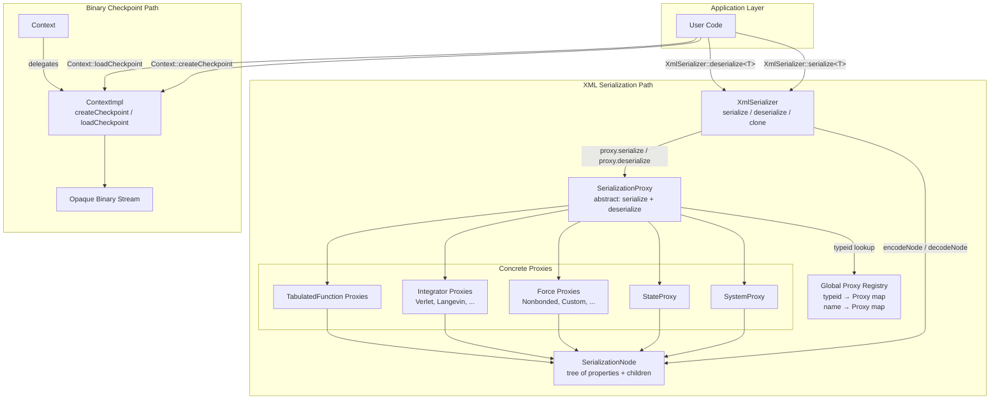

OpenMM provides two complementary mechanisms for persisting simulation state: an **XML-based serialization framework** for portable object reconstruction, and a **binary checkpointing system** for exact Context-level state restoration. Understanding the boundary between these systems—and the architectural decisions that separate them—is essential for building reliable, reproducible simulation workflows. This page dissects both subsystems from the proxy registration layer down to the XML encoding primitives.

## Architectural Overview

The serialization subsystem is organized as a classic **Proxy pattern** with a global type registry. Every serializable type (System, State, Force, Integrator, TabulatedFunction) has a corresponding `SerializationProxy` subclass that knows how to encode that type into a `SerializationNode` tree and decode it back again. `XmlSerializer` acts as the I/O bridge, converting node trees to/from XML text streams. Context-level checkpointing operates on an entirely separate code path within `ContextImpl`, producing opaque binary data.

## The Proxy Registration System

All serialization capability is bootstrapped through a single entry point: the `registerSerializationProxies()` function defined in [SerializationProxyRegistration.cpp](serialization/src/SerializationProxyRegistration.cpp#L121-L191). This function is invoked automatically when the shared library loads—via `DllMain` on Windows or `__attribute__((constructor))` on POSIX systems—ensuring every proxy is registered before any user code executes.

The `SerializationProxy` base class ([SerializationProxy.h](serialization/include/openmm/serialization/SerializationProxy.h#L54-L113)) maintains two parallel lookup maps: one keyed by `std::type_info` (used during serialization to find the correct proxy for a concrete C++ object) and another keyed by type name string (used during deserialization to reconstruct an object when only the XML `type` attribute is known). Each concrete proxy constructor passes its type name string—typically the class name—to the `SerializationProxy` constructor. The table below shows the complete set of registered types:

| Category | Registered Types |
|----------|-----------------|
| **Core Objects** | `System`, `State` |
| **Standard Forces** | `NonbondedForce`, `HarmonicBondForce`, `HarmonicAngleForce`, `PeriodicTorsionForce`, `RBTorsionForce`, `CMAPTorsionForce`, `GBSAOBCForce`, `GayBerneForce`, `LCPOForce`, `ATMForce`, `ConstantPotentialForce`, `OrientationRestraintForce`, `RGForce`, `RMSDForce` |
| **Custom Forces** | `CustomBondForce`, `CustomAngleForce`, `CustomTorsionForce`, `CustomNonbondedForce`, `CustomHbondForce`, `CustomGBForce`, `CustomExternalForce`, `CustomManyParticleForce`, `CustomCentroidBondForce`, `CustomCompoundBondForce`, `CustomCVForce`, `CustomVolumeForce` |
| **Integrators** | `VerletIntegrator`, `LangevinIntegrator`, `LangevinMiddleIntegrator`, `BrownianIntegrator`, `VariableLangevinIntegrator`, `VariableVerletIntegrator`, `CustomIntegrator`, `CompoundIntegrator`, `DPDIntegrator`, `NoseHooverIntegrator`, `QTBIntegrator` |
| **Thermostats & Barostats** | `AndersenThermostat`, `MonteCarloBarostat`, `MonteCarloAnisotropicBarostat`, `MonteCarloFlexibleBarostat`, `MonteCarloMembraneBarostat`, `CMMotionRemover` |
| **Tabulated Functions** | `Continuous1DFunction`, `Continuous2DFunction`, `Continuous3DFunction`, `Discrete1DFunction`, `Discrete2DFunction`, `Discrete3DFunction` |

Sources: [SerializationProxyRegistration.cpp](serialization/src/SerializationProxyRegistration.cpp#L121-L191), [SerializationProxy.h](serialization/include/openmm/serialization/SerializationProxy.h#L88-L104)

## SerializationNode: The Intermediate Representation

`SerializationNode` ([SerializationNode.h](serialization/include/openmm/serialization/SerializationNode.h#L50-L273)) is the tree-structured intermediate representation that decouples object serialization logic from XML encoding. Each node carries a name, an ordered list of child nodes, and a property map where keys are always strings and values are stored as strings internally but accessible through typed accessors (`getIntProperty()`, `getDoubleProperty()`, `getBoolProperty()`, `getLongProperty()`). Type coercion is implicit: setting a property via `setIntProperty()` and reading it via `getStringProperty()` produces the decimal string representation, while reading via `getDoubleProperty()` performs the numeric conversion. If the original string is non-numeric, the behavior is undefined—this is a deliberate performance trade-off that avoids validation overhead in the deserialization hot path.

The node tree is deliberately flexible. While there is typically a one-to-one correspondence between serializable objects and nodes, proxies are free to create arbitrary child structures. The `SystemProxy`, for example, creates nested `<Particles>`, `<Constraints>`, and `<Forces>` child containers, each holding per-element nodes. During deserialization, `getChildNode(name)` throws if the expected child is absent, providing fail-fast semantics for malformed input.

Sources: [SerializationNode.h](serialization/include/openmm/serialization/SerializationNode.h#L50-L100), [SerializationNode.h](serialization/include/openmm/serialization/SerializationNode.h#L105-L190)

## XmlSerializer: The I/O Bridge

`XmlSerializer` ([XmlSerializer.h](serialization/include/openmm/serialization/XmlSerializer.h#L43-L97)) is a fully static class providing three templated entry points. The **serialize** method resolves the proxy via `typeid(*object)`, invokes `proxy.serialize()` to populate a `SerializationNode`, stamps the node with a `type` property (guarding against proxies that accidentally use the reserved name `type`), and then recursively encodes the tree to XML using tab-indented formatting. The **deserialize** method reverses this: it parses XML via irrXML into a root `SerializationNode`, reads the `type` property to locate the correct proxy by name, and calls `proxy.deserialize()` to reconstruct the object. The **clone** method is an optimization that bypasses XML entirely—serializing to a `SerializationNode` and immediately deserializing—for deep-copying objects without the overhead of string encoding.

The XML encoding in [XmlSerializer.cpp](serialization/src/XmlSerializer.cpp#L107-L158) applies standard entity escaping (`&amp;`, `&lt;`, `&gt;`, `&quot;`, `&apos;`) and represents control characters below ASCII 32 as hexadecimal character references (e.g., `&#x0A;`). Leaf nodes (those with no children) are emitted as self-closing XML elements. The `StreamReader` adapter class wraps a C++ `std::istream` behind irrXML's `IFileReadCallBack` interface, enabling the parser to read from any standard stream source.

Sources: [XmlSerializer.h](serialization/include/openmm/serialization/XmlSerializer.h#L43-L80), [XmlSerializer.cpp](serialization/src/XmlSerializer.cpp#L107-L196)

## System Serialization

The `SystemProxy` ([SystemProxy.cpp](serialization/src/SystemProxy.cpp#L44-L179)) serializes the complete definition of a molecular system. The encoded XML includes a `version` property (currently always `1`) and an `openmmVersion` property for provenance tracking. The body contains three principal child containers:

- **`<PeriodicBoxVectors>`** — Three child nodes (`A`, `B`, `C`) each with `x`, `y`, `z` double properties encoding the default periodic box. This captures the `System.setDefaultPeriodicBoxVectors()` configuration.
- **`<Particles>`** — One `<Particle>` child per particle, each carrying a `mass` property. Particles that are virtual sites include an additional child node whose name identifies the virtual site type: `TwoParticleAverageSite`, `ThreeParticleAverageSite`, `OutOfPlaneSite`, `LocalCoordinatesSite`, or `SymmetrySite`. Each variant encodes its construction parameters (particle indices, weights, rotation matrices, offset vectors) as properties.
- **`<Constraints>`** — One `<Constraint>` child per constraint, with `p1`, `p2` (particle indices) and `d` (distance) properties.
- **`<Forces>`** — One `<Force>` child per force, each serialized by its own proxy. The `SerializationNode` constructor overload `createChildNode("Force", &system.getForce(i))` automatically delegates to the appropriate force proxy, creating nested subtrees.

During deserialization, the proxy reconstructs particles, virtual sites, constraints, and forces in order. A `try/catch` block ensures that a partially-constructed `System*` is deleted if deserialization fails partway through, preventing memory leaks from allocation errors in later stages.

Sources: [SystemProxy.cpp](serialization/src/SystemProxy.cpp#L44-L115), [SystemProxy.cpp](serialization/src/SystemProxy.cpp#L117-L179)

## State Serialization

The `StateProxy` ([StateProxy.cpp](serialization/src/StateProxy.cpp#L43-L157)) serializes a simulation snapshot. Unlike `SystemProxy` which captures structural definition, `StateProxy` captures instantaneous dynamical data. The serialized form is conditional on the `State.getDataTypes()` bitmask—the proxy only includes child nodes for data that was actually requested when `Context.getState()` was called.

| Child Node | Data Types Flag | Content |
|------------|----------------|---------|
| `<PeriodicBoxVectors>` | Always present | `A`, `B`, `C` with `x`, `y`, `z` double properties |
| `<Parameters>` | `State::Parameters` | Key-value double properties from `State.getParameters()` |
| `<Energies>` | `State::Energy` | `PotentialEnergy` and `KineticEnergy` double properties |
| `<Positions>` | `State::Positions` | One `<Position>` child per particle with `x`, `y`, `z` |
| `<Velocities>` | `State::Velocities` | One `<Velocity>` child per particle with `x`, `y`, `z` |
| `<Forces>` | `State::Forces` | One `<Force>` child per particle with `x`, `y`, `z` |
| `<IntegratorParameters>` | `State::IntegratorParameters` | A raw `SerializationNode` pushed directly from `State.getIntegratorParameters()` |

The deserialization path uses `State::StateBuilder` to incrementally assemble the `State` object. A critical validation step at [line 151](serialization/src/StateProxy.cpp#L151-L155) checks that all array-type data (positions, velocities, forces) have identical sizes, throwing `OpenMMException("State Deserialization Particle Size Mismatch")` if they disagree. This guard prevents subtle corruption from truncated or partially-written state files.

Sources: [StateProxy.cpp](serialization/src/StateProxy.cpp#L43-L95), [StateProxy.cpp](serialization/src/StateProxy.cpp#L96-L157)

## Checkpointing: Binary Context State

Context-level checkpointing via `Context::createCheckpoint()` and `Context::loadCheckpoint()` ([Context.h](openmmapi/include/openmm/Context.h#L274-L294)) is architecturally distinct from XML serialization. While XML serialization operates at the object level (System, State) and produces portable, human-readable text, checkpointing captures the **complete internal state of a Context**—including platform-specific GPU memory, random number generator seeds, constraint solver state, and any other internal data that the platform implementation maintains. The checkpoint stream is an **opaque binary blob** with no guaranteed format stability across OpenMM versions, hardware configurations, or even platform backends.

The official API documentation in [Context.h](openmmapi/include/openmm/Context.h#L281-L293) makes this specificity explicit: *"A checkpoint contains data that is highly specific to the Context from which it was created. It depends on the details of the System, the Platform being used, and the hardware and software of the computer it was created on."* Loading a checkpoint on different hardware or with a different OpenMM version will likely throw an exception. Even when it succeeds, deterministic trajectory reproducibility is described as not *"strictly guaranteed."*

The checkpoint system also underpins `Context::reinitialize(bool preserveState)` ([Context.h](openmmapi/include/openmm/Context.h#L267-L273)). When `preserveState` is `true`, the reimplementation internally creates a checkpoint before destroying the Context's internal state, then loads it after reconstruction. This means `reinitialize(true)` will throw if the System has changed incompatibly (e.g., particle count change) because the checkpoint cannot be loaded.

The test suite in [TestCheckpoints.h](tests/TestCheckpoints.h#L140-L288) exercises three critical checkpoint properties. First, `testSetState()` verifies that `Context.setState()` correctly restores positions, velocities, and parameters from a `State` object, and that partial states (positions-only) leave other fields untouched. Second, `testMultipleDevices()` confirms that a checkpoint created on one Context can be loaded into a different Context, and that subsequent simulation steps produce identical trajectories. Third, `testLangevin()` validates checkpoint behavior with stochastic integrators where random number generator state is critical for reproducibility.

Sources: [Context.h](openmmapi/include/openmm/Context.h#L274-L294), [TestCheckpoints.h](tests/TestCheckpoints.h#L73-L139), [TestCheckpoints.h](tests/TestCheckpoints.h#L140-L288)

## setState vs. loadCheckpoint: Choosing the Right Mechanism

The table below captures the critical distinctions between the two state restoration mechanisms, based directly on the API contract documented in [Context.h](openmmapi/include/openmm/Context.h#L120-L135) and [Context.h](openmmapi/include/openmm/Context.h#L281-L293).

| Dimension | `Context.setState(State)` | `Context.loadCheckpoint(stream)` |
|-----------|---------------------------|----------------------------------|
| **Data restored** | Positions, velocities, energies, parameters, forces, time, step count | All of the above plus RNG state, constraint solver state, platform internal state |
| **Portability** | Fully portable across platforms, hardware, and OpenMM versions | Tied to specific System, Platform, hardware, and OpenMM version |
| **Format** | `State` object (optionally XML-serialized via `XmlSerializer`) | Opaque binary stream |
| **Partial state** | Supported—only specified data types are applied | Always full state restoration |
| **Trajectory reproducibility** | Not guaranteed (RNG state is lost) | Nearly deterministic (same hardware/software) |
| **Failure mode** | Silent loss of RNG-related state | Explicit exception on incompatibility |
| **Use case** | Cross-platform state transfer, analysis workflows, human-readable archives | Exact simulation restart, debugging, `reinitialize(true)` |

> [!TIP]
> The `loadCheckpoint()` guarantee is intentionally weaker than binary equivalence. The API documentation states *"the internal state should be close enough to be reasonably considered equivalent"* rather than guaranteeing bit-identical trajectories. For workflows requiring strict reproducibility, you must use the same hardware, platform, and OpenMM build—and even then, validate empirically rather than relying on the contract alone.

> [!TIP]
> When using `Context.setState()` with a `State` that was deserialized from XML, be aware that the `State` must have been created with the appropriate data type flags. A State serialized without `State::Velocities` will leave velocities unchanged in the target Context—even if the original Context had well-defined velocities. Always check `State.getDataTypes()` before relying on a deserialized State for state restoration.

## Plugin Serialization Extensibility

The proxy registry is a global, flat namespace. Plugin libraries (such as the AMOEBA, Drude, and RPMD force field plugins) register their own serialization proxies when their shared libraries are loaded, using the same `SerializationProxy::registerProxy()` mechanism. This means plugin-specific types (e.g., `AmoebaMultipoleForce`) become transparently serializable once the plugin is loaded—the XML output will contain the plugin type's `type` attribute, and deserialization will resolve to the plugin's proxy at load time.

The implication for checkpointing is important: a Context using plugin forces can only be checkpointed and restored in an environment where the same plugins are loaded. A checkpoint from an AMOEBA simulation is useless without the AMOEBA plugin library present. This coupling does not exist for XML-based System serialization (the System XML is self-describing), but it does affect Context checkpoints because the binary format may encode plugin-specific platform kernel state.

## Summary of Key Source Locations

| Component | Header | Implementation |
|-----------|--------|----------------|
| SerializationProxy (abstract) | [SerializationProxy.h](serialization/include/openmm/serialization/SerializationProxy.h) | [SerializationProxy.cpp](serialization/src/SerializationProxy.cpp) |
| SerializationNode | [SerializationNode.h](serialization/include/openmm/serialization/SerializationNode.h) | [SerializationNode.cpp](serialization/src/SerializationNode.cpp) |
| XmlSerializer | [XmlSerializer.h](serialization/include/openmm/serialization/XmlSerializer.h) | [XmlSerializer.cpp](serialization/src/XmlSerializer.cpp) |
| SystemProxy | [SystemProxy.h](serialization/include/openmm/serialization/SystemProxy.h) | [SystemProxy.cpp](serialization/src/SystemProxy.cpp) |
| StateProxy | [StateProxy.h](serialization/include/openmm/serialization/StateProxy.h) | [StateProxy.cpp](serialization/src/StateProxy.cpp) |
| Proxy Registration | — | [SerializationProxyRegistration.cpp](serialization/src/SerializationProxyRegistration.cpp) |
| Context Checkpoint API | [Context.h](openmmapi/include/openmm/Context.h) | Platform-specific `ContextImpl` |
| Checkpoint Tests | [TestCheckpoints.h](tests/TestCheckpoints.h) | Platform test suites |

For broader context on how serialized Systems feed into simulation construction, see [System and Context](11-system-and-context). For details on the specific Force and Integrator classes that the proxy system serializes, see [Force Classes](13-force-classes) and [Integrator Hierarchy](12-integrator-hierarchy). To understand how plugins extend the serialization registry, see [Plugin Architecture](20-plugin-architecture). For the practical workflow of building simulations from serialized systems, proceed to [Building from Source](24-building-from-source).