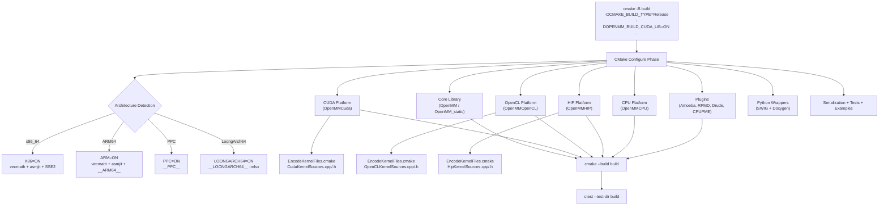
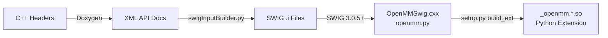

Building OpenMM from source gives you full control over platform targets, compiler optimizations, and plugin selection. This guide covers the complete build pipeline — from prerequisites through verification — based on the actual CMake configuration used by the project's own CI infrastructure. It is written for developers who need to produce custom builds, integrate OpenMM into larger CMake projects, or contribute platform-specific code.

## Build Architecture Overview

OpenMM's build system follows a **monorepo aggregation pattern**: a single root `CMakeLists.txt` orchestrates the compilation of the core library, all hardware platforms, every plugin, the Python bindings, the test suite, and the documentation into one unified build tree. There is no separate build step per component — everything is resolved in a single `cmake --build` invocation.



The key architectural insight is the **kernel encoding system**: GPU platforms (CUDA, OpenCL, HIP) do not compile kernel source files directly into the binary. Instead, `EncodeKernelFiles.cmake` reads the kernel sources from `platforms/*/src/kernels/`, escapes them into C string literals, and generates a `*KernelSources.cpp` file at configure time. These kernels are then JIT-compiled at runtime. This is why you will find `.cu.in`, `.cl.in`, and `.hip.in` template files rather than pre-compiled kernels in the source tree.

Sources: [CMakeLists.txt](CMakeLists.txt#L1-L13), [cmake_modules/EncodeKernelFiles.cmake](cmake_modules/EncodeKernelFiles.cmake#L1-L30), [cmake_modules/TargetArch.cmake](cmake_modules/TargetArch.cmake#L100-L187)

## Prerequisites and Toolchain Requirements

The minimum CMake version is **3.17**, enforced at configure time. Beyond CMake, requirements vary by which platforms and components you intend to build.

### Core Build Dependencies

| Dependency | Minimum Version | Required For | Notes |
|---|---|---|---|
| CMake | 3.17 | All builds | Enforced via `CMAKE_MINIMUM_REQUIRED` |
| C++ Compiler | C++11 standard | All builds | GCC, Clang, or MSVC |
| Python | 3.x | Python wrappers, SWIG input generation | Found via `find_package(PythonInterp)` |
| SWIG | ≥ 3.0.5 | Python wrappers | Build fails with `SEND_ERROR` if older |
| Doxygen | Any recent | Python wrappers | Required for parsing headers into SWIG input |
| NumPy | Any | Python wrappers | Needed at build time for Cython |
| Cython | Any | Python wrappers | Listed in CI environment |

Sources: [CMakeLists.txt](CMakeLists.txt#L24-L24), [wrappers/python/CMakeLists.txt](wrappers/python/CMakeLists.txt#L105-L122), [wrappers/python/CMakeLists.txt](wrappers/python/CMakeLists.txt#L124-L125)

### GPU Platform Dependencies

| Platform | SDK/Library | Detection Method | CMake Cache Variable |
|---|---|---|---|
| **CUDA** | CUDA Toolkit | `find_package(CUDAToolkit QUIET)` | `OPENMM_BUILD_CUDA_LIB` |
| **OpenCL** | OpenCL ICD / SDK | Custom `FindOpenCL.cmake` (checks `OPENCL_DIR`, `CUDA_PATH`, `AMDAPPSDKROOT`, macOS framework) | `OPENMM_BUILD_OPENCL_LIB` |
| **HIP** | ROCm (hip, hiprtc) | `find_package(HIP CONFIG QUIET)` with `$ROCM_PATH` and `/opt/rocm` prefix | `OPENMM_BUILD_HIP_LIB` |

A critical design decision: **GPU platform detection is automatic and opt-out, not opt-in**. If `CUDAToolkit_FOUND` is true, `OPENMM_BUILD_CUDA_LIB` defaults to `ON`. If `OPENCL_FOUND` is true, `OPENMM_BUILD_OPENCL_LIB` defaults to `ON`. If `HIP_FOUND` is true, `OPENMM_BUILD_HIP_LIB` defaults to `ON`. To build *only* the Reference and CPU platforms, you must explicitly set these to `OFF`.

Sources: [CMakeLists.txt](CMakeLists.txt#L324-L357), [cmake_modules/FindOpenCL.cmake](cmake_modules/FindOpenCL.cmake#L1-L96), [platforms/hip/CMakeLists.txt](platforms/hip/CMakeLists.txt#L15-L15)

### Architecture-Specific Compiler Flags

The build system detects the target architecture via `TargetArch.cmake`, which uses a clever preprocessor trick: it compiles a C file containing nested `#ifdef`/`#error` directives, and parses the architecture name from the compiler's error output. This works correctly even when cross-compiling because the code is never executed, only preprocessed.

| Architecture | Flag | Special Libraries |
|---|---|---|
| x86_64 / i386 | `-msse2 -pthread` (Linux), `-msse2 -stdlib=libc++` (macOS) | `vecmath`, `asmjit` (with `-DLEPTON_USE_JIT`) |
| ARM64 | `-pthread` | `vecmath`, `asmjit` (with `-DLEPTON_USE_JIT`) |
| PPC | `-pthread` | No vecmath/asmjit |
| LoongArch64 | `-pthread -mlsx` | No vecmath/asmjit |
| MSVC (any) | `/W2 /wd4305 /wd4244` | No extra flags for SSE (handled differently) |

The `asmjit` JIT compiler library is conditionally included only for x86 and ARM architectures, and only when building the shared library (it is explicitly excluded on Windows static builds). When present, it enables Lepton expression JIT compilation via the `-DLEPTON_USE_JIT` define.

Sources: [CMakeLists.txt](CMakeLists.txt#L36-L53), [CMakeLists.txt](CMakeLists.txt#L97-L132), [CMakeLists.txt](CMakeLists.txt#L237-L250)

## Source Subdirectory Composition

Understanding which source directories are aggregated into each build target is essential for debugging compilation issues and adding new code.

### Core Library Source Subdirectories

The core `OpenMM` library is built from these source directories, all handled from the root `CMakeLists.txt` rather than as CMake subdirectories:

```
.  openmmapi  olla  libraries/jama  libraries/quern  libraries/lepton
libraries/sfmt  libraries/lbfgs  libraries/hilbert  libraries/csha1
libraries/pocketfft  libraries/vkfft  platforms/reference  serialization
libraries/irrxml  [+ libraries/vecmath if X86 or ARM]
```

This means the core library already includes the Reference platform implementation, the serialization subsystem, and all vendored math libraries. The GPU platforms and CPU platform are **not** part of the core library — they are separate shared libraries loaded at runtime.

Sources: [CMakeLists.txt](CMakeLists.txt#L90-L95)

### Plugin Source Subdirectories

Plugins mirror the core pattern but add their own platform implementations:

| Plugin | Source Subdirs | GPU Platform Links |
|---|---|---|
| **Amoeba** | `.`, `openmmapi`, `serialization` | Conditionally adds `platforms/cuda`, `platforms/opencl`, `platforms/hip` |
| **RPMD** | Follows same pattern | Conditional GPU platforms |
| **Drude** | Follows same pattern | Conditional GPU platforms |
| **CPU PME** | Standalone | Links against `OpenMM` core |

Each plugin links against the core `OpenMM` shared library. The Amoeba plugin, in particular, has its own CUDA, OpenCL, and HIP sub-platforms (producing `OpenMMAmoebaCuda`, `OpenMMAmoebaOpenCL`, `OpenMMAmoebaHIP`) which are only built if the corresponding core platform is also being built.

Sources: [plugins/amoeba/CMakeLists.txt](plugins/amoeba/CMakeLists.txt#L17-L17), [plugins/amoeba/CMakeLists.txt](plugins/amoeba/CMakeLists.txt#L126-L166)

## Complete Build Procedure

### Step 1: Configure

```bash
# Clone the repository
git clone https://github.com/openmm/openmm.git
cd openmm

# Create a build directory (out-of-source build is required)
cmake -B build -DCMAKE_BUILD_TYPE=Release
```

The default install prefix is `/usr/local/openmm` on Unix and `$ENV{ProgramFiles}/OpenMM` on Windows. Override with `-DCMAKE_INSTALL_PREFIX=/your/path`.

### Step 2: Customize Build Targets

All build customization happens through CMake cache variables. Here are the most important ones for advanced use:

| Variable | Default | Purpose |
|---|---|---|
| `OPENMM_BUILD_CUDA_LIB` | Auto-detected | Build CUDA platform (`libOpenMMCuda.so`) |
| `OPENMM_BUILD_OPENCL_LIB` | Auto-detected | Build OpenCL platform (`libOpenMMOpenCL.so`) |
| `OPENMM_BUILD_HIP_LIB` | Auto-detected | Build HIP platform (`libOpenMMHIP.so`) |
| `OPENMM_BUILD_CPU_LIB` | `ON` | Build optimized CPU platform (`libOpenMMCPU.so`) |
| `OPENMM_BUILD_SHARED_LIB` | `ON` | Build shared libraries |
| `OPENMM_BUILD_STATIC_LIB` | `OFF` | Build static libraries |
| `OPENMM_BUILD_PYTHON_WRAPPERS` | `ON` | Build SWIG-based Python wrappers |
| `OPENMM_BUILD_C_AND_FORTRAN_WRAPPERS` | `ON` | Build C/Fortran API wrappers |
| `OPENMM_BUILD_AMOEBA_PLUGIN` | `ON` | Build Amoeba polarizable FF plugin |
| `OPENMM_BUILD_RPMD_PLUGIN` | `ON` | Build RPMD plugin |
| `OPENMM_BUILD_DRUDE_PLUGIN` | `ON` | Build Drude polarizable plugin |
| `OPENMM_BUILD_PME_PLUGIN` | `ON` | Build CPU PME plugin |
| `OPENMM_BUILD_EXAMPLES` | `ON` | Build example executables |
| `OPENMM_BUILD_COMMON` | `OFF` | Build common compute files without GPU platforms |
| `BUILD_TESTING` | `ON` | Build test suite |

**Important constraint**: The Python wrappers require all three plugins (Amoeba, RPMD, Drude) to be built — CMake will emit a `SEND_ERROR` and halt configuration if any is disabled. Similarly, CPU platform tests require the CPU PME plugin. If you want a minimal build without Python wrappers, you must also set `OPENMM_BUILD_PYTHON_WRAPPERS=OFF`.

Sources: [CMakeLists.txt](CMakeLists.txt#L316-L474), [wrappers/python/CMakeLists.txt](wrappers/python/CMakeLists.txt#L437-L448)

### Step 3: Build and Install

```bash
# Build everything
cmake --build build -j$(nproc)

# Run the test suite
ctest --test-dir build --output-on-failure -j$(nproc)

# Install to the configured prefix
cmake --install build
```

On Linux, the default build type is `Release` if `CMAKE_BUILD_TYPE` is not explicitly set. Release builds use `-O3 -DNDEBUG`. Debug builds use `-g` with no optimization flags.

> [!TIP]
> **Kernel encoding is a configure-time operation, not a build-time operation.** If you modify a `.cu`, `.cl`, or `.hip` kernel file under `platforms/*/src/kernels/`, you must re-run CMake configuration (not just the build) to regenerate the encoded kernel source files. CMake tracks this via `DEPENDS` on the `GLOB`-discovered kernel files, but incremental builds may miss changes if files are added or removed — always reconfigure after kernel file additions.

Sources: [CMakeLists.txt](CMakeLists.txt#L134-L150), [platforms/hip/CMakeLists.txt](platforms/hip/CMakeLists.txt#L91-L97)

## Platform-Specific Build Configurations

### CUDA Platform (NVIDIA GPUs)

When `CUDAToolkit_FOUND` is true, the CUDA platform produces `libOpenMMCuda.so` (or `OpenMMCUDA.dll`). The platform includes its own test suite, controlled by `OPENMM_BUILD_CUDA_TESTS` (default `ON`). On MSVC, kernel `.cu` files are compiled directly; on Unix, they are encoded into C++ strings at configure time.

The CUDA platform source subdirectories are `.` and `../common` — it pulls in the shared Common Compute framework that provides GPU-agnostic implementations reused across CUDA, OpenCL, and HIP.

Sources: [CMakeLists.txt](CMakeLists.txt#L324-L332), [platforms/cuda/CMakeLists.txt](platforms/cuda/CMakeLists.txt#L22-L22), [platforms/cuda/CMakeLists.txt](platforms/cuda/CMakeLists.txt#L77-L86)

### OpenCL Platform

The OpenCL platform uses a custom `FindOpenCL.cmake` module with a multi-tier search strategy. It probes these locations in order: `OPENCL_DIR` environment variable, `CUDA_PATH` (since CUDA includes OpenCL headers), `AMDAPPSDKROOT`, macOS platform framework headers (when `CMAKE_OSX_SYSROOT` is defined), and finally system default paths including `/usr/local/cuda` and `/usr/local/streamsdk`.

The produced library is `libOpenMMOpenCL.so` (or `OpenMMOpenCL.dll`). On MSVC, `.cl` kernel files are compiled directly; on Unix, they are encoded.

Sources: [cmake_modules/FindOpenCL.cmake](cmake_modules/FindOpenCL.cmake#L1-L38), [platforms/opencl/CMakeLists.txt](platforms/opencl/CMakeLists.txt#L67-L70)

### HIP Platform (AMD GPUs)

The HIP platform requires ROCm components: `hip::host` and `hiprtc::hiprtc` (found via `find_package(HIPRTC CONFIG)`). CMake's prefix path is augmented with `$ENV{ROCM_PATH}` and `/opt/rocm` before the search. The produced library is `libOpenMMHIP.so`, and it is installed to `/lib/plugins/` rather than `/lib/` — distinguishing it from the core platform libraries.

The HIP platform explicitly declares a `HipKernels` custom target that depends on the `CommonKernels` target, ensuring kernel encoding completes before library compilation begins.

Sources: [CMakeLists.txt](CMakeLists.txt#L348-L357), [platforms/hip/CMakeLists.txt](platforms/hip/CMakeLists.txt#L91-L104)

### CPU Platform

The CPU platform is enabled by default and produces `libOpenMMCPU.so`. It has a known incompatibility with Clang 3.6 due to AVX bugs in that compiler version — CMake emits a `FATAL_ERROR` if Clang 3.6 is detected, advising users to downgrade to 3.5, upgrade to 3.7+, or disable the CPU platform entirely.

Sources: [platforms/cpu/CMakeLists.txt](platforms/cpu/CMakeLists.txt#L25-L40)

## Python Wrapper Build Pipeline

The Python wrapper build is the most complex subsystem in the CMake configuration, involving four distinct stages:



**Stage 1 — Doxygen parsing**: A custom Doxyfile is configured from `Doxyfile.in`, pointing at all OpenMM header directories. Doxygen produces XML output containing the full API surface.

**Stage 2 — SWIG input generation**: `swigInputBuilder.py` consumes the Doxygen XML and a configuration file (`swigInputConfig.py`) to generate `OpenMMSwigHeaders.i`, `OpenMM_docstring.i`, `pythonprepend.i`, and `pythonappend.i`. These files map C++ declarations to SWIG-compatible interfaces with docstrings extracted from Doxygen comments.

**Stage 3 — SWIG code generation**: SWIG processes `OpenMM.i` along with all generated and hand-written `.i` files to produce `OpenMMSwig.cxx` (the C++ wrapper source) and `openmm.py` (the Python module).

**Stage 4 — Python build**: A `setup.py` is configured with the correct include paths and library references. CMake invokes it indirectly via a `.cmake.in` script to build the extension module, supporting `build`, `bdist`, `sdist`, `bdist_wheel`, and `install` commands.

The wrapper compilation pulls headers from seven source trees: `.`, `openmmapi`, `olla`, `serialization`, `plugins/amoeba/openmmapi`, `plugins/rpmd/openmmapi`, and `plugins/drude/openmmapi`. This is why all three plugins must be built for the Python wrappers to succeed.

Sources: [wrappers/python/CMakeLists.txt](wrappers/python/CMakeLists.txt#L131-L211), [wrappers/python/CMakeLists.txt](wrappers/python/CMakeLists.txt#L224-L232), [wrappers/python/CMakeLists.txt](wrappers/python/CMakeLists.txt#L238-L256)

## Install Layout

The default install prefix is `/usr/local/openmm` on Unix and `%ProgramFiles%\OpenMM` on Windows. The layout follows this structure:

```
<prefix>/
├── lib/
│   ├── libOpenMM.so              # Core library (shared)
│   ├── libOpenMMCuda.so           # CUDA platform
│   ├── libOpenMMOpenCL.so         # OpenCL platform
│   ├── libOpenMMHIP.so            # HIP platform (in lib/plugins/)
│   ├── libOpenMMCPU.so            # CPU platform
│   ├── libOpenMMAmoeba.so         # Amoeba plugin
│   ├── libOpenMMRPMD.so           # RPMD plugin
│   ├── libOpenMMDrude.so          # Drude plugin
│   └── libOpenMMCPU.so            # CPU PME plugin
├── include/
│   ├── openmm/                    # Core API headers
│   ├── openmm/internal/           # Internal headers
│   ├── openmm/reference/          # Reference platform headers
│   ├── openmm/cuda/               # CUDA platform headers
│   ├── openmm/opencl/             # OpenCL platform headers
│   ├── openmm/hip/                # HIP platform headers
│   ├── openmm/cpu/                # CPU platform headers
│   ├── lepton/                    # Lepton expression library
│   └── sfmt/                      # SFMT random number generator
└── plugins/
    └── lib/                       # HIP and other plugin libraries
```

Sources: [CMakeLists.txt](CMakeLists.txt#L410-L427)

## Minimal and Specialized Build Configurations

### Reference-Only Build (No GPU, No CPU Optimization)

For debugging, testing new Force implementations, or environments without GPU support:

```bash
cmake -B build \
  -DOPENMM_BUILD_CUDA_LIB=OFF \
  -DOPENMM_BUILD_OPENCL_LIB=OFF \
  -DOPENMM_BUILD_HIP_LIB=OFF \
  -DOPENMM_BUILD_CPU_LIB=OFF \
  -DOPENMM_BUILD_PYTHON_WRAPPERS=OFF \
  -DOPENMM_BUILD_AMOEBA_PLUGIN=OFF \
  -DOPENMM_BUILD_RPMD_PLUGIN=OFF \
  -DOPENMM_BUILD_DRUDE_PLUGIN=OFF \
  -DOPENMM_BUILD_PME_PLUGIN=OFF \
  -DOPENMM_BUILD_EXAMPLES=OFF \
  -DCMAKE_BUILD_TYPE=Debug
```

This produces only `libOpenMM.so` with the Reference platform embedded, plus C/Fortran wrappers if desired.

### Full GPU Build with All Platforms

```bash
cmake -B build \
  -DCMAKE_BUILD_TYPE=Release \
  -DOPENMM_BUILD_CUDA_LIB=ON \
  -DOPENMM_BUILD_OPENCL_LIB=ON \
  -DOPENMM_BUILD_HIP_LIB=ON \
  -DCUDA_TOOLKIT_ROOT_DIR=/usr/local/cuda
```

### Verifying Your Build

```bash
# Run all tests
ctest --test-dir build --output-on-failure -j$(nproc)

# Run only Reference platform tests
ctest --test-dir build -R Reference --output-on-failure

# Verify Python import (if wrappers were built)
export LD_LIBRARY_PATH=/usr/local/openmm/lib:$LD_LIBRARY_PATH
python -c "import openmm; print(openmm.__version__)"
```

> [!TIP]
> **Environment variable for OpenCL discovery**: If you have the OpenCL SDK installed in a non-standard location, set `OPENCL_DIR` before running CMake. The `FindOpenCL.cmake` module checks this environment variable first, before probing CUDA paths, AMD SDK paths, and macOS framework headers. This takes priority over all other discovery mechanisms.

## CI Reference Builds

The project's GitHub Actions workflows provide authoritative build configurations that can serve as reference environments. The CI uses conda environments defined in `devtools/ci/gh-actions/conda-envs/`.

| Workflow File | Platform | Key Dependencies |
|---|---|---|
| `build-ubuntu-latest.yml` | x86_64 Linux | cmake, swig, doxygen, numpy, cython, ocl-icd-system |
| `build-ubuntu-arm.yml` | aarch64 Linux | cmake, swig, doxygen, numpy, cython, ocl-icd-system, sysroot_linux-aarch64 |
| `build-ubuntu-latest-hip.yml` | x86_64 Linux + ROCm | cmake, hip-devel, hipcc, rocm-cmake, rocm-device-libs |
| `build-macos.yml` | macOS ARM/x86_64 | cmake, swig, doxygen, numpy, cython |
| `build-windows-latest.yml` | Windows x86_64 | cmake, swig, doxygen, numpy, cython |

All Linux CI environments pin `cmake<4.0` and use `sysroot_linux-64 2.17` for glibc compatibility. The HIP build notably does not include Python wrappers, SWIG, or Cython — it is a C++-only build focused on the AMD GPU platform.

Sources: [devtools/ci/gh-actions/conda-envs/build-ubuntu-latest.yml](devtools/ci/gh-actions/conda-envs/build-ubuntu-latest.yml#L1-L24), [devtools/ci/gh-actions/conda-envs/build-ubuntu-latest-hip.yml](devtools/ci/gh-actions/conda-envs/build-ubuntu-latest-hip.yml#L1-L18), [devtools/ci/gh-actions/conda-envs/build-ubuntu-arm.yml](devtools/ci/gh-actions/conda-envs/build-ubuntu-arm.yml#L1-L24)

## Next Steps

For context on how the built platforms integrate at runtime, see [Platform and Kernel System](8-platform-and-kernel-system). If you plan to modify platform implementations, the developer guide chapters in [docs-source/developerguide/](docs-source/developerguide/index.rst) provide platform-specific architecture documentation. To understand the plugin system that the Amoeba, RPMD, and Drude builds participate in, see [Plugin Architecture](20-plugin-architecture). For the serialization subsystem that is always built alongside the core library, see [Serialization and Checkpointing](23-serialization-and-checkpointing).