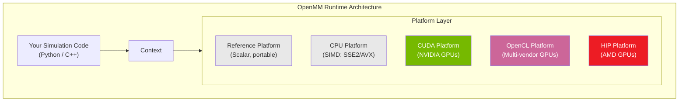
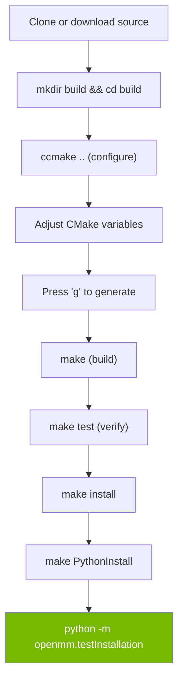
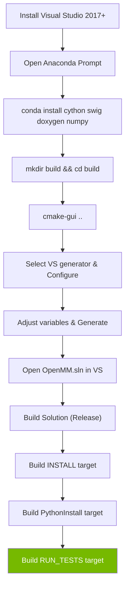
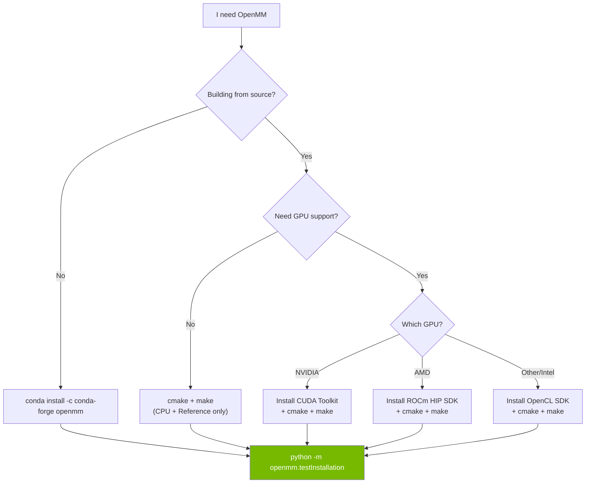

This page covers everything you need to get OpenMM running on your machine — from a one-command install to a full source build with GPU acceleration. By the end, you will understand how OpenMM's platform architecture maps to your hardware, which installation path is right for you, and how to verify that everything works correctly.

---

## Understanding the OpenMM Platform Architecture

Before installing anything, it is worth understanding *what* you are installing. OpenMM is not a single monolithic binary — it is a **core library** plus a collection of **platform plugins**, each targeting a specific compute backend. The core (`libOpenMM`) provides the simulation API, while platforms translate that API into optimized hardware-specific code. This architecture, defined in the top-level [CMakeLists.txt](CMakeLists.txt#L81-L83), means you only build the platforms relevant to your hardware.



The platform layer is what makes OpenMM unique among molecular dynamics toolkits — the same simulation code can run on a laptop CPU, an NVIDIA data-center GPU, or an AMD workstation without modification. You simply select the platform at runtime. For a deeper look at how this abstraction works internally, see [Platform and Kernel System](8-platform-and-kernel-system).

---

## Quick Install with Conda or Pip (Recommended)

For the vast majority of users, the pre-built packages from conda-forge are the best option. They include the core library, all platforms that can reasonably be pre-built, Python wrappers, and the standard plugin set.

### Step 1: Install via Conda

Conda handles binary dependencies (CUDA runtime, Python, NumPy) automatically and is the officially recommended method.

```bash
# Install Miniconda if you don't have it: https://docs.conda.io/en/latest/miniconda.html

# Create a dedicated environment (recommended)
conda create -n openmm-env python=3.11 -c conda-forge
conda activate openmm-env

# Install OpenMM with all plugins
conda install -c conda-forge openmm
```

The conda-forge package bundles the core library (v8.5.0 as defined in [CMakeLists.txt](CMakeLists.txt#L166-L169)), the Reference, CPU, and CUDA platforms, and all four standard plugins (Amoeba, RPMD, Drude, CPU PME). The conda-forge release process is documented in [CONDA_FORGE_RELEASES.md](devtools/CONDA_FORGE_RELEASES.md#L1-L10).

### Step 2: Install via Pip (Alternative)

If you prefer pip, OpenMM is also available on PyPI. Note that pip packages may not include GPU platform support on all systems — conda is generally more reliable for GPU-accelerated installs.

```bash
pip install openmm
```

### GPU Driver Prerequisites

If you plan to use a GPU platform, ensure you have modern drivers installed **before** installing OpenMM:

| GPU Vendor | Minimum Driver | Additional SDK |
|---|---|---|
| **NVIDIA** | CUDA 11.x+ driver | CUDA Toolkit (for source builds only) |
| **AMD** | ROCm 5.x+ driver | ROCm HIP SDK (for source builds only) |
| **Intel** | Latest OpenCL driver | None required |

For pre-built conda packages, the CUDA runtime is bundled automatically — you do **not** need to install the full CUDA Toolkit separately.

> [!TIP]
> **Conda vs. Pip for GPU workloads**: The conda-forge OpenMM package ships with the CUDA runtime libraries bundled, so you never need to match CUDA versions manually. With pip, the CUDA runtime must already be present on your system and version-compatible. For production GPU simulations, conda is strongly recommended.

---

## Platform Overview and Hardware Mapping

Each platform in OpenMM targets a specific compute device. The build system in [CMakeLists.txt](CMakeLists.txt#L332-L370) auto-detects available SDKs and enables the corresponding platforms. Here is the complete mapping:

| Platform | Library Name | Target Hardware | Kernel Source | Auto-Detected by CMake |
|---|---|---|---|---|
| **Reference** | `libOpenMM` (core) | Any CPU (scalar) | C++ | Always built |
| **CPU** | `libOpenMMCPU` | x86_64 / ARM (SIMD) | C++ with asmjit JIT | Default ON |
| **CUDA** | `libOpenMMCUDA` | NVIDIA GPUs | `.cu` (compiled at runtime) | Requires CUDAToolkit |
| **OpenCL** | `libOpenMMOpenCL` | NVIDIA / AMD / Intel GPUs | `.cl` (compiled at runtime) | Requires OpenCL SDK |
| **HIP** | `libOpenMMHIP` | AMD GPUs | `.hip` (compiled at runtime) | Requires ROCm HIP |

Key architectural points from the source code:

- The **Reference platform** is always compiled into the core `libOpenMM` library and serves as the correctness baseline. It uses pure scalar C++ with no architecture-specific optimizations ([CMakeLists.txt](CMakeLists.txt#L81)).
- The **CPU platform** leverages the **asmjit** JIT compiler for runtime code generation and includes SIMD-optimized kernels via the `vecmath` library ([CMakeLists.txt](CMakeLists.txt#L249-L254)). It explicitly blocks Clang 3.6 due to known AVX bugs ([platforms/cpu/CMakeLists.txt](platforms/cpu/CMakeLists.txt#L27-L32)).
- The **CUDA platform** requires `CUDAToolkit` to be found by CMake's `FIND_PACKAGE` ([CMakeLists.txt](CMakeLists.txt#L333-L336)).
- The **HIP platform** searches `ROCM_PATH` and `/opt/rocm` for the HIP SDK ([CMakeLists.txt](CMakeLists.txt#L347-L352)).
- GPU platforms share common compute code from the [`platforms/common/`](platforms/common/) directory, which is only built when at least one GPU platform is enabled ([CMakeLists.txt](CMakeLists.txt#L359-L362)).

### Supported CPU Architectures

The build system detects and configures for multiple CPU architectures using the [`cmake_modules/TargetArch.cmake`](cmake_modules/TargetArch.cmake) module ([CMakeLists.txt](CMakeLists.txt#L33-L47)):

| Architecture | CMake Flag | Notes |
|---|---|---|
| x86_64 / i386 | `X86=ON` | SSE2 required; asmjit JIT enabled |
| ARM (AArch64) | `ARM=ON` | 64-bit only; `__ARM64__` defined |
| PowerPC | `PPC=ON` | `__PPC__` defined |
| LoongArch64 | `LOONGARCH64=ON` | LSX extensions enabled (`-mlsx`) |

---

## Building from Source

Building from source is necessary when you need custom platform configurations, are working on a platform without pre-built packages, or are contributing to OpenMM development. The process is managed entirely by CMake (minimum version 3.17, per [CMakeLists.txt](CMakeLists.txt#L30)).

> [!TIP]
> **When to build from source**: You only need a source build if (1) you are modifying OpenMM itself, (2) you need a platform configuration not available in conda-forge, or (3) you are on an unsupported OS. For all other cases, `conda install -c conda-forge openmm` is faster, safer, and easier to maintain.

### Prerequisites

Install all build dependencies via conda (the officially supported method):

```bash
conda install -c conda-forge cmake make cython swig doxygen numpy setuptools
```

For GPU platform support, add the appropriate SDK:

```bash
# CUDA platform (NVIDIA)
# Install CUDA Toolkit from https://developer.nvidia.com/cuda-downloads

# HIP platform (AMD)
conda install -c conda-forge hip-devel hipcc rocm-cmake rocm-device-libs
```

### Build Flow (Linux and macOS)



**Step 1 — Configure with CMake:**

```bash
mkdir build && cd build
ccmake ..
```

Critical CMake variables to set:

| Variable | Recommended Value | Purpose |
|---|---|---|
| `CMAKE_INSTALL_PREFIX` | Your conda env path (e.g., `$CONDA_PREFIX`) | Installation destination |
| `PYTHON_EXECUTABLE` | Auto-detected, or set manually | Python for wrappers |
| `OPENMM_BUILD_CUDA_LIB` | `ON` if CUDAToolkit found | Build CUDA platform |
| `OPENMM_BUILD_OPENCL_LIB` | `ON` if OpenCL found | Build OpenCL platform |
| `OPENMM_BUILD_HIP_LIB` | `ON` if HIP found | Build HIP platform |
| `OPENMM_BUILD_CPU_LIB` | `ON` (default) | Build optimized CPU platform |
| `OPENMM_BUILD_PYTHON_WRAPPERS` | `ON` (default) | Build Python API |

The Python wrappers have a hard dependency on three plugins — Amoeba, RPMD, and Drude — and will produce a build error if any is disabled ([CMakeLists.txt](CMakeLists.txt#L416-L423)).

**Step 2 — Build and Install:**

```bash
make              # Compile everything
make test         # Run ~317 unit tests
make install      # Install libraries and headers
make PythonInstall  # Install Python wrappers
```

**Step 3 — Verify:**

```bash
python -m openmm.testInstallation
```

### Build Flow (Windows)

On Windows, the process uses Visual Studio 2017+ and the CMake GUI:



**Critical**: Launch `cmake-gui.exe` from the Anaconda Prompt, **not** from the Windows Start Menu. This ensures CMake can locate conda-installed tools like SWIG and Cython ([docs-source/usersguide/library/02_compiling.rst](docs-source/usersguide/library/02_compiling.rst#L288-L298)).

The default install prefix on Windows is `%ProgramFiles%/OpenMM` ([CMakeLists.txt](CMakeLists.txt#L54-L56)), but for conda environments you should set `CMAKE_INSTALL_PREFIX` to your environment's root directory.

---

## Plugins

OpenMM ships with four official plugins that extend the core simulation capabilities. All are enabled by default in both conda packages and source builds:

| Plugin | Directory | Provides |
|---|---|---|
| **Amoeba** | [`plugins/amoeba/`](plugins/amoeba/) | Polarizable force field with multipole electrostatics |
| **RPMD** | [`plugins/rpmd/`](plugins/rpmd/) | Ring Polymer Molecular Dynamics |
| **Drude** | [`plugins/drude/`](plugins/drude/) | Drude polarizable force field |
| **CPU PME** | [`plugins/cpupme/`](plugins/cpupme/) | CPU-optimized Particle Mesh Ewald |

Each plugin is a separate CMake subdirectory with its own libraries, headers, and tests ([CMakeLists.txt](CMakeLists.txt#L373-L400)). The CMake cache variables `OPENMM_BUILD_AMOEBA_PLUGIN`, `OPENMM_BUILD_RPMD_PLUGIN`, `OPENMM_BUILD_DRUDE_PLUGIN`, and `OPENMM_BUILD_PME_PLUGIN` control whether each is built. If you are building Python wrappers, all three of Amoeba, RPMD, and Drude **must** remain enabled — disabling any one will cause a hard build error ([CMakeLists.txt](CMakeLists.txt#L416-L423)).

---

## Verifying Your Installation

OpenMM includes a comprehensive installation test script at [`wrappers/python/openmm/testInstallation.py`](wrappers/python/openmm/testInstallation.py) that validates every component of your setup:

```bash
python -m openmm.testInstallation
```

This script performs the following checks ([wrappers/python/openmm/testInstallation.py](wrappers/python/openmm/testInstallation.py#L31-L95)):

1. **Import validation** — Confirms all OpenMM Python modules (`openmm.app`, `openmm`, `openmm.unit`) are importable
2. **Version reporting** — Prints the OpenMM library version and git revision
3. **Platform enumeration** — Lists every available platform (Reference, CPU, CUDA, OpenCL, HIP)
4. **Force computation test** — Creates a test system (alanine dipeptide with AMBER99SB + TIP3P) and computes forces on every detected platform
5. **Cross-platform accuracy** — Compares force vectors between all platforms, reporting median relative differences; flags any pair exceeding 10⁻⁴ tolerance

A successful run ends with: `All differences are within tolerance.` If a platform fails to compute forces, the script reports the specific error — this usually indicates a driver or SDK problem.

Typical output looks like:

```
OpenMM Version: 8.5
Git Revision: <hash>

There are 4 Platforms available:

1 Reference - Successfully computed forces
2 CPU - Successfully computed forces
3 CUDA - Successfully computed forces
4 OpenCL - Successfully computed forces

Median difference in forces between platforms:

Reference vs. CPU: 2.5e-06
Reference vs. CUDA: 3.1e-06
Reference vs. OpenCL: 2.8e-06
...

All differences are within tolerance.
```

---

## Troubleshooting Common Issues

| Problem | Likely Cause | Solution |
|---|---|---|
| `ImportError: libOpenMM.so not found` | Library path not set | Add install `lib/` to `LD_LIBRARY_PATH` (Linux) or `DYLD_LIBRARY_PATH` (macOS) |
| CUDA platform not listed | CUDAToolkit not found at build time | Install CUDA Toolkit; re-run CMake; verify `OPENMM_BUILD_CUDA_LIB=ON` |
| HIP platform not listed | ROCm not in search path | Set `ROCM_PATH` environment variable; re-run CMake |
| `openmm.testInstallation` import failure | Python wrappers not installed | Run `make PythonInstall` or `conda install -c conda-forge openmm` |
| Clang 3.6 build failure (CPU) | Known AVX bug in Clang 3.6 | Upgrade to Clang 3.7+ or switch to GCC ([platforms/cpu/CMakeLists.txt](platforms/cpu/CMakeLists.txt#L27-L32)) |
| Large force differences between platforms | GPU driver mismatch | Update GPU drivers to latest vendor-recommended version |

For additional help, consult the GitHub [discussion forum](https://github.com/openmm/openmm/discussions) or the [issue tracker](https://github.com/openmm/openmm/issues) ([SUPPORT.md](SUPPORT.md#L1-L15)).

---

## Installation Decision Guide



---

## Summary

OpenMM's installation is designed to be as simple as `conda install -c conda-forge openmm` for most users, with the platform architecture ensuring that the same Python code runs optimally on whatever hardware you have. The source build path exists for developers and specialized deployments, with CMake providing fine-grained control over which platforms and plugins are compiled. After installation, always run `python -m openmm.testInstallation` to confirm everything is working correctly before starting production simulations.

---

**Next Steps**: Now that OpenMM is installed and verified, continue to the [Quick Start](2-quick-start) page to run your first simulation, or explore the [Architecture Overview](7-architecture-overview) to understand how the platform system you just installed actually works under the hood.