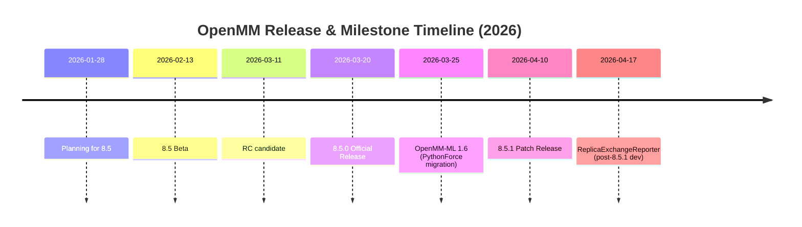

OpenMM has had a busy spring. Between the official 8.5.0 release in March, a quick 8.5.1 patch in April, and a rapidly evolving set of post-release commits pushing toward the next feature frontier -- multistate sampling -- there is a lot to digest. This page summarizes what has shipped, what is actively being built, and what the community has been discussing.

---

## Release Timeline

---

## OpenMM 8.5.0 -- What Shipped

The [8.5.0 release](https://zenodo.org/records/19136598), published on March 20, 2026, is the most feature-rich drop in recent memory. The release was preceded by a structured beta/RC cycle documented in [Discussion #5194](https://github.com/openmm/openmm/discussions/5194), where maintainer Peter Eastman solicited last-minute testing -- particularly of the new GPU minimizer.

### Headline Features

| Feature | PR / Reference | Why It Matters |
|---|---|---|
| **GPU L-BFGS Minimizer** | [PR #1237](https://github.com/openmm/openmm/issues/1237) | Energy minimization now runs entirely on the GPU, eliminating host-device round trips. For large systems this can be dramatically faster. |
| **PythonForce** | [PR #5122](https://github.com/openmm/openmm/pull/5122) | A new Force subclass that calls back into Python to compute forces and energy. The primary motivation is **machine learning potentials** -- it unifies support for a far wider range of ML models than TorchForce alone ever could. |
| **LCPO Surface Area** | [PR #5130](https://github.com/openmm/openmm/pull/5130) | For GBSA implicit solvent, LCPO is a more accurate (but slower) approximation for the nonpolar solvation term compared to the default ACE method. |
| **Device Querying API** | [PR #5192](https://github.com/openmm/openmm/pull/5192), closes [#52](https://github.com/openmm/openmm/issues/52) | After 13 years as an open request, you can now query available platforms and devices programmatically before creating a Context. This is a quality-of-life win for anyone running multi-GPU or HPC workflows. |
| **Next-Gen OpenFF Support** | [PR #5181](https://github.com/openmm/openmm/pull/5181) | Internal changes to support upcoming Open Force Field releases, including templates that can match whole molecules. |
| **Additional Gromacs VSite** | [PR #5155](https://github.com/openmm/openmm/pull/5155) | GromacsTopFile now supports vsite type 3fad, improving compatibility with GROMACS topology files. |

### PythonForce: The ML Gateway

PythonForce deserves special attention. Unlike TorchForce, which leverages PyTorch's autograd to back-propagate forces from energy, PythonForce requires users to return both energy and forces explicitly. As Eastman noted in the [beta discussion](https://github.com/openmm/openmm/discussions/5194), it "always needs to output both forces and energy" because the returned value is a plain number, not a tensor with a computation graph.

The payoff came almost immediately: [OpenMM-ML 1.6](https://github.com/openmm/openmm-ml/releases), released March 25, migrated nearly every model backend -- MACE, AIMNet2, NequIP, TorchMD-Net, ANI, FeNNol, Orb -- to PythonForce, and added support for arbitrary [ASE Calculator](https://wiki.fysik.dtu.dk/ase/)-based models. That is a significant expansion of the ML potential ecosystem accessible from OpenMM with minimal boilerplate.

An independent [arXiv preprint](https://arxiv.org/abs/2412.18271) by Wang and Yan also describes a plugin approach to PythonForce callbacks for accelerated Python modules, underscoring that the community sees this interface as a general-purpose extensibility point.

---

## OpenMM 8.5.1 -- Patch Fixes

The [8.5.1 patch](https://zenodo.org/records/19501238), released April 10, 2026, addresses four targeted bugs discovered during beta testing and early production use:

1. **[#5236](https://github.com/openmm/openmm/pull/5236)**: A leaked variable in the template system could cause spurious constraint assignments. This was caught and fixed by contributor Jeff Wagner with an accompanying test.
2. **[#5242](https://github.com/openmm/openmm/pull/5242)**: The new GPU minimizer could lose precision during line search energy comparisons. Evan Pretti's fix ensures the energy difference is computed on the CPU before precision reduction.
3. **[#5243](https://github.com/openmm/openmm/pull/5243)**: Multiple forces could end up running concurrently on the worker thread, a subtle race condition now resolved.
4. **[#5251](https://github.com/openmm/openmm/pull/5251)**: The pressure calculation in `MonteCarloFlexibleBarostat` was incorrect and has been fixed.

---

## Post-8.5.1 Development: Multistate Sampling Takes Shape

The most significant ongoing work is the construction of a **native multistate sampling framework** directly inside OpenMM. This has been a long-standing gap -- users have relied on [openmmtools' MultistateSampler](https://openmmtools.readthedocs.io/en/stable/multistate.html) for replica exchange and SAMS, but that lives outside the core library.

### Infrastructure Layer

The first commit landed on April 2: [PR #5231](https://github.com/openmm/openmm/pull/5231) ("Infrastructure for multistate sampling") introduces a `computeRelativeEnergies()` method, allowing a single Context to evaluate the energy of a configuration across multiple thermodynamic states. This is the low-level primitive that all multistate methods will build on.

### ReplicaExchangeSampler

On April 10, [PR #5257](https://github.com/openmm/openmm/pull/5257) added `ReplicaExchangeSampler`, and on April 17, [PR #5261](https://github.com/openmm/openmm/pull/5261) followed with `ReplicaExchangeReporter`. The design discussion in [Issue #5235](https://github.com/openmm/openmm/issues/5235) lays out the key open questions:

- **What methods to include**: At minimum one parallel (replica exchange) and one serial (simulated tempering / SAMS) algorithm.
- **Customizability**: The sampler's internal methods (`simulateReplica()`, `exchangeReplicas()`) are designed to be overridable in subclasses.
- **Output and analysis**: How to partition trajectory output -- by replica or by state -- and what built-in analysis to provide.
- **Multi-context GPU scaling**: Whether to support multiple Contexts on multiple GPUs simultaneously. Eastman is currently treating this as out of scope for the initial implementation.

This is a foundational change. If OpenMM ships native replica exchange, it eliminates the dependency on openmmtools for a large class of free energy workflows and positions the toolkit as a more complete platform for enhanced sampling.

### PythonForce Subset Restriction

[PR #5246](https://github.com/openmm/openmm/pull/5246) extends PythonForce with a `setParticles()` method, allowing the force to be applied to only a subset of particles. When you are computing an ML potential for just the ligand in a large solvated system, this avoids passing irrelevant atom positions through the callback and can **greatly improve performance**. The [API documentation](https://docs.openmm.org/development/api-python/generated/openmm.openmm.PythonForce.html) now reflects this capability.

---

## Performance and Internal Improvements

Several recent commits target performance without changing the public API:

| Commit | Description | Impact |
|---|---|---|
| [e4728a2](https://github.com/openmm/openmm/commit/e4728a2160d2f25ca108d7fddeb1dd20654e644e) (by ramdoys) | Switched `atomFlags` from `std::map` to `unordered_map` | Hash-based lookup for atom flags is faster than the red-black tree, particularly for large systems. |
| [6717a85](https://github.com/openmm/openmm/commit/6717a85cc4255c7e3985d5cfdb022fbc9106830f) | Reduced memory used by `SerializationNode` | Serialization for checkpointing and state transfer is lighter on RAM. |
| [26df7a8](https://github.com/openmm/openmm/commit/26df7a872512ce427bb3d7be817ebf37fe99fff7) | Cache coefficients for long-range correction | Avoids recomputing dispersion correction coefficients every step; cache is cleared on `updateParametersInContext()`. |
| [2c287f1](https://github.com/openmm/openmm/commit/2c287f10fadd01b2a9422ab87c3d33fd92ff767d) | Fix inefficient sorting for single-atom blocks | A sorting bug affecting neighbor list construction when a block contained only one atom; fix applied to CUDA, OpenCL, and HIP backends. |
| [068495f](https://github.com/openmm/openmm/commit/068495f3700d627319618efe9ef4ce9ed0e822d2) | Fix compilation error on some AMD GPUs | Resolved a build issue specific to certain AMD GPU architectures under the HIP platform. |

These are the kind of commits that do not make headlines but cumulatively matter. The `unordered_map` switch, for instance, is a textbook example of choosing the right data structure for the access pattern -- and it came from an external contributor.

---

## Notable Issues and Community Discussions

### Open Issues Worth Watching

**[GPU access lost in Docker containers (#5267)](https://github.com/openmm/openmm/issues/5267)**: A user running long simulations with CUDA 12.2 inside Docker on an RTX 4090 reports that NVML suddenly returns "Unknown Error" after hours of operation. The process silently falls back to CPU. This is not an OpenMM bug per se -- it is a known [NVIDIA Container Toolkit issue](https://github.com/NVIDIA/nvidia-docker/issues/1730) where containers using `runc` with systemd cgroup management can abruptly lose GPU access. The workaround is to either switch Docker's cgroup driver to `cgroupfs` or run `nvidia-ctk system create-dev-char-symlinks --create-all` at boot. If you are deploying OpenMM in containers on Ubuntu 22.04 (where systemd cgroups are the default), you should proactively apply one of these mitigations.

**[DrudeSCFIntegrator regression (#5245)](https://github.com/openmm/openmm/issues/5245)**: A user reports that Drude particles "fly away" -- drifting from 2.46 nm to 4.50 nm in a single step -- when using `DrudeSCFIntegrator` in OpenMM 8.2.0 and later, compared to correct behavior in 8.1.0. The test case is minimal and reproducible. The Drude integrator has had [historical energy drift issues](https://github.com/openmm/openmm/issues/3233), but this specific regression appears to be a new bug introduced in the 8.2 timeframe.

**[GBN2 Born radii question (#5260)](https://github.com/openmm/openmm/issues/5260)**: A user from Adrian Roitberg's group questions whether OpenMM uses the correct Born radii for GBN2 (mbondi3) versus OBC2 (mbondi2). Maintainer Evan Pretti points out that the XML force field files (e.g., `gbn2.xml`) should call the appropriate `_mbondi3_radii()` function, but the issue highlights that the mapping between AMBER `igb` values and OpenMM's internal handling is not always obvious to users. This connects to a [broader discussion about GB energy discrepancies](https://github.com/openmm/openmmforcefields/issues/380) between OpenMM and AMBER.

**[Missing Python 3.13 Linux wheel (#5266)](https://github.com/openmm/openmm/issues/5266)**: The 8.5.1 release on PyPI is missing a `cp313` wheel for Linux (and a `cp310` wheel for mac-x64). This appears to be a build/publishing oversight rather than an intentional exclusion.

**[Replica-averaged restraint force (#5262)](https://github.com/openmm/openmm/issues/5262)**: Researchers working on NMR chemical shift restraints have a [custom force](https://github.com/mercadde/openmm-napshift) based on openmm-torch that computes ensemble-average restraints across parallel replicas. The current implementation is described as "hacky" -- it requires pausing multiple simulations, accumulating shifts in Python, and passing averages back. The user is asking whether the new multistate sampling infrastructure (specifically [Issue #4018](https://github.com/openmm/openmm/issues/4018)) will enable more efficient kernel-level communication between replicas. Eastman has acknowledged this is worth considering but has not committed to a timeline.

### Long-Standing Open Requests

Several older issues remain open and continue to attract discussion:

- **[Batch computations (#2535)](https://github.com/openmm/openmm/issues/2535)**: The ability to evaluate energies of many conformations simultaneously on a single GPU. This would be a game-changer for high-throughput screening of small molecules but raises significant architectural questions. Still open since 2020.
- **[Improved random number generator (#3716)](https://github.com/openmm/openmm/issues/3716)**: A proposal to replace Mersenne Twister (CPU) and KISS (GPU) with PCG64 DXSM for better statistical properties and speed. The [reference implementation](https://github.com/imneme/pcg-cpp) exists, but the change has not been prioritized.
- **[Memory optimization for large simulations (#4051)](https://github.com/openmm/openmm/issues/4051)**: A 1.2 million-atom simulation showed an 8 GB RAM spike during setup (unpacking state/system/integrator files) before settling to ~5 GB during runtime. For Folding@home work units, this spike limits which donor machines can accept the work.

### Recently Closed Issues of Note

- **[Midtown splines for faster PME (#5104)](https://github.com/openmm/openmm/issues/5104)**: After careful analysis, Eastman [closed this as not planned](https://github.com/openmm/openmm/issues/5104#issuecomment-2773017439). The proposed 6th-order midtown splines are only C0 continuous (discontinuous forces), and their Gaussian width constraint is incompatible with OpenMM's automatic parameter selection scheme. "The C0 continuity is a dealbreaker," he concluded. A good example of the project evaluating academic proposals rigorously before committing to implementation.
- **[Device querying (#52, #5157)](https://github.com/openmm/openmm/issues/5157)**: Both the original 2013 request and the 2025 follow-up are now resolved by the API shipped in 8.5.0.
- **[Constant-pH simulation (#172)](https://github.com/openmm/openmm/issues/172)**: Closed after 13 years. The discussion about implementing Mongan/Stern NCMC-based constant-pH methods has been resolved, though the details of what was merged are not documented in the closing comment.

---

## Ecosystem Context

Two external developments are worth tracking in relation to these OpenMM updates:

**NVIDIA MPS for OpenMM throughput**: A March 2026 [NVIDIA Developer Blog post](https://developer.nvidia.com/blog/maximizing-openmm-molecular-dynamics-throughput-with-nvidia-multi-process-service/) demonstrates how NVIDIA Multi-Process Service can dramatically increase OpenMM throughput by running multiple simulations concurrently on a single GPU. For small systems (23K atoms like DHFR), total throughput more than doubles on an H100. This is directly relevant to the [batch computation request (#2535)](https://github.com/openmm/openmm/issues/2535) -- while OpenMM does not yet support native batching, MPS provides an external workaround that requires no code changes.

**Academic multistate methods**: The [MT-REXEE paper](https://pubs.acs.org/doi/10.1021/acs.jctc.4c01268) (Friedman, Hsu, and Shirts, JCTC 2025) describes multiple topology replica exchange of expanded ensembles, implemented in GROMACS. The authors note that the method "does not necessitate modifications to the MD code." As OpenMM builds its own native multistate sampling infrastructure, supporting these kinds of advanced exchange protocols -- including multi-topology swaps -- is likely to become a point of comparison.

---

## Summary

The 8.5.x cycle represents a meaningful step forward for OpenMM. The GPU minimizer and PythonForce together modernize two of the most performance-critical and extensibility-critical parts of the stack. The multistate sampling work currently in development, if it lands well, could be the headline feature of 8.6.

The project continues to show the pattern that has kept it relevant for over a decade: a small core team (primarily Eastman, with contributions from Pretti, Wagner, and others) making conservative, well-tested API additions while rigorously evaluating academic proposals (as with midtown splines). The tension between "we need batch computation" and "that requires fundamental architectural changes" remains unresolved, but MPS and the evolving multistate infrastructure both offer partial answers from different directions.

If you are running production simulations, upgrade to 8.5.1 -- the barostat and minimizer fixes are substantive. If you are using ML potentials, install OpenMM-ML 1.6 and take advantage of the PythonForce migration. And if you are running in Docker, check your cgroup driver configuration before your next long simulation.