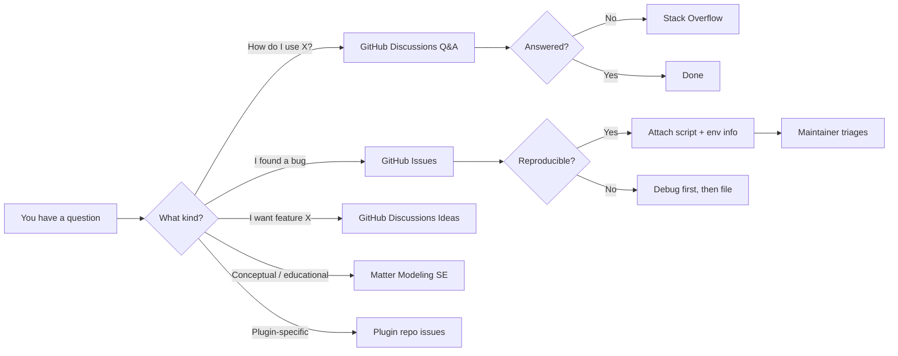
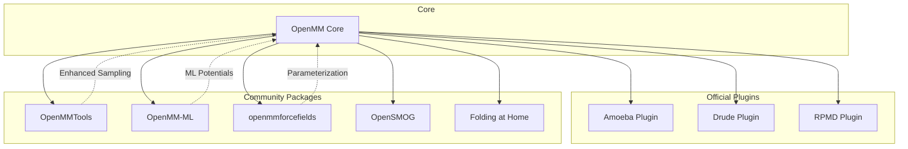

OpenMM is, at its core, an academic project. It does not have a corporate support desk, a paid SLA, or a dedicated community manager. What it does have is a surprisingly functional support ecosystem built around GitHub, a handful of companion packages, and the collective patience of computational chemists, biophysicists, and ML researchers who depend on it. Understanding how that ecosystem works -- and where its gaps are -- will save you significant time when something goes wrong.

## Where to Get Help

The support landscape for OpenMM is more fragmented than you might expect for a project with nearly 1,900 GitHub stars. There is no single canonical help channel. Instead, help is distributed across several venues, each with different strengths and response patterns.

### GitHub Discussions (Primary Forum)

The [GitHub Discussions](https://github.com/openmm/openmm/discussions) board is the closest thing OpenMM has to an official forum. It is organized into five categories:

| Category | Purpose |
|---|---|
| **General** | Release announcements, project-level updates |
| **Q&A** | Usage questions, debugging help |
| **Ideas** | Feature proposals and design discussions |
| **Polls** | Community consensus-gathering |
| **Show and Tell** | Community projects and demos |

Discussions are further annotated with labels like `faq`, `bug`, `cookbook`, `benchmarks`, `documentation`, `enhancement`, and `machine-learning`. The Q&A category is the most active for day-to-day support. Recent threads there range from practical questions like [How to exactly reproduce a simulation?](https://github.com/openmm/openmm/discussions/5263) to migration concerns like [OpenMM alternative equivalent files for Amber prmtop files?](https://github.com/openmm/openmm/discussions/5264).

Peter Eastman, the project's primary maintainer, is a consistent presence in these threads. He posts release announcements (e.g., [OpenMM 8.5.1](https://github.com/openmm/openmm/discussions/5260) in April 2026) and frequently answers technical questions directly. However, many Q&A threads remain unanswered, particularly those involving edge cases in ML potential integration or niche platform issues. The signal-to-noise ratio is decent, but do not expect Stack Overflow levels of turnaround.

### GitHub Issues (Bug Reports and Feature Requests)

If you have a reproducible bug, the [issue tracker](https://github.com/openmm/openmm/issues) is the right place. The repository currently tracks 395 open issues and 19 open pull requests. A significant portion of open issues are long-lived feature requests that serve as design discussions rather than actionable tickets. A few notable examples:

- [Batch computations (#2535)](https://github.com/openmm/openmm/issues/2535) -- opened in January 2020, still open. This is a feature request for evaluating energies of many conformations in parallel on a single GPU, which would dramatically improve throughput for small systems.
- [Improved random number generator (#3716)](https://github.com/openmm/openmm/issues/3716) -- opened in July 2022, proposing a move from Mersenne Twister and KISS to PCG64 DXSM.
- [Ways to optimize memory usage for large simulations? (#4051)](https://github.com/openmm/openmm/issues/4051) -- a community discussion started after a user ran a 1.2 million atom simulation.

The issue tracker also houses active bug reports. For example, a user reported that `DrudeSCFIntegrator` produces flying Drude particles in OpenMM 8.2.0 and later ([#5245](https://github.com/openmm/openmm/issues/5245)), with a clear minimal reproduction script. These targeted, well-documented reports tend to get attention faster than vague feature requests.

### Bi-Monthly Community Meetings

The OpenMM team holds periodic community meetings that influence the project roadmap. Evidence of these shows up in issue discussions where maintainers reference decisions made in meetings. For instance, in the [Classes for multistate sampling (#5235)](https://github.com/openmm/openmm/issues/5235) design discussion, Peter Eastman writes: "This came up in a meeting, that you should be able to extend the sampling classes and override methods to customize them." Similarly, the [device querying (#5157)](https://github.com/openmm/openmm/issues/5157) discussion references a meeting where the team acknowledged that device-querying utilities already exist in OpenMM's internals and could be wrapped into public APIs.

These meetings are not heavily advertised outside GitHub, which is a missed opportunity. If you are doing serious work with OpenMM -- particularly if you are building tools on top of it -- tracking the General discussions and release-planning threads (e.g., [Planning for 8.5 release](https://github.com/openmm/openmm/discussions/5248)) is the best way to stay informed.

### External Communities

OpenMM questions also surface on external platforms, though these are not officially maintained by the project:

- **Matter Modeling Stack Exchange** -- The `openmm` tag on [Matter Modeling SE](https://mattermodeling.stackexchange.com/questions/tagged/openmm) hosts conceptual questions about the toolkit, such as [What exactly is an integrator?](https://mattermodeling.stackexchange.com/questions/13963/what-exactly-is-an-integrator). These tend to be educational rather than debugging-focused.
- **PLUMED Users (Google Groups)** -- The [PLUMED community](https://groups.google.com/g/plumed-users) occasionally discusses OpenMM in the context of enhanced sampling plugins and interoperability.
- **Biophysical research labs** -- Many labs maintain their own internal documentation. The [Chodera Lab](https://www.choderalab.org/publications/tag/OpenMM) at MSKCC, for example, is a major contributor to both OpenMM and its ecosystem packages.

## Documentation and Learning Resources

Before asking for help, you should consult the official documentation. OpenMM's docs are thorough but have a reputation for being dense.

| Resource | URL | Notes |
|---|---|---|
| User Guide | [docs.openmm.org/latest/userguide](https://docs.openmm.org/latest/userguide/introduction.html) | Three parts: application layer, library API, mathematical theory |
| Python API | [docs.openmm.org/latest/api-python](https://docs.openmm.org/latest/api-python/) | Complete class reference |
| C++ API | [docs.openmm.org/latest/api-c++](https://docs.openmm.org/latest/api-c++) | For plugin and platform developers |
| FAQ | [openmm.org/faq](https://openmm.org) | Linked from the User Guide introduction |
| GitHub Examples | [github.com/openmm/openmm/tree/master/examples](https://github.com/openmm/openmm/tree/master/examples) | Runnable Python scripts |
| Cookbook | [openmm.github.io/openmm-cookbook](https://openmm.github.io/openmm-cookbook/) | Community-contributed Jupyter notebooks |

### The OpenMM Cookbook

The [OpenMM Cookbook](https://github.com/openmm/openmm-cookbook) is a separate repository that hosts Jupyter notebook tutorials and recipes. It is rendered at `openmm.github.io/openmm-cookbook` and provides practical, copy-pasteable examples. Each notebook can be opened directly in Google Colab with dependencies auto-installed. The cookbook has its own CI pipeline that tests notebooks against both the latest release and nightly development builds of OpenMM.

If you are transitioning from another MD engine, the cookbook is often more immediately useful than the API reference. Discussions labeled `cookbook` on GitHub track candidate recipes that could be added.

## The Plugin Ecosystem

OpenMM's architecture is designed for extensibility through a [plugin system](https://github.com/openmm/openmmexampleplugin). This has spawned a rich ecosystem of companion packages, many of which have their own support channels.

### OpenMMTools

[OpenMMTools](https://github.com/choderalab/openmmtools) (319 stars, 86 forks) is the most important companion package. Developed primarily by the Chodera Lab, it provides:

- High-quality Langevin integrators (g-BAOAB, VVVR, and other splittings)
- Nonequilibrium integrators for free energy calculations (NCMC)
- An MCMC framework for mixing Monte Carlo and MD-based methods
- Enhanced sampling methods including replica exchange and SAMS
- Alchemical factories for absolute and relative free energy calculations
- A suite of test systems for benchmarking

Its documentation is at [openmmtools.readthedocs.io](https://openmmtools.readthedocs.io). The package is under active development (most recent release 0.26.0 in January 2026) and has its own [232 open issues](https://github.com/choderalab/openmmtools/issues). If you are working with replica exchange or free energy methods, you will almost certainly end up here.

### OpenMM-ML

[OpenMM-ML](https://github.com/openmm/openmm-ml) provides the `MLPotential` class for running machine learning potentials (NequIP, MACE, etc.) within OpenMM's simulation framework. Peter Eastman announces OpenMM-ML releases on GitHub Discussions (e.g., [OpenMM-ML 1.6](https://github.com/openmm/openmm/discussions/5255) in March 2026). Compatibility issues between OpenMM-ML and specific ML architectures are a recurring source of community questions, such as [Current OpenMM seems to be incompatible with latest NequIP](https://github.com/openmm/openmm/discussions/5249).

### Other Notable Ecosystem Packages

| Package | Purpose | Link |
|---|---|---|
| **openmmforcefields** | Small molecule parameterization (GAFF, SMIRNOFF/OpenFF, espaloma) | [conda-forge](https://conda-forge.org/) |
| **OpenSMOG** | Coarse-grained structure-based models via SMOG 2 | [smog-server.org](https://smog-server.org/smog2/OpenSMOG) |
| **openmm-torch** | PyTorch-based custom forces for NMR restraints and similar | [github.com/openmm/openmm-torch](https://github.com/openmm/openmm-torch) |
| **OpenMMDL** | Streamlined setup/analysis of protein-ligand MD simulations | [github.com/wolberlab/OpenMMDL](https://github.com/wolberlab/OpenMMDL) |
| **Folding@home** | Distributed computing integration (uses OpenMM as its simulation engine) | [foldingathome.org](https://foldingathome.org/) |

## How to Report a Bug Effectively

If you are going to file an issue, do it right. The maintainers are academics with limited time, and a well-structured report dramatically increases your chances of getting a fix. Based on patterns in the issue tracker, here is what separates reports that get addressed from those that languish:

**Do:**

1. Specify your OpenMM version, Python version, and platform (CUDA/OpenCL/CPU, driver version, OS).
2. Provide a minimal, self-contained reproduction script. The [DrudeSCFIntegrator bug report (#5245)](https://github.com/openmm/openmm/issues/5245) is a textbook example: a 50-line script that anyone can run.
3. Include the full stack trace and any error messages.
4. Check if the issue has been reported before. Search both open and closed issues.

**Do not:**

1. File a bug that is really a usage question. Use Discussions Q&A instead.
2. Report a bug against an old version without first testing on the latest release.
3. Bundle multiple unrelated issues into a single report.
4. Omit your environment details and expect maintainers to guess.

For reference, look at how the [GPU access lost in Docker containers (#5267)](https://github.com/openmm/openmm/issues/5267) issue was filed: it specifies the OpenMM version (8.2), CUDA version (12.2), NVIDIA Container Runtime version (1.17.4), GPU model (RTX 4090), and provides a clear description of the failure mode. This is the standard.

## Contributing to OpenMM

If you want to give back rather than just take, the project has a clear contribution pathway documented in [CONTRIBUTING.md](https://github.com/openmm/openmm/blob/master/CONTRIBUTING.md). The repository also maintains a [CODE_OF_CONDUCT.md](https://github.com/openmm/openmm/blob/master/CODE_OF_CONDUCT.md) (added in September 2020 via [PR #2833](https://github.com/openmm/openmm/pull/2833)).

Contribution opportunities range from documentation fixes (the recent [Update patch documentation (#5208)](https://github.com/openmm/openmm/pull/5208) by Yulian Manchev is a good example) to core feature implementation. The [device querying (#5157)](https://github.com/openmm/openmm/issues/5157) discussion explicitly noted that utility functions already exist in OpenMM internals and just need to be wrapped into public APIs -- a relatively low-effort contribution.

For plugin development, the [openmmexampleplugin](https://github.com/openmm/openmmexampleplugin) repository provides a comprehensive template with implementations for Reference, OpenCL, and CUDA platforms, serialization support, test cases, and a Python API via SWIG.

## Citing OpenMM

OpenMM depends on academic research grants for funding. If you use it in your work, cite the [OpenMM 8 paper](https://doi.org/10.1021/acs.jpcb.3c07692):

> P. Eastman, R. Galvelis, R. P. Pelaez, C. R. A. Abreu, S. E. Farr, E. Gallicchio, A. Gorenko, M. M. Henry, F. Hu, J. Huang, A. Kramer, J. Michel, J. A. Mitchell, V. S. Pande, J. PGLM Rodrigues, J. Rodriguez-Guerra, A. C. Simmonett, S. Singh, J. Swails, P. Turner, Y. Wang, I. Zhang, J. D. Chodera, G. De Fabritiis, and T. E. Markland. "OpenMM 8: Molecular Dynamics Simulation with Machine Learning Potentials." J. Phys. Chem. B 128(1), pp. 109-116 (2023).

Citations are not just an academic courtesy -- they are the mechanism by which the project justifies continued funding. This is worth remembering.

## The Honest Assessment

OpenMM's community support works, but it works because of a small number of highly active individuals rather than a broad base of contributors. Peter Eastman carries a disproportionate share of the maintenance burden. The GitHub Discussions board has improved the situation compared to the old SimTK forums, but response times are inconsistent, and many questions go unanswered. The plugin ecosystem is strong -- OpenMMTools, OpenMM-ML, and openmmforcefields fill real gaps -- but fragmentation means that users often do not know which package to file issues against.

The project would benefit from more visible contribution guidelines for non-core developers, better indexing of answered questions (a curated FAQ pulled from the best Discussions threads would be invaluable), and more proactive communication about the bi-monthly community meetings. If you are a heavy user, the single best thing you can do is answer one question in Discussions for every question you ask.